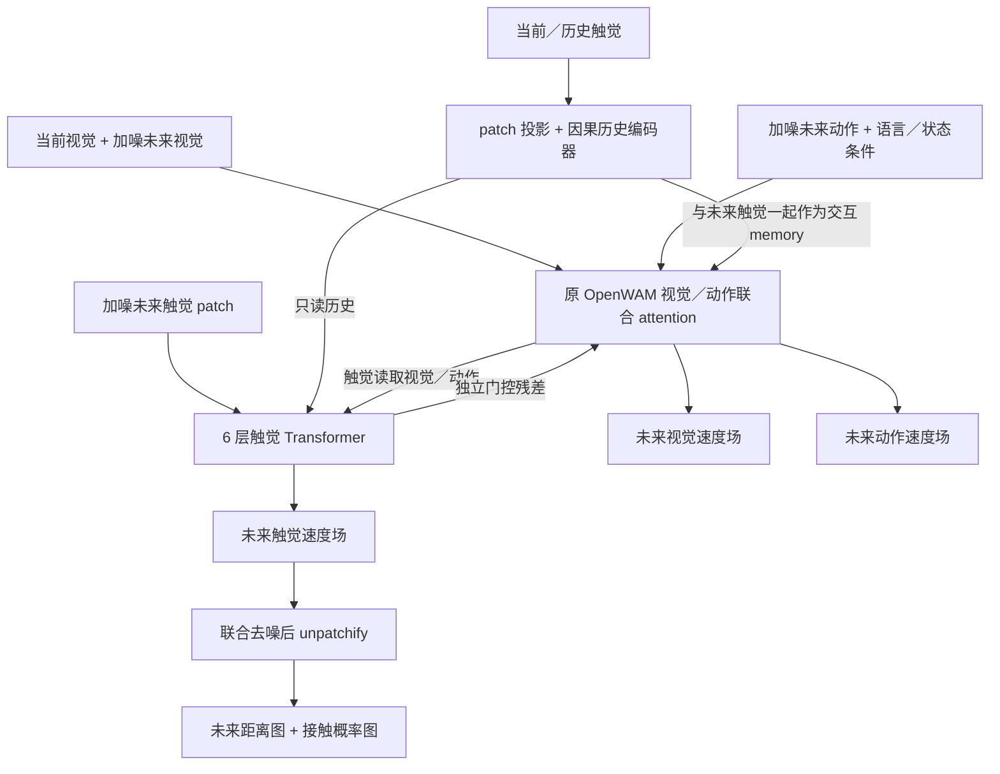

# TouchWAM V2：紧凑的视觉／动作／触觉三分支

架构日期：2026-10-12；训练策略更新：2026-10-15。实现位置：`openwam/model/architectures/touchwam/`。

本版面向当前 Bench2Dex Sharpa 小数据实验：复用 OpenWAM Alpha，增加独立的未来触觉生成分支。它与只使用观测触觉条件的 V1 分别注册、分别保存 checkpoint。旧 `new_only` 实验已完成 40k microsteps；当前默认改为三分支联合微调，详见第 5 节。实现验证及训练损失不能替代闭环成功率评估。

## 1. 默认模型

| 模块 | 配置 |
|---|---|
| 视觉 DiT | 原 Alpha Wan2.2 TI2V，30 层、3072 维，复用原参数 |
| 动作 DiT | 原 Alpha，30 层、1024 维，复用原参数 |
| 动作／状态 | 沿用 Alpha 80 维槽位；Bench2Dex 有 58 个有效维度 |
| 触觉历史 | 当前及过去 3 帧，10 个指尖，2 通道，32×32 |
| 触觉表示 | 16×16 patch，每个指尖每帧 4 个 token，每个 patch 原始向量 512 维 |
| 历史编码器 | 512→256→256 投影、位置 embedding、2 层因果 Transformer |
| 未来触觉分支 | 6 层，256 维，8 heads，FFN 为 1024 维 |
| 交互位置 | 原 VA 层之后：[4,9,14,19,24,29]，零基编号 |
| 未来时间 | t+2,t+4,…,t+16，共 8 帧；20 Hz 原始数据对应未来 0.1～0.8 秒 |
| 触觉输出 | 距离（米）、接触概率，以及单独的有效性 mask |

历史为 160 个触觉 token，未来为 320 个触觉 token。未来触觉使用自己的噪声时间；不与视觉 VAE 的“四帧压缩”绑定。时间对应由数据行偏移确定。

全尺寸配置的新增参数为 **30,522,892（约 3,052 万）**，均位于 `touch_v2.*`。

这里的两通道是 `distance_along_normal_m` 与 `contact_mask`。距离是射线接触几何，不能解释为标定压力或切向力。

## 2. 数据流



原视觉／动作之间仍然执行原来的联合 attention。触觉交互使用独立的 attention 与 softmax，没有把触觉 K/V 追加进原来的 softmax。

每个选定层的顺序是：

1. 执行原 VA 层，得到视觉与动作特征。
2. 未来触觉读取只读历史和其他未来触觉 token。
3. 未来触觉读取该层的视觉／动作特征，再通过 FFN。
4. 视觉／动作读取历史与更新后的未来触觉，经过 `tanh(gate)` 加回各自残差。

触觉块采用由触觉噪声时间生成的 AdaLN shift/scale。触觉位置编码包含指尖、patch 和时间槽位。

两个写回 gate 初始化为 0。相同原参数、输入及随机噪声下，初始化时的视觉与动作输出与原 Alpha 路径一致。触觉预测损失从第一步即可训练触觉分支；门控打开后，动作／视觉损失也能训练触觉交互路径。

## 3. 为什么本版不训练触觉 VAE

`TactilePatchCodec` 是固定的归一化与 patch 排列：

- 接触区域距离除以 0.015 米并裁剪到 [-1,1]；无接触区域的距离置零。
- 接触 0/1 映射到 -1/+1。
- 32×32 图划分为四个 16×16 patch，不再进行空间下采样。
- patchify/unpatchify 对归一化后的地图可逆；距离裁剪与无接触区域归零属于预处理约定。

这个固定表示使 flow matching 的目标保持稳定，避免小数据下同时训练一个编码器产生不断变化的目标或潜变量塌缩。模型内 512→256 的投影仍然可训练，输出头预测每个 patch 的 512 维速度。

本版不是 ME-Dex 的预训练触觉自编码器，也不是多传感器通用编码器。将来接入真实光学触觉或其他阵列时，需要新增输入适配与相应监督定义。

## 4. 训练目标与数据隔离

三种模态独立采样噪声水平：

```text
x_sigma = (1-sigma) * x_clean + sigma * noise
velocity_target = noise - x_clean
loss = lambda_video * L_video + lambda_action * L_action + tactile.loss_weight * L_touch
```

视频与动作沿用原有损失及 padding mask。触觉采用有效像素上的速度 MSE：

- 接触通道：真实接触像素权重 5，其余有效像素权重 1。
- 距离通道：接触像素权重 1，背景权重 0.1。
- 两通道分别按各自有效权重之和归一化，再相加。
- 缺失传感器与非有限数值不参与触觉损失。
- 触觉噪声使用独立 ActionScheduler 实例；当前触觉损失不再乘 VA 使用的 timestep 权重。

权重 5、0.1、1.0 都是初始实验配置，需要在验证集上选择。

数据加载器把 `tactile_maps` 和 `future_tactile_maps` 分开返回。历史不能读到当前时刻之后，未来标签不能跨越轨迹有效片段的边界。模型还检查标签偏移是否与配置一致。

`forward()` 拒绝原始未来触觉标签，只接受 `noisy_tactile`。干净历史编码不读取未来；视觉首帧也不接收触觉写回。完全加噪时，替换未来标签不会改变三分支预测输出。

“没有接触”仍然是有效观测，不能与“没有传感器数据”共用一个 mask。

## 5. 训练入口

2026-10-15 修订：默认改为视觉／动作／触觉联合微调，`new_only` 只保留为显式消融选项。以前的 `new_only` checkpoint 不会因为修改此文档而变成联合训练权重。

### 从官方 Alpha 初始化，三分支一起微调

```bash
source ../activate_openwam.sh
bash scripts/run_bench2dex_touchwam_v2.sh \
  dataloader.tactile_cache_root=assets/benchmark_data/bench2dex_sharpa3_tactile_v1
```

可直接复用 V1 的逐帧触觉缓存。设置 `tactile_cache_root=null` 时直接读取 HDF5，结果一致但较慢。

配置：`configs/train_touchwam_v2.yaml`。默认从官方 Alpha 154k checkpoint 初始化，`training_mode=joint_finetune`，4 卡、每 GPU batch 4、梯度累积 8，共 40000 microsteps = 5000 次 optimizer update；有效 batch 128。每 2000 microsteps 保存、保留全部 20 份权重。GPU 可用环境变量显式调整。

核对来源为本地保存的官方 `origin/main` 提交 `a8992b613fdb5b1c4649f53b3a914379c49e3892` 中的 `configs/train.yaml`、`configs/model/dual_system.yaml` 和 `assets/openwam_usage_docs/openwam-alpha-finetuning.md`，不是把本地自定义 launcher 当作官方策略。此次直接访问 GitHub 原文连接失败，不能声称已核对远端最新提交。

继承官方默认 AdamW：统一峰值 LR 1e-4、betas=(0.9,0.95)、weight decay=0.01、clip=1.0、5% warmup + cosine、最低 LR 1e-6；bf16、ZeRO-2、gradient checkpointing。新增的触觉损失和触觉分支属于我们的扩展；三任务、4 卡、40k 和保存策略属于实验设置，不是官方对 Bench2Dex 的最优超参数保证。

训练范围包括视觉 DiT、整个 ActionDiT、本体状态编码器、触觉历史编码器、未来触觉分支及其双向交互。VAE、文本编码器等预处理模块继续冻结，沿用官方冻结范围。

### 已有 V2 权重继续做联合微调

```bash
bash scripts/run_bench2dex_touchwam_v2_joint.sh \
  training.finetune_ckpt_path=/absolute/path/to/selected_v2.safetensors \
  dataloader.tactile_cache_root=assets/benchmark_data/bench2dex_sharpa3_tactile_v1
```

这里严格加载完整 V2 权重，重新创建覆盖所有可训练分支的优化器；`initialize_touch_from_openwam=false`，`resume_ckpt_path=null`。实时 `joint_finetune` 配置覆盖旧 checkpoint 中保存的 `new_only`，不能恢复旧的“仅触觉”优化器状态。可用 `training.offload_optimizer_device=cpu` 将优化器状态放到本机内存以减小显存占用，权重仍保存在本机输出目录。

启动时会核对所有可训练参数在优化器中恰好出现一次。输出目录的 `parameter_update_audit.json` 记录完整参数统计，以及每个分支代表性权重的非零梯度和实际变化；它会区分 `pending`、`verified` 和 `unverified_at_limit`，不会把 `requires_grad=True` 当作已经更新的证据。

三种 trainability：

- `joint_finetune`：当前默认；联合训练视觉、动作、状态和触觉；预处理编码器冻结。
- `new_only`：仅用于显式对照或预热，只训练 `touch_v2.*`，不是完整任务微调。
- `action_finetune`：仅用于显式对照，训练新增模块、动作和状态，视觉主干冻结。

冻结原 DiT 使用 `requires_grad=False`，不会包裹 `no_grad`，因此梯度仍能经过其计算传回早期触觉交互层。不要把整个动作／视觉分支加入 `freeze:`。

## 6. 推理与输出

沿用现有 `JointInferenceEngine`、Bench2Dex 触觉历史缓存及服务握手。模型内部执行三分支联合 Euler 去噪，触觉采用动作分支的 sigma 日程；动作日程停留时，触觉也暂停更新，但仍保留在模型上下文中。

调用 `architecture.generate(...)` 的额外输入：

```python
tactile_maps   # [4,10,2,32,32] 或带 batch=1
tactile_valid  # [4,10]，明确区分缺失和无接触
```

返回值除原有 `video`、`actions` 外，还包含：

```python
future_tactile_maps     # [8,10,2,32,32]；距离米 + 接触概率
future_tactile_valid    # [8,10]；表示哪些位置有可解释的预测
future_tactile_offsets  # [2,4,6,8,10,12,14,16]
tactile_fps            # 20
```

未来可用的传感器位置由历史中出现过的有效传感器决定，不读取真实未来接触或未来有效性。全部触觉缺失时，触觉写回旁路、未来结果全部标记无效；填充零不表示预测到了“无接触”。

历史只编码一次，在本次去噪中复用；不同观测、不同 episode 之间不缓存历史特征。

当前限制：

- 当前实现面向 Wan 的三维 token 布局；不是 Cosmos/VLM 第三分支。
- `generate` 为单观测推理，训练／forward 支持 batch。
- 需要 `optimization.compile.enabled=false` 和 `optimization.dit_cache.enabled=false`。旧 DiT cache 只保存 V/A，不能直接用于 V/A/T。
- 实现了顺序与合并 CFG；启用 CFG 时视频预处理器必须提供条件／无条件文本上下文。仅在支持该上下文的预处理路径上可用。
- 默认一直计算触觉分支；尚未加入基于接触阶段的硬算力开关。
- 返回未来触觉不等于已经实现候选动作搜索或 MPC。当前动作仍由联合生成模型直接产生。

## 7. 权重与验证

所有原 Alpha 参数路径保持不变；新增参数统一使用 `touch_v2.*`。显式 Alpha 初始化允许缺失这些新增参数，对任何原参数名称或形状不匹配都会报错。V2 自身的 checkpoint 使用版本、输入 schema、codec 和配置元数据进行严格加载。

执行官方权重的全尺寸名称／形状检查：

```bash
.venv/bin/python scripts/audit_touchwam_v2_checkpoint.py \
  /data_all/share/checkpoints/OpenWAM/OpenWAM-Alpha-Pretrain-Foundation-Model/checkpoint_step_154000.safetensors \
  --output docs/touchwam/v2_alpha_compatibility.json
```

脚本在 meta device 上构建完整架构并读取 checkpoint header，不执行完整模型推理或训练。

相关验证覆盖：固定 codec 的稀疏接触保留；历史因果性；未来标签隔离；无效传感器与零接触区分；原 Alpha 路径零门控等价；双向交互；三种冻结策略；梯度检查点一致性；严格权重迁移和重载；三分支去噪／CFG；真实 Bench2Dex 缓存时间对齐；真实小尺寸 Wan TI2V + ActionDiT 的 FP32/BF16 前后向。

2026-10-12 验证结果：以下 **66 项测试全部通过**，无跳过；Ruff 检查、`git diff --check` 和启动脚本语法检查通过。官方 Alpha 的 **2,089 个原参数张量**与完整 V2 模型逐一通过名称与形状检查，详见 `v2_alpha_compatibility.json`。这项检查不等于加载官方权重进行了全尺寸数值推理；数值前后向验证采用真实代码的小尺寸模型。

```bash
OMP_NUM_THREADS=1 MKL_NUM_THREADS=1 .venv/bin/python -m pytest \
  tests/test_touchwam_v2.py tests/test_bench2dex_tactile_v2.py \
  tests/test_touchwam_v1.py tests/test_touchwam_migration.py \
  tests/test_bench2dex_deploy.py tests/test_training_utils.py \
  tests/test_bench2dex_batch.py tests/test_prepare_accelerate_unwrap.py \
  -q --disable-warnings
```

核心文件：

- `openwam/model/architectures/touchwam/v2.py`：模型组装、前向、损失、训练策略、checkpoint。
- `openwam/model/architectures/touchwam/modules_v2.py`：patch codec、历史编码器、触觉块、门控交互、触觉损失。
- `openwam/model/architectures/touchwam/inference_v2.py`：三分支联合推理。
- `openwam/dataloader/bench2dex_tactile.py`：V2 历史／未来标签读取。
- `tests/test_touchwam_v2.py`、`tests/test_bench2dex_tactile_v2.py`：模型与数据验证。

联合微调后仍需同预算闭环对照。代码正确性、触觉预测准确性和任务成功率是三个分别验证的指标。
