# 公开触觉数据集调研报告

**面向：自建触觉世界模型｜基础检索：2026年10月9日｜实际样例与时长：2026年10月19日｜SharpaDex增补：2026年10月20日｜版本：1.3**

**本次更新：**R16加入SharpaDex v1.0官方发布：59任务、28,993条轨迹，全部495份元数据核算299.964556小时；新增真实六路视触觉联合可视化、数值／语言抽查、非商业许可与使用限制。保留旧Sharpa FTP样例及估计，因轨迹重叠未量化，按同来源家族保守计一次，不额外加旧25.24小时。2026-10-19版本的其他样例与来源分类保持原证据；新增元数据审计不等于全库视频质量已验证。

> 配图更新：2026-10-19。本版共83张图片，覆盖57个目录条目，其中52个属于主统计来源，9个人类ego来源均已配图。5组数值触觉样例由本报告读取公开数据后绘制。基础核验日期为2026-10-09；2026-10-19另增真实文件抽样与时长核验，参见各条目样例卡；这里的图片统计独立于新增轨迹统计。
> 图片保留来源、采集／仿真／预测标识；图片版权归原作者。点击HTML中的图片可放大查看。

<section class="trajectory-overview" id="trajectory-overview"><h2>真实数据样例与时长核验 · SharpaDex增补2026-10-20</h2><div class="trajectory-kpis"><div><strong>72</strong><span>逐条记录下载结果</span></div><div><strong>63</strong><span>条目有已关联样例（含镜像/复用）</span></div><div><strong>49</strong><span>下载完整序列（含仅触觉）</span></div><div><strong>33</strong><span>条目有量化时长证据</span></div></div><p>另有 1 个同名候选样例（OpenTouch）尚未证实与官方数据的关联，单独标记，不计入上述样例及完整序列数。8 个条目本次未取得样例。各条目下新增真实文件绘制的样例、同步方法及来源；可直接播放，或单独打开播放器。视频预览可能截短／降采样，<strong>预览时长不等于原始样例时长</strong>。没有RGB的库明确显示触觉；静态图不称为轨迹，下载失败的库保留准确原因。</p><p>官方发布量、论文用量和元数据推算分别列出。多相机／双指不重复计时，汇编与上游不重复相加；原始证据未确认采样率或全库覆盖时保留未知；本轮规划估算另列。本轮记录真实下载验证结果，不保证已审计全部文件。</p><p><a href="#duration-audit">查看全部时长表 ↓</a> · <a href="dataset_durations.csv">下载时长CSV</a> · <a href="trajectory_manifest.json">样例与证据JSON</a></p></section>

<section class="duration-totals" id="duration-totals"><h2>各类触觉数据可获取时长 · 含明确标注的估算</h2><div class="duration-total-head"><div><strong>72 / 72</strong><span>条目均给出数值及口径</span></div><div><strong>约 966.08 h</strong><span>已确认发布覆盖的主估计</span></div><div><strong>另约 150.97 h</strong><span>公开归档存在，全量覆盖待确认</span></div><div><strong>另约 34.71 h</strong><span>有官方入口，下载尚未验证</span></div></div><p class="duration-legend">主估计基于公开文件目录、读取的元数据或发布方规模说明，时长敏感性范围 <strong>871.37–1,135.84 小时</strong>。<strong>“发布覆盖已确认”不等于时长实测</strong>，也不等于本次已下载全量或全量质量已核验；每个条目的估计方法和范围均在下方给出。只凭论文规模外推、尚未核对该规模是否全数发布的部分，放入第二数值列。</p><div class="duration-total-scroll"><table><thead><tr><th>类型</th><th>已确认发布覆盖的主估计<br>（敏感性范围）h</th><th>公开归档存在<br>全量覆盖待确认 h</th><th>仅官方入口<br>下载未验证 h</th><th>静态帧等效 h<br>不加到录制小时</th><th>待权限规模 h</th></tr></thead><tbody><tr><td>人类 ego 视觉＋触觉</td><td class="number"><strong>142.31</strong><br>136.59–156.91<br><small>8个来源</small></td><td>0<br><small>0个条目；0</small></td><td>5.10<br><small>5.05–5.15</small></td><td>0<br><small>0个静态条目</small></td><td>100.00</td></tr><tr><td>机器人真机触觉</td><td class="number"><strong>643.78</strong><br>572.74–745.10<br><small>17个来源</small></td><td>132.97<br><small>3个条目；66.86–265.19</small></td><td>12.78<br><small>6.64–20.44</small></td><td>0.270<br><small>3个静态条目</small></td><td>0</td></tr><tr><td>手持工具／UMI 触觉</td><td class="number"><strong>15.70</strong><br>15.70<br><small>2个来源</small></td><td>18.00<br><small>3个条目；12.73–47.12</small></td><td>0<br><small>0</small></td><td>0<br><small>0个静态条目</small></td><td>1,000.00</td></tr><tr><td>其他人类真实触觉</td><td class="number"><strong>33.07</strong><br>22.02–74.67<br><small>5个来源</small></td><td>0<br><small>0个条目；0</small></td><td>16.00<br><small>16.00</small></td><td>0<br><small>0个静态条目</small></td><td>0</td></tr><tr><td>探测／标定／实验台触觉</td><td class="number"><strong>131.22</strong><br>124.32–143.45<br><small>10个来源</small></td><td>0<br><small>0个条目；0</small></td><td>0.833<br><small>0.833</small></td><td>1.29<br><small>4个静态条目</small></td><td>0<br>另12.10等效h</td></tr><tr><td>力／力矩扩展（另列）</td><td class="number"><strong>17.64</strong><br>14.17–31.53<br><small>2个来源</small></td><td>0<br><small>0个条目；0</small></td><td>0<br><small>0</small></td><td>0<br><small>0个静态条目</small></td><td>0</td></tr></tbody></table></div><p class="duration-legend">五类主估计相加约 966.08 h。另外，ActionSense补入无可核对ego时间戳的双手触觉 0.996 h，Touch and Go补入仅触觉 2.08 h，共<strong>额外 3.07 h</strong>；计入补充后约 969.15 h。若第二、三数值列的全量发布和下载条件均成立，可规划约 1,154.83 h；这些条件尚未核实。</p><p class="duration-legend">力／力矩扩展另列，不加入五类触觉总量。按独立采集来源去重：多相机、双手、处理版本和汇编不重复。录制通常包含非接触帧、停顿或校准，不能称为净接触小时；例如 Tactile MNIST 录制窗口约120.903小时，其中接触窗口约10.713小时。EgoTactile的5.817h中约0.610h是裸手画面与另一只戴手套手的协调参考，不能视作可见裸手的直接压力测量。</p><p class="duration-legend">静态图片按明确帧率假设给出“帧等效小时”，合计约 1.56 h，不混入连续轨迹总量。条件开放、来源关系待确认及未发布数据也单列。<strong>范围是参数敏感性范围，不是统计置信区间或可获取量的保证</strong>。仅上传索引、缺少对应视频的记录已剔除；例如Touch and Go不再将138条索引全部计入。</p><p class="duration-legend"><strong>2026-10-20 SharpaDex增补：</strong><a href="#R16">R16</a>以官方SharpaDex单一导出为统计范围，495份元数据核算299.964556h；旧Sharpa FTP约25.24h估计从待确认加和中撤出，<a href="duration_estimates/history/R16-ftp-20261019.json">历史记录保留</a>。来源数量仍按同采集家族保守计一次，既不重复累计，也不声称新库已包含全部旧轨迹。</p><p class="duration-legend"><strong>主估计中影响较大的时长假设：</strong><a href="#duration-R15">白虎-VTouch / OpenLoong visuo-tactile</a>约111.20h（77.84–144.56h）；<a href="#duration-R01">VisGel</a>约29.36h（14.68–58.72h）；<a href="#duration-P07">Sparsh / TacBench原创监督数据</a>约26.82h（22.62–31.10h）；<a href="#duration-H06">Tactile Gesture Language</a>约20.35h（10.18–61.06h）。请按各条目的时间戳抽样、FPS或分块规则假设评估训练预算。</p><p><a href="#duration-complete">查看全部72条时长与计算依据 ↓</a> · <a href="duration_estimates.csv">下载估算总表 CSV</a> · <a href="duration_totals.json">下载分类汇总 JSON</a></p><details><summary>查看每类统计所包含的条目</summary><p><strong>人类 ego 视觉＋触觉</strong></p><p class="duration-total-links">发布覆盖主估计：<a href="#duration-E01">E01</a><a href="#duration-E02">E02</a><a href="#duration-E04">E04</a><a href="#duration-E05">E05</a><a href="#duration-E06">E06</a><a href="#duration-E07">E07</a><a href="#duration-E08">E08</a><a href="#duration-E09">E09</a></p><p class="duration-total-links">仅官方入口：<a href="#duration-E03">E03</a></p><p class="duration-total-links">待权限：<a href="#duration-C01">C01</a></p><p class="duration-total-links">未严格配对补充：<a href="#duration-E01">E01</a><a href="#duration-E07">E07</a></p><p><strong>机器人真机触觉</strong></p><p class="duration-total-links">发布覆盖主估计：<a href="#duration-R01">R01</a><a href="#duration-R03">R03</a><a href="#duration-R04">R04</a><a href="#duration-R08">R08</a><a href="#duration-R10">R10</a><a href="#duration-R12">R12</a><a href="#duration-R13">R13</a><a href="#duration-R14">R14</a><a href="#duration-R15">R15</a><a href="#duration-R16">R16</a><a href="#duration-R17">R17</a><a href="#duration-R18">R18</a><a href="#duration-R19">R19</a><a href="#duration-R20">R20</a><a href="#duration-R21">R21</a><a href="#duration-R22">R22</a><a href="#duration-X04">X04</a></p><p class="duration-total-links">全量覆盖待确认：<a href="#duration-R07">R07</a><a href="#duration-R09">R09</a><a href="#duration-R11">R11</a></p><p class="duration-total-links">仅官方入口：<a href="#duration-R05">R05</a></p><p class="duration-total-links">静态等效：<a href="#duration-R02">R02</a><a href="#duration-R06">R06</a><a href="#duration-R23">R23</a></p><p><strong>手持工具／UMI 触觉</strong></p><p class="duration-total-links">发布覆盖主估计：<a href="#duration-U01">U01</a><a href="#duration-X01">X01</a></p><p class="duration-total-links">全量覆盖待确认：<a href="#duration-U02">U02</a><a href="#duration-U03">U03</a><a href="#duration-U04">U04</a></p><p class="duration-total-links">待权限：<a href="#duration-U05">U05</a></p><p><strong>其他人类真实触觉</strong></p><p class="duration-total-links">发布覆盖主估计：<a href="#duration-H01">H01</a><a href="#duration-H03">H03</a><a href="#duration-H04">H04</a><a href="#duration-H05">H05</a><a href="#duration-H06">H06</a></p><p class="duration-total-links">仅官方入口：<a href="#duration-H02">H02</a></p><p><strong>探测／标定／实验台触觉</strong></p><p class="duration-total-links">发布覆盖主估计：<a href="#duration-P01">P01</a><a href="#duration-P02">P02</a><a href="#duration-P03">P03</a><a href="#duration-P04">P04</a><a href="#duration-P05">P05</a><a href="#duration-P07">P07</a><a href="#duration-P08">P08</a><a href="#duration-P09">P09</a><a href="#duration-P11">P11</a><a href="#duration-P13">P13</a></p><p class="duration-total-links">仅官方入口：<a href="#duration-P06">P06</a></p><p class="duration-total-links">静态等效：<a href="#duration-P10">P10</a><a href="#duration-P12">P12</a><a href="#duration-X05">X05</a><a href="#duration-X06">X06</a></p><p class="duration-total-links">待权限的静态等效：<a href="#duration-C02">C02</a></p><p><strong>力／力矩扩展（另列）</strong></p><p class="duration-total-links">发布覆盖主估计：<a href="#duration-F01">F01</a><a href="#duration-F02">F02</a></p></details></section>

## 1. 结论与数量

本次登记 **72 个条目**，其中 **60 个独立真实触觉采集来源家族**有可核实的数据文件目录或官方数据发布入口：**人类 ego 9 个、机器人真机 24 个、人操持工具／UMI 6 个、其他人类实测 6 个、实物探测／标定／混合实验台 15 个**。此外，TouchScale 和 ToucHD 是 **2 个条件开放家族**，单独计入时合计 **62 个**。

这个结论回答的是“本轮检索发现了多少有公开发布证据的来源”，**不是全网已经穷尽的绝对总量，也不是60个均已成功匿名下载、均有无用途限制的开源许可证**。主数中的55个看到实际数据文件目录，另外5个确认了官方入口／脚本但没有验证大归档。需要最严格的可核实文件目录口径时，请使用A列。

| 类别 | A：已见文件目录 | B：已见官方入口 | 主统计 A+B | 另有条件开放 |
|---|---:|---:|---:|---:|
| E · 人类ego＋实测触觉 | 8 | 1 | **9** | 1 |
| R · 机器人真机触觉 | 23 | 1 | **24** | 0 |
| U · 人操持工具／UMI | 5 | 1 | **6** | 0 |
| H · 其他人类实测（非ego或视角未确认） | 5 | 1 | **6** | 0 |
| P · 实物探测／标定／混合实验台 | 14 | 1 | **15** | 1 |
| 合计 | **55** | **5** | **60** | **2** |

### 1.1 用户关心的ego和真机分别是多少

- **人类 ego＋实测触觉：9个；含需接受条款的TouchScale则10个。** 其中Touch and Go是人手持触觉探头，测到局部探头接触；其余8个是人手／手套或手—压力板录制。ego只说明视角，并不保证全手压力、连续手姿态或机器人action。
- **机器人真机触觉：24个。** 加上人操持工具／UMI的6个来源，共30个操作采集来源；两类分开统计。
- **其他真实物理触觉：21个＝6个人类非ego／视角未确认＋15个探测／实验台家族。** 非ego实测来源合计51个，其中只有R类24个归为机器人真机。

### 1.2 “公开”与“开源”要分开

按本次逐条读取的数据卡／数据专用许可，60个主统计来源中，**23个标明无NC（非商业）限制的数据许可，13个明确有非商业限制，24个的数据专用许可尚未确认或需追溯上游条款**。这里的23个包含MIT、Apache、CC BY、CC BY-SA、GPL及CDLA等不同条款，并不意味着可以免署名、免履行共享条件。许可统计是对发布声明的整理，不是对作者全部上游权利的独立审计。

| 类别 | 已标明无NC限制 | 明确有NC限制 | 数据许可未确认／上游待查 |
|---|---:|---:|---:|
| 人类ego＋实测触觉 | 2 | 4 | 3 |
| 机器人真机触觉 | 7 | 4 | 13 |
| 人操持工具／UMI | 3 | 1 | 2 |
| 其他人类实测（非ego或视角未确认） | 4 | 1 | 1 |
| 实物探测／标定／混合实验台 | 7 | 3 | 5 |

最适合起步的组合取决于目标传感器：人手压力路线优先看HumanTouch公开子集、OpenTouch、EgoTouch、ActionSense及OpenGraph样例；机器人动作条件路线优先看RDP、HapTile，再扩展FreeTacMan／Touch in the Wild工具示范和LET-Dex／VTouch等不同本体。跨传感器编码则重点看TacQuad、HPT、TaF和TacBench。以上是基于字段与采集协议的适配建议，尚未进行统一模型训练比较。

## 2. 检索方法、证据和计数规则

### 2.1 纳入的“触觉”是什么

主目录纳入直接测量接触的压力／力阵列、触觉皮肤、BioTac／OptoForce等接触传感器，以及GelSight、DIGIT等通过弹性体形变成像的光学触觉。**光学触觉图像记录真实接触，但图像像素本身不等于已标定的力值。** 实物实验台、手持探头、人类手套和机器人都可纳入；按采集方式互斥分组。

仅有腕部六维F/T、本体关节力矩，或传感器意义不清的state量，放入力觉扩展；只有人手／物体姿态、几何接触标签、热成像接触印迹、视频推断的伪触觉，放入相关数据附录。纯仿真不进入真实触觉数量。混合库只计真实部分。

### 2.2 证据等级与核查深度

| 等级 | 本报告完成的核查 | 不能由此推出的结论 |
|---|---|---|
| A | 官方或由官方／论文可追溯的发布平台可见实际数据文件，如ZIP、TAR、HDF5、Zarr、Parquet、视频等 | 未下载并校验全量文件；目录存在不保证每个归档完整、内容符合论文全部规模 |
| B | 官方项目／README提供明确下载URL、逐文件链接或下载脚本 | 未核实归档payload；旧链接可能需登录、限流、已迁移或失效 |
| C | 有真实数据发布及文件目录，但API表明需接受条款／提供资料 | 未申请、未登录接受协议，不算无条件公开访问 |
| D | 有论文、代码或候选归档，但下载、独立来源、模态或分类证据尚不足 | 不据名称、论文实验或“coming soon”推断已开源 |

检索以作者项目、论文、GitHub README、HF／ModelScope数据卡、文件目录为主，并沿FTP-1、FoTa、Sparsh、AnyTouch等论文的来源表反向追踪。第三方awesome清单用于发现线索，不单独支持关键规模和开放结论。参考年份一般是论文／项目年份，不保证等于数据首次开放日期。

本次环境对GitHub和HF直连存在超时与速率限制：部分GitHub文件通过jsDelivr读取对应官方仓库副本，HF卡片和目录主要通过hf-mirror读取，并与作者项目／论文中的仓库名交叉核对。报告给出原始平台URL。缓存包含失败请求和搜索页，**缓存URL数量不是“独立权威证据数量”**。没有下载TB级数据，也没有声称已核实每一条轨迹的数值质量。

### 2.3 去重与分类规则

1. **计独立采集来源家族，不计仓库数量。** 同一来源的原始版、处理版、mini/full、单／双臂、不同分辨率、训练／测试、HF／Drive镜像合并。不同采集协议但被作者明确作为同一发布家族的版本，也按一家族保守统计。
2. **汇编不再加一次。** FTP-1、FoTa、Sparsh、Touch100k和yxma再编码包单列。能辨明独立新增采集的来源单独计，如Sharpa、TVL-HCT、Touch-Slide、TacBench原创监督部分；不能辨明的新增部分不为凑数加入。
3. **TVL拆来源，任务不拆数据集。** 机器人SSVTP和新增人采HCT是不同采集来源，分别计；TVL总包不再计。TacBench不同任务／传感器不全部拆成独立库。
4. **同一跨本体家族只归一类。** VTouch含青龙、D-WHEEL和PIKA，在机器人R类计一次，PIKA不再给U类加数。类别中的“机器人”不意味着这个混合家族的全部轨迹都由机器人采集。
5. **严格保留人类ego条件。** 固定相机、人手采集但没有视角说明的库不加E；机器人腕部相机也不属于人类ego。PX、FusionX V3等因此暂列H。VTDexManip的头戴采集与ego样例已通过作者项目采集图确认。
6. **不把不同物理量相加。** 帧／图像对／试验／episode／多相机stream-hour／人类操作小时彼此不直接换算；论文采集总量与当前开放量分列。

## 3. 主目录速览

编号链接跳转到详细说明；每条详细说明都包含数据入口、规模、模态、动作字段、许可及局限。CSV含全部72个条目，可按类别、证据与许可筛选。

| 编号 | 数据集／来源家族 | 分类 | 证据 | 首要入口 |
|---|---|---|---|---|
| [E01](#E01) | ActionSense | E | A | [项目](https://action-sense.csail.mit.edu/) |
| [E02](#E02) | EgoPressure | E | A | [官方数据](https://huggingface.co/datasets/eth-siplab/EgoPressure) |
| [E03](#E03) | OpenTouch | E | B | [项目](https://opentouch-tactile.github.io/) |
| [E04](#E04) | EgoTouch（TouchAnything数据） | E | A | [官方数据](https://huggingface.co/datasets/zhouzhoujy/EgoTouch) |
| [E05](#E05) | EgoTactile | E | A | [官方数据](https://huggingface.co/datasets/HustleHard/EgoTactile) |
| [E06](#E06) | OpenGraph Ego-Tactile Manipulation | E | A | [官方数据及格式](https://huggingface.co/datasets/OpenGraphLabs-Research/ego-tactile-manipulation) |
| [E07](#E07) | Touch and Go | E | A | [官方项目/许可](https://touch-and-go.github.io/) |
| [E08](#E08) | VTDexManip（真实人类预训练数据） | E | A | [项目](https://lqts.github.io/VTDexManip/) |
| [E09](#E09) | HumanTouch（Xspark-HumanTouch；Spark-0人类触觉预训练数据） | E | A | [官方数据（HF）](https://huggingface.co/datasets/chuqiaoLyu/Xspark-HumanTouch) |
| [R01](#R01) | VisGel | R | A | [作者仓库/下载脚本](https://github.com/YunzhuLi/VisGel) |
| [R02](#R02) | Calandra抓取数据 / The Feeling of Success | R | A | [原项目](https://sites.google.com/view/the-feeling-of-success/) |
| [R03](#R03) | ObjectFolder-Real | R | A | [官方数据与结构](https://objectfolder.stanford.edu/objectfolder-real-download) |
| [R04](#R04) | Eagle Shoal / Visual-Tactile Dataset | R | A | [数据仓库/许可](https://github.com/tsinghua-rll/Visual-Tactile_Dataset) |
| [R05](#R05) | PoseIt | R | B | [官方数据说明/Drive](https://github.com/Robo-Touch/PoseIt) |
| [R06](#R06) | YCB-Sight（真实部分） | R | A | [官方数据/逐物体下载](https://github.com/Robo-Touch/YCB-Sight) |
| [R07](#R07) | RH20T（触觉配置） | R | A | [官方项目/下载](https://rh20t.github.io/) |
| [R08](#R08) | Reactive Diffusion Policy（RDP）数据 | R | A | [官方数据](https://huggingface.co/datasets/WendiChen/reactive_diffusion_policy_dataset) |
| [R09](#R09) | UniT数据 | R | A | [作者仓库/原始Drive](https://github.com/ZhengtongXu/UniT) |
| [R10](#R10) | VLA-Touch数据 | R | A | [官方数据](https://huggingface.co/datasets/AllenBi21/VLA-Touch) |
| [R11](#R11) | OmniViTac（OmniVTA数据） | R | A | [官方数据](https://huggingface.co/datasets/tars-robotics/OmniVitac) |
| [R12](#R12) | HapTile | R | A | [数据](https://huggingface.co/datasets/HapTile2026/HapTile) |
| [R13](#R13) | LET-Dex Dataset | R | A | [官方数据](https://huggingface.co/datasets/LejuRobotics/LET-Dex-Dataset) |
| [R14](#R14) | Humanoid Everyday（触觉部分） | R | A | [官方数据](https://huggingface.co/datasets/USC-PSI-Lab/humanoid-everyday) |
| [R15](#R15) | 白虎-VTouch / OpenLoong visuo-tactile | R | A | [官方数据](https://www.modelscope.cn/datasets/OpenLoong-Community/visuo-tactile) |
| [R16](#R16) | SharpaDex v1.0 / Sharpa North（关联FTP旧发布） | R | A | [SharpaDex官方发布](https://huggingface.co/datasets/Sharpa-Robotics/SharpaDex-v1.0) |
| [R17](#R17) | Tactile MNIST（Real） | R | A | [真实序列数据](https://huggingface.co/datasets/TimSchneider42/tactile-mnist-touch-real-seq-t256-320x240) |
| [R18](#R18) | ARQ-CRISP Slip Detection Dataset | R | A | [数据及协议](https://github.com/ARQ-CRISP/slip_detection_dataset_2021) |
| [R19](#R19) | iCub Hybrid Touch Texture Dataset | R | A | [官方数据](https://github.com/clear-nus/TactileLearning) |
| [R20](#R20) | Doro/Jaco OptoForce Object Classification | R | A | [原作者数据仓库](https://github.com/philipmaus/Tactile_Object_Classification) |
| [R21](#R21) | BioTac_slide_20_50 | R | A | [官方数据](https://github.com/dexrob/BioTac_slide_20_50) |
| [R22](#R22) | Active Clothing Material Perception（Yuan18） | R | A | [原始数据归档](http://data.csail.mit.edu/active_clothing/Data_ICRA18.tar) |
| [R23](#R23) | SSVTP | R | A | [公开数据（TVL内ssvtp）](https://huggingface.co/datasets/mlfu7/Touch-Vision-Language-Dataset) |
| [U01](#U01) | FreeTacMan | U | A | [官方数据](https://huggingface.co/datasets/OpenDriveLab/FreeTacMan) |
| [U02](#U02) | Touch in the Wild | U | A | [官方数据](https://huggingface.co/datasets/binghaohuang-robot/touch_in_the_wild-dataset) |
| [U03](#U03) | exUMI | U | A | [官方数据](https://huggingface.co/datasets/silicx/exUMI) |
| [U04](#U04) | ViTaMIn | U | A | [作者数据](https://huggingface.co/datasets/chuanyune/ViTaMIn_dataset) |
| [U05](#U05) | Daimon-Infinity | U | B | [官方说明/许可](https://github.com/dmrobot-admin/Daimon-Infinity) |
| [H01](#H01) | STAG | H | A | [官方项目与下载](https://stag.csail.mit.edu/) |
| [H02](#H02) | PressureVisionDB | H | B | [官方代码/下载器/许可](https://github.com/facebookresearch/PressureVision) |
| [H03](#H03) | PX OmniSharing DB SampleData | H | A | [官方样例数据](https://huggingface.co/datasets/paxini/Omnisharing_DB_SampleData) |
| [H04](#H04) | FusionX Multimodal Sample Dataset V3 | H | A | [发布方数据](https://huggingface.co/datasets/touchtronix/FusionX-Multimodal-Sample-Data-V3) |
| [H05](#H05) | Tachin Fixed Viewpoint Tactile Dataset | H | A | [发布方数据/字段定义](https://huggingface.co/datasets/Tachintech/Fixed_Viewpoint_Tactile_Dataset) |
| [H06](#H06) | Tactile Gesture Language | H | A | [发布方数据](https://huggingface.co/datasets/Tachintech/Tactile_Gesture_Language) |
| [P01](#P01) | TVL-HCT（TVL新增人采部分） | P | A | [官方数据及修复说明](https://huggingface.co/datasets/mlfu7/Touch-Vision-Language-Dataset) |
| [P02](#P02) | TacQuad（AnyTouch） | P | A | [官方数据](https://huggingface.co/datasets/xxuan01/TacQuad) |
| [P03](#P03) | HPT / HTT Dataset | P | A | [官方数据/manifest](https://huggingface.co/datasets/AllenBi21/HTT-dataset) |
| [P04](#P04) | TaF-Dataset | P | A | [官方数据/字段/许可](https://huggingface.co/datasets/jiamig/taf-dataset) |
| [P05](#P05) | Touch-Slide | P | A | [官方数据](https://huggingface.co/datasets/facebook/touch-slide) |
| [P06](#P06) | YCB-Slide（Real） | P | B | [官方数据/下载](https://github.com/rpl-cmu/YCB-Slide) |
| [P07](#P07) | Sparsh / TacBench原创监督数据 | P | A | [DIGIT力/滑移](https://huggingface.co/datasets/facebook/digit-force-estimation) |
| [P08](#P08) | TactileTracking / NormalFlow Dataset | P | A | [官方数据](https://huggingface.co/datasets/joehjhuang/TactileTracking) |
| [P09](#P09) | GelSLAM Dataset | P | A | [官方数据及局限](https://huggingface.co/datasets/joehjhuang/GelSLAM_dataset) |
| [P10](#P10) | GelSight Sim2Real（真实A域） | P | A | [官方数据/协议](https://github.com/RVSATHU/GelSight-Sim2Real) |
| [P11](#P11) | PhysiCLeAR（Octopi 1.0/1.5） | P | A | [官方数据下载说明](https://github.com/clear-nus/octopi-1.5) |
| [P12](#P12) | Touch-Ex | P | A | [发布方数据及采集说明](https://huggingface.co/datasets/gemixin/touch-ex) |
| [P13](#P13) | Tactile Deformation Response | P | A | [发布方数据](https://huggingface.co/datasets/Tachintech/tactile-deformation-response) |
| [X01](#X01) | DexUMI | U | A | [官方项目](https://dex-umi.github.io/) |
| [X04](#X04) | Tactile Grasp and Move / Action-Conditioned Tactile Prediction | R | A | [作者仓库](https://github.com/WillMandil001/Tactile_Grasp_and_Move_Dataset) |
| [X05](#X05) | Touch-GS Dataset | P | A | [作者数据仓库](https://github.com/armlabstanford/touch-gs-data) |
| [X06](#X06) | HUST-Tactile | P | A | [作者仓库](https://github.com/HUSTOROP/Hust-Tac-Dataset) |


## 4. 人类ego视频＋真实触觉（9个）


<a id="E01"></a>

### E01 · ActionSense

**分类：**人类ego＋实测触觉　**参考年份：**2022　**证据：**A（已核实实际数据文件目录；计入主统计）

**数据／项目链接：**[项目](https://action-sense.csail.mit.edu/)；[数据下载](https://action-sense.csail.mit.edu/data.html)；[字段与质量说明](https://action-sense.csail.mit.edu/dataset_info.html)

| 项目 | 核实信息 |
|---|---|
| 规模与发布口径 | 官方说明：10位参与者、总录制778.0分钟，其中厨房活动543.5分钟；20类活动。总量不等于触觉有效时长。 |
| 传感器、模态与时序 | 第一视角眼动相机、双手导电织物触觉手套、身体IMU、手指跟踪、EMG、外部RGB/深度及声音；各流有时间信息。 |
| 动作与状态 | 有人体运动和活动标签；不是机器人控制命令。 |
| 对触觉世界模型的用途 | 厨房连续接触动态、跨模态预训练、长序列事件预测。 |
| 数据许可 | CC BY-NC-SA 4.0 |
| 限制、证据缺口与去重 | 官方数据质量说明明确S06–S09未佩戴触觉及手指跟踪手套；另有仅相机参与者/早期Manus质量问题。778.0分钟不可全部计作视觉—触觉同步时长。已从S02原始HDF5和MP4抽取削黄瓜活动的对应RGB与压力片段；其他参与者完整有效触觉时长待逐流审计。 |

<section id="sample-E01" class="sample-card partial_trajectory"><h4>实际数据样例 <span class="sample-status">部分时序样例</span></h4>
<div class="sample-player"><video controls playsinline preload="none" poster="trajectories/E01/poster.webp" src="trajectories/E01/preview.mp4" aria-label="E01 实际数据可视化"></video></div>
<p class="sample-caption">ActionSense真实双手物体操作：S02在官方标注“Peel a cucumber”时段内，左手握持黄瓜、右手握削皮器反复削皮。展示原始视频约956–981秒的连续25秒片段；已人工检查1、5、10、15秒处，均能看到手与物体接触。RGB与双手32×32原始触觉来自同一录制，依据HDF5 time_s逐帧匹配最近已采集触觉值；触觉约6Hz、RGB约30Hz，不做虚构触觉插值。MP4帧时间间隔与HDF5视频时钟的最大差为0.0164秒；触觉值最多滞后左手0.207秒/右手0.208秒。此为长录制内的操作片段，不是整项任务。</p>
<div class="sample-meta"><div><b>样例／文件</b>S02 / Peel a cucumber / video frames 28487..29232</div><div><b>下载范围</b>部分记录或静态样本 · 746 帧 / 原始采样率未确认</div><div><b>原始样例时长</b>25.000 秒</div></div>
<p class="sample-caption"><strong>对齐方式：</strong>同一录制HDF5真实time_s对齐；使用最近已采集的触觉样本（~6Hz），RGB~30Hz；详见sync_qa.json</p>
<p class="sample-caption">官方活动标签内25秒双手削黄瓜片段；人工检查可见抓物与操作。保留旧校准片段备份。</p>
<p class="sample-caption"><strong>当前缺口：</strong>当前展示25秒操作片段，不是完整削黄瓜任务。</p>
<p class="sample-links">
<a href="trajectories/E01/index.html" target="_blank" rel="noopener">单独打开样例</a>
<a href="https://action-sense.csail.mit.edu/data.html" target="_blank" rel="noopener">数据源</a>
<a href="https://data.csail.mit.edu/ActionNet/wearable_data/2022-06-13_experiment_S02/2022-06-13_21-47-57_actionNet-wearables_S02/2022-06-13_21-48-24_streamLog_actionNet-wearables_S02.hdf5" target="_blank" rel="noopener">原始下载入口</a>
<a href="trajectory_records/E01.json">下载／校验记录</a></p>
<p class="sample-links"><a href="trajectory_work/E01/manip_contact_sheet.jpg">详细审计 1</a><a href="trajectory_work/E01/sync_qa.json">详细审计 2</a></p>
<div class="sample-duration"><strong>数据集时长：</strong>论文范围 12.967 h<p><strong>覆盖范围：</strong>总录制778分钟（12.967小时）；厨房活动543.5分钟</p><p>778分钟是整个多模态项目录制量，含无触觉的S06–S09，不能作为触觉总量。本轮已遍历S00–S05的12个HDF5：双手触觉共同覆盖6.679502小时，其中可核对ego时间戳的三流共同覆盖5.683252小时，见下方统计记录。</p></div>
<details class="sample-evidence"><summary>时长及下载证据</summary><ul><li><a href="https://action-sense.csail.mit.edu/dataset_info.html" target="_blank" rel="noopener">来源 1</a>：778.0 minutes recorded;543.5 minutes kitchen activities</li><li><a href="https://action-sense.csail.mit.edu/data.html" target="_blank" rel="noopener">来源 2</a>：Subjects06 through09 did not wear finger-tracking gloves or tactile hand sensors;S01wearable data lost after calibration/peeling cucumber</li><li><a href="https://data.csail.mit.edu/ActionNet/wearable_data/2022-06-13_experiment_S02/2022-06-13_21-47-57_actionNet-wearables_S02/2022-06-13_21-48-24_streamLog_actionNet-wearables_S02.hdf5" target="_blank" rel="noopener">来源 3</a>：实际Range读取双手压力；HDF5活动标签Peel a cucumber，源视频951.653–1009.462秒；展示约956–981秒。</li><li><a href="https://data.csail.mit.edu/ActionNet/wearable_data/2022-06-13_experiment_S02/2022-06-13_21-47-57_actionNet-wearables_S02/2022-06-13_21-48-24_S02_eye-tracking-video-world_frame.mp4" target="_blank" rel="noopener">来源 4</a>：从原始ego MP4提取连续25秒、746帧，保留可变帧率；与HDF5逐帧时间差最大16.4ms，全片解码和4时点目视检查通过。</li></ul></details>
<div class="duration-estimate" id="duration-E01"><h5>本轮统计值：5.68 小时 <span class="estimate-tag metadata">元数据实算</span></h5><p>范围：5.68 小时 · 可信度：高 · 已验证文件入口</p><p><strong>覆盖：</strong>已核对时间戳的第一视角RGB与双手触觉共同覆盖时长；含校准、等待及未标注时段。</p><p><strong>计算：</strong>遍历S00–S05全部12个官方HDF5，逐录制计算 max(0,min(三流末时间)−max(三流首时间))，仅10段具备三流时间戳，求和20459.70596秒/3600=5.683252小时。</p><p>官方原文件支持HTTP Range，已实际读取全部12段的时间边界。</p><p>含未严格配对部分的同库触觉共 6.68 小时；比主值额外 0.996 小时，在分类汇总中单列补充。</p><details><summary>估算假设与来源</summary><ul><li>范围上下限相同表示此时间边界口径的确定计算，并非所有帧均有效接触或无内部丢帧。</li><li>S06–S09官方明确未戴触觉手套，全部排除。</li><li>S01和S03第一段缺少可核对的ego frame_timestamp；其双手触觉仍另计入全触觉6.679502小时，不冒充严格RGB—触觉配对。</li></ul><ul><li><a href="https://action-sense.csail.mit.edu/data.html" target="_blank" rel="noopener">来源 1</a>：官方12个S00–S05 wearable HDF5入口；S06–S09无触觉手套说明</li><li><a href="https://data.csail.mit.edu/ActionNet/wearable_data/2022-06-13_experiment_S02/2022-06-13_21-47-57_actionNet-wearables_S02/2022-06-13_21-48-24_streamLog_actionNet-wearables_S02.hdf5" target="_blank" rel="noopener">来源 2</a>：读取tactile-glove-left/right与eye-tracking-video-world/frame_timestamp的time_s首末值；完整逐文件证据见E01_stream_totals.json</li></ul><p>核查明细：<a href="duration_estimates/evidence/E01_stream_totals.json">[1]</a> </p></details><p><a href="duration_estimates/E01.json">下载该条计算记录</a></p></div></section>

<div class="dataset-figures">
<figure class="dataset-figure" id="fig-e01-01">
<div class="figure-type"><strong>E01 · 图1</strong><span>采集装置</span><small>点击图片放大</small></div>
<a class="figure-open" href="figures/e01-01.webp" target="_blank" rel="noopener" aria-label="放大：ActionSense官方可穿戴采集装置：第一视角相机、双手触觉手套及人体运动传感器。各模态有效覆盖仍须按参与者核对。">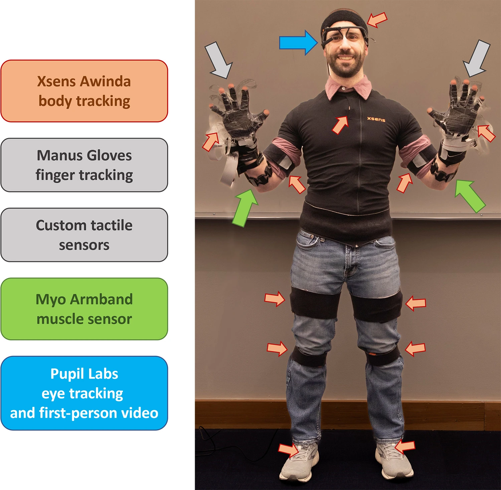</a>
<figcaption>ActionSense官方可穿戴采集装置：第一视角相机、双手触觉手套及人体运动传感器。各模态有效覆盖仍须按参与者核对。<span class="figure-links"><a href="https://action-sense.csail.mit.edu/" target="_blank" rel="noopener">来源：作者项目／论文</a><a href="https://action-sense.csail.mit.edu/images/wearable_sensors_v0.jpg" target="_blank" rel="noopener">原图／视频／PDF</a></span></figcaption>
</figure>
<figure class="dataset-figure wide" id="fig-e01-02">
<div class="figure-type"><strong>E01 · 图2</strong><span>数据概览</span><small>点击图片放大</small></div>
<a class="figure-open" href="figures/e01-02.webp" target="_blank" rel="noopener" aria-label="放大：ActionSense多模态厨房活动录制概览；展示视觉、人体运动及触觉的互补观测。">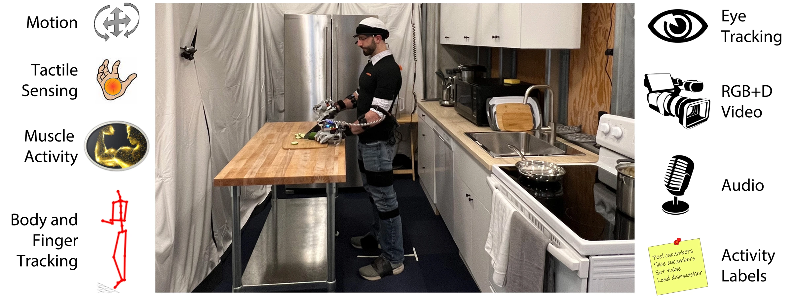</a>
<figcaption>ActionSense多模态厨房活动录制概览；展示视觉、人体运动及触觉的互补观测。<span class="figure-links"><a href="https://action-sense.csail.mit.edu/" target="_blank" rel="noopener">来源：作者项目／论文</a><a href="https://action-sense.csail.mit.edu/images/overview.jpg" target="_blank" rel="noopener">原图／视频／PDF</a></span></figcaption>
</figure>
</div>


<a id="E02"></a>

### E02 · EgoPressure

**分类：**人类ego＋实测触觉　**参考年份：**2025　**证据：**A（已核实实际数据文件目录；计入主统计）

**数据／项目链接：**[官方数据](https://huggingface.co/datasets/eth-siplab/EgoPressure)；[工具/字段](https://github.com/eth-siplab/EgoPressure)；[论文](https://arxiv.org/abs/2409.02224)

| 项目 | 核实信息 |
|---|---|
| 规模与发布口径 | 当前官方数据卡：21人、1,344序列、32手势×双手；每路约630K帧、8路合计约5M相机帧；约1.96TB。 |
| 传感器、模态与时序 | 头戴RGB-D与7个固定RGB-D视角，30Hz；Sensel Morph桌面压力板105×185原始网格，UV压力、MANO手网格、逐帧ego相机位姿。 |
| 动作与状态 | 手部姿态/网格是运动监督，没有机器人动作。 |
| 对触觉世界模型的用途 | 压力估计、接触区域与几何联合建模；适合做有计量依据的压力预测基准。 |
| 数据许可 | CC BY-NC-SA 4.0；MANO另受其许可约束 |
| 限制、证据缺口与去重 | 压力来自手接触桌面压力板，不是全手戴手套操作任意物体；不能把多相机帧数视作独立接触状态。论文与新版数据卡规模口径不同，本文以现有发布卡为准。 |

<section id="sample-E02" class="sample-card complete_trajectory"><h4>实际数据样例 <span class="sample-status">完整时序样例</span></h4>
<div class="sample-player"><video controls playsinline preload="none" poster="trajectories/E02/poster.webp" src="trajectories/E02/preview.mp4" aria-label="E02 实际数据可视化"></video></div>
<p class="sample-caption">EgoPressure p_001_index_press_high_x5_left：已下载完整413帧、13.767秒的cam-d第一视角JPEG与Sensel压力数据，按公共frame编号1–413逐帧匹配，30Hz。右侧为pressure.parquet/force原始105×185网格；未额外将数值转换为牛顿。首个校准样本压力全零，故展示实际高压食指接触任务。</p>
<div class="sample-meta"><div><b>样例／文件</b>p_001/p_001_index_press_high_x5_left</div><div><b>下载范围</b>完整录制/序列 · 413 帧 / 30.000 Hz</div><div><b>原始样例时长</b>13.767 秒</div></div>
<p class="sample-caption"><strong>对齐方式：</strong>两Parquet的frame数组逐项相同，按30Hz公共帧号播放</p>
<p class="sample-links">
<a href="trajectories/E02/index.html" target="_blank" rel="noopener">单独打开样例</a>
<a href="https://huggingface.co/datasets/eth-siplab/EgoPressure" target="_blank" rel="noopener">数据源</a>
<a href="https://huggingface.co/datasets/eth-siplab/EgoPressure/resolve/main/data/p_001/p_001_index_press_high_x5_left/pressure.parquet" target="_blank" rel="noopener">原始下载入口</a>
<a href="trajectory_records/E02.json">下载／校验记录</a></p>
<div class="sample-duration"><strong>数据集时长：</strong>元数据推算 5.833 h<p><strong>覆盖范围：</strong>约5.83小时（由官方约630K单路帧/30Hz推算）</p><p>官网每路约630K帧、8个同步相机。只计算单路时间，不能用约5M多相机帧除30Hz；含校准及无接触序列，非全部接触有效时长。</p></div>
<details class="sample-evidence"><summary>时长及下载证据</summary><ul><li><a href="https://huggingface.co/datasets/eth-siplab/EgoPressure/blob/main/README.md" target="_blank" rel="noopener">来源 1</a>：≈630K per camera;8 synchronized views;30Hz</li></ul></details>
<div class="duration-estimate" id="duration-E02"><h5>本轮统计值：5.83 小时 <span class="estimate-tag estimated">估算</span></h5><p>范围：5.79–5.88 小时 · 可信度：中 · 已验证文件入口</p><p><strong>覆盖：</strong>EgoPressure公开库的单一同步时间轴；不把8个相机累加。</p><p><strong>计算：</strong>作者约630K帧/相机÷30Hz÷3600≈5.833333小时；按630K为最接近10K的约数，625K–635K给出5.787037–5.879630小时的舍入敏感性区间。</p><p>官方Hugging Face公开，已下载完整RGB/压力样本。</p><details><summary>估算假设与来源</summary><ul><li>630K是作者近似统计，区间是约数解释，不是独立全库审计或统计置信区间。</li><li>含校准和无接触阶段；8路相机及压力只计一次同步时间。</li></ul><ul><li><a href="https://huggingface.co/datasets/eth-siplab/EgoPressure/blob/main/README.md" target="_blank" rel="noopener">来源 1</a>：≈630K per camera;8 synchronized views;30Hz</li></ul></details><p><a href="duration_estimates/E02.json">下载该条计算记录</a></p></div></section>

<div class="dataset-figures">
<figure class="dataset-figure wide" id="fig-e02-01">
<div class="figure-type"><strong>E02 · 图1</strong><span>采集装置</span><small>点击图片放大</small></div>
<a class="figure-open" href="figures/e02-01.webp" target="_blank" rel="noopener" aria-label="放大：EgoPressure论文图3：7个固定视角与1个ego相机组成的采集系统；接触压力来自桌面压力板。">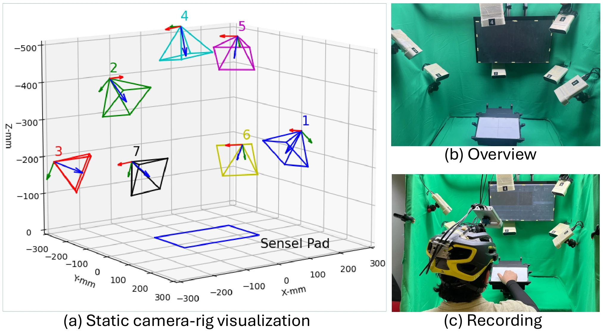</a>
<figcaption>EgoPressure论文图3：7个固定视角与1个ego相机组成的采集系统；接触压力来自桌面压力板。<span class="figure-links"><a href="https://arxiv.org/html/2409.02224" target="_blank" rel="noopener">来源：作者项目／论文</a><a href="https://arxiv.org/html/2409.02224v2/camera_setup.png" target="_blank" rel="noopener">原图／视频／PDF</a></span></figcaption>
</figure>
<figure class="dataset-figure wide" id="fig-e02-02">
<div class="figure-type"><strong>E02 · 图2</strong><span>数据样例</span><small>点击图片放大</small></div>
<a class="figure-open" href="figures/e02-02.webp" target="_blank" rel="noopener" aria-label="放大：EgoPressure论文标注样例（右手）：视觉、手部几何和压力监督。此处展示数据标注，不是将预测压力当传感器实测。">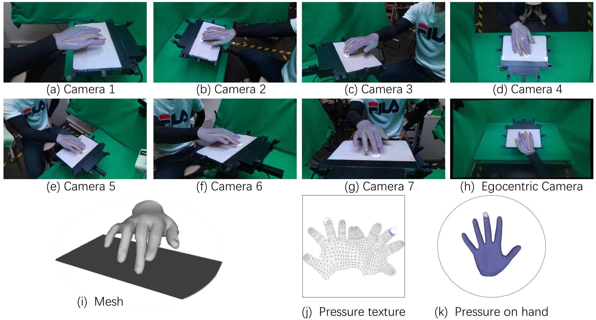</a>
<figcaption>EgoPressure论文标注样例（右手）：视觉、手部几何和压力监督。此处展示数据标注，不是将预测压力当传感器实测。<span class="figure-links"><a href="https://arxiv.org/html/2409.02224" target="_blank" rel="noopener">来源：作者项目／论文</a><a href="https://arxiv.org/html/2409.02224v2/F2.png" target="_blank" rel="noopener">原图／视频／PDF</a></span></figcaption>
</figure>
</div>


<a id="E03"></a>

### E03 · OpenTouch

**分类：**人类ego＋实测触觉　**参考年份：**2025　**证据：**B（已核实官方下载入口／脚本，归档未验证；计入主统计）

**数据／项目链接：**[项目](https://opentouch-tactile.github.io/)；[官方数据脚本](https://github.com/OpenTouch-MIT/opentouch/blob/main/scripts/download_data.sh)；[论文](https://arxiv.org/abs/2512.16842)

| 项目 | 核实信息 |
|---|---|
| 规模与发布口径 | 论文：5.1小时同步录制、2,900精选片段（约3小时），14种环境。 |
| 传感器、模态与时序 | Aria第一视角视频、169触点全手压力、Rokoko手姿态，30Hz同步；动作、物体、抓型和自然语言标注。 |
| 动作与状态 | 硬件跟踪的人手运动轨迹；语义动作标签不是低层控制动作。 |
| 对触觉世界模型的用途 | 第一版人手触觉时序模型的优先来源，可研究视频—姿态—触觉联合预测。 |
| 数据许可 | 本次未确认数据专用许可证 |
| 限制、证据缺口与去重 | 官方项目及README仍指向Google Drive，本次未能读取。另下载同名HF候选样例，但未找到官方交叉链接或作者/论文引用，不能证明其属于原始2025 OpenTouch；候选可视化单独标记，不计已核实样例覆盖，保留B级证据。 |

<section id="sample-E03" class="sample-card unverified_sample"><h4>实际数据样例 <span class="sample-status">同名候选／来源未证实</span></h4>
<div class="sample-player"><video controls playsinline preload="none" poster="trajectories/E03/poster.webp" src="trajectories/E03/preview.mp4" aria-label="E03 实际数据可视化"></video></div>
<p class="sample-caption">同名公开候选样例（来源关联尚未证实）：从opentouch-neurips2026/opentouch-sample取得eat_mcdonalds.hdf5中的完整demo_40（source_file=clip_011655_011804.hdf5）。实际解码150帧RGB、16×16右手压力及共享纳秒时间戳，约5秒。官方OpenTouch仍只指向Google Drive，尚未找到与此仓库的作者关联，因此不计入已核实数据集样例及完整序列覆盖。16×16为存储矩阵，不等于256有效触点；颜色为原字段数值，未推断物理压力或响应单调性。</p>
<div class="sample-meta"><div><b>样例／文件</b>eat_mcdonalds.hdf5/data/demo_40;clip_011655_011804.hdf5</div><div><b>下载范围</b>完整录制/序列 · 150 帧 / 原始采样率未确认</div><div><b>原始样例时长</b>4.999 秒</div></div>
<p class="sample-caption"><strong>对齐方式：</strong>同一个HDF5 demo组，150个共享纳秒timestamps分别索引RGB/pressure</p>
<p class="sample-caption">同名公开候选样例（来源关联尚未证实）。官方项目、README及下载脚本未指向此Hugging Face仓库；数据卡无作者/论文引用，名称及字段结构不足以证明属于原始2025 OpenTouch。已完整下载的是候选库短片段，不能作为官方数据下载成功的证据。</p>
<p class="sample-links">
<a href="trajectories/E03/index.html" target="_blank" rel="noopener">单独打开样例</a>
<a href="https://huggingface.co/datasets/opentouch-neurips2026/opentouch-sample" target="_blank" rel="noopener">数据源</a>
<a href="https://huggingface.co/datasets/opentouch-neurips2026/opentouch-sample/resolve/main/eat_mcdonalds.hdf5" target="_blank" rel="noopener">原始下载入口</a>
<a href="trajectory_records/E03.json">下载／校验记录</a></p>
<div class="sample-duration"><strong>数据集时长：</strong>论文范围 5.100 h<p><strong>覆盖范围：</strong>论文5.1小时录制，其中约3小时精选标注</p><p>官方项目页约5小时录制，其中约3小时密集标注片段；未审计原Drive全量时长。下方候选样例约5秒仅属候选仓库，不能验证官方数据集总量或可下载性。</p></div>
<details class="sample-evidence"><summary>时长及下载证据</summary><ul><li><a href="https://arxiv.org/abs/2512.16842" target="_blank" rel="noopener">来源 1</a>：5.1h recordings;2900 curated clips (~3h)</li><li><a href="https://huggingface.co/datasets/opentouch-neurips2026/opentouch-sample/resolve/main/eat_mcdonalds.hdf5" target="_blank" rel="noopener">来源 2</a>：9,231,719bytes;decoded150JPEG/pressure/timestamps</li><li><a href="https://drive.google.com/file/d/1EjMOzs45devBo0TqhuhZTT_Ll7HZ1lrW/view" target="_blank" rel="noopener">来源 3</a>：官方原Drive本机及4090连接超时；不能用同名候选仓库认定官方文件已下载</li><li><a href="https://opentouch-tactile.github.io/" target="_blank" rel="noopener">来源 4</a>：官方项目；未发现指向该HF样例库的交叉链接</li><li><a href="https://github.com/OpenTouch-MIT/opentouch" target="_blank" rel="noopener">来源 5</a>：官方README及下载脚本仍指向Google Drive；同名HF数据卡无作者及论文引用</li></ul></details>
<div class="duration-estimate" id="duration-E03"><h5>本轮统计值：5.10 小时 <span class="estimate-tag reported">作者报告</span></h5><p>范围：5.05–5.15 小时 · 可信度：中 · 仅官方入口，下载未验证</p><p><strong>覆盖：</strong>原始OpenTouch官方Google Drive发布入口对应的5.1小时录制；其中约3小时精选标注。</p><p><strong>计算：</strong>采用论文5.1小时公开数据规模；5.05–5.15小时仅表示保留一位小数的舍入范围。</p><p>官方入口公开，当前网络Drive超时；保留B级及候选样例来源限制。</p><details><summary>估算假设与来源</summary><ul><li>未通过当前网络下载原始Drive全库，5.1小时是作者报告量。</li><li>同名opentouch-neurips2026候选样本与原始OpenTouch的来源关联未证实；其5秒样例不用于证明这5.1小时可直接下载。</li></ul><ul><li><a href="https://arxiv.org/abs/2512.16842" target="_blank" rel="noopener">来源 1</a>：5.1h recordings；2900 curated clips约3h</li><li><a href="https://github.com/OpenTouch-MIT/opentouch/blob/main/scripts/download_data.sh" target="_blank" rel="noopener">来源 2</a>：官方脚本公开Google Drive文件ID；未指向同名HF候选仓库</li></ul></details><p><a href="duration_estimates/E03.json">下载该条计算记录</a></p></div></section>

<div class="dataset-figures">
<figure class="dataset-figure wide" id="fig-e03-01">
<div class="figure-type"><strong>E03 · 图1</strong><span>采集装置</span><small>点击图片放大</small></div>
<a class="figure-open" href="figures/e03-01.webp" target="_blank" rel="noopener" aria-label="放大：OpenTouch论文图4：Aria眼镜、手部跟踪与全手触觉采集及标注流程。语言标签来自后续自动标注。">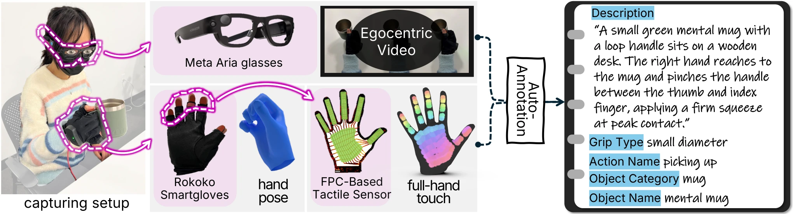</a>
<figcaption>OpenTouch论文图4：Aria眼镜、手部跟踪与全手触觉采集及标注流程。语言标签来自后续自动标注。<span class="figure-links"><a href="https://arxiv.org/html/2512.16842v1" target="_blank" rel="noopener">来源：作者项目／论文</a><a href="https://arxiv.org/html/2512.16842v1/opentouch_hardware.png" target="_blank" rel="noopener">原图／视频／PDF</a></span></figcaption>
</figure>
<figure class="dataset-figure wide" id="fig-e03-02">
<div class="figure-type"><strong>E03 · 图2</strong><span>数据样例</span><small>点击图片放大</small></div>
<a class="figure-open" href="figures/e03-02.webp" target="_blank" rel="noopener" aria-label="放大：OpenTouch论文图3：视频、手姿态与触觉对照。接触压力补充了遮挡、透明物体及仅看外观难以辨别的交互信息。">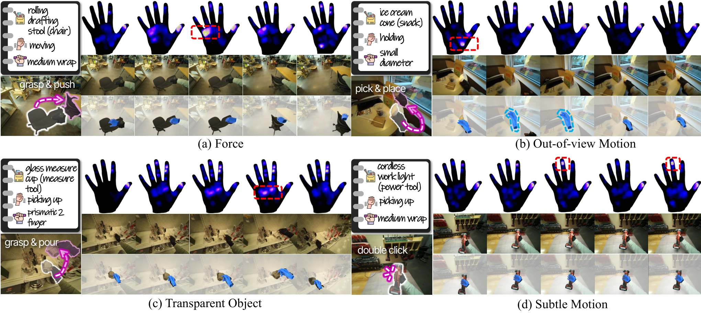</a>
<figcaption>OpenTouch论文图3：视频、手姿态与触觉对照。接触压力补充了遮挡、透明物体及仅看外观难以辨别的交互信息。<span class="figure-links"><a href="https://arxiv.org/html/2512.16842v1" target="_blank" rel="noopener">来源：作者项目／论文</a><a href="https://arxiv.org/html/2512.16842v1/opentouch_dataexample.png" target="_blank" rel="noopener">原图／视频／PDF</a></span></figcaption>
</figure>
</div>


<a id="E04"></a>

### E04 · EgoTouch（TouchAnything数据）

**分类：**人类ego＋实测触觉　**参考年份：**2026　**证据：**A（已核实实际数据文件目录；计入主统计）

**数据／项目链接：**[官方数据](https://huggingface.co/datasets/zhouzhoujy/EgoTouch)；[项目/格式](https://github.com/Jianyi2004/TouchAnything)；[论文](https://arxiv.org/abs/2605.13083)

| 项目 | 核实信息 |
|---|---|
| 规模与发布口径 | 作者当前README：208任务、1,891 episodes、约2M帧、1,000+物体；发布说明仍保留“上传中/可能不完整”。 |
| 传感器、模态与时序 | ego+双腕3路视频、双手压力、人手姿态与相机位姿。代码中的处理格式为30FPS、21×21压力网格、WiLoR双手21关节点及有效掩码。 |
| 动作与状态 | 人手运动估计和相机位姿；不能直接作为机器人关节控制标签。 |
| 对触觉世界模型的用途 | 双手接触、遮挡下多视角预测、跨视角和跨本体预训练。 |
| 数据许可 | 数据许可未确认；代码MIT不自动等于数据MIT |
| 限制、证据缺口与去重 | 原始传感器、16×16采集说明和21×21处理网格须区分；不能把WiLoR估计称作全量动捕真值。数据目录有Home/Office/Outdoor/Retail/Workbench和split.json，但未证明覆盖论文全部样本。 |

<section id="sample-E04" class="sample-card complete_trajectory"><h4>实际数据样例 <span class="sample-status">完整时序样例</span></h4>
<div class="sample-player"><video controls playsinline preload="none" poster="trajectories/E04/poster.webp" src="trajectories/E04/preview.mp4" aria-label="E04 实际数据可视化"></video></div>
<p class="sample-caption">EgoTouch Home/arrange_pillow/20260412_101136_379：完整1652帧、55.067秒chest视频和双手21×21处理压力网格，按30fps等长逐帧对齐。展示的是pressure_grids.npz中处理后的网格（含基线校正/归一化），不是标定牛顿力，也不等同原始传感器几何；预览10fps。</p>
<div class="sample-meta"><div><b>样例／文件</b>Home/arrange_pillow/20260412_101136_379</div><div><b>下载范围</b>完整录制/序列 · 1652 帧 / 30.000 Hz</div><div><b>原始样例时长</b>55.067 秒</div></div>
<p class="sample-caption"><strong>对齐方式：</strong>同目录同1652帧；30fps帧索引对齐。</p>
<p class="sample-links">
<a href="trajectories/E04/index.html" target="_blank" rel="noopener">单独打开样例</a>
<a href="https://huggingface.co/datasets/zhouzhoujy/EgoTouch" target="_blank" rel="noopener">数据源</a>
<a href="https://huggingface.co/datasets/zhouzhoujy/EgoTouch/resolve/main/Home/arrange_pillow/20260412_101136_379/pressure_grids.npz" target="_blank" rel="noopener">原始下载入口</a>
<a href="trajectory_records/E04.json">下载／校验记录</a></p>
<div class="sample-duration"><strong>数据集时长：</strong>元数据推算 18.519 h<p><strong>覆盖范围：</strong>约18.5小时（仅按作者约2M帧/30fps粗估）</p><p>作者README约2M帧与30FPS处理规格给出约18.5小时名义等效时长，仍在上传且未逐episode审计，不能当成已验证完整发布时长。</p></div>
<details class="sample-evidence"><summary>时长及下载证据</summary><ul><li><a href="https://github.com/Jianyi2004/TouchAnything" target="_blank" rel="noopener">来源 1</a>：~2M frames; processed FPS=30</li></ul></details>
<div class="duration-estimate" id="duration-E04"><h5>本轮统计值：15.08 小时 <span class="estimate-tag estimated">估算</span></h5><p>范围：12.04–18.72 小时 · 可信度：中 · 已验证文件入口</p><p><strong>覆盖：</strong>EgoTouch当前公开1933个pressure_grids.npz与chest.mp4配套目录的总时长估计。</p><p><strong>计算：</strong>公开目录分Home1145/Office191/Outdoor157/Retail127/Workbench313条；固定种子20261019在每场景均匀随机抽40条，共200条，实际Range解码NPZ内数组shape。估计Σ(场景条数×场景样本平均帧数)/30/3600=15.080688小时；场景内bootstrap20000次给出约95%经验区间12.037938–18.717731小时。</p><p>官方公开库，当前快照目录计数；200/1933序列已实际读元数据。</p><details><summary>估算假设与来源</summary><ul><li>处理规格30fps；未逐条验证chest视频帧数与NPZ完全一致。</li><li>随机抽样按发布目录分层，不按任务、时长或参与者再分层；长尾时长、场景内部组成和后续补传可能造成偏差。</li><li>bootstrap仅反映此次样本内抽样波动，不覆盖FPS或发布文件质量错误。</li><li>不使用所有三路相机和可视化视频重复计时；旧约2M帧/30fps=18.5185h作者口径另留。</li></ul><ul><li><a href="https://huggingface.co/datasets/zhouzhoujy/EgoTouch/tree/main" target="_blank" rel="noopener">来源 1</a>：完整API目录有1933个pressure_grids.npz及1933个chest.mp4</li><li><a href="https://github.com/Jianyi2004/TouchAnything" target="_blank" rel="noopener">来源 2</a>：数据处理FPS=30；旧README约2M frames</li><li><a href="https://huggingface.co/datasets/zhouzhoujy/EgoTouch/resolve/main/Home/arrange_pillow/20260412_101243_753/pressure_grids.npz" target="_blank" rel="noopener">来源 3</a>：Range读取ZIP内NPY头示例shape=(3235,21,21)；200条头部全部成功读取</li></ul><p>核查明细：<a href="duration_estimates/evidence/E04_sample_plan.json">[1]</a> <a href="duration_estimates/evidence/E04_audited_counts.json">[2]</a> <a href="duration_estimates/evidence/E04_estimator.json">[3]</a> </p></details><p><a href="duration_estimates/E04.json">下载该条计算记录</a></p></div></section>

<div class="dataset-figures">
<figure class="dataset-figure wide" id="fig-e04-01">
<div class="figure-type"><strong>E04 · 图1</strong><span>采集装置</span><small>点击图片放大</small></div>
<a class="figure-open" href="figures/e04-01.webp" target="_blank" rel="noopener" aria-label="放大：EgoTouch论文图2：头戴和双腕相机、压力手套以及对齐后的多模态样例。公开处理代码中的手姿态包含WiLoR估计，应保留其有效掩码。">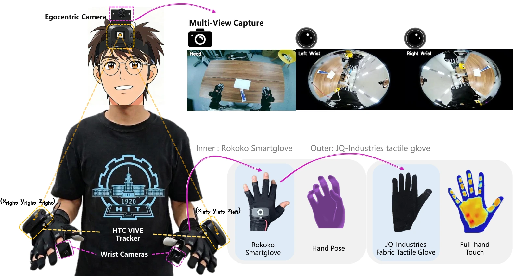</a>
<figcaption>EgoTouch论文图2：头戴和双腕相机、压力手套以及对齐后的多模态样例。公开处理代码中的手姿态包含WiLoR估计，应保留其有效掩码。<span class="figure-links"><a href="https://arxiv.org/html/2605.13083" target="_blank" rel="noopener">来源：作者项目／论文</a><a href="https://arxiv.org/html/2605.13083v1/data_collection.png" target="_blank" rel="noopener">原图／视频／PDF</a></span></figcaption>
</figure>
<figure class="dataset-figure wide" id="fig-e04-02">
<div class="figure-type"><strong>E04 · 图2</strong><span>数据样例</span><small>点击图片放大</small></div>
<a class="figure-open" href="figures/e04-02.webp" target="_blank" rel="noopener" aria-label="放大：EgoTouch论文图3：多场景操作中的视角、手部姿态与接触压力示例。采集读数和模型估计字段需按正文区分。">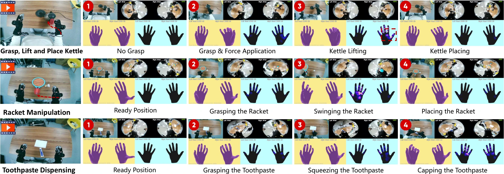</a>
<figcaption>EgoTouch论文图3：多场景操作中的视角、手部姿态与接触压力示例。采集读数和模型估计字段需按正文区分。<span class="figure-links"><a href="https://arxiv.org/html/2605.13083" target="_blank" rel="noopener">来源：作者项目／论文</a><a href="https://arxiv.org/html/2605.13083v1/example_of_touchanything.png" target="_blank" rel="noopener">原图／视频／PDF</a></span></figcaption>
</figure>
</div>


<a id="E05"></a>

### E05 · EgoTactile

**分类：**人类ego＋实测触觉　**参考年份：**2026　**证据：**A（已核实实际数据文件目录；计入主统计）

**数据／项目链接：**[官方数据](https://huggingface.co/datasets/HustleHard/EgoTactile)；[项目](https://egotactile.github.io/)；[论文](https://arxiv.org/abs/2606.09243)

| 项目 | 核实信息 |
|---|---|
| 规模与发布口径 | 12位参与者、63种日常物体、7物体类别；本次未确认可用于总量相加的完整时长。 |
| 传感器、模态与时序 | 1280×720 ego视频、162位置压力，视觉与压力对齐15Hz；戴手套与裸手两子集。 |
| 动作与状态 | 数据卡未给连续机器人动作；主要是视频到压力监督。 |
| 对触觉世界模型的用途 | 抓握压力预测、跨参与者和跨物体泛化、压力时序表征。 |
| 数据许可 | CC BY-NC 4.0 |
| 限制、证据缺口与去重 | 裸手子集可见手没有戴手套：参考压力来自画面外另一只戴手套的手，以节拍器协调动作。裸手子集不应标成“可见手直接测量压力真值”。 |

<section id="sample-E05" class="sample-card complete_trajectory"><h4>实际数据样例 <span class="sample-status">完整时序样例</span></h4>
<div class="sample-player"><video controls playsinline preload="none" poster="trajectories/E05/poster.webp" src="trajectories/E05/preview.mp4" aria-label="E05 实际数据可视化"></video></div>
<p class="sample-caption">EgoTactile gloved_hand/p001/Apple/repeat0000：完整399帧、26.6秒配对样例。视频15fps，按JSON frame_id对应；触觉显示实际存储的RH.sensor_256按16×16展平值，不把256存储项称为256有效触点（数据卡162位置）。使用戴手套子集；预览10fps。JSON相机时间跨度26.864秒与恒帧率视频26.6秒略异，展示采用发布帧号配对。</p>
<div class="sample-meta"><div><b>样例／文件</b>Raw_data/gloved_hand/p001/Apple/repeat0000</div><div><b>下载范围</b>完整录制/序列 · 399 帧 / 15.000 Hz</div><div><b>原始样例时长</b>26.600 秒</div></div>
<p class="sample-caption"><strong>对齐方式：</strong>JSON frame_id与MP4399帧对应；按15fps播放，绝对采集时间有轻微不均匀。</p>
<p class="sample-links">
<a href="trajectories/E05/index.html" target="_blank" rel="noopener">单独打开样例</a>
<a href="https://huggingface.co/datasets/HustleHard/EgoTactile" target="_blank" rel="noopener">数据源</a>
<a href="https://huggingface.co/datasets/HustleHard/EgoTactile/resolve/main/Raw_data/gloved_hand/p001/Apple/repeat0000/data.json" target="_blank" rel="noopener">原始下载入口</a>
<a href="trajectory_records/E05.json">下载／校验记录</a></p>
<div class="sample-duration"><strong>数据集时长：</strong>总时长未核实<p><strong>覆盖范围：</strong>未公开可核实的全库总时长</p><p>数据卡只给12人、63物体、15Hz；不能用人数×物体×单个样例时长外推总时长。当前实际样例26.6秒。</p></div>
<details class="sample-evidence"><summary>时长及下载证据</summary><ul><li><a href="https://huggingface.co/datasets/HustleHard/EgoTactile" target="_blank" rel="noopener">来源 1</a>：12 participants /63 objects /15 FPS；无总小时数</li></ul></details>
<div class="duration-estimate" id="duration-E05"><h5>本轮统计值：5.82 小时 <span class="estimate-tag metadata">元数据实算</span></h5><p>范围：5.80–5.90 小时 · 可信度：高 · 已验证文件入口</p><p><strong>覆盖：</strong>EgoTactile当前767个具有data.json及同目录视频的发布序列，含戴手套与裸手协调参考两子集。</p><p><strong>计算：</strong>逐下载并解析全部767份JSON，共314100帧；全部frame_id从首到尾连续。314100/15/3600=5.816667小时。下界按每段末−首帧间隔(314100−767)/15；上界按各camera_timestamp末−首再加1/15秒，合计5.900834小时。</p><p>767份发布JSON全部读取成功；公开RGB对应目录已核对。</p><p>其中直接测量可见操作手 5.21 小时；裸手画面＋另一只戴手套手协调参考 0.610 小时，不能视作对可见裸手的直接测量。</p><details><summary>估算假设与来源</summary><ul><li>名义15Hz与真实相机时间戳存在约1.4%差异；范围反映两种实际时间口径，不是置信区间。</li><li>戴手套692条281185帧=5.207130小时，为可见操作手的直接压力测量；裸手75条32915帧=0.609537小时，其压力来自另一只画面外戴手套手的协调动作。</li><li>768个视频文件中只有767份配套data.json，本统计只计配对目录；不从12人×63物体外推。</li></ul><ul><li><a href="https://huggingface.co/datasets/HustleHard/EgoTactile" target="_blank" rel="noopener">来源 1</a>：官方发布目录及15Hz同步说明、裸手参考协议</li><li><a href="https://huggingface.co/datasets/HustleHard/EgoTactile/raw/main/Raw_data/gloved_hand/p002/Apple/repeat0000/data.json" target="_blank" rel="noopener">来源 2</a>：全部767份JSON读取frame_id及camera_timestamp首末；统计明细见E05_audited_counts.json</li></ul><p>核查明细：<a href="duration_estimates/evidence/E05_totals.json">[1]</a> <a href="duration_estimates/evidence/E05_audited_counts.json">[2]</a> </p></details><p><a href="duration_estimates/E05.json">下载该条计算记录</a></p></div></section>

<div class="dataset-figures">
<figure class="dataset-figure wide" id="fig-e05-01">
<div class="figure-type"><strong>E05 · 图1</strong><span>采集装置</span><small>点击图片放大</small></div>
<a class="figure-open" href="figures/e05-01.webp" target="_blank" rel="noopener" aria-label="放大：EgoTactile论文图2：戴手套与裸手设置及数据分布。裸手设置的参考压力由画面外另一只戴手套的手提供，不能当成可见裸手的直接压力真值。">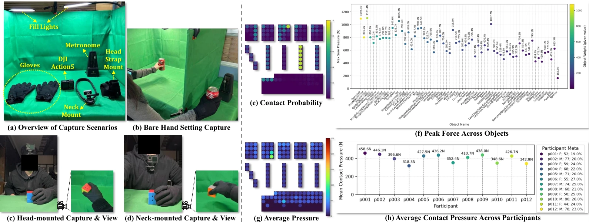</a>
<figcaption>EgoTactile论文图2：戴手套与裸手设置及数据分布。裸手设置的参考压力由画面外另一只戴手套的手提供，不能当成可见裸手的直接压力真值。<span class="figure-links"><a href="https://arxiv.org/html/2606.09243v1" target="_blank" rel="noopener">来源：作者项目／论文</a><a href="https://arxiv.org/html/2606.09243v1/dataset_overview.png" target="_blank" rel="noopener">原图／视频／PDF</a></span></figcaption>
</figure>
<figure class="dataset-figure" id="fig-e05-02">
<div class="figure-type"><strong>E05 · 图2</strong><span>触觉表示</span><small>点击图片放大</small></div>
<a class="figure-open" href="figures/e05-02.webp" target="_blank" rel="noopener" aria-label="放大：EgoTactile论文图7：稀疏触点序列与标准手形热图的映射；热图是传感器读数的派生表示，并非独立的稠密压力测量。">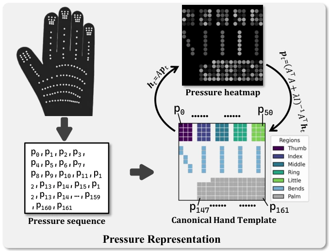</a>
<figcaption>EgoTactile论文图7：稀疏触点序列与标准手形热图的映射；热图是传感器读数的派生表示，并非独立的稠密压力测量。<span class="figure-links"><a href="https://arxiv.org/html/2606.09243v1" target="_blank" rel="noopener">来源：作者项目／论文</a><a href="https://arxiv.org/html/2606.09243v1/pressure_representation.png" target="_blank" rel="noopener">原图／视频／PDF</a></span></figcaption>
</figure>
</div>


<a id="E06"></a>

### E06 · OpenGraph Ego-Tactile Manipulation

**分类：**人类ego＋实测触觉　**参考年份：**2026　**证据：**A（已核实实际数据文件目录；计入主统计）

**数据／项目链接：**[官方数据及格式](https://huggingface.co/datasets/OpenGraphLabs-Research/ego-tactile-manipulation)

| 项目 | 核实信息 |
|---|---|
| 规模与发布口径 | 公开样例72 episodes、1.28小时、138,629帧。 |
| 传感器、模态与时序 | 1920×1080头戴视频；OGLO每手80、双手160压力通道；30Hz对齐并保留90Hz原始触觉，头/双腕IMU；LeRobot v3。 |
| 动作与状态 | 语义分段、物体/抓型标签；未见连续机器人action或完整手关节位姿字段。 |
| 对触觉世界模型的用途 | 小规模快速跑通时序数据管线；允许商业用途的ego压力样本。 |
| 数据许可 | CC BY 4.0 |
| 限制、证据缺口与去重 | 公开的是样例，不能推算其商业全库规模。动作边界由接触信号自动生成，数据卡明确不是人工真值；腕部IMU不等于腕部6DoF位置。 |

<section id="sample-E06" class="sample-card complete_trajectory"><h4>实际数据样例 <span class="sample-status">完整时序样例</span></h4>
<div class="sample-player"><video controls playsinline preload="none" poster="trajectories/E06/poster.webp" src="trajectories/E06/preview.mp4" aria-label="E06 实际数据可视化"></video></div>
<p class="sample-caption">OpenGraph episode 0：已下载完整4369帧、145.633秒的ego RGB与双手160通道压力，30Hz。报告播放前45秒，降采样10fps；每手按五指4×4传感器依次横向排列（4×20），保持每指网格，未人为画成手掌。视频与Parquet通过LeRobot episode metadata对齐。</p>
<div class="sample-meta"><div><b>样例／文件</b>episode_000000</div><div><b>下载范围</b>完整录制/序列 · 4369 帧 / 30.000 Hz</div><div><b>原始样例时长</b>145.633 秒</div></div>
<p class="sample-caption"><strong>对齐方式：</strong>episode metadata视频0–145.633秒对应episode0帧号</p>
<p class="sample-links">
<a href="trajectories/E06/index.html" target="_blank" rel="noopener">单独打开样例</a>
<a href="https://huggingface.co/datasets/OpenGraphLabs-Research/ego-tactile-manipulation" target="_blank" rel="noopener">数据源</a>
<a href="https://huggingface.co/datasets/OpenGraphLabs-Research/ego-tactile-manipulation/resolve/main/videos/observation.images.ego/chunk-000/file-000.mp4" target="_blank" rel="noopener">原始下载入口</a>
<a href="trajectory_records/E06.json">下载／校验记录</a></p>
<div class="sample-duration"><strong>数据集时长：</strong>官方发布／公开范围 1.280 h；元数据推算 1.284 h<p><strong>覆盖范围：</strong>1.28360小时（官网四舍五入1.28小时）</p><p>138,629帧/30Hz，不将90Hz原始压力或双手重复相加。</p></div>
<details class="sample-evidence"><summary>时长及下载证据</summary><ul><li><a href="https://huggingface.co/datasets/OpenGraphLabs-Research/ego-tactile-manipulation/blob/main/meta/info.json" target="_blank" rel="noopener">来源 1</a>：138629 frames /30fps,72episodes</li></ul></details>
<div class="duration-estimate" id="duration-E06"><h5>本轮统计值：1.28 小时 <span class="estimate-tag metadata">元数据实算</span></h5><p>范围：1.28–1.28 小时 · 可信度：高 · 已验证文件入口</p><p><strong>覆盖：</strong>OpenGraph当前72条发布episode的同步RGB—触觉时间轴。</p><p><strong>计算：</strong>meta.total_frames=138629、fps=30：138629/30/3600=1.283602小时；按每段只计首末间隔的下界(138629−72)/30/3600=1.282935小时。</p><p>官方公开HF元数据；完整episode0已实际下载。</p><details><summary>估算假设与来源</summary><ul><li>只计一个同步时间轴，不把双手、图像流或90Hz原始压力重复加时。</li></ul><ul><li><a href="https://huggingface.co/datasets/OpenGraphLabs-Research/ego-tactile-manipulation/blob/main/meta/info.json" target="_blank" rel="noopener">来源 1</a>：138629 frames /30fps,72episodes</li></ul></details><p><a href="duration_estimates/E06.json">下载该条计算记录</a></p></div></section>

<div class="dataset-figures">
<figure class="dataset-figure wide" id="fig-e06-01">
<div class="figure-type"><strong>E06 · 图1</strong><span>采集装置</span><small>点击图片放大</small></div>
<a class="figure-open" href="figures/e06-01.webp" target="_blank" rel="noopener" aria-label="放大：OpenGraph官方数据卡中的OGLO触觉手套；每手80个压力通道，传感器分布应与原始字段映射一起使用。">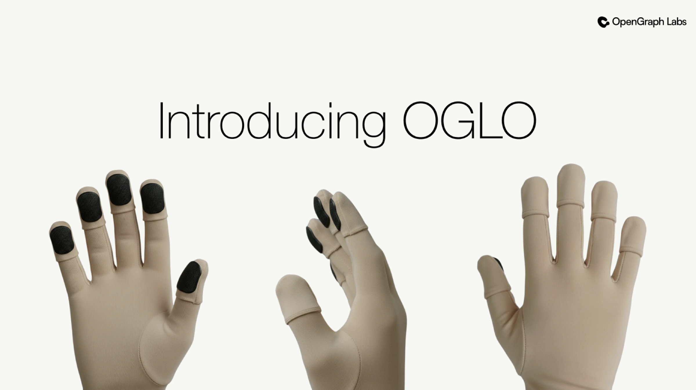</a>
<figcaption>OpenGraph官方数据卡中的OGLO触觉手套；每手80个压力通道，传感器分布应与原始字段映射一起使用。<span class="figure-links"><a href="https://huggingface.co/datasets/OpenGraphLabs-Research/ego-tactile-manipulation/raw/main/README.md" target="_blank" rel="noopener">来源：作者项目／论文</a><a href="https://huggingface.co/datasets/OpenGraphLabs-Research/ego-tactile-manipulation/resolve/main/assets/oglo_gloves.png" target="_blank" rel="noopener">原图／视频／PDF</a></span></figcaption>
</figure>
<figure class="dataset-figure wide" id="fig-e06-02">
<div class="figure-type"><strong>E06 · 图2</strong><span>数据样例</span><small>点击图片放大</small></div>
<a class="figure-open" href="figures/e06-02.webp" target="_blank" rel="noopener" aria-label="放大：OpenGraph官方动作分段示例。接触边界由触觉信号自动生成，图中分段不等于人工逐帧标注。">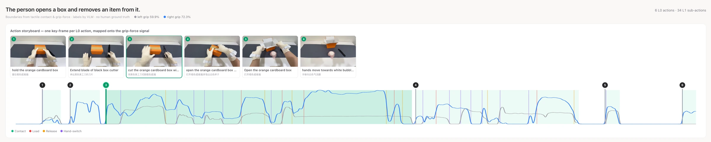</a>
<figcaption>OpenGraph官方动作分段示例。接触边界由触觉信号自动生成，图中分段不等于人工逐帧标注。<span class="figure-links"><a href="https://huggingface.co/datasets/OpenGraphLabs-Research/ego-tactile-manipulation/raw/main/README.md" target="_blank" rel="noopener">来源：作者项目／论文</a><a href="https://huggingface.co/datasets/OpenGraphLabs-Research/ego-tactile-manipulation/resolve/main/assets/action_seg_storyboard.png" target="_blank" rel="noopener">原图／视频／PDF</a></span></figcaption>
</figure>
</div>


<a id="E07"></a>

### E07 · Touch and Go

**分类：**人类ego＋实测触觉　**参考年份：**2022　**证据：**A（已核实实际数据文件目录；计入主统计）

**数据／项目链接：**[官方项目/许可](https://touch-and-go.github.io/)；[官方数据](https://drive.google.com/drive/folders/1NDasyshDCL9aaQzxjn_-Q5MBURRT360B)；[论文](https://arxiv.org/abs/2211.12498)

| 项目 | 核实信息 |
|---|---|
| 规模与发布口径 | 自然环境中的视觉—触觉录制；包括原始视频、接触片段与材质标签。不同预处理版帧数不同，本文不混用250K/262K等训练子集数字。 |
| 传感器、模态与时序 | 人类手持GelSight探测器触碰物体，同时记录第一视角视频；提供接触起始/材质信息。 |
| 动作与状态 | 没有可直接执行的机器人控制动作；也没有全手压力分布。 |
| 对触觉世界模型的用途 | 自然材质、跨模态编码器、视频条件未来触觉预测。 |
| 数据许可 | CC BY 4.0 |
| 限制、证据缺口与去重 | ego指相机视角，不代表测到人类皮肤或手套压力；触觉是探头局部接触。与Sparsh/FoTa/AnyTouch中的Touch and Go去重。 |

<section id="sample-E07" class="sample-card complete_trajectory"><h4>实际数据样例 <span class="sample-status">完整时序样例</span></h4>
<div class="sample-player"><video controls playsinline preload="none" poster="trajectories/E07/poster.webp" src="trajectories/E07/preview.mp4" aria-label="E07 实际数据可视化"></video></div>
<p class="sample-caption">Touch and Go：官方Drive在当前网络不可达；已从公开转换副本yxma/tactile-video-pretrain下载20220318_233801的完整136帧RGB与GelSight视频，并读取配对time_scene/time_tactile。两视频同136帧，但容器27.17fps给出5.006秒，metadata实际时间跨度4.507秒；展示按metadata时钟重建约4.54秒。触觉侧是真实光学传感器图像，不是生成预测。该转换记录不代表已验证原官方全部采集数据。</p>
<div class="sample-meta"><div><b>样例／文件</b>touchandgo:20220318_233801 (yxma public converted copy)</div><div><b>下载范围</b>完整录制/序列 · 136 帧 / 原始采样率未确认</div><div><b>原始样例时长</b>4.539 秒</div></div>
<p class="sample-caption"><strong>对齐方式：</strong>转换副本同一clip_id，两个136帧视频，time_scene/time_tactile逐项相同；未独立审计转换前的原时钟</p>
<p class="sample-caption">完整下载公开转换记录；不宣称原站全量可达。</p>
<p class="sample-caption">同源复用：<a href="#sample-A05">A05</a>；不作为新增独立来源计数。</p>
<p class="sample-links">
<a href="trajectories/E07/index.html" target="_blank" rel="noopener">单独打开样例</a>
<a href="https://touch-and-go.github.io/" target="_blank" rel="noopener">数据源</a>
<a href="https://huggingface.co/datasets/yxma/tactile-video-pretrain/resolve/main/videos/touchandgo/20220318_233801/scene.mp4" target="_blank" rel="noopener">原始下载入口</a>
<a href="trajectory_records/E07.json">下载／校验记录</a></p>
<p class="sample-links"><a href="trajectory_audits/E07/source_duration.json">详细审计 1</a></p>
<div class="sample-duration"><strong>数据集时长：</strong>派生索引名义值 14.607 h<p><strong>覆盖范围：</strong>转换副本138条名义时长合计14.607小时，非官方有效时间审计</p><p>138行索引的duration_s名义合计14.607h包含未发布文件。本轮核查完整文件清单，只有39条双模态及15条仅触觉可取；配对时间戳口径3.374920h，另有仅触觉2.076667h，见下方统计记录。原索引值保留用于追溯，不进入分类总量。</p></div>
<details class="sample-evidence"><summary>时长及下载证据</summary><ul><li><a href="https://huggingface.co/datasets/yxma/tactile-video-pretrain/blob/main/tactile_rgb/train-00000-of-00001.parquet" target="_blank" rel="noopener">来源 1</a>：138 rows duration_s sum=52586.69215232134; sampled136frames time span4.506836s versus container5.005521s</li><li><a href="https://huggingface.co/datasets/yxma/tactile-video-pretrain/tree/main/videos/touchandgo/20220318_233801" target="_blank" rel="noopener">来源 2</a>：两个MP4都实际下载解码136帧</li><li><a href="https://huggingface.co/datasets/yxma/tactile-video-pretrain/resolve/main/videos/touchandgo/20220318_021533/scene.mp4" target="_blank" rel="noopener">来源 3</a>：第一候选RGB缺失，已改用完整配对条目</li></ul></details>
<div class="duration-estimate" id="duration-E07"><h5>本轮统计值：3.37 小时 <span class="estimate-tag metadata">元数据实算</span></h5><p>范围：3.37–3.75 小时 · 可信度：中 · 公开镜像／派生入口</p><p><strong>覆盖：</strong>Touch and Go公开转换副本中实际同时存在RGB与GelSight文件的39条记录。</p><p><strong>计算：</strong>逐核对完整仓库18591条siblings及touchandgo子树175项，无分页遗漏；138条索引中仅39条具备两个视频文件。对这39条逐求time_scene/time_tactile交集并加中位末帧间隔=3.374920小时；仅首末交集3.374573小时，下界；视频容器名义时长合计3.745610小时作为另一时钟口径上界。</p><p>已确认实际文件存在的公开转换子集；原Drive全量未下载。</p><p>含未严格配对部分的同库触觉共 5.45 小时；比主值额外 2.08 小时，在分类汇总中单列补充。</p><details><summary>估算假设与来源</summary><ul><li>来源是非作者公开转换副本，未独立审核从官方原视频到转换时间戳的过程。</li><li>原先138条duration_s之和14.607414h包含未发布文件，不能当可获取完整配对时长；完整索引真实时钟约13.1619h也不能全部计入当前可取量。</li><li>同源数据也出现在A05聚合库，跨库汇总必须去重。</li><li>另有15条仅触觉视频可取得，按其metadata时钟含末帧约2.076667小时；全部54条可取触觉合计5.451587小时。另14条只有RGB，不计触觉量。</li></ul><ul><li><a href="https://huggingface.co/api/datasets/yxma/tactile-video-pretrain" target="_blank" rel="noopener">来源 1</a>：完整API 18591 siblings；touchandgo107文件，68目录中的39目录有双模态</li><li><a href="https://huggingface.co/datasets/yxma/tactile-video-pretrain/blob/main/tactile_rgb/train-00000-of-00001.parquet" target="_blank" rel="noopener">来源 2</a>：138条source=touchandgo；读取逐帧time_scene/time_tactile，39条配对可用</li><li><a href="https://touch-and-go.github.io/" target="_blank" rel="noopener">来源 3</a>：原始官方项目/Drive入口；当前网络未取全量</li></ul><p>核查明细：<a href="duration_estimates/evidence/E07_all_clock_spans.json">[1]</a> <a href="duration_estimates/evidence/A05_full_repository_files.json">[2]</a> <a href="duration_estimates/evidence/E07_tree.txt">[3]</a> </p></details><p><a href="duration_estimates/E07.json">下载该条计算记录</a></p></div></section>

<div class="dataset-figures">
<figure class="dataset-figure wide" id="fig-e07-01">
<div class="figure-type"><strong>E07 · 图1</strong><span>采集装置</span><small>点击图片放大</small></div>
<a class="figure-open" href="figures/e07-01.webp" target="_blank" rel="noopener" aria-label="放大：Touch and Go官方项目展示的自然环境采集：人操持GelSight探头，记录局部触觉与第一视角视觉。它不是全手皮肤压力录制。">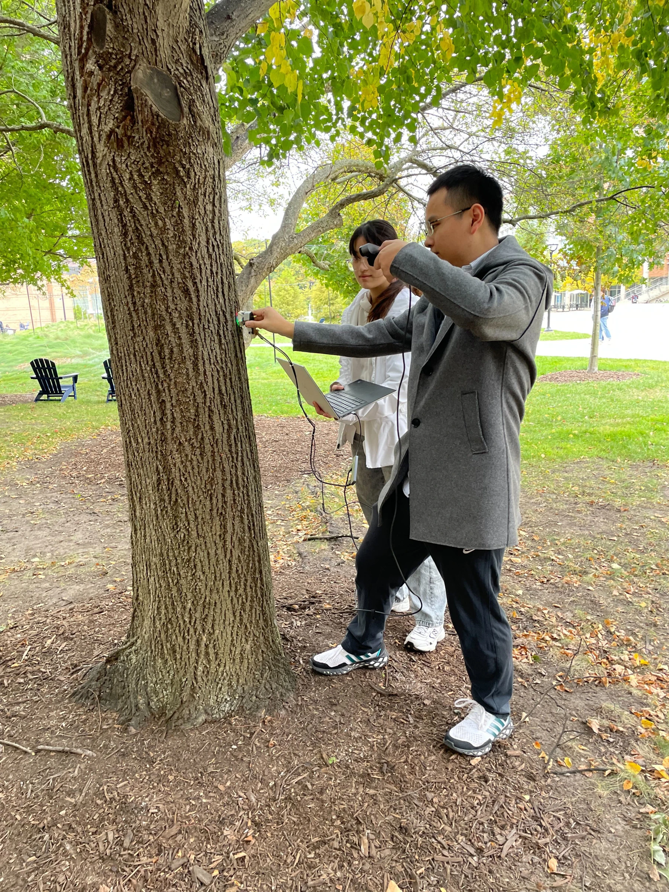</a>
<figcaption>Touch and Go官方项目展示的自然环境采集：人操持GelSight探头，记录局部触觉与第一视角视觉。它不是全手皮肤压力录制。<span class="figure-links"><a href="https://touch-and-go.github.io/" target="_blank" rel="noopener">来源：作者项目／论文</a><a href="https://touch-and-go.github.io/resources/images/human_collect2.jpg" target="_blank" rel="noopener">原图／视频／PDF</a></span></figcaption>
</figure>
</div>


<a id="E08"></a>

### E08 · VTDexManip（真实人类预训练数据）

**分类：**人类ego＋实测触觉　**参考年份：**2025　**证据：**A（已核实实际数据文件目录；计入主统计）

**数据／项目链接：**[项目](https://lqts.github.io/VTDexManip/)；[官方采集图](https://lqts.github.io/VTDexManip/resources/dataset.jpg)；[官方数据下载说明](https://github.com/LQTS/VTDexManipPretraining)；[论文](https://openreview.net/forum?id=jf7C7EGw21)

| 项目 | 核实信息 |
|---|---|
| 规模与发布口径 | 官方项目确认10种日常操作、182物体；机器人评测另有6项仿真任务。 |
| 传感器、模态与时序 | 人类第一视角操作视频与稀疏触觉接触信号；官方采集示意图明确展示头戴设备及ego样例。真实预训练录制与仿真RL基准须分开。 |
| 动作与状态 | 不应把仿真RL的动作字段当成人类原始录制所附的机器人控制标签。 |
| 对触觉世界模型的用途 | 人类到灵巧手的表征迁移、接触有无和多指接触模式。 |
| 数据许可 | 归档内有License.txt，本次未解包确认条款 |
| 限制、证据缺口与去重 | 本次样例来自非作者wuliwuling公开镜像；包结构、标签、帧索引及4×5触觉数组吻合官方说明和代码，未核验与官方OneDrive逐字节一致，也未发现官方镜像授权链接。实际文件已解码，A级表示读到真实文件，不表示作者授权或全库真实性已核验。原始采样率仍未知。 |

<section id="sample-E08" class="sample-card complete_trajectory"><h4>实际数据样例 <span class="sample-status">完整时序样例</span></h4>
<div class="sample-player"><video controls playsinline preload="none" poster="trajectories/E08/poster.webp" src="trajectories/E08/preview.mp4" aria-label="E08 实际数据可视化"></video></div>
<p class="sample-caption">VTDexManip 101000 / PickUp：原OneDrive当前网络不可达；从非作者wuliwuling公开镜像（结构及索引吻合官方说明，未核验与官方OneDrive逐字节一致）流式读取sub1.tar.gz首条完整253张PNG，并配对tactile/101000.json的253×4×5连续触觉。PNG idx=0–252与JSON逐项对应；显示原始传感器读数，未二值化也未换算牛顿。原文件没有时间戳，官方visualize.py设30fps只证明演示速度，故本页以15帧/秒展示，16.87秒不是实测采集时长。</p>
<div class="sample-meta"><div><b>样例／文件</b>101000 / PickUp</div><div><b>下载范围</b>完整录制/序列 · 253 帧 / 原始采样率未确认</div><div><b>原始样例时长</b>真实秒数未确认</div></div>
<p class="sample-caption"><strong>对齐方式：</strong>253个连续PNG idx=0..252对应253行JSON，官方visualize.py同样按排序索引配对</p>
<p class="sample-caption">本样例来自非作者公开镜像；结构及索引吻合官方代码，未核验与官方OneDrive逐字节一致，也未发现官方镜像授权链接。</p>
<p class="sample-links">
<a href="trajectories/E08/index.html" target="_blank" rel="noopener">单独打开样例</a>
<a href="https://huggingface.co/datasets/wuliwuling/VTDexmanip" target="_blank" rel="noopener">数据源</a>
<a href="https://huggingface.co/datasets/wuliwuling/VTDexmanip/resolve/main/sub1.tar.gz" target="_blank" rel="noopener">原始下载入口</a>
<a href="trajectory_records/E08.json">下载／校验记录</a></p>
<div class="sample-duration"><strong>数据集时长：</strong>总时长未核实<p><strong>覆盖范围：</strong>未核实真实总时长</p><p>公开镜像含10任务/182物体原结构；JSON/PNG仅帧序，未找到原始采样时钟。官方可视化使用30fps，不能据此把全库帧数换算为实测小时。</p></div>
<details class="sample-evidence"><summary>时长及下载证据</summary><ul><li><a href="https://github.com/LQTS/VTDexManipPretraining/blob/master/vitac_pretrain/visualize.py" target="_blank" rel="noopener">来源 1</a>：按PNG idx排序、touch_data[i]配对；VideoWriter(...30...)仅生成演示视频</li><li><a href="https://huggingface.co/datasets/wuliwuling/VTDexmanip" target="_blank" rel="noopener">来源 2</a>：sub1–5.tar.gz/tactile.tar.gz/info.tar.gz镜像</li><li><a href="https://huggingface.co/datasets/wuliwuling/VTDexmanip/resolve/main/sub1.tar.gz" target="_blank" rel="noopener">来源 3</a>：以流式tar读取首条完整101000，253PNG，共22,828,818bytes；未下载整15.95GB归档</li><li><a href="https://huggingface.co/datasets/wuliwuling/VTDexmanip/resolve/main/tactile.tar.gz" target="_blank" rel="noopener">来源 4</a>：完整37,422,433bytes归档含匹配101000.json</li><li><a href="https://lqts.github.io/VTDexManip/" target="_blank" rel="noopener">来源 5</a>：官方入口为OneDrive；本次使用非作者HF镜像，无官方交叉链接/校验和比对。sub1–5/tactile/info结构、101000标签、PNG idx与4×5数组符合官方代码。</li></ul></details>
<div class="duration-estimate" id="duration-E08"><h5>本轮统计值：5.23 小时 <span class="estimate-tag estimated">估算</span></h5><p>范围：2.62–15.70 小时 · 可信度：低 · 公开镜像／派生入口</p><p><strong>覆盖：</strong>VTDexManip非作者公开镜像中2032条连续触觉序列的假设帧率时长估计。</p><p><strong>计算：</strong>实际遍历整个tactile.tar.gz的2032个JSON，共565328帧。中心采用官方visualize.py演示帧率30作为计算假设：565328/30/3600=5.234519小时；假设10–60Hz给出2.617259–15.703556小时。</p><p>公开非作者镜像；已完整读取触觉归档并下载一条配对RGB，未认证与官方OneDrive逐字节一致。</p><details><summary>估算假设与来源</summary><ul><li>原始采集FPS及逐帧时钟未找到；30fps只来自官方导出视频参数，不能证明采集率。</li><li>10–60Hz是显式的宽规划敏感性范围，不是证据支持的真实采样率区间或统计置信区间；实际时长可能超出。</li><li>假定发布帧保持等间隔连续顺序，未大幅重采样或填充；若不成立，数字只表示该速率下的序列播放尺度。</li><li>镜像文件组织和官方加载代码一致，但未有作者镜像授权链接或原始OneDrive文件校验和对比。</li></ul><ul><li><a href="https://huggingface.co/datasets/wuliwuling/VTDexmanip/resolve/main/tactile.tar.gz" target="_blank" rel="noopener">来源 1</a>：完整37,422,433字节触觉归档，2032个JSON共565328帧</li><li><a href="https://github.com/LQTS/VTDexManipPretraining/blob/master/vitac_pretrain/visualize.py" target="_blank" rel="noopener">来源 2</a>：PNG按idx排序，与touch_data[i]配对；VideoWriter参数30仅为演示帧率</li></ul><p>核查明细：<a href="duration_estimates/evidence/E08_frame_counts.json">[1]</a> </p></details><p><a href="duration_estimates/E08.json">下载该条计算记录</a></p></div></section>

<div class="dataset-figures">
<figure class="dataset-figure wide" id="fig-e08-01">
<div class="figure-type"><strong>E08 · 图1</strong><span>采集与样例</span><small>点击图片放大</small></div>
<a class="figure-open" href="figures/e08-01.webp" target="_blank" rel="noopener" aria-label="放大：VTDexManip官方数据介绍图：头戴采集、触觉手套、10种操作样例与数据统计。图中的真实人类数据与另行发布的仿真机器人评测需分开。">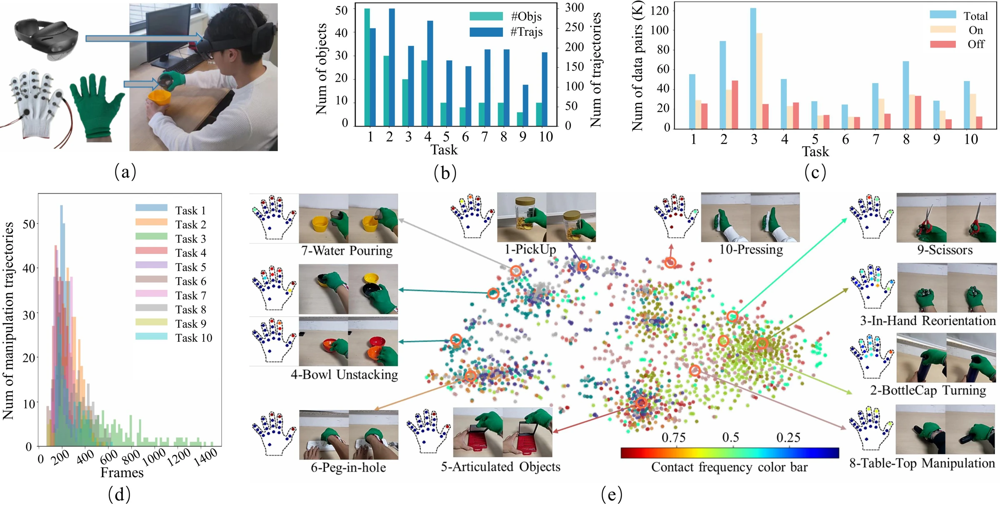</a>
<figcaption>VTDexManip官方数据介绍图：头戴采集、触觉手套、10种操作样例与数据统计。图中的真实人类数据与另行发布的仿真机器人评测需分开。<span class="figure-links"><a href="https://lqts.github.io/VTDexManip/" target="_blank" rel="noopener">来源：作者项目／论文</a><a href="https://lqts.github.io/VTDexManip/resources/dataset.jpg" target="_blank" rel="noopener">原图／视频／PDF</a></span></figcaption>
</figure>
</div>


<a id="E09"></a>

### E09 · HumanTouch（Xspark-HumanTouch；Spark-0人类触觉预训练数据）

**分类：**人类ego＋实测触觉　**参考年份：**2026　**证据：**A（已核实实际数据文件目录；计入主统计）

**数据／项目链接：**[官方数据（HF）](https://huggingface.co/datasets/chuqiaoLyu/Xspark-HumanTouch)；[国内数据／许可](https://www.modelscope.cn/datasets/chuqiaoLyu/Xspark-HumanTouch)；[HumanTouch官方发布说明](https://xsparkai.com/sparklab/humantouch/)；[Spark-0项目](https://xsparkai.com/Spark-0/)；[Spark-0论文](https://arxiv.org/abs/2610.22342)；[公开字段定义](https://huggingface.co/datasets/chuqiaoLyu/Xspark-HumanTouch/blob/main/X001/meta/info.json)

| 项目 | 核实信息 |
|---|---|
| 规模与发布口径 | 2026-10-19补核：官方首版约100小时、10个规范任务（X001–X010）；Spark-0论文使用1,000小时、100多种任务、32名操作者的HumanTouch，尚未确认该全量已公开。公开HF仓库非私有、非门控，已有Parquet、MP4及meta文件。 |
| 传感器、模态与时序 | 60Hz统一时间线；头戴第一视角RGB＋左右腕RGB；双手柔性压阻触觉、MANUS每手25关节位置／朝向、头部及双腕位姿与有效性掩码。公开文件每手460维原始触觉，另有12维区域压力。早期数据卡称360个有效点／手，Spark-0论文屏蔽140个弯曲伪影点后使用320点／手，三种口径不能混用。LeRobot v2.1风格：数值Parquet＋多视角MP4。 |
| 动作与状态 | 公开样例包含人体观测位姿、手骨架、时间戳和任务／子任务索引；所抽查原始Parquet未见机器人控制action列。论文中的机器人手重定向动作是后续处理结果，不能当作原始数据已附控制命令。 |
| 对触觉世界模型的用途 | 优先用于人手运动条件的未来触觉预测、ego视频—姿态—接触联合建模、接触位置监督和人到机器人表征迁移。适合全手数值触觉路线；训练前核对有效通道、时钟、标定与非商业许可。 |
| 数据许可 | CC BY-NC 4.0（以ModelScope发布页标注为准） |
| 限制、证据缺口与去重 | 已实际读取X001/data/chunk-000/episode_000001.parquet（6,361,520字节、1,597帧），确认左右手各460维原始触觉与12维区域压力。目录／meta统计存在差异，未审计全量有效同步时长；不能把官网扩展计划或论文1,000小时当成已发布量，也不能把原始响应／patch压力自动视为牛顿真值。HumanTouch只计一家族；Spark-0是模型，SparkArena是评测套件，不另外增加本数据集计数。 |

<section id="sample-E09" class="sample-card complete_trajectory"><h4>实际数据样例 <span class="sample-status">完整时序样例</span></h4>
<div class="sample-player"><video controls playsinline preload="none" poster="trajectories/E09/poster.webp" src="trajectories/E09/preview.mp4" aria-label="E09 实际数据可视化"></video></div>
<p class="sample-caption">HumanTouch X001/episode_000001：已下载完整1597帧、26.617秒的头戴RGB与双手触觉，60Hz按episode帧号对齐。预览降采样为10fps；每手460维原始响应按23×20存储顺序展平显示，不是手掌空间形状，也不把所有原始通道视为有效触点或牛顿值。</p>
<div class="sample-meta"><div><b>样例／文件</b>X001/episode_000001</div><div><b>下载范围</b>完整录制/序列 · 1597 帧 / 60.000 Hz</div><div><b>原始样例时长</b>26.617 秒</div></div>
<p class="sample-caption"><strong>对齐方式：</strong>同一episode，视频帧号和Parquet frame_index完全对应。</p>
<p class="sample-links">
<a href="trajectories/E09/index.html" target="_blank" rel="noopener">单独打开样例</a>
<a href="https://huggingface.co/datasets/chuqiaoLyu/Xspark-HumanTouch" target="_blank" rel="noopener">数据源</a>
<a href="https://huggingface.co/datasets/chuqiaoLyu/Xspark-HumanTouch/resolve/main/X001/videos/chunk-000/observation.images.cam_head/episode_000001.mp4" target="_blank" rel="noopener">原始下载入口</a>
<a href="trajectory_records/E09.json">下载／校验记录</a></p>
<div class="sample-duration"><strong>数据集时长：</strong>官方发布／公开范围 100.000 h；元数据推算 132.754 h；论文范围 1,000.000 h<p><strong>覆盖范围：</strong>首版官方约100小时；meta推算132.754小时；论文1000小时</p><p>十个任务meta.total_frames/60总和为132.754小时，但文件数量与meta episodes不一致，未审计全量同步有效时长，因此发布规模沿用官方约100小时。</p></div>
<details class="sample-evidence"><summary>时长及下载证据</summary><ul><li><a href="https://xsparkai.com/sparklab/humantouch/" target="_blank" rel="noopener">来源 1</a>：initial release ~100 hours / 10 canonical tasks</li><li><a href="https://huggingface.co/datasets/chuqiaoLyu/Xspark-HumanTouch/blob/main/X001/meta/info.json" target="_blank" rel="noopener">来源 2</a>：各X001–X010 meta.total_frames / 60，总计132.753972小时</li></ul></details>
<div class="duration-estimate" id="duration-E09"><h5>本轮统计值：100.00 小时 <span class="estimate-tag reported">作者报告</span></h5><p>范围：100.00 小时 · 可信度：高 · 已验证文件入口</p><p><strong>覆盖：</strong>HumanTouch官方首版约100小时、10任务的公开release规模。</p><p><strong>计算：</strong>保守沿用作者明确公布的initial release ~100 hours；不把论文1000小时、未来发布量或尚未全量核验的132.754小时meta推算代替公开主值。</p><p>官方HF公开可读，已下载完整1597帧样本；全库尚未逐文件审计。</p><details><summary>估算假设与来源</summary><ul><li>100小时为作者的近似发布规模，low=high=100仅表示没有虚构误差范围，不表示实测到小时或完整同步有效100小时。</li><li>各X001–X010 meta.total_frames/60合计132.753972h，但episode文件数量与meta不一致，作为替代元数据口径单列。</li></ul><ul><li><a href="https://xsparkai.com/sparklab/humantouch/" target="_blank" rel="noopener">来源 1</a>：initial release ~100 hours / 10 canonical tasks</li><li><a href="https://huggingface.co/datasets/chuqiaoLyu/Xspark-HumanTouch/blob/main/X001/meta/info.json" target="_blank" rel="noopener">来源 2</a>：各X001–X010 meta.total_frames / 60，总计132.753972小时</li></ul></details><p><a href="duration_estimates/E09.json">下载该条计算记录</a></p></div></section>

<div class="dataset-figures">
<figure class="dataset-figure wide" id="fig-e09-acquisition">
<div class="figure-type"><strong>E09 · 图1</strong><span>官方采集装置与多模态样例</span><small>点击图片放大</small></div>
<a class="figure-open" href="figures/e09-acquisition.webp" target="_blank" rel="noopener" aria-label="放大：HumanTouch官方介绍图5：头戴与双腕相机、手部跟踪、外层动捕手套和内层触觉手套，以及相机视角、手骨架和触觉可视化。图中输出属于作者展示，不能据此认定所有公开字段均已转换为物理力；本报告按发布子集计数。">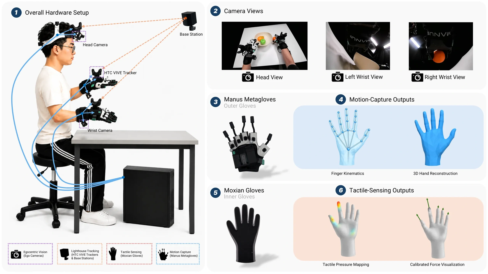</a>
<figcaption>HumanTouch官方介绍图5：头戴与双腕相机、手部跟踪、外层动捕手套和内层触觉手套，以及相机视角、手骨架和触觉可视化。图中输出属于作者展示，不能据此认定所有公开字段均已转换为物理力；本报告按发布子集计数。<span class="figure-links"><a href="https://xsparkai.com/sparklab/humantouch/" target="_blank" rel="noopener">来源：作者项目／论文</a><a href="https://xsparkai.com/sparklab/humantouch/_astro/figure-5.D1HbAxGj_3i2Hg.webp" target="_blank" rel="noopener">原图／视频／PDF</a></span></figcaption>
</figure>
<figure class="dataset-figure wide" id="fig-e09-sample">
<div class="figure-type"><strong>E09 · 图2</strong><span>本报告据实测数据绘制</span><small>点击图片放大</small></div>
<a class="figure-open" href="figures/e09-sample.webp" target="_blank" rel="noopener" aria-label="放大：本报告实际读取公开X001/episode_000001.parquet的1,597帧，绘制左右手各460个原始触觉通道随时间的变化。横轴采用文件timestamp，纵轴仅为原始通道序号，不是手掌几何位置；左右图独立色标，保留文件数值，未转换为牛顿或帕斯卡，也未套用论文的320点筛选。">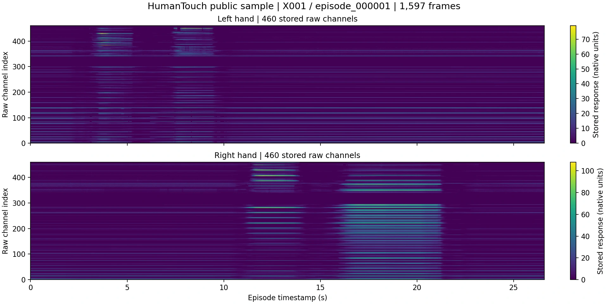</a>
<figcaption>本报告实际读取公开X001/episode_000001.parquet的1,597帧，绘制左右手各460个原始触觉通道随时间的变化。横轴采用文件timestamp，纵轴仅为原始通道序号，不是手掌几何位置；左右图独立色标，保留文件数值，未转换为牛顿或帕斯卡，也未套用论文的320点筛选。<span class="figure-links"><a href="https://huggingface.co/datasets/chuqiaoLyu/Xspark-HumanTouch" target="_blank" rel="noopener">来源：公开数据文件</a><a href="https://huggingface.co/datasets/chuqiaoLyu/Xspark-HumanTouch/resolve/main/X001/data/chunk-000/episode_000001.parquet" target="_blank" rel="noopener">查看原始数据</a></span></figcaption>
</figure>
</div>

**与Spark-0论文的关系：**HumanTouch是论文新建的人类触觉采集来源。表5的预训练混合还包括EgoDex 662小时、同款手套机器人采集20小时、去除触觉的机器人采集24小时、仿真25小时、Fourier ActionNet 153小时、AgiBot World 60小时；连同HumanTouch 1,000小时共1,944小时。HumanTouch采样权重35%，不等于占35%的原始时长。论文用量不代表本仓库公开量。

**公开规模的证据边界：**官方README仍称首版约100小时。10个任务的`meta/info.json`累计17,608个episode，按帧数／60Hz换算约132.75小时；当前目录则有17,576个Parquet、52,826个MP4，X005和X008的episode数与meta不完全一致。因此，132.75小时仅是元数据推算，不能视为已验证的完整有效同步时长，也不能据此改称1,000小时全量开放。保留官方“首版约100小时”的发布口径，逐任务核验记录见[HumanTouch审计附件](humantouch_audit.json)。


## 5. 机器人真机触觉（24个）


<a id="R01"></a>

### R01 · VisGel

**分类：**机器人真机触觉　**参考年份：**2019　**证据：**A（已核实实际数据文件目录；计入主统计）

**数据／项目链接：**[作者仓库/下载脚本](https://github.com/YunzhuLi/VisGel)；[项目](https://visgel.csail.mit.edu/)

| 项目 | 核实信息 |
|---|---|
| 规模与发布口径 | 官方代码提供data_seen约328GB、data_unseen约83.2GB、数据列表及演示集。 |
| 传感器、模态与时序 | 机器人GelSight接触视频与外部视觉视频，包含接触前后变化。 |
| 动作与状态 | 官方主要任务是视觉↔触觉预测；本次未确认发布中可用的控制action字段。 |
| 对触觉世界模型的用途 | 触觉生成、视觉—触觉时序对齐与表征预训练。 |
| 数据许可 | 本次未确认数据专用许可 |
| 限制、证据缺口与去重 | 项目主页本次403，但作者仓库的下载说明可读；FoTa的VisGel-small是抽样/去平坦图版，不能与原库重复计数或拿其帧数代表原库。 |

<section id="sample-R01" class="sample-card static_sample"><h4>实际数据样例 <span class="sample-status">静态样本</span></h4>
<div class="sample-player">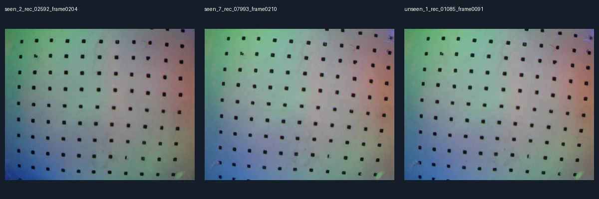</div>
<p class="sample-caption">实际从FoTa公开转换包提取3张VisGel真实触觉样本及同名JSON。这3张是不同记录的静态样本，不构成一条连续轨迹；转换包未包含匹配场景RGB，未补造视觉。</p>
<div class="sample-meta"><div><b>样例／文件</b>FoundationTactile/visgel/val/data-000317.tar / first3 decoded samples</div><div><b>下载范围</b>部分记录或静态样本 · 3 帧 / 原始采样率未确认</div><div><b>原始样例时长</b>真实秒数未确认</div></div>
<p class="sample-caption"><strong>对齐方式：</strong>3 independent static samples; no matched RGB</p>
<p class="sample-caption">ZIP成员前4MiB解压前缀取完整JPEG/JSON，不是完整tar。</p>
<p class="sample-caption"><strong>当前缺口：</strong>作者脚本所指演示数据ZIP实际返回HTTP403；未取得原始配对序列。原始seen/unseen全库约411GB，未用论文demo代替样本。；FoTa派生WDS仅提供静态触觉及标签，本次仍未获得原始完整RGB+触觉轨迹。</p>
<p class="sample-caption">同源复用：A01/FoTa转换包中的visgel上游来源；只计原始采集来源一次；不作为新增独立来源计数。</p>
<p class="sample-links">
<a href="trajectories/R01/index.html" target="_blank" rel="noopener">单独打开样例</a>
<a href="https://huggingface.co/datasets/alanz-mit/FoundationTactile" target="_blank" rel="noopener">数据源</a>
<a href="https://hf-mirror.com/datasets/alanz-mit/FoundationTactile/resolve/main/dataset/FoTa_dataset.z19" target="_blank" rel="noopener">原始下载入口</a>
<a href="trajectory_records/R01.json">下载／校验记录</a></p>
<div class="sample-duration"><strong>数据集时长：</strong>总时长未核实<p><strong>覆盖范围：</strong>完整发布数据</p><p>原论文Table1：12000次触碰、每次250帧，共300万视觉—触觉配对帧；论文未给可核对的记录FPS，故不能据此可靠换算小时数。FoTa抽样图不保留完整时间轴。</p></div>
<details class="sample-evidence"><summary>时长及下载证据</summary><ul><li><a href="https://openaccess.thecvf.com/content_CVPR_2019/papers/Li_Connecting_Touch_and_Vision_via_Cross-Modal_Prediction_CVPR_2019_paper.pdf" target="_blank" rel="noopener">来源 1</a>：12,000 touches on195objects; each touch250frames; Table1 total3,000,000pairedframes; no captureFPS identified</li><li><a href="https://visgel.csail.mit.edu/files/vision2touch/demo.zip" target="_blank" rel="noopener">来源 2</a>：作者脚本所指演示数据ZIP实际返回HTTP403；未取得原始配对序列。原始seen/unseen全库约411GB，未用论文demo代替样本。</li><li><a href="https://hf-mirror.com/datasets/alanz-mit/FoundationTactile/resolve/main/dataset/FoTa_dataset.z19" target="_blank" rel="noopener">来源 3</a>：FoundationTactile/visgel/val/data-000317.tar;3 JPEG/JSON successfully decoded</li></ul></details>
<div class="duration-estimate" id="duration-R01"><h5>本轮统计值：29.36 小时 <span class="estimate-tag estimated">估算</span></h5><p>范围：14.68–58.72 小时 · 可信度：低 · 公开镜像／派生入口</p><p><strong>覆盖：</strong>可访问FoTa镜像中的VisGel完整版触觉序列范围；未恢复原同步场景RGB，不能把完整及下采样版本重复计入。</p><p><strong>计算：</strong>FoTa预处理清单报告原始3,170,795帧；假定原始30fps，小时数=N/(fps×3600)，15–60fps作为敏感性范围。</p><p>原始下载主机本次403；公开FoTa镜像ZIP含visgel完整版318个tar及visgel_downsampled 74个tar。完整分片保留序列ID与原帧号，可重组触觉顺序；没有核实物理帧率或每段无缺帧。</p><details><summary>估算假设与来源</summary><ul><li>未找到原始保存帧率，30fps是估算参数，不是已核实的采样率。</li><li>FoTa接触筛选后726,740张图不是连续全视频，不能用它代表原始录制时长。</li><li>同一帧的视觉和触觉只计一次。</li><li>镜像成员名如seen_2_rec_02592_frame0204.jpg；作者预处理保留原录制目录及frame编号，完整与下采样版本同源，按完整版计一次。</li></ul><ul><li><a href="https://github.com/alanzjl/t3/blob/main/dataset_preproc/README.md" target="_blank" rel="noopener">来源 1</a>：3,170,795 original tactile images; downsampled to726,740。</li><li><a href="https://github.com/YunzhuLi/VisGel" target="_blank" rel="noopener">来源 2</a>：原始seen/unseen数据下载脚本；论文约12,000次触碰、3M帧。</li><li><a href="https://github.com/alanzjl/t3/blob/main/dataset_preproc/preprocess_visgel_images.py" target="_blank" rel="noopener">来源 3</a>：预处理保留seen/unseen、rec目录及frame原编号；当前镜像ZIP目录已核对318个完整版分片。</li></ul></details><p><a href="duration_estimates/R01.json">下载该条计算记录</a></p></div></section>

<div class="dataset-figures">
<figure class="dataset-figure wide" id="fig-r01-01">
<div class="figure-type"><strong>R01 · 图1</strong><span>官方示例（含预测）</span><small>点击图片放大</small></div>
<a class="figure-open" href="figures/r01-01.webp" target="_blank" rel="noopener" aria-label="放大：VisGel官方视觉到触觉演示截帧：原图包含真实输入／目标与模型生成结果，须按图内标签区分；预测列不作为真实触觉数据。">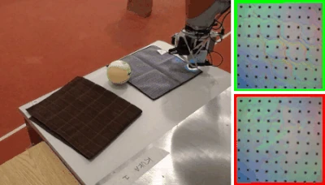</a>
<figcaption>VisGel官方视觉到触觉演示截帧：原图包含真实输入／目标与模型生成结果，须按图内标签区分；预测列不作为真实触觉数据。<span class="figure-links"><a href="https://github.com/YunzhuLi/VisGel/blob/master/README.md" target="_blank" rel="noopener">来源：作者项目／论文</a><a href="https://github.com/YunzhuLi/VisGel/blob/master/imgs/vision2touch_0.gif" target="_blank" rel="noopener">原图／视频／PDF</a></span></figcaption>
</figure>
</div>


<a id="R02"></a>

### R02 · Calandra抓取数据 / The Feeling of Success

**分类：**机器人真机触觉　**参考年份：**2017　**证据：**A（已核实实际数据文件目录；计入主统计）

**数据／项目链接：**[原项目](https://sites.google.com/view/the-feeling-of-success/)；[可用汇编入口](https://huggingface.co/datasets/alanz-mit/FoundationTactile)；[Sparsh下载说明](https://github.com/facebookresearch/sparsh)

| 项目 | 核实信息 |
|---|---|
| 规模与发布口径 | 多物体抓取试验；不同论文/预处理版的trial与双指image计数不同，本文不合并成一个未经核对的总数。 |
| 传感器、模态与时序 | 机器人夹爪双GelSight图像、视觉、抓取成功/失败标签。 |
| 动作与状态 | 主要监督是抓取结果；不能默认每例具有长时程完整动作。 |
| 对触觉世界模型的用途 | 抓取稳定性、接触状态、触觉编码器及成功预测。 |
| 数据许可 | 原始数据许可本次未确认 |
| 限制、证据缺口与去重 | Calandra17、后续抓取版本及FoTa/Sparsh重打包按一个来源家族计，避免版本膨胀。FoTa源码表确认收录该来源。 |

<section id="sample-R02" class="sample-card static_sample"><h4>实际数据样例 <span class="sample-status">静态样本</span></h4>
<div class="sample-player">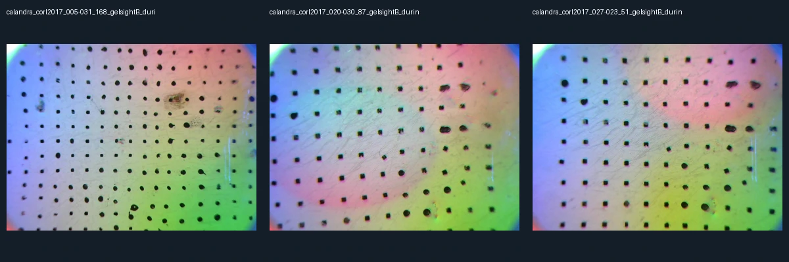</div>
<p class="sample-caption">实际从FoTa公开转换包提取3张Calandra / Feeling of Success真实触觉样本及同名JSON。这3张是不同记录的静态样本，不构成一条连续轨迹；转换包未包含匹配场景RGB，未补造视觉。</p>
<div class="sample-meta"><div><b>样例／文件</b>FoundationTactile/calandra17/val/data-000000.tar / first3 decoded samples</div><div><b>下载范围</b>部分记录或静态样本 · 3 帧 / 原始采样率未确认</div><div><b>原始样例时长</b>真实秒数未确认</div></div>
<p class="sample-caption"><strong>对齐方式：</strong>3 independent static samples; no matched RGB</p>
<p class="sample-caption">ZIP成员前4MiB解压前缀取完整JPEG/JSON，不是完整tar。</p>
<p class="sample-caption"><strong>当前缺口：</strong>Sparsh官方脚本第一个原数据Drive文件在本环境连接超时；原项目Google Sites亦不可达。尚未下载可核验的完整抓取试验。；FoTa派生WDS仅提供静态触觉及标签，本次仍未获得原始完整RGB+触觉轨迹。</p>
<p class="sample-caption">同源复用：A01/FoTa转换包中的calandra17上游来源；只计原始采集来源一次；不作为新增独立来源计数。</p>
<p class="sample-links">
<a href="trajectories/R02/index.html" target="_blank" rel="noopener">单独打开样例</a>
<a href="https://huggingface.co/datasets/alanz-mit/FoundationTactile" target="_blank" rel="noopener">数据源</a>
<a href="https://hf-mirror.com/datasets/alanz-mit/FoundationTactile/resolve/main/dataset/FoTa_dataset.z01" target="_blank" rel="noopener">原始下载入口</a>
<a href="trajectory_records/R02.json">下载／校验记录</a></p>
<div class="sample-duration"><strong>数据集时长：</strong>总时长未核实<p><strong>覆盖范围：</strong>完整发布数据</p><p>未找到可可靠汇总的总时长；不以样本数或文件体积推算。</p></div>
<details class="sample-evidence"><summary>时长及下载证据</summary><ul><li><a href="https://drive.usercontent.google.com/download?id=1dHA-9QwZCMu5JCuCDZ6ooB1lNG-k6-tM&amp;export=download" target="_blank" rel="noopener">来源 1</a>：Sparsh官方脚本第一个原数据Drive文件在本环境连接超时；原项目Google Sites亦不可达。尚未下载可核验的完整抓取试验。</li><li><a href="https://hf-mirror.com/datasets/alanz-mit/FoundationTactile/resolve/main/dataset/FoTa_dataset.z01" target="_blank" rel="noopener">来源 2</a>：FoundationTactile/calandra17/val/data-000000.tar;3 JPEG/JSON successfully decoded</li></ul></details>
<div class="duration-estimate" id="duration-R02"><h5>本轮统计值：0.223 等效小时 <span class="estimate-tag static_equivalent">静态帧等效</span></h5><p>范围：0.112–0.670 等效小时 · 可信度：中 · 公开镜像／派生入口</p><p><strong>覆盖：</strong>FoTa公开Calandra17静态触觉图像子集24,118张。</p><p><strong>计算：</strong>仅作训练帧量等价：24,118/(30×3600)；10–60fps给出等价范围。</p><p class="estimate-warning">静态图没有连续时间轴，此数是帧预算等效值；连续录制总量贡献为 0。</p><p>已实际下载FoTa静态镜像；原始Drive未在本次环境取得。</p><details><summary>估算假设与来源</summary><ul><li>这些是阶段快照/双指图像，未把不同手指图像当作增加的物理采集时间。</li><li>本条数字是传感器图像帧量等价，不是实际录制小时数。</li><li>原论文9,269次×约60秒=154.483h是机器人执行时间，不能替代公开静态数据时长。</li></ul><ul><li><a href="https://github.com/alanzjl/t3/blob/main/dataset_preproc/README.md" target="_blank" rel="noopener">来源 1</a>：Calandra corl17镜像24,118 images。</li><li><a href="https://sites.google.com/view/the-feeling-of-success/" target="_blank" rel="noopener">来源 2</a>：论文：9,269 grasps,106 objects；每trial约60s，模型使用3个阶段快照。</li></ul></details><p><a href="duration_estimates/R02.json">下载该条计算记录</a></p></div></section>

<div class="dataset-figures">
<figure class="dataset-figure" id="fig-r02-01">
<div class="figure-type"><strong>R02 · 图1</strong><span>采集装置</span><small>点击图片放大</small></div>
<a class="figure-open" href="figures/r02-01.webp" target="_blank" rel="noopener" aria-label="放大：The Feeling of Success论文图1：Sawyer机械臂与双GelSight平行夹爪。">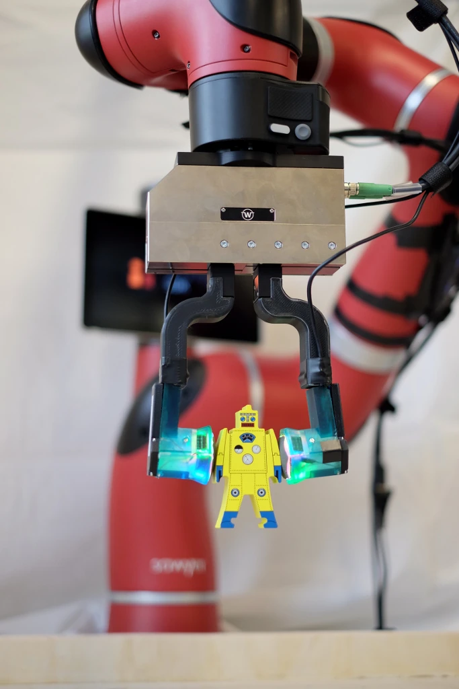</a>
<figcaption>The Feeling of Success论文图1：Sawyer机械臂与双GelSight平行夹爪。<span class="figure-links"><a href="https://arxiv.org/html/1710.05512v2" target="_blank" rel="noopener">来源：作者项目／论文</a><a href="https://arxiv.org/html/1710.05512v2/fig/sawyer_gelsight.jpg" target="_blank" rel="noopener">原图／视频／PDF</a></span></figcaption>
</figure>
<figure class="dataset-figure wide" id="fig-r02-pdf-fig2">
<div class="figure-type"><strong>R02 · 图2</strong><span>论文真实触觉样例</span><small>点击图片放大</small></div>
<a class="figure-open" href="figures/r02-pdf-fig2.webp" target="_blank" rel="noopener" aria-label="放大：The Feeling of Success论文图2（PDF第2页裁图）：不同物体在GelSight上产生的原始接触图像。只裁去页边和无关正文，图像内容未改写。">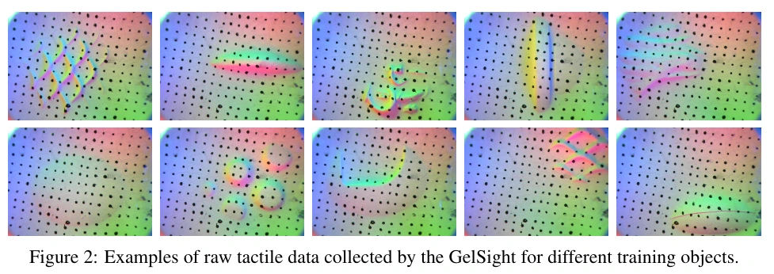</a>
<figcaption>The Feeling of Success论文图2（PDF第2页裁图）：不同物体在GelSight上产生的原始接触图像。只裁去页边和无关正文，图像内容未改写。<span class="figure-links"><a href="https://arxiv.org/abs/1710.05512" target="_blank" rel="noopener">来源：作者项目／论文</a><a href="https://arxiv.org/pdf/1710.05512" target="_blank" rel="noopener">原图／视频／PDF</a></span></figcaption>
</figure>
</div>


<a id="R03"></a>

### R03 · ObjectFolder-Real

**分类：**机器人真机触觉　**参考年份：**2023　**证据：**A（已核实实际数据文件目录；计入主统计）

**数据／项目链接：**[官方数据与结构](https://objectfolder.stanford.edu/objectfolder-real-download)

| 项目 | 核实信息 |
|---|---|
| 规模与发布口径 | 100个真实家居物体；每物体约30–50个接触位置；多分辨率mesh、视觉、声音和触觉。 |
| 传感器、模态与时序 | GelSight系光学触觉视频、手上相机和第三视角接触视频；另有敲击声及敲击接触力。 |
| 动作与状态 | 接触位置/物体几何提供条件；非通用机器人操作action轨迹。 |
| 对触觉世界模型的用途 | 几何—材质—触觉对齐、局部形变过程和多模态预训练。 |
| 数据许可 | 本次未确认数据专用许可 |
| 限制、证据缺口与去重 | 与ObjectFolder 1.0/2.0的合成数据区别；声学敲击实验的力曲线不能自动当成触觉按压实验的力真值。官方明确触觉读数是视频，不能误写成只有静态图。 |

<section id="sample-R03" class="sample-card static_sample"><h4>实际数据样例 <span class="sample-status">静态样本</span></h4>
<div class="sample-player">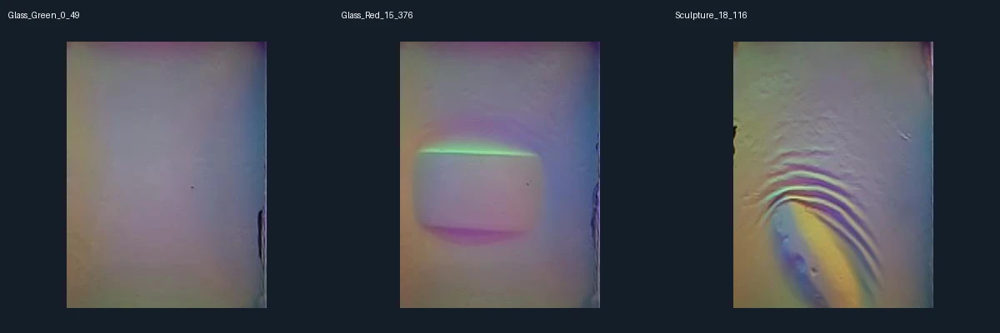</div>
<p class="sample-caption">实际从FoTa公开转换包提取3张ObjectFolder-Real真实触觉样本及同名JSON。这3张是不同记录的静态样本，不构成一条连续轨迹；转换包未包含匹配场景RGB，未补造视觉。</p>
<div class="sample-meta"><div><b>样例／文件</b>FoundationTactile/objectfolder_real/val/data-000028.tar / first3 decoded samples</div><div><b>下载范围</b>部分记录或静态样本 · 3 帧 / 原始采样率未确认</div><div><b>原始样例时长</b>真实秒数未确认</div></div>
<p class="sample-caption"><strong>对齐方式：</strong>3 independent static samples; no matched RGB</p>
<p class="sample-caption">ZIP成员前4MiB解压前缀取完整JPEG/JSON，不是完整tar。</p>
<p class="sample-caption"><strong>当前缺口：</strong>原始Stanford gzip流只取得首接触cam_0的部分RGB，未下载到匹配触觉；不将不同来源图像强行配对。；FoTa派生WDS仅提供静态触觉及标签，本次仍未获得原始完整RGB+触觉轨迹。</p>
<p class="sample-caption">同源复用：A01/FoTa转换包中的objectfolder_real上游来源；只计原始采集来源一次；不作为新增独立来源计数。</p>
<p class="sample-links">
<a href="trajectories/R03/index.html" target="_blank" rel="noopener">单独打开样例</a>
<a href="https://huggingface.co/datasets/alanz-mit/FoundationTactile" target="_blank" rel="noopener">数据源</a>
<a href="https://hf-mirror.com/datasets/alanz-mit/FoundationTactile/resolve/main/dataset/FoTa_dataset.z01" target="_blank" rel="noopener">原始下载入口</a>
<a href="trajectory_records/R03.json">下载／校验记录</a></p>
<div class="sample-duration"><strong>数据集时长：</strong>总时长未核实<p><strong>覆盖范围：</strong>完整发布数据</p><p>未找到可可靠汇总的总时长；不以样本数或文件体积推算。</p></div>
<details class="sample-evidence"><summary>时长及下载证据</summary><ul><li><a href="https://hf-mirror.com/datasets/alanz-mit/FoundationTactile/resolve/main/dataset/FoTa_dataset.z01" target="_blank" rel="noopener">来源 1</a>：FoundationTactile/objectfolder_real/val/data-000028.tar;3 JPEG/JSON successfully decoded</li></ul></details>
<div class="duration-estimate" id="duration-R03"><h5>本轮统计值：13.13 小时 <span class="estimate-tag estimated">估算</span></h5><p>范围：6.56–26.25 小时 · 可信度：低 · 已验证文件入口</p><p><strong>覆盖：</strong>ObjectFolder-Real真实触觉视频的单路GelSight时间轴（FoTa预处理0/gelsight范围）。</p><p><strong>计算：</strong>公开FoTa清单1,417,600触觉帧÷假定30fps；15–60fps给出范围。</p><p>原始下载入口与FoTa镜像均公开；已取得镜像触觉图及原始部分视觉帧。</p><details><summary>估算假设与来源</summary><ul><li>原始帧率未核实，30fps只作规划假设。</li><li>预处理源码固定每trial的0/gelsight，未把多个视觉相机叠加为时间。</li><li>不可使用声音片段6s代替触觉轨迹时长。</li></ul><ul><li><a href="https://github.com/alanzjl/t3/blob/main/dataset_preproc/README.md" target="_blank" rel="noopener">来源 1</a>：ObjectFolder-Real1,417,600 images。</li><li><a href="https://github.com/alanzjl/t3/blob/main/dataset_preproc/preprocess_objectfolder_real_images.py" target="_blank" rel="noopener">来源 2</a>：逐物体trial读取0/gelsight/*.png。</li><li><a href="https://objectfolder.stanford.edu/objectfolder-real-download" target="_blank" rel="noopener">来源 3</a>：100个真实物体，每物体约30–50次接触；原始触觉序列公开。</li></ul></details><p><a href="duration_estimates/R03.json">下载该条计算记录</a></p></div></section>

<div class="dataset-figures">
<figure class="dataset-figure wide" id="fig-r03-01">
<div class="figure-type"><strong>R03 · 图1</strong><span>数据概览</span><small>点击图片放大</small></div>
<a class="figure-open" href="figures/r03-01.webp" target="_blank" rel="noopener" aria-label="放大：ObjectFolder官方ObjectFolder-Real物体集合图。该库另有视觉、声音和真实触觉视频；这里展示采集对象，不是三种模态的同步样例。">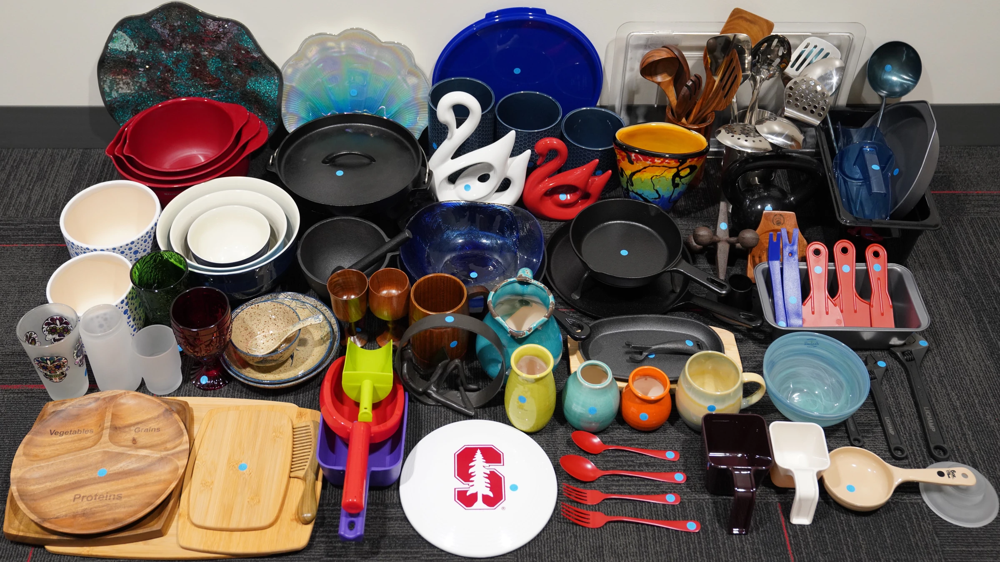</a>
<figcaption>ObjectFolder官方ObjectFolder-Real物体集合图。该库另有视觉、声音和真实触觉视频；这里展示采集对象，不是三种模态的同步样例。<span class="figure-links"><a href="https://objectfolder.stanford.edu/" target="_blank" rel="noopener">来源：作者项目／论文</a><a href="https://objectfolder.stanford.edu/assets/img/objectfolder/ObjectFolder-Real.jpg" target="_blank" rel="noopener">原图／视频／PDF</a></span></figcaption>
</figure>
</div>


<a id="R04"></a>

### R04 · Eagle Shoal / Visual-Tactile Dataset

**分类：**机器人真机触觉　**参考年份：**2019　**证据：**A（已核实实际数据文件目录；计入主统计）

**数据／项目链接：**[数据仓库/许可](https://github.com/tsinghua-rll/Visual-Tactile_Dataset)；[论文](https://doi.org/10.1177/1729881418821571)

| 项目 | 核实信息 |
|---|---|
| 规模与发布口径 | Intel Eagle Shoal机器人手采集的多模态抓取数据；本次未重新统计总样本数。 |
| 传感器、模态与时序 | 视觉、非光学触觉读数及抓取相关数据；官方仓库说明数据文件格式。 |
| 动作与状态 | 机器人抓取上下文；是否具备目标控制命令应以文件字段为准。 |
| 对触觉世界模型的用途 | 数值式触觉与视觉融合、抓取识别。 |
| 数据许可 | CDLA-Permissive 1.0 |
| 限制、证据缺口与去重 | 不是GelSight图像库，不能直接套用只处理光学图像的加载器。 |

<section id="sample-R04" class="sample-card complete_trajectory"><h4>实际数据样例 <span class="sample-status">完整时序样例</span></h4>
<div class="sample-player"><video controls playsinline preload="none" poster="trajectories/R04/poster.webp" src="trajectories/R04/preview.mp4" aria-label="R04 实际数据可视化"></video></div>
<p class="sample-caption">完整下载Cheez/100_432/right/0试验的front_rgb.mp4、tactile.txt、pos.txt及label.txt。左视频349帧、18fps；右为完整400×16原始触觉矩阵的静态热图。两流无共同时间戳且帧数不同，故不移动触觉游标、不声称逐帧同步。</p>
<div class="sample-meta"><div><b>样例／文件</b>dataset/Cheez/100_432/right/0</div><div><b>下载范围</b>完整录制/序列 · 400 帧 / 原始采样率未确认</div><div><b>原始样例时长</b>19.389 秒</div></div>
<p class="sample-caption"><strong>对齐方式：</strong>same trial; no shared timestamps; no invented temporal alignment</p>
<p class="sample-links">
<a href="trajectories/R04/index.html" target="_blank" rel="noopener">单独打开样例</a>
<a href="https://github.com/tsinghua-rll/Visual-Tactile_Dataset" target="_blank" rel="noopener">数据源</a>
<a href="trajectory_records/R04.json">下载／校验记录</a></p>
<div class="sample-duration"><strong>数据集时长：</strong>总时长未核实<p><strong>覆盖范围：</strong>完整发布数据</p><p>官方共2550组，其中1650组有视频；本次RGB样例19.389秒，但触觉采样率及全库视频总时长未核实，不外推。</p></div>
<details class="sample-evidence"><summary>时长及下载证据</summary><ul><li><a href="https://github.com/tsinghua-rll/Visual-Tactile_Dataset/blob/master/dataset/README.md" target="_blank" rel="noopener">来源 1</a>：2550 sets; only1650 have video data</li></ul></details>
<div class="duration-estimate" id="duration-R04"><h5>本轮统计值：13.73 小时 <span class="estimate-tag estimated">估算</span></h5><p>范围：7.08–21.25 小时 · 可信度：低 · 已验证文件入口</p><p><strong>覆盖：</strong>Eagle Shoal全部2,550次试验；其中1,650次有视觉视频。</p><p><strong>计算：</strong>2,550×已下载trial的RGB时长349/18=19.3889s；以平均每trial10–30s给出范围。</p><p>公开下载入口已核查，已有真实样本下载。</p><details><summary>估算假设与来源</summary><ul><li>只审计了一条视频，不能证明全库平均时长。</li><li>假定900条无视频试验的触觉记录时长与有视频试验同量级；触觉400帧没有独立时间戳验证。</li><li>视频、深度、触觉为同一次试验，不累加模态。</li></ul><ul><li><a href="https://github.com/tsinghua-rll/Visual-Tactile_Dataset/blob/master/dataset/README.md" target="_blank" rel="noopener">来源 1</a>：2,550 sets；only1,650有video。</li><li><a href="https://github.com/tsinghua-rll/Visual-Tactile_Dataset" target="_blank" rel="noopener">来源 2</a>：已下载dataset/Cheez/100_432/right/0，RGB349帧/18fps。</li></ul></details><p><a href="duration_estimates/R04.json">下载该条计算记录</a></p></div></section>


<a id="R05"></a>

### R05 · PoseIt

**分类：**机器人真机触觉　**参考年份：**2022　**证据：**B（已核实官方下载入口／脚本，归档未验证；计入主统计）

**数据／项目链接：**[官方数据说明/Drive](https://github.com/Robo-Touch/PoseIt)

| 项目 | 核实信息 |
|---|---|
| 规模与发布口径 | 1,840次抓取数据点、26物体、16种持握姿态。 |
| 传感器、模态与时序 | UR5e+WSG50，GelSight和WSG-DSA触觉、RGB-D、六维力/力矩、关节位置/速度和夹爪力；抓取—变姿态—晃动检验。 |
| 动作与状态 | 有机器人状态和稳定性相关标签；控制命令须再核对。 |
| 对触觉世界模型的用途 | 持握稳定性、姿态变化与滑移风险。 |
| 数据许可 | 数据CC BY-SA 4.0；代码MIT |
| 限制、证据缺口与去重 | 16×26不是总trial数；不要把单次抓取样本直接视为长任务轨迹。 |

<section id="sample-R05" class="sample-card blocked"><h4>实际数据样例 <span class="sample-status">本次未能下载</span></h4>
<p class="sample-caption"><strong>当前缺口：</strong>作者公开Google Drive文件夹连接超时，未取得目录或单次抓取文件。保留官方1840次抓取规模，无法换算全库时长。</p>
<p class="sample-links">
<a href="https://github.com/Robo-Touch/PoseIt" target="_blank" rel="noopener">数据源</a>
<a href="https://drive.google.com/drive/folders/1CQiMPBEVvRMrDBSIRVeuwyuUOCOesfMc" target="_blank" rel="noopener">原始下载入口</a>
<a href="trajectory_records/R05.json">下载／校验记录</a></p>
<div class="sample-duration"><strong>数据集时长：</strong>总时长未核实<p><strong>覆盖范围：</strong>完整发布数据</p><p>未取得可汇总的完整时间戳或官方总小时数；试验/图像数量不能直接换算时长。</p></div>
<details class="sample-evidence"><summary>时长及下载证据</summary><ul><li><a href="https://github.com/Robo-Touch/PoseIt" target="_blank" rel="noopener">来源 1</a>：1,840次抓取数据点、26物体、16种持握姿态。</li><li><a href="https://drive.google.com/drive/folders/1CQiMPBEVvRMrDBSIRVeuwyuUOCOesfMc" target="_blank" rel="noopener">来源 2</a>：作者公开Google Drive文件夹连接超时，未取得目录或单次抓取文件。保留官方1840次抓取规模，无法换算全库时长。</li><li><a href="https://drive.google.com/drive/folders/1CQiMPBEVvRMrDBSIRVeuwyuUOCOesfMc" target="_blank" rel="noopener">来源 3</a>：再次从Atlas所在4090主机访问，连接失败：[Errno101] Network is unreachable。未使用登录凭证。</li></ul></details>
<div class="duration-estimate" id="duration-R05"><h5>本轮统计值：12.78 小时 <span class="estimate-tag estimated">估算</span></h5><p>范围：6.64–20.44 小时 · 可信度：低 · 仅官方入口，下载未验证</p><p><strong>覆盖：</strong>PoseIt公开入口所指1,840次抓取的完整四阶段轨迹。</p><p><strong>计算：</strong>1,840×假定每次25s；按每次13–40s给出规划范围。论文只明确抓前1s及姿态后1s等待，其余运动时长未报告。</p><p>作者公开Drive入口存在；本环境及4090连接失败，未发现必须申请的证据。</p><details><summary>估算假设与来源</summary><ul><li>25s是基于抓取、姿态调整、摇晃、回撤四阶段的规划假设，未从文件实测。</li><li>假定明确的2s等待之外，四阶段机器人动作合计23s（11–38s）。</li><li>原始文件未下载成功，数值不证明当前可用录制量。</li></ul><ul><li><a href="https://arxiv.org/html/2209.05022" target="_blank" rel="noopener">来源 1</a>：1,840 datapoints/26objects/16poses；采集1s before grasp、1s after pose，含四阶段。</li><li><a href="https://github.com/Robo-Touch/PoseIt" target="_blank" rel="noopener">来源 2</a>：公开GoogleDrive数据入口。</li></ul></details><p><a href="duration_estimates/R05.json">下载该条计算记录</a></p></div></section>

<div class="dataset-figures">
<figure class="dataset-figure wide" id="fig-r05-01">
<div class="figure-type"><strong>R05 · 图1</strong><span>数据模态</span><small>点击图片放大</small></div>
<a class="figure-open" href="figures/r05-01.webp" target="_blank" rel="noopener" aria-label="放大：PoseIt官方仓库的多模态观测图：机器人抓取中结合视觉、光学／阵列触觉与力学信息。">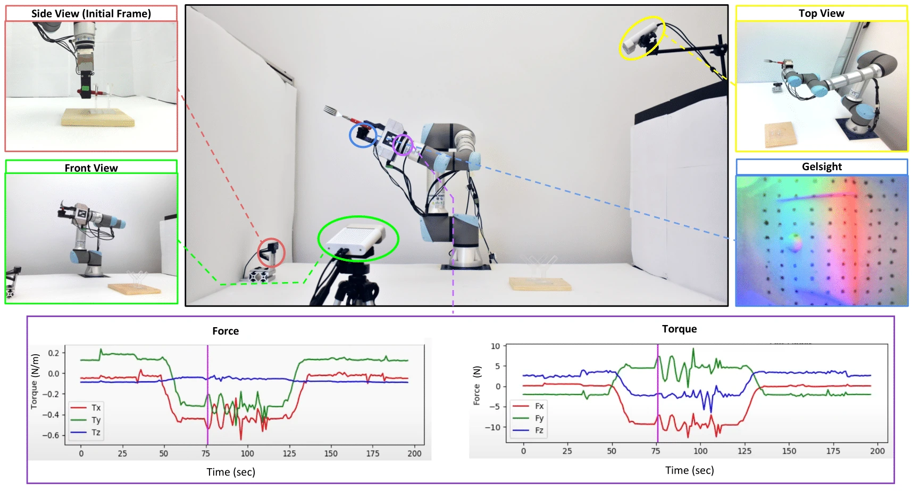</a>
<figcaption>PoseIt官方仓库的多模态观测图：机器人抓取中结合视觉、光学／阵列触觉与力学信息。<span class="figure-links"><a href="https://github.com/Robo-Touch/PoseIt/blob/main/README.md" target="_blank" rel="noopener">来源：作者项目／论文</a><a href="https://github.com/CMURoboTouch/PoseIt/blob/main/figures/data_modalities-1-1.png" target="_blank" rel="noopener">原图／视频／PDF</a></span></figcaption>
</figure>
<figure class="dataset-figure" id="fig-r05-02">
<div class="figure-type"><strong>R05 · 图2</strong><span>采集对象</span><small>点击图片放大</small></div>
<a class="figure-open" href="figures/r05-02.webp" target="_blank" rel="noopener" aria-label="放大：PoseIt官方物体集合；用于比较不同材质、几何与持握稳定性。">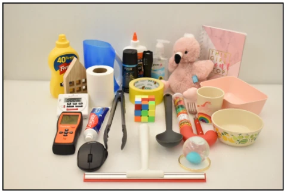</a>
<figcaption>PoseIt官方物体集合；用于比较不同材质、几何与持握稳定性。<span class="figure-links"><a href="https://github.com/Robo-Touch/PoseIt/blob/main/README.md" target="_blank" rel="noopener">来源：作者项目／论文</a><a href="https://github.com/CMURoboTouch/PoseIt/blob/main/figures/object_set.PNG" target="_blank" rel="noopener">原图／视频／PDF</a></span></figcaption>
</figure>
</div>


<a id="R06"></a>

### R06 · YCB-Sight（真实部分）

**分类：**机器人真机触觉　**参考年份：**2021　**证据：**A（已核实实际数据文件目录；计入主统计）

**数据／项目链接：**[官方数据/逐物体下载](https://github.com/Robo-Touch/YCB-Sight)

| 项目 | 核实信息 |
|---|---|
| 规模与发布口径 | 官方列30个仿真物体、6个真实物体；主计数只纳入真实部分。 |
| 传感器、模态与时序 | GelSight触觉、Azure Kinect RGB-D、物体模型和接触几何。 |
| 动作与状态 | 几何与位姿条件，非通用操作动作数据。 |
| 对触觉世界模型的用途 | 视觉—触觉几何对齐、位姿与sim-to-real研究。 |
| 数据许可 | 数据CC BY-SA 4.0；代码MIT |
| 限制、证据缺口与去重 | 与YCB-Slide是不同采集项目；真实与仿真文件必须分开，不把全部30物体都写成真机。 |

<section id="sample-R06" class="sample-card static_sample"><h4>实际数据样例 <span class="sample-status">静态样本</span></h4>
<div class="sample-player">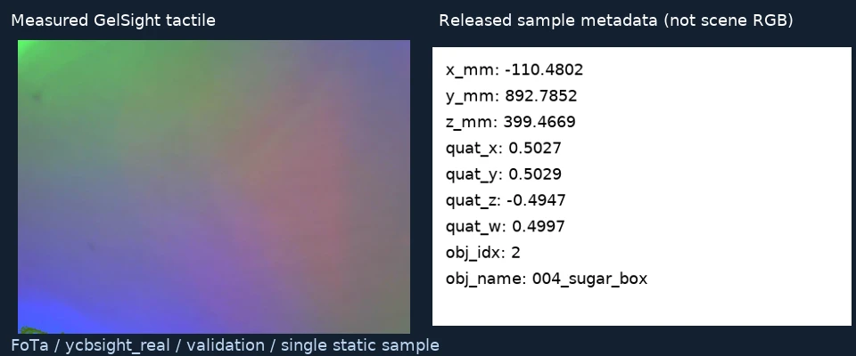</div>
<p class="sample-caption">FoTa公开转换包中的YCB-Sight真实GelSight静态样本（004_sugar_box）与同名位姿JSON；实际原始Drive下载超时。本样本没有场景RGB，也不能当作完整连续轨迹。</p>
<div class="sample-meta"><div><b>样例／文件</b>FoundationTactile/ycbsight_real/val/data-000000.tar::004_sugar_box_gelsight_30_1630695247053154.jpg</div><div><b>下载范围</b>部分记录或静态样本 · 1 帧 / 原始采样率未确认</div><div><b>原始样例时长</b>真实秒数未确认</div></div>
<p class="sample-caption"><strong>对齐方式：</strong>同名JPEG和JSON组成同一样本，无场景RGB。</p>
<p class="sample-caption"><strong>当前缺口：</strong>原始Drive暂不可达；公开派生样本仅保留单张GelSight及位姿，无RGB、无连续时间轴。</p>
<p class="sample-caption">同源复用：A01/FoTa中的ycbsight_real真实样本；原始采集按R06计一次，附件路径复用以避免重复下载。；不作为新增独立来源计数。</p>
<p class="sample-links">
<a href="trajectories/A01/index.html" target="_blank" rel="noopener">单独打开样例</a>
<a href="https://huggingface.co/datasets/alanz-mit/FoundationTactile" target="_blank" rel="noopener">数据源</a>
<a href="https://hf-mirror.com/datasets/alanz-mit/FoundationTactile/resolve/main/dataset/FoTa_dataset.zip" target="_blank" rel="noopener">原始下载入口</a>
<a href="trajectory_records/R06.json">下载／校验记录</a></p>
<div class="sample-duration"><strong>数据集时长：</strong>总时长未核实<p><strong>覆盖范围：</strong>完整发布数据</p><p>未取得可汇总的完整时间戳或官方总小时数；试验/图像数量不能直接换算时长。</p></div>
<details class="sample-evidence"><summary>时长及下载证据</summary><ul><li><a href="https://github.com/Robo-Touch/YCB-Sight" target="_blank" rel="noopener">来源 1</a>：官方列30个仿真物体、6个真实物体；主计数只纳入真实部分。</li><li><a href="https://drive.usercontent.google.com/download?id=1ZfwuXom_ngccnyox-ud4b-pOa1zMw-Wr&amp;export=download" target="_blank" rel="noopener">来源 2</a>：作者真实部分002_master_chef_can（约0.97GB）Google Drive下载端连接超时；没有用可用的仿真图冒充真实序列。</li><li><a href="https://hf-mirror.com/datasets/alanz-mit/FoundationTactile/resolve/main/dataset/FoTa_dataset.zip" target="_blank" rel="noopener">来源 3</a>：解析分卷ZIP central-directory并解压真实验证tar(3,573,760字节)，读取JPEG/JSON。</li></ul></details>
<div class="duration-estimate" id="duration-R06"><h5>本轮统计值：0.004 等效小时 <span class="estimate-tag static_equivalent">静态帧等效</span></h5><p>范围：0.002–0.013 等效小时 · 可信度：中 · 公开镜像／派生入口</p><p><strong>覆盖：</strong>YCB-Sight Real的6物体、480张真实GelSight接触图（不包含1,800张仿真图）。</p><p><strong>计算：</strong>480/(30×3600)仅作静态训练帧量等价；10–60fps给出范围。</p><p class="estimate-warning">静态图没有连续时间轴，此数是帧预算等效值；连续录制总量贡献为 0。</p><p>作者Drive网络未通；FoTa真实子集可下载且已取得样本。</p><details><summary>估算假设与来源</summary><ul><li>这些是稀疏接触位置图，不能据此还原连续采集时间。</li><li>以可实际取得的FoTa真实图像发布范围计量。</li></ul><ul><li><a href="https://github.com/alanzjl/t3/blob/main/dataset_preproc/README.md" target="_blank" rel="noopener">来源 1</a>：480real images and1800sim images。</li><li><a href="https://github.com/Robo-Touch/YCB-Sight" target="_blank" rel="noopener">来源 2</a>：6真实物体；gelsight_&lt;idx&gt;_&lt;timestamp&gt;.jpg。</li></ul></details><p><a href="duration_estimates/R06.json">下载该条计算记录</a></p></div></section>

<div class="dataset-figures">
<figure class="dataset-figure wide" id="fig-r06-01">
<div class="figure-type"><strong>R06 · 图1</strong><span>真实数据样例</span><small>点击图片放大</small></div>
<a class="figure-open" href="figures/r06-01.webp" target="_blank" rel="noopener" aria-label="放大：YCB-Sight作者仓库明确标为real的演示截帧；与同仓库的仿真展示分开。">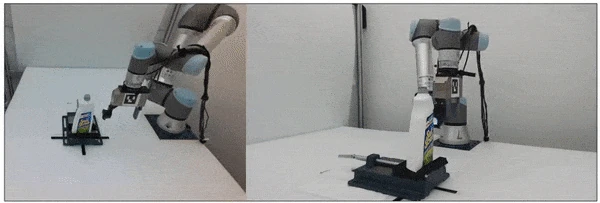</a>
<figcaption>YCB-Sight作者仓库明确标为real的演示截帧；与同仓库的仿真展示分开。<span class="figure-links"><a href="https://github.com/Robo-Touch/YCB-Sight" target="_blank" rel="noopener">来源：作者项目／论文</a><a href="https://github.com/Robo-Touch/YCB-Sight/blob/main/media/YCBSight-real.gif" target="_blank" rel="noopener">原图／视频／PDF</a></span></figcaption>
</figure>
</div>


<a id="R07"></a>

### R07 · RH20T（触觉配置）

**分类：**机器人真机触觉　**参考年份：**2023　**证据：**A（已核实实际数据文件目录；计入主统计）

**数据／项目链接：**[官方项目/下载](https://rh20t.github.io/)；[配置/API](https://github.com/rh20t/rh20t_api)；[公开转换包](https://huggingface.co/datasets/MJJJJ1064/FTP-1-Dataset/tree/main/RH20TCfg7Tactile)

| 项目 | 核实信息 |
|---|---|
| 规模与发布口径 | RH20T全库规模不能当作触觉子集规模；本报告仅将有触觉的配置计一次。 |
| 传感器、模态与时序 | Cfg7的uSkin阵列触觉与腕部F/T、视觉和机器人状态；Cfg5/6主要是关节力矩/腕力。 |
| 动作与状态 | 机器人操作时序、状态与相应动作信息；应按配置读取。 |
| 对触觉世界模型的用途 | 阵列触觉机器人后训练、接触丰富操作；与人手压力编码器适配。 |
| 数据许可 | 原始条款以官方数据申请/下载说明为准；本次未确认独立数据许可 |
| 限制、证据缺口与去重 | FTP公开包中RH20TCfg7Tactile有归档；Cfg5/6不是额外两个触觉数据集。不能把所有RH20T视频/人类示范都声称带触觉。 |

<section id="sample-R07" class="sample-card complete_trajectory"><h4>实际数据样例 <span class="sample-status">完整时序样例</span></h4>
<div class="sample-player"><video controls playsinline preload="none" poster="trajectories/R07/poster.webp" src="trajectories/R07/preview.mp4" aria-label="R07 实际数据可视化"></video></div>
<p class="sample-caption">从FTP公开转换包抽取Cfg7 task_0050_Dish_on_rack第0条完整episode，260帧、时间戳跨度26.595秒。左为camera_main_rgb，右为双指uSkin各4×4的Z原始读数（色标37645–50615，不是牛顿）；按同一索引同步，每2帧展示1帧。</p>
<div class="sample-meta"><div><b>样例／文件</b>task_0050_Dish_on_rack.zarr / episode0</div><div><b>下载范围</b>完整录制/序列 · 260 帧 / 原始采样率未确认</div><div><b>原始样例时长</b>26.595 秒</div></div>
<p class="sample-caption"><strong>对齐方式：</strong>same FTP processed frame index</p>
<p class="sample-caption">同源复用：FTP格式转换；按RH20T原始来源计一次；不作为新增独立来源计数。</p>
<p class="sample-links">
<a href="trajectories/R07/index.html" target="_blank" rel="noopener">单独打开样例</a>
<a href="https://huggingface.co/datasets/MJJJJ1064/FTP-1-Dataset/tree/main/RH20TCfg7Tactile" target="_blank" rel="noopener">数据源</a>
<a href="https://www.modelscope.cn/api/v1/datasets/Eureka1064/FTP-1-Dataset/repo?Revision=master&amp;FilePath=RH20TCfg7Tactile%2FRH20TCfg7Tactile.tar.part-0000" target="_blank" rel="noopener">原始下载入口</a>
<a href="trajectory_records/R07.json">下载／校验记录</a></p>
<div class="sample-duration"><strong>数据集时长：</strong>元数据推算 0.206 h<p><strong>覆盖范围：</strong>FTP-Cfg7中task_0050单任务20条，非Cfg7全库</p><p>读取该任务20条episode全部timestamps，首尾跨度合计740.664秒（0.206小时）；RH20T全库时长不能代替触觉Cfg7。</p></div>
<details class="sample-evidence"><summary>时长及下载证据</summary><ul><li><a href="https://huggingface.co/datasets/MJJJJ1064/FTP-1-Dataset/tree/main/RH20TCfg7Tactile" target="_blank" rel="noopener">来源 1</a>：task0050,20 episode spans sum=740.664s</li></ul></details>
<div class="duration-estimate" id="duration-R07"><h5>本轮统计值：9.43 小时 <span class="estimate-tag estimated">估算</span></h5><p>范围：4.72–18.87 小时 · 可信度：低 · 公开镜像／派生入口</p><p><strong>覆盖：</strong>RH20T触觉配置（Cfg7），按917条触觉轨迹估计，不含RH20T其他无触觉配置。</p><p><strong>计算：</strong>已审计Dish_on_rack的20条合计0.20574h；全触觉子集估计0.20574/20×917。跨任务均值设为审计任务的0.5–2倍。</p><p class="estimate-warning"><strong>全量发布覆盖待确认：</strong>公开归档及样例存在，但主值依赖论文全量已发布这一条件；分类汇总中单列，不混入已确认发布覆盖的主估计。</p><p>官方RH20T及FTP公开转换版；已下载完整样例。</p><details><summary>估算假设与来源</summary><ul><li>917条/55任务来自OmniVTA比较表的RH20T*触觉范围。</li><li>一项任务不能代表55任务时长分布，因此范围为敏感性分析，不是统计置信区间。</li></ul><ul><li><a href="https://arxiv.org/html/2603.19201" target="_blank" rel="noopener">来源 1</a>：TableI：RH20T*55tasks,917trajectories,uSkin。</li><li><a href="https://huggingface.co/datasets/MJJJJ1064/FTP-1-Dataset/tree/main/RH20TCfg7Tactile" target="_blank" rel="noopener">来源 2</a>：公开转换包Dish_on_rack20条逐episode时间戳合计740.664s。</li></ul></details><p><a href="duration_estimates/R07.json">下载该条计算记录</a></p></div></section>

<div class="dataset-figures">
<figure class="dataset-figure wide" id="fig-r07-pdf-fig5">
<div class="figure-type"><strong>R07 · 图1</strong><span>采集平台概览</span><small>点击图片放大</small></div>
<a class="figure-open" href="figures/r07-pdf-fig5.webp" target="_blank" rel="noopener" aria-label="放大：RH20T论文图5（PDF第5页裁图）：多视角视觉、机器人与力反馈采集平台。此图说明整套采集方式，不能用它推断所有配置都带指尖触觉；本报告只统计Cfg7触觉部分。">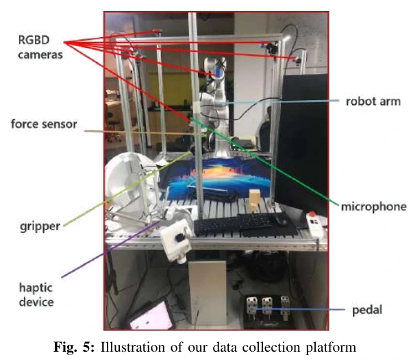</a>
<figcaption>RH20T论文图5（PDF第5页裁图）：多视角视觉、机器人与力反馈采集平台。此图说明整套采集方式，不能用它推断所有配置都带指尖触觉；本报告只统计Cfg7触觉部分。<span class="figure-links"><a href="https://rh20t.github.io/" target="_blank" rel="noopener">来源：作者项目／论文</a><a href="https://rh20t.github.io/static/RH20T_paper_compressed.pdf" target="_blank" rel="noopener">原图／视频／PDF</a></span></figcaption>
</figure>
</div>


<a id="R08"></a>

### R08 · Reactive Diffusion Policy（RDP）数据

**分类：**机器人真机触觉　**参考年份：**2025　**证据：**A（已核实实际数据文件目录；计入主统计）

**数据／项目链接：**[官方数据](https://huggingface.co/datasets/WendiChen/reactive_diffusion_policy_dataset)；[代码/字段](https://github.com/xiaoxiaoxh/reactive_diffusion_policy)

| 项目 | 核实信息 |
|---|---|
| 规模与发布口径 | 公开full/mini和触觉表征采集子集；任务含peeling、wiping、lifting。 |
| 传感器、模态与时序 | GelSight Mini/MCTac图像与marker位移、外部/腕部RGB、TCP姿态/速度、夹爪力/宽度、腕部wrench和时间戳。 |
| 动作与状态 | 公开Zarr示例明确有action、target、状态；不同任务/重采样频率须保持一致。 |
| 对触觉世界模型的用途 | 优先：动作条件触觉预测、快慢时序建模、接触反应控制。 |
| 数据许可 | MIT |
| 限制、证据缺口与去重 | 单臂/双臂、raw/processed、mini/full都按一个来源家族；PCA采集时长不是操作示范总时长。 |

<section id="sample-R08" class="sample-card complete_trajectory"><h4>实际数据样例 <span class="sample-status">完整时序样例</span></h4>
<div class="sample-player"><video controls playsinline preload="none" poster="trajectories/R08/poster.webp" src="trajectories/R08/preview.mp4" aria-label="R08 实际数据可视化"></video></div>
<p class="sample-caption">公开mini的lift_v2_downsample2第0条完整episode，共294帧，左external_img、右left_gripper2_img（MCTac，gripper1图像为全零占位）。转换包timestamp为float32 Unix秒，约1.7e9处精度不足（相邻帧坍缩），不能用其估计真实时长；10fps为浏览速度。保留action及状态字段。</p>
<div class="sample-meta"><div><b>样例／文件</b>dataset_mini/lift_v2_downsample2_zarr.zip / episode0</div><div><b>下载范围</b>完整录制/序列 · 294 帧 / 原始采样率未确认</div><div><b>原始样例时长</b>真实秒数未确认</div></div>
<p class="sample-caption"><strong>对齐方式：</strong>same processed Zarr index; timestamp float32 precision insufficient</p>
<p class="sample-links">
<a href="trajectories/R08/index.html" target="_blank" rel="noopener">单独打开样例</a>
<a href="https://huggingface.co/datasets/WendiChen/reactive_diffusion_policy_dataset" target="_blank" rel="noopener">数据源</a>
<a href="https://hf-mirror.com/datasets/WendiChen/reactive_diffusion_policy_dataset/resolve/main/dataset_mini/lift_v2_downsample2_zarr.zip" target="_blank" rel="noopener">原始下载入口</a>
<a href="trajectory_records/R08.json">下载／校验记录</a></p>
<div class="sample-duration"><strong>数据集时长：</strong>总时长未核实<p><strong>覆盖范围：</strong>完整发布数据</p><p>不能用本次processed timestamp推时长：Unix秒存float32，样例相邻帧时间被舍入到同值。公开full/mini不可重复累加；尚无可信全库小时总计。</p></div>
<div class="duration-estimate" id="duration-R08"><h5>本轮统计值：1.00 小时 <span class="estimate-tag metadata">元数据实算</span></h5><p>范围：1.00–1.91 小时 · 可信度：高 · 已验证文件入口</p><p><strong>覆盖：</strong>RDP三任务full操作集190条；另40个触觉表征视频与操作集是否重叠待核实，仅进入上界。</p><p><strong>计算：</strong>三个downsample2的action.shape共43,351帧÷12Hz=1.003495h，作为主值与下界。另40个MP4 mvhd时长合计3,249.477s=0.902633h；无法证明独立采集，只有在全部不重叠情景下上界才为1.906128h。</p><p>公开下载入口已核查，已有真实样本下载。</p><details><summary>估算假设与来源</summary><ul><li>官方代码说明原始24fps、downsample2对应12fps；N/fps为传感器记录长度换算，真实首尾跨度会有每条不超过约一帧的端点差异。</li><li>mini/raw/downsample1/downsample2是相同采集的不同表示，仅计一次。</li><li>数据卡只说明表征视频用于PCA训练，没有证明与操作集完全独立；主值不累加这0.902633h。</li><li>高置信度指190条操作范围的元数据换算，上界是额外视频全独立的条件情景。</li></ul><ul><li><a href="https://github.com/xiaoxiaoxh/reactive_diffusion_policy#data-postprocessing" target="_blank" rel="noopener">来源 1</a>：官方README说明24fps采集、12fps对应downsample2。</li><li><a href="https://huggingface.co/datasets/WendiChen/reactive_diffusion_policy_dataset" target="_blank" rel="noopener">来源 2</a>：三ZIP中央目录和.zarray已读取：lift50/11690帧，peel60/12927，wipe80/18734；40个MP4头已逐个审计。</li></ul><p>核查明细：<a href="duration_estimates/work_robot/R08_lift_v2.json">[1]</a> <a href="duration_estimates/work_robot/R08_peel_v3.json">[2]</a> <a href="duration_estimates/work_robot/R08_wipe_v1.5.json">[3]</a> <a href="duration_estimates/work_robot/R08_embedding_video_durations.json">[4]</a> </p></details><p><a href="duration_estimates/R08.json">下载该条计算记录</a></p></div></section>

<div class="dataset-figures">
<figure class="dataset-figure wide" id="fig-r08-01">
<div class="figure-type"><strong>R08 · 图1</strong><span>采集装置</span><small>点击图片放大</small></div>
<a class="figure-open" href="figures/r08-01.webp" target="_blank" rel="noopener" aria-label="放大：RDP论文图2：TactAR遥操作采集系统及触觉／力反馈。用于理解真实机器人状态、动作与触觉流的采集关系。">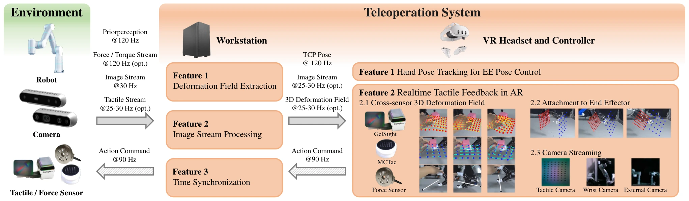</a>
<figcaption>RDP论文图2：TactAR遥操作采集系统及触觉／力反馈。用于理解真实机器人状态、动作与触觉流的采集关系。<span class="figure-links"><a href="https://arxiv.org/html/2503.02881v3" target="_blank" rel="noopener">来源：作者项目／论文</a><a href="https://arxiv.org/html/2503.02881v3/system_layout.png" target="_blank" rel="noopener">原图／视频／PDF</a></span></figcaption>
</figure>
<figure class="dataset-figure wide" id="fig-r08-02">
<div class="figure-type"><strong>R08 · 图2</strong><span>触觉样例</span><small>点击图片放大</small></div>
<a class="figure-open" href="figures/r08-02.webp" target="_blank" rel="noopener" aria-label="放大：RDP论文图3：不同接触模式下GelSight Mini的marker形变；形变场是触觉图像中的运动观测，不直接等同于标定力值。">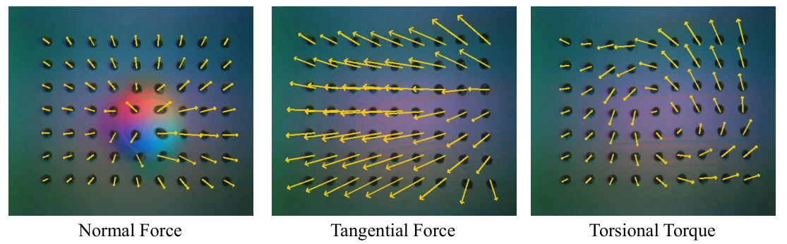</a>
<figcaption>RDP论文图3：不同接触模式下GelSight Mini的marker形变；形变场是触觉图像中的运动观测，不直接等同于标定力值。<span class="figure-links"><a href="https://arxiv.org/html/2503.02881v3" target="_blank" rel="noopener">来源：作者项目／论文</a><a href="https://arxiv.org/html/2503.02881v3/marker_motion.png" target="_blank" rel="noopener">原图／视频／PDF</a></span></figcaption>
</figure>
<figure class="dataset-figure" id="fig-r08-03">
<div class="figure-type"><strong>R08 · 图3</strong><span>任务样例</span><small>点击图片放大</small></div>
<a class="figure-open" href="figures/r08-03.webp" target="_blank" rel="noopener" aria-label="放大：RDP论文图7：剥离、擦拭与双臂搬运三类接触丰富任务。">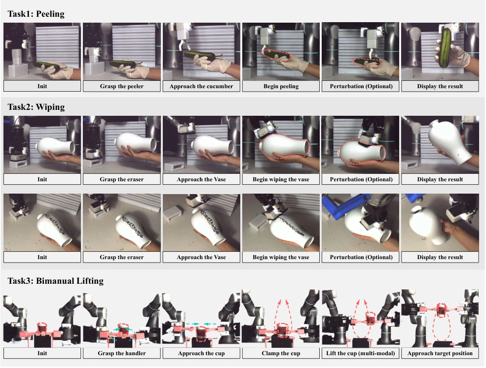</a>
<figcaption>RDP论文图7：剥离、擦拭与双臂搬运三类接触丰富任务。<span class="figure-links"><a href="https://arxiv.org/html/2503.02881v3" target="_blank" rel="noopener">来源：作者项目／论文</a><a href="https://arxiv.org/html/2503.02881v3/task.png" target="_blank" rel="noopener">原图／视频／PDF</a></span></figcaption>
</figure>
</div>


<a id="R09"></a>

### R09 · UniT数据

**分类：**机器人真机触觉　**参考年份：**2024　**证据：**A（已核实实际数据文件目录；计入主统计）

**数据／项目链接：**[作者仓库/原始Drive](https://github.com/ZhengtongXu/UniT)；[公开转换包](https://huggingface.co/datasets/MJJJJ1064/FTP-1-Dataset/tree/main/Unit)

| 项目 | 核实信息 |
|---|---|
| 规模与发布口径 | 原作者README：挂鸡腿200、薯片抓取180、六角扳手插入170示范；另有表征和手内姿态子集。 |
| 传感器、模态与时序 | 带markers的GelSight Mini、视觉和真实机器人操作数据。 |
| 动作与状态 | 有操作策略学习轨迹；不是只有单物体触觉表征图。 |
| 对触觉世界模型的用途 | 小规模动作条件动态基准，插装/易损物体操作。 |
| 数据许可 | 原始数据许可本次未确认 |
| 限制、证据缺口与去重 | FTP Unit/Unit_Bimanual不再额外计数。原表征“单物体20分钟内”等描述不能套到全部策略数据。 |

<section id="sample-R09" class="sample-card complete_trajectory"><h4>实际数据样例 <span class="sample-status">完整时序样例</span></h4>
<div class="sample-player"><video controls playsinline preload="none" poster="trajectories/R09/poster.webp" src="trajectories/R09/preview.mp4" aria-label="R09 实际数据可视化"></video></div>
<p class="sample-caption">FTP公开转换包UniT allenkey_insertion第0条完整episode，196帧。左camera_main_rgb，右GelSight Mini；同索引配对。整数秒timestamp跨度19秒、内部完整秒均有10帧，按10fps浏览19.6秒；实际首尾时间存在小于1秒的量化误差。</p>
<div class="sample-meta"><div><b>样例／文件</b>FTP Unit/allenkey_insertion.zarr / episode0</div><div><b>下载范围</b>完整录制/序列 · 196 帧 / 10.000 Hz</div><div><b>原始样例时长</b>19.000 秒</div></div>
<p class="sample-caption"><strong>对齐方式：</strong>matching stored frame; integer timestamps10frames per interior second</p>
<p class="sample-caption">同源复用：FTP格式转换，归属于UniT原始采集来源；不作为新增独立来源计数。</p>
<p class="sample-links">
<a href="trajectories/R09/index.html" target="_blank" rel="noopener">单独打开样例</a>
<a href="https://github.com/ZhengtongXu/UniT" target="_blank" rel="noopener">数据源</a>
<a href="https://www.modelscope.cn/api/v1/datasets/Eureka1064/FTP-1-Dataset/repo?Revision=master&amp;FilePath=Unit%2FUnit.tar" target="_blank" rel="noopener">原始下载入口</a>
<a href="trajectory_records/R09.json">下载／校验记录</a></p>
<p class="sample-links"><a href="trajectory_audits/R09/duration_audit.json">详细审计 1</a></p>
<div class="sample-duration"><strong>数据集时长：</strong>元数据推算 1.070 h<p><strong>覆盖范围：</strong>FTP-UniT中allenkey_insertion单任务170条，近似时长</p><p>读取该任务170条全部整数秒timestamps，首末跨度合计约3851秒（1.070小时）；逐条时间量化误差&lt;1秒，总量保守误差&lt;170秒。不是UniT全部任务总时长。</p></div>
<details class="sample-evidence"><summary>时长及下载证据</summary><ul><li><a href="https://huggingface.co/datasets/MJJJJ1064/FTP-1-Dataset/tree/main/Unit" target="_blank" rel="noopener">来源 1</a>：170episodes; sum integer timestamp spans=3851.0s; no double-count Unit_Bimanual</li></ul></details>
<div class="duration-estimate" id="duration-R09"><h5>本轮统计值：4.21 小时 <span class="estimate-tag estimated">估算</span></h5><p>范围：2.48–7.67 小时 · 可信度：低 · 公开镜像／派生入口</p><p><strong>覆盖：</strong>UniT作者声明发布的三类原始数据：550条操作示范、15,685帧表征数据、11,340帧USB姿态数据；不再计YCB-Sight复用。</p><p><strong>计算：</strong>操作：allenkey170条合计1.069722h，按550/170外推为3.460866h（跨任务均值0.5–2倍）。表征：论文15,685帧/10Hz=0.435694h；USB姿态：11,340帧/10Hz=0.315000h。合计4.211560h；后两项为论文明确数量/频率换算，不是新增假设帧数。</p><p class="estimate-warning"><strong>全量发布覆盖待确认：</strong>公开归档及样例存在，但主值依赖论文全量已发布这一条件；分类汇总中单列，不混入已确认发布覆盖的主估计。</p><p>操作样本已从FTP公开转换包下载；作者README声明三类数据均在公开Drive发布，表征/姿态部分本次未逐文件确认。</p><details><summary>估算假设与来源</summary><ul><li>操作部分200挂鸡腿+180薯片+170六角扳手；仅allenkey任务逐条时间戳已审计，其余操作时间仍为跨任务估计。</li><li>论文表征数据为Allen key10,854帧、small ball4,831帧，固定10Hz；USB姿态训练10,111帧+测试1,229帧，固定10Hz。</li><li>3D与6D pose是同一USB姿态采集的不同预测任务，仅计一次；论文YCB-Sight分类的240图属于R06复用，排除。</li><li>README明确表征、手内姿态、操作三类均已发布；后两类Drive文件本次未逐项下载清点，依作者声明/论文规模计入，不能称文件完整性已验证。</li><li>N/fps换算按记录长度计，未额外外推未报告的重建展示图或评测视频；FTP Unit/Unit_Bimanual等转换副本不再次累加。</li></ul><ul><li><a href="https://github.com/ZhengtongXu/UniT" target="_blank" rel="noopener">来源 1</a>：官方README逐任务200/180/170demonstrations。</li><li><a href="https://huggingface.co/datasets/MJJJJ1064/FTP-1-Dataset/tree/main/Unit" target="_blank" rel="noopener">来源 2</a>：allenkey_insertion全170条时间戳审计。</li><li><a href="https://arxiv.org/html/2408.06481" target="_blank" rel="noopener">来源 3</a>：IV-B：10Hz采集、Allen key10,854images、ball4,831images；VI-A：USB姿态10Hz，训练10,111+测试1,229；3D/6D共享采集；YCB-Sight为复用数据。</li></ul><p>核查明细：<a href="https://arxiv.org/html/2408.06481">[1]</a> </p></details><p><a href="duration_estimates/R09.json">下载该条计算记录</a></p></div></section>

<div class="dataset-figures">
<figure class="dataset-figure wide" id="fig-r09-01">
<div class="figure-type"><strong>R09 · 图1</strong><span>数据可视化</span><small>点击图片放大</small></div>
<a class="figure-open" href="figures/r09-01.webp" target="_blank" rel="noopener" aria-label="放大：UniT官方Rerun数据可视化截帧，用于展示多路视觉、触觉与运动数据的共同时间轴。">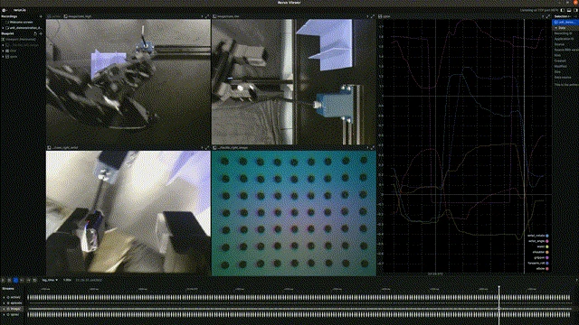</a>
<figcaption>UniT官方Rerun数据可视化截帧，用于展示多路视觉、触觉与运动数据的共同时间轴。<span class="figure-links"><a href="https://github.com/ZhengtongXu/UniT/blob/main/README.md" target="_blank" rel="noopener">来源：作者项目／论文</a><a href="https://github.com/ZhengtongXu/UniT/blob/main/teasers/rerun_example.gif" target="_blank" rel="noopener">原图／视频／PDF</a></span></figcaption>
</figure>
</div>


<a id="R10"></a>

### R10 · VLA-Touch数据

**分类：**机器人真机触觉　**参考年份：**2025　**证据：**A（已核实实际数据文件目录；计入主统计）

**数据／项目链接：**[官方数据](https://huggingface.co/datasets/AllenBi21/VLA-Touch)；[原作者仓库](https://github.com/jxbi1010/VLA-Touch)

| 项目 | 核实信息 |
|---|---|
| 规模与发布口径 | 官方提供原始Drive及HF processed数据；本次未重新计算轨迹总数。 |
| 传感器、模态与时序 | Franka机器人视觉、GelSight Mini触觉/marker信息和控制轨迹。 |
| 动作与状态 | 用于触觉反馈策略的机器人动作与观测。 |
| 对触觉世界模型的用途 | 机器人动作修正、接触阶段条件建模。 |
| 数据许可 | 代码MIT；数据专用许可本次未确认 |
| 限制、证据缺口与去重 | 不要与Tactile-VLA混名。FTP中VLA_touch是重打包；其时间戳/物理FPS应单独审计。 |

<section id="sample-R10" class="sample-card complete_trajectory"><h4>实际数据样例 <span class="sample-status">完整时序样例</span></h4>
<div class="sample-player"><video controls playsinline preload="none" poster="trajectories/R10/poster.webp" src="trajectories/R10/preview.mp4" aria-label="R10 实际数据可视化"></video></div>
<p class="sample-caption">完整下载 mango/episode_0.h5，79 个配对观测：左 camera1，右 GelSight 原始图像。按同一HDF5索引配对；文件没有时间戳/FPS，播放器以10帧/秒方便浏览，7.9秒是展示时长，不代表真实交互时长。</p>
<div class="sample-meta"><div><b>样例／文件</b>mango/episode_0.h5</div><div><b>下载范围</b>完整录制/序列 · 79 帧 / 原始采样率未确认</div><div><b>原始样例时长</b>真实秒数未确认</div></div>
<p class="sample-caption"><strong>对齐方式：</strong>同一存储索引；物理采样间隔未提供。</p>
<p class="sample-links">
<a href="trajectories/R10/index.html" target="_blank" rel="noopener">单独打开样例</a>
<a href="https://huggingface.co/datasets/AllenBi21/VLA-Touch" target="_blank" rel="noopener">数据源</a>
<a href="https://hf-mirror.com/datasets/AllenBi21/VLA-Touch/resolve/main/mango/episode_0.h5" target="_blank" rel="noopener">原始下载入口</a>
<a href="trajectory_records/R10.json">下载／校验记录</a></p>
<div class="sample-duration"><strong>数据集时长：</strong>总时长未核实<p><strong>覆盖范围：</strong>完整发布数据</p><p>未找到可可靠汇总的总时长；不以样本数或文件体积推算。</p></div>
<div class="duration-estimate" id="duration-R10"><h5>本轮统计值：0.808 小时 <span class="estimate-tag estimated">估算</span></h5><p>范围：0.473–1.25 小时 · 可信度：中 · 已验证文件入口</p><p><strong>覆盖：</strong>HF公开380个processed HDF5 episode：mango179、watercup100、wipe101；rawZIP为副本不另加。</p><p><strong>计算：</strong>分任务读取episode0/50/99共9个HDF5的ee_poses.shape，均值按10Hz换算后乘各任务真实文件数。范围采用各任务样本最短/最长时长外推，再放宽20%。</p><p>公开下载入口已核查，已有真实样本下载。</p><details><summary>估算假设与来源</summary><ul><li>10Hz来自OmniVTA TableI对VLA-Touch的采样频率描述；本地HDF5自身无fps/时间戳字段。</li><li>9条非随机系统抽样，范围不是统计置信区间，其他episode可能更长。</li></ul><ul><li><a href="https://huggingface.co/datasets/AllenBi21/VLA-Touch" target="_blank" rel="noopener">来源 1</a>：完整仓库文件树380个HDF5；9个HDF5远程元数据已读。</li><li><a href="https://arxiv.org/html/2603.19201" target="_blank" rel="noopener">来源 2</a>：TableI VLA-Touch3tasks，10Hz。</li></ul><p>核查明细：<a href="duration_estimates/work_robot/R10_samples.json">[1]</a> </p></details><p><a href="duration_estimates/R10.json">下载该条计算记录</a></p></div></section>

<div class="dataset-figures">
<figure class="dataset-figure wide" id="fig-r10-01">
<div class="figure-type"><strong>R10 · 图1</strong><span>触觉样例与文本</span><small>点击图片放大</small></div>
<a class="figure-open" href="figures/r10-01.webp" target="_blank" rel="noopener" aria-label="放大：VLA-Touch论文图3：原始触觉图、生成的语言描述及规划响应。原图同时含模型输出，文字描述不是物理传感器真值。">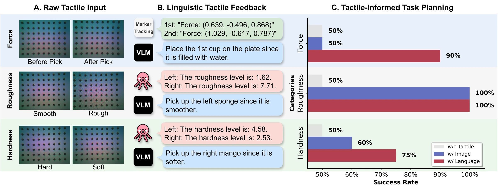</a>
<figcaption>VLA-Touch论文图3：原始触觉图、生成的语言描述及规划响应。原图同时含模型输出，文字描述不是物理传感器真值。<span class="figure-links"><a href="https://arxiv.org/html/2507.17294v2" target="_blank" rel="noopener">来源：作者项目／论文</a><a href="https://arxiv.org/html/2507.17294v2/4_planning.png" target="_blank" rel="noopener">原图／视频／PDF</a></span></figcaption>
</figure>
</div>


<a id="R11"></a>

### R11 · OmniViTac（OmniVTA数据）

**分类：**机器人真机触觉　**参考年份：**2026　**证据：**A（已核实实际数据文件目录；计入主统计）

**数据／项目链接：**[官方数据](https://huggingface.co/datasets/tars-robotics/OmniVitac)；[论文](https://arxiv.org/abs/2603.19201)

| 项目 | 核实信息 |
|---|---|
| 规模与发布口径 | 公开目录有多个操作任务，未从目录推断全论文训练小时数。 |
| 传感器、模态与时序 | 多类光学触觉传感器、机器人视觉与操作轨迹；论文框架支持跨传感器触觉策略。 |
| 动作与状态 | 机器人操作数据；具体每任务字段按公开文件核对。 |
| 对触觉世界模型的用途 | 跨传感器接触建模、策略与世界模型联合训练候选。 |
| 数据许可 | CC BY-NC 4.0 |
| 限制、证据缺口与去重 | OmniVTA、OmniVTLA和OmniViTac三个名字有区别；数据已发布不代表全部模型代码也已完整发布。 |

<section id="sample-R11" class="sample-card complete_trajectory"><h4>实际数据样例 <span class="sample-status">完整时序样例</span></h4>
<div class="sample-player"><video controls playsinline preload="none" poster="trajectories/R11/poster.webp" src="trajectories/R11/preview.mp4" aria-label="R11 实际数据可视化"></video></div>
<p class="sample-caption">从OmniViTac公开Adjustment分卷读取0000完整camera1和tactile1流：RGB 278帧，触觉deform 1178帧。左camera1，右3×700原始deform字段热图（固定色标-0.841至0.496；不是牛顿，也不代表手掌形状）。按毫秒时间戳最近邻匹配，最大差8ms；预览RGB覆盖18.467秒，触觉流尾部另有约1.17秒。</p>
<div class="sample-meta"><div><b>样例／文件</b>mnt/oss_data/it20260119/Adjustment/Adjustment_Gello_Adjust the white rectangular prism and insert it into the corresponding slot_150/0000</div><div><b>下载范围</b>完整录制/序列 · 278 帧 / 原始采样率未确认</div><div><b>原始样例时长</b>18.467 秒</div></div>
<p class="sample-caption"><strong>对齐方式：</strong>nearest timestamp, max difference 8ms</p>
<p class="sample-caption">selected full RGB/tactile streams; no depth or raw tactile camera downloaded</p>
<p class="sample-links">
<a href="trajectories/R11/index.html" target="_blank" rel="noopener">单独打开样例</a>
<a href="https://huggingface.co/datasets/tars-robotics/OmniVitac" target="_blank" rel="noopener">数据源</a>
<a href="https://hf-mirror.com/datasets/tars-robotics/OmniVitac/resolve/main/Adjustment_zip_new/Adjustment.tar.gz.00?download=true" target="_blank" rel="noopener">原始下载入口</a>
<a href="trajectory_records/R11.json">下载／校验记录</a></p>
<div class="sample-duration"><strong>数据集时长：</strong>总时长未核实<p><strong>覆盖范围：</strong>完整发布数据</p><p>论文报告21,879条、86任务，但没有可直接采用的全库小时总计；30–60Hz是采样率范围，不能乘一个固定平均长度推全库。</p></div>
<details class="sample-evidence"><summary>时长及下载证据</summary><ul><li><a href="https://arxiv.org/html/2603.19201" target="_blank" rel="noopener">来源 1</a>：Table I: 21,879 trajectories,86 tasks,30–60Hz; no total hours</li></ul></details>
<div class="duration-estimate" id="duration-R11"><h5>本轮统计值：119.33 小时 <span class="estimate-tag estimated">估算</span></h5><p>范围：59.66–238.65 小时 · 可信度：低 · 已验证文件入口</p><p><strong>覆盖：</strong>条件估计：按OmniViTac论文21,879条全部已公开的情景；本次未确认这些episode在发布文件中全部存在。</p><p><strong>计算：</strong>仅能确认官方仓库六类目录下736个压缩数据分卷，未提供逐episode清单，README仅含许可证。119.325635h=论文21,879条×已取得的一条完整触觉流19.634s/3600；59.662818–238.651270h是“全部21,879条发布且均值0.5–2倍”条件下的敏感性范围，不是已审计开放小时数。</p><p class="estimate-warning"><strong>全量发布覆盖待确认：</strong>公开归档及样例存在，但主值依赖论文全量已发布这一条件；分类汇总中单列，不混入已确认发布覆盖的主估计。</p><p>官方HF存在六类共736个数据分卷，完整样例已取得；无逐episode manifest，不能确认论文21,879条已经全部公开。</p><details><summary>估算假设与来源</summary><ul><li>关键未验证条件：论文21,879条与当前公开分卷内容完全一致。轻量目录只能证明736个分卷存在，不能证明每条轨迹均可取得。</li><li>已实际下载并验证1条完整Adjustment轨迹，触觉19.634s；其他86任务没有充分时长样本。</li><li>上下界均条件于论文规模全部发布；若发布不全，实际可获取总时长可能低于该下界。</li><li>不把RGB、多指触觉与原始/转换版相加。</li></ul><ul><li><a href="https://arxiv.org/html/2603.19201" target="_blank" rel="noopener">来源 1</a>：21,879trajectories/86tasks/126objects。</li><li><a href="https://huggingface.co/datasets/tars-robotics/OmniVitac" target="_blank" rel="noopener">来源 2</a>：已取Adjustment0000完整RGB与tactile1：RGB18.467s，触觉19.634s。</li><li><a href="https://huggingface.co/datasets/tars-robotics/OmniVitac/tree/main" target="_blank" rel="noopener">来源 3</a>：完整API目录744条：6目录+736数据分卷+2元文件。分卷计数{&#x27;Adjustment_zip_new&#x27;: 130, &#x27;Assembly_zip_new&#x27;: 134, &#x27;Cutting_zip_new&#x27;: 67, &#x27;Grasping_zip_new&#x27;: 300, &#x27;Peeling_zip_new&#x27;: 53, &#x27;Wiping_zip_new&#x27;: 52}；README只有CC-BY-NC-4.0许可证，未列episode数量。</li></ul><p>核查明细：<a href="duration_audits/R11/tree.json">[1]</a> <a href="duration_estimates/work_robot/R11_card.md">[2]</a> </p></details><p><a href="duration_estimates/R11.json">下载该条计算记录</a></p></div></section>

<div class="dataset-figures">
<figure class="dataset-figure wide" id="fig-r11-01">
<div class="figure-type"><strong>R11 · 图1</strong><span>采集装置</span><small>点击图片放大</small></div>
<a class="figure-open" href="figures/r11-01.webp" target="_blank" rel="noopener" aria-label="放大：OmniViTac论文图2：机器人／TacUMI采集平台、可更换触觉末端与数据概览。图示包含不同本体，不能把所有轨迹一概视为机器人自主执行。">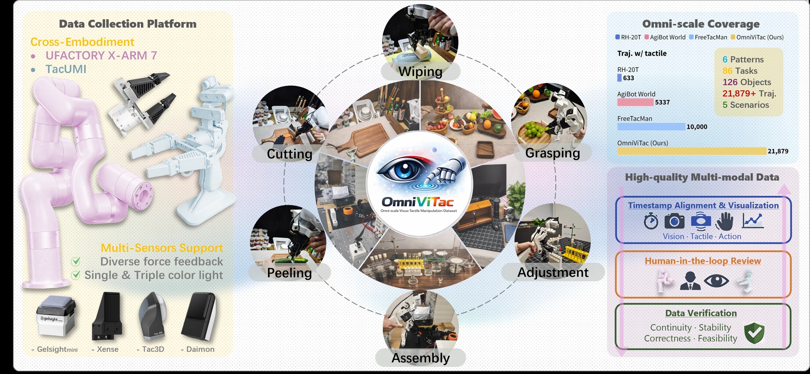</a>
<figcaption>OmniViTac论文图2：机器人／TacUMI采集平台、可更换触觉末端与数据概览。图示包含不同本体，不能把所有轨迹一概视为机器人自主执行。<span class="figure-links"><a href="https://arxiv.org/html/2603.19201v3" target="_blank" rel="noopener">来源：作者项目／论文</a><a href="https://arxiv.org/html/2603.19201v3/fig/dataset_teaser_0630.png" target="_blank" rel="noopener">原图／视频／PDF</a></span></figcaption>
</figure>
<figure class="dataset-figure wide" id="fig-r11-02">
<div class="figure-type"><strong>R11 · 图2</strong><span>数据样例</span><small>点击图片放大</small></div>
<a class="figure-open" href="figures/r11-02.webp" target="_blank" rel="noopener" aria-label="放大：OmniViTac论文图3：装配、切割、调整、剥离、抓取和擦拭六类视觉—触觉交互样例。">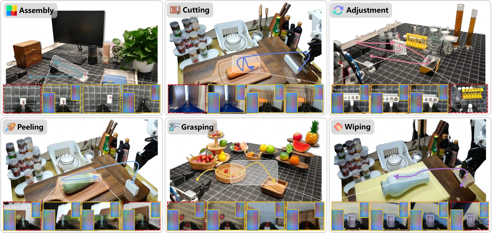</a>
<figcaption>OmniViTac论文图3：装配、切割、调整、剥离、抓取和擦拭六类视觉—触觉交互样例。<span class="figure-links"><a href="https://arxiv.org/html/2603.19201v3" target="_blank" rel="noopener">来源：作者项目／论文</a><a href="https://arxiv.org/html/2603.19201v3/OmniVTA-6pattern.png" target="_blank" rel="noopener">原图／视频／PDF</a></span></figcaption>
</figure>
</div>


<a id="R12"></a>

### R12 · HapTile

**分类：**机器人真机触觉　**参考年份：**2026　**证据：**A（已核实实际数据文件目录；计入主统计）

**数据／项目链接：**[数据](https://huggingface.co/datasets/HapTile2026/HapTile)；[字段定义](https://haptile-dataset.github.io/)；[下载可视化工具](https://github.com/HapTile-dataset/Dataset_quickstart)

| 项目 | 核实信息 |
|---|---|
| 规模与发布口径 | HF有按任务打包的ZIP；涵盖折叠、插入、移动、按压、放置、移除、堆叠、旋转和擦拭。 |
| 传感器、模态与时序 | UR5e+Robotiq 2F-85双指光学触觉，外部/腕部视觉、语言指令、marker运动、机器人状态。 |
| 动作与状态 | HDF5 frames/control为6维delta pose+夹爪控制；逐示范freq.txt与时间戳。 |
| 对触觉世界模型的用途 | 优先：有明确动作字段的接触动态/策略模型训练。 |
| 数据许可 | CC BY 4.0 |
| 限制、证据缺口与去重 | HDF5中的frames/videos是组而非普通目录；频率读取元数据，不能把任务ZIP个数当成示范个数。 |

<section id="sample-R12" class="sample-card complete_trajectory"><h4>实际数据样例 <span class="sample-status">完整时序样例</span></h4>
<div class="sample-player"><video controls playsinline preload="none" poster="trajectories/R12/poster.webp" src="trajectories/R12/preview.mp4" aria-label="R12 实际数据可视化"></video></div>
<p class="sample-caption">完整下载move_toy_car任务包中的0428_131000/trajectory.h5；278帧、时间戳跨度18.506秒。左base_camera_rgb_0，右tactile_left_rgb；嵌入视频原标称15fps，按帧索引配对播放，采集间隔存在波动。</p>
<div class="sample-meta"><div><b>样例／文件</b>Data/move_toy_car.zip / 0428_131000</div><div><b>下载范围</b>完整录制/序列 · 278 帧 / 15.000 Hz</div><div><b>原始样例时长</b>18.506 秒</div></div>
<p class="sample-caption"><strong>对齐方式：</strong>same HDF5 frame/video index; video_fps15</p>
<p class="sample-links">
<a href="trajectories/R12/index.html" target="_blank" rel="noopener">单独打开样例</a>
<a href="https://huggingface.co/datasets/HapTile2026/HapTile" target="_blank" rel="noopener">数据源</a>
<a href="https://hf-mirror.com/datasets/HapTile2026/HapTile/resolve/main/Data/move_toy_car.zip" target="_blank" rel="noopener">原始下载入口</a>
<a href="trajectory_records/R12.json">下载／校验记录</a></p>
<div class="sample-duration"><strong>数据集时长：</strong>元数据推算 0.144 h<p><strong>覆盖范围：</strong>仅本次下载move_toy_car任务包</p><p>对该包30条episode的首尾ISO时间戳求和，519.607秒（0.144小时）。这只是一个任务，不能代表整个HapTile全库。</p></div>
<details class="sample-evidence"><summary>时长及下载证据</summary><ul><li><a href="https://hf-mirror.com/datasets/HapTile2026/HapTile/resolve/main/Data/move_toy_car.zip" target="_blank" rel="noopener">来源 1</a>：30 trajectories; sum(last-first)=519.606891 s</li></ul></details>
<div class="duration-estimate" id="duration-R12"><h5>本轮统计值：8.18 小时 <span class="estimate-tag estimated">估算</span></h5><p>范围：4.09–16.36 小时 · 可信度：低 · 已验证文件入口</p><p><strong>覆盖：</strong>HapTile公开38个任务ZIP内全部1,700条trajectory.h5。</p><p><strong>计算：</strong>逐ZIP中央目录实数1,700条；move_toy_car30条时间戳总计519.606891s，均值17.32023s；1,700×该均值。范围均值0.5–2倍。</p><p>公开下载入口已核查，已有真实样本下载。</p><details><summary>估算假设与来源</summary><ul><li>已量出全库episode数，但仅一项任务完整审计时长。</li><li>任务之间长度差异未知，范围为跨任务敏感性，不是正式置信区间。</li></ul><ul><li><a href="https://huggingface.co/datasets/HapTile2026/HapTile" target="_blank" rel="noopener">来源 1</a>：38ZIP中央目录1,700个trajectory.h5；每任务27–71条。</li><li><a href="https://haptile-dataset.github.io/" target="_blank" rel="noopener">来源 2</a>：数据按轨迹包含timestamps和RGB/触觉。</li></ul><p>核查明细：<a href="duration_estimates/work_robot/R12_counts.json">[1]</a> </p></details><p><a href="duration_estimates/R12.json">下载该条计算记录</a></p></div></section>

<div class="dataset-figures">
<figure class="dataset-figure wide" id="fig-r12-collection">
<div class="figure-type"><strong>R12 · 图1</strong><span>官方采集视频截帧</span><small>点击图片放大</small></div>
<a class="figure-open" href="figures/r12-collection.webp" target="_blank" rel="noopener" aria-label="放大：HapTile官方datacollection_process视频第4秒截帧：多次机器人搬放瓶子的采集过程。画面展示不同演示的动作差异。">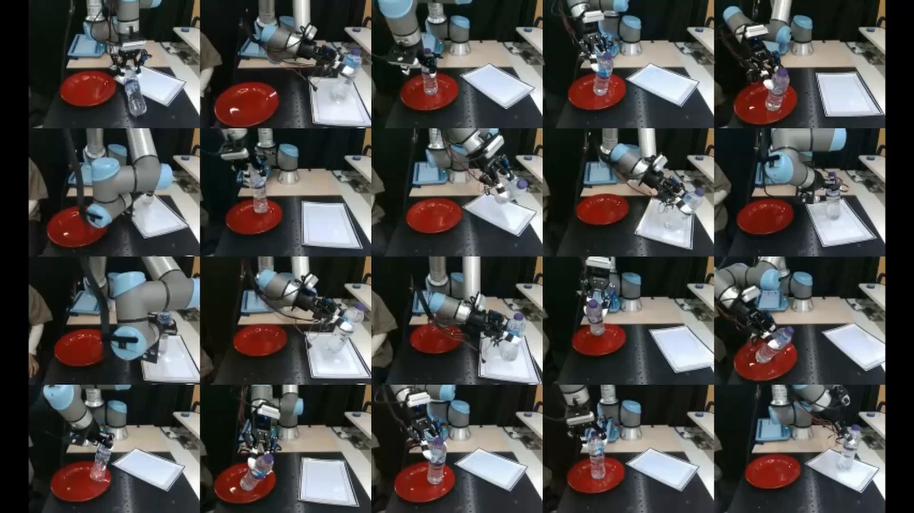</a>
<figcaption>HapTile官方datacollection_process视频第4秒截帧：多次机器人搬放瓶子的采集过程。画面展示不同演示的动作差异。<span class="figure-links"><a href="https://haptile-dataset.github.io/" target="_blank" rel="noopener">来源：作者项目／论文</a><a href="https://haptile-dataset.github.io/static/videos/datacollection_process.mov" target="_blank" rel="noopener">原图／视频／PDF</a></span></figcaption>
</figure>
<figure class="dataset-figure" id="fig-r12-markers">
<div class="figure-type"><strong>R12 · 图2</strong><span>真实触觉与派生特征</span><small>点击图片放大</small></div>
<a class="figure-open" href="figures/r12-markers.webp" target="_blank" rel="noopener" aria-label="放大：HapTile官方marker_tracking视频第2秒截帧：场景视觉、左右指原始触觉与marker追踪并列。右侧箭头是计算的运动特征，不是额外力传感器真值。">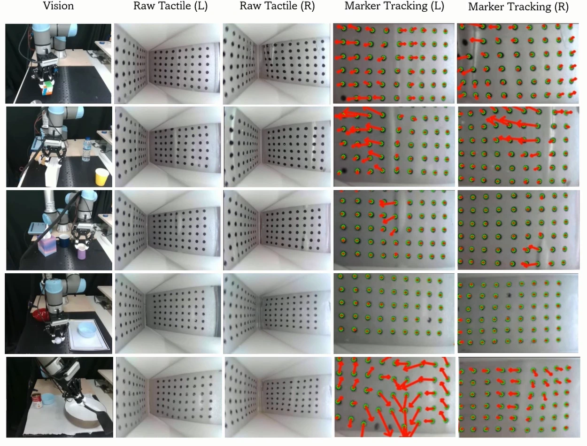</a>
<figcaption>HapTile官方marker_tracking视频第2秒截帧：场景视觉、左右指原始触觉与marker追踪并列。右侧箭头是计算的运动特征，不是额外力传感器真值。<span class="figure-links"><a href="https://haptile-dataset.github.io/" target="_blank" rel="noopener">来源：作者项目／论文</a><a href="https://haptile-dataset.github.io/static/videos/marker_tracking.mov" target="_blank" rel="noopener">原图／视频／PDF</a></span></figcaption>
</figure>
</div>


<a id="R13"></a>

### R13 · LET-Dex Dataset

**分类：**机器人真机触觉　**参考年份：**2025　**证据：**A（已核实实际数据文件目录；计入主统计）

**数据／项目链接：**[官方数据](https://huggingface.co/datasets/LejuRobotics/LET-Dex-Dataset)；[转换工具](https://github.com/LejuRobotics/kuavo_data_challenge)

| 项目 | 核实信息 |
|---|---|
| 规模与发布口径 | 官方首批真机灵巧手力触觉数据；本次以可见文件为发布证据，不把整个LET平台总量纳入。 |
| 传感器、模态与时序 | Kuavo 4 Pro/轮式平台、Linker Hand L6；5指6×12触觉阵列、六维力/力矩、RGB-D、关节及任务标注。 |
| 动作与状态 | ROSbag原始流和转换工具；机器人控制/状态须按topic区分。 |
| 对触觉世界模型的用途 | 优先：分布式指尖触觉、灵巧手动作后训练。 |
| 数据许可 | CC BY-NC-SA 4.0 |
| 限制、证据缺口与去重 | LET全库和LET-Dex触觉子库不能重复计数；数据卡部分旧下载别名与现仓库名不同，优先使用本条HF地址。 |

<section id="sample-R13" class="sample-card complete_trajectory"><h4>实际数据样例 <span class="sample-status">完整时序样例</span></h4>
<div class="sample-player"><video controls playsinline preload="none" poster="trajectories/R13/poster.webp" src="trajectories/R13/preview.mp4" aria-label="R13 实际数据可视化"></video></div>
<p class="sample-caption">完整下载Smart_postal_packages任务原始ROSbag，10.396秒；左头部RGB，右左手5指×72通道压力数组（展平通道顺序，不是手掌几何），色标原始uint8 0–255。以bag时间戳最近邻配对，最大时间差17.5ms。</p>
<div class="sample-meta"><div><b>样例／文件</b>datasets/rosbag/tactile/real/Labelled/Smart_postal_packages-P4-Linker_Hand_L6/A10-A12-I-L-03-TQ_04_01-P4_338-dex_hand-20251219161353-v001.bag</div><div><b>下载范围</b>完整录制/序列 · 312 帧 / 原始采样率未确认</div><div><b>原始样例时长</b>10.396 秒</div></div>
<p class="sample-caption"><strong>对齐方式：</strong>bag timestamp nearest neighbour maximum offset 17.5ms</p>
<p class="sample-caption">另核查最小2.96秒bag所有触觉为0，故选择下一条完整原袋</p>
<p class="sample-links">
<a href="trajectories/R13/index.html" target="_blank" rel="noopener">单独打开样例</a>
<a href="https://huggingface.co/datasets/LejuRobotics/LET-Dex-Dataset" target="_blank" rel="noopener">数据源</a>
<a href="https://hf-mirror.com/datasets/LejuRobotics/LET-Dex-Dataset/resolve/main/datasets/rosbag/tactile/real/Labelled/Smart_postal_packages-P4-Linker_Hand_L6/A10-A12-I-L-03-TQ_04_01-P4_338-dex_hand-20251219161353-v001.bag" target="_blank" rel="noopener">原始下载入口</a>
<a href="trajectory_records/R13.json">下载／校验记录</a></p>
<div class="sample-duration"><strong>数据集时长：</strong>总时长未核实<p><strong>覆盖范围：</strong>完整发布数据</p><p>未找到可可靠汇总的总时长；不以样本数或文件体积推算。</p></div>
<div class="duration-estimate" id="duration-R13"><h5>本轮统计值：6.89 小时 <span class="estimate-tag estimated">估算</span></h5><p>范围：3.45–13.78 小时 · 可信度：低 · 已验证文件入口</p><p><strong>覆盖：</strong>LET-Dex当前公开714个真机触觉ROSbag，不包括整个LET平台未发布数据。</p><p><strong>计算：</strong>公开714个ROSbag合计545.7GB；以完整实测sample228,702,187bytes/10.395954371s标定秒/字节，再乘全库字节数。</p><p>公开下载入口已核查，已有真实样本下载。</p><details><summary>估算假设与来源</summary><ul><li>ROSbag字节率受图像压缩、模态和事件频率影响，不能把体积直接当时长；这里只用真实时间锚点作有条件外推。</li><li>范围为标定字节率0.5–2倍的敏感性分析。</li><li>其中至少发现一个全零触觉bag，未逐条筛查非零接触比例，主值为有触觉通道的录制跨度。</li></ul><ul><li><a href="https://huggingface.co/datasets/LejuRobotics/LET-Dex-Dataset" target="_blank" rel="noopener">来源 1</a>：完整文件树714个.bag，四类任务；已下载有效接触样例并读ROS时间戳。</li></ul></details><p><a href="duration_estimates/R13.json">下载该条计算记录</a></p></div></section>

<div class="dataset-figures">
<figure class="dataset-figure" id="fig-r13-01">
<div class="figure-type"><strong>R13 · 图1</strong><span>采集硬件</span><small>点击图片放大</small></div>
<a class="figure-open" href="figures/r13-01.webp" target="_blank" rel="noopener" aria-label="放大：LET-Dex官方数据卡中的Linker Hand灵巧手硬件。触觉阵列与六维力传感器应按各自topic读取。">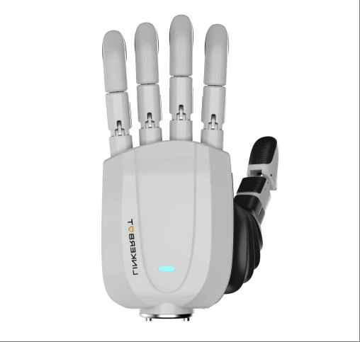</a>
<figcaption>LET-Dex官方数据卡中的Linker Hand灵巧手硬件。触觉阵列与六维力传感器应按各自topic读取。<span class="figure-links"><a href="https://huggingface.co/datasets/LejuRobotics/LET-Dex-Dataset/raw/main/README.md" target="_blank" rel="noopener">来源：作者项目／论文</a><a href="https://huggingface.co/datasets/LejuRobotics/LET-Dex-Dataset/resolve/main/docs/images/linker_hand.png" target="_blank" rel="noopener">原图／视频／PDF</a></span></figcaption>
</figure>
<figure class="dataset-figure wide" id="fig-r13-02">
<div class="figure-type"><strong>R13 · 图2</strong><span>数据可视化</span><small>点击图片放大</small></div>
<a class="figure-open" href="figures/r13-02.webp" target="_blank" rel="noopener" aria-label="放大：LET-Dex官方数据可视化示例；用来了解机器人、相机和触觉流的布局，不代表所有录制均包含完整模态。">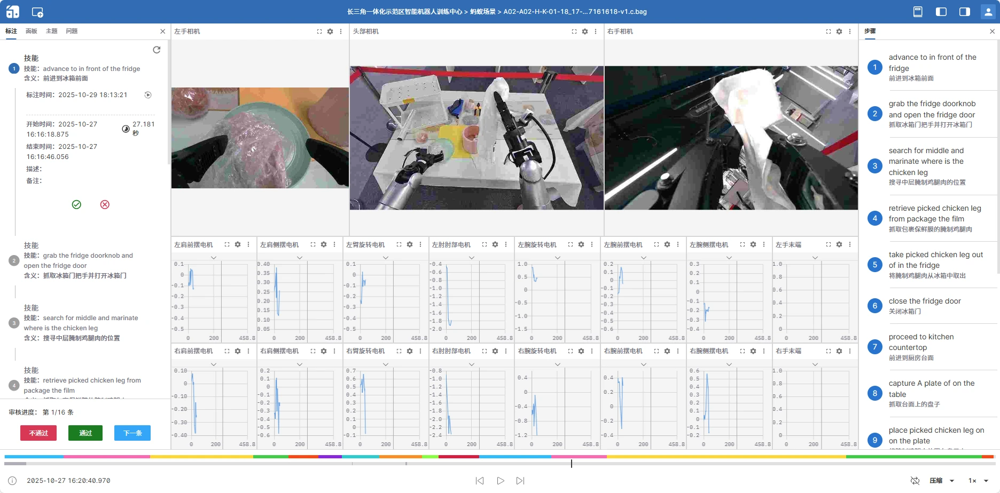</a>
<figcaption>LET-Dex官方数据可视化示例；用来了解机器人、相机和触觉流的布局，不代表所有录制均包含完整模态。<span class="figure-links"><a href="https://huggingface.co/datasets/LejuRobotics/LET-Dex-Dataset/raw/main/README.md" target="_blank" rel="noopener">来源：作者项目／论文</a><a href="https://huggingface.co/datasets/LejuRobotics/LET-Dex-Dataset/resolve/main/docs/images/Visualize+Datasets.png" target="_blank" rel="noopener">原图／视频／PDF</a></span></figcaption>
</figure>
</div>


<a id="R14"></a>

### R14 · Humanoid Everyday（触觉部分）

**分类：**机器人真机触觉　**参考年份：**2025　**证据：**A（已核实实际数据文件目录；计入主统计）

**数据／项目链接：**[官方数据](https://huggingface.co/datasets/USC-PSI-Lab/humanoid-everyday)；[论文](https://arxiv.org/abs/2510.08807)

| 项目 | 核实信息 |
|---|---|
| 规模与发布口径 | 作者数据卡：260+任务、7大类，30Hz多模态；仅触觉可用部分应进入触觉训练。 |
| 传感器、模态与时序 | 人形机器人遥操作；RGB、depth、LiDAR、触觉与IMU；FTP引用Unitree Dex3相关信号。 |
| 动作与状态 | 机器人操作序列，提供LeRobot及原始下载表。 |
| 对触觉世界模型的用途 | 人形/灵巧手本体多样性、触觉与全身操作关联。 |
| 数据许可 | Apache 2.0 |
| 限制、证据缺口与去重 | 不能假设每条、每个平台都含同一触觉字段；数据卡使用过USC-GVL旧命名，现发布方为USC-PSI-Lab。 |

<section id="sample-R14" class="sample-card complete_trajectory"><h4>实际数据样例 <span class="sample-status">完整时序样例</span></h4>
<div class="sample-player"><video controls playsinline preload="none" poster="trajectories/R14/poster.webp" src="trajectories/R14/preview.mp4" aria-label="R14 实际数据可视化"></video></div>
<p class="sample-caption">完整episode_000000：515帧、30Hz，样例时间戳跨度17.134秒。左为同步ego RGB，右为18×4原始触觉数组（行是sensor_id，列是字段，不代表手掌几何）；含NaN及约30000/101000基线，灰色为NaN，未标定为牛顿。展示每3帧取1帧。</p>
<div class="sample-meta"><div><b>样例／文件</b>episode_000000</div><div><b>下载范围</b>完整录制/序列 · 515 帧 / 30.000 Hz</div><div><b>原始样例时长</b>17.134 秒</div></div>
<p class="sample-caption"><strong>对齐方式：</strong>30Hz同一episode索引</p>
<p class="sample-links">
<a href="trajectories/R14/index.html" target="_blank" rel="noopener">单独打开样例</a>
<a href="https://huggingface.co/datasets/USC-PSI-Lab/humanoid-everyday" target="_blank" rel="noopener">数据源</a>
<a href="trajectory_records/R14.json">下载／校验记录</a></p>
<div class="sample-duration"><strong>数据集时长：</strong>元数据推算 31.816 h<p><strong>覆盖范围：</strong>混合机器人全库，非逐条确认有触觉的子集</p><p>官方meta/info.json：3,436,171帧 ÷ 30Hz ÷3600 = 31.816小时、8949条。含触觉字段不保证每条有效，不能把全库31.82小时全算成有效触觉。</p></div>
<details class="sample-evidence"><summary>时长及下载证据</summary><ul><li><a href="https://hf-mirror.com/datasets/USC-PSI-Lab/humanoid-everyday/resolve/main/meta/info.json" target="_blank" rel="noopener">来源 1</a>：{&#x27;total_frames&#x27;: 3436171, &#x27;fps&#x27;: 30, &#x27;total_episodes&#x27;: 8949}</li></ul></details>
<div class="duration-estimate" id="duration-R14"><h5>本轮统计值：16.47 小时 <span class="estimate-tag metadata">元数据实算</span></h5><p>范围：16.44–16.47 小时 · 可信度：中 · 已验证文件入口</p><p><strong>覆盖：</strong>Humanoid Everyday仅G1 Dex3-1触觉手平台：4,064条、1,779,287帧；排除H1。</p><p><strong>计算：</strong>官方每episode robot_type筛选g1，然后sum(length)/(30×3600)=16.47488h；下限每episode扣一个端点帧。</p><p>公开下载入口已核查，已有真实样本下载。</p><details><summary>估算假设与来源</summary><ul><li>这是触觉传感器平台的录制时长，未逐帧剔除NaN、基线、未接触片段；不等于全部为有效接触。</li><li>H1的4,885条/1,656,884帧没有论文所述Dex3-1触觉手，不能计入主值。</li></ul><ul><li><a href="https://arxiv.org/html/2510.08807" target="_blank" rel="noopener">来源 1</a>：BothH1andG1；In addition,theG1Dex3-1 hands possess tactile sensors；30Hz采集。</li><li><a href="https://huggingface.co/datasets/USC-PSI-Lab/humanoid-everyday/blob/main/meta/episodes.jsonl" target="_blank" rel="noopener">来源 2</a>：全8949条按robot_type分组实算，G1 4064条1,779,287帧。</li></ul></details><p><a href="duration_estimates/R14.json">下载该条计算记录</a></p></div></section>

<div class="dataset-figures">
<figure class="dataset-figure wide" id="fig-r14-01">
<div class="figure-type"><strong>R14 · 图1</strong><span>采集装置</span><small>点击图片放大</small></div>
<a class="figure-open" href="figures/r14-01.webp" target="_blank" rel="noopener" aria-label="放大：Humanoid Everyday论文的数据采集设置。整库含多种模态，本报告仅将实际含触觉的部分作为触觉训练候选。">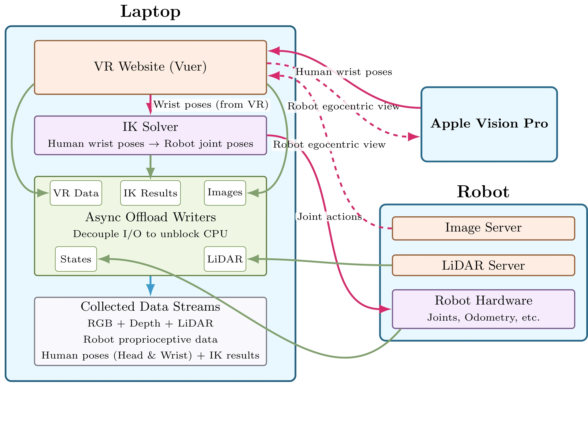</a>
<figcaption>Humanoid Everyday论文的数据采集设置。整库含多种模态，本报告仅将实际含触觉的部分作为触觉训练候选。<span class="figure-links"><a href="https://arxiv.org/html/2510.08807v3" target="_blank" rel="noopener">来源：作者项目／论文</a><a href="https://arxiv.org/html/2510.08807v3/images/datacollection-1.png" target="_blank" rel="noopener">原图／视频／PDF</a></span></figcaption>
</figure>
</div>


<a id="R15"></a>

### R15 · 白虎-VTouch / OpenLoong visuo-tactile

**分类：**机器人真机触觉　**参考年份：**2026　**证据：**A（已核实实际数据文件目录；计入主统计）

**数据／项目链接：**[官方数据](https://www.modelscope.cn/datasets/OpenLoong-Community/visuo-tactile)；[官方可读数据卡](https://www.modelscope.cn/datasets/OpenLoong-Community/visuo-tactile.md)；[可见归档](https://huggingface.co/datasets/MJJJJ1064/FTP-1-Dataset/tree/main/VisuoTactile_D-WHEEL)

| 项目 | 核实信息 |
|---|---|
| 规模与发布口径 | 官方ModelScope条目标示约16TB；含青龙、D-WHEEL及手持PIKA平台，100+原子技能（不是已核实任务数）。 |
| 传感器、模态与时序 | 多路真实视触觉、头/腕RGB-D、关节位姿与HDF5操作序列。 |
| 动作与状态 | 机器人与手持工具子集分别有运动字段，需按平台处理。 |
| 对触觉世界模型的用途 | 大规模视触觉操作候选；可用于跨本体动作条件模型。 |
| 数据许可 | CC BY-NC-SA 4.0 |
| 限制、证据缺口与去重 | 这里按一个跨本体来源家族计入R；PIKA部分不再计入U。FTP的VisuoTactile_D-WHEEL/QINGLOONG也是该家族，不能再加两个；16TB不是小时数。 |

<section id="sample-R15" class="sample-card complete_trajectory"><h4>实际数据样例 <span class="sample-status">完整时序样例</span></h4>
<div class="sample-player"><video controls playsinline preload="none" poster="trajectories/R15/poster.webp" src="trajectories/R15/preview.mp4" aria-label="R15 实际数据可视化"></video></div>
<p class="sample-caption">从官方原始HDF5完整抽取709帧头部RGB与左夹爪左指触觉流，任务“使用润滑油瓶滴油至轴承”。metadata明确aligned_to_30_fps，timestamp为纳秒、跨度23.600秒；每2帧展示1帧。只下载选定两路与元数据，未下载其它相机/深度/关节字段。</p>
<div class="sample-meta"><div><b>样例／文件</b>使用润滑油瓶滴油至轴承/D-WHEEL/s13c30c3652e4616903d8ca2e0ec4706.h5</div><div><b>下载范围</b>完整录制/序列 · 709 帧 / 30.000 Hz</div><div><b>原始样例时长</b>23.600 秒</div></div>
<p class="sample-caption"><strong>对齐方式：</strong>official metadata aligned_to_30_fps; same indices</p>
<p class="sample-caption">entire trajectory selected RGB+tactile streams, other modalities omitted</p>
<p class="sample-links">
<a href="trajectories/R15/index.html" target="_blank" rel="noopener">单独打开样例</a>
<a href="https://www.modelscope.cn/datasets/OpenLoong-Community/visuo-tactile" target="_blank" rel="noopener">数据源</a>
<a href="https://www.modelscope.cn/api/v1/datasets/OpenLoong-Community/visuo-tactile/repo?Revision=master&amp;FilePath=%E4%BD%BF%E7%94%A8%E6%B6%A6%E6%BB%91%E6%B2%B9%E7%93%B6%E6%BB%B4%E6%B2%B9%E8%87%B3%E8%BD%B4%E6%89%BF%2FD-WHEEL%2Fs13c30c3652e4616903d8ca2e0ec4706.h5" target="_blank" rel="noopener">原始下载入口</a>
<a href="trajectory_records/R15.json">下载／校验记录</a></p>
<div class="sample-duration"><strong>数据集时长：</strong>总时长未核实<p><strong>覆盖范围：</strong>完整发布数据</p><p>原数据metadata可逐episode统计时长；本次仅核实23.600秒样例，16TB文件体积不能换算为小时。</p></div>
<div class="duration-estimate" id="duration-R15"><h5>本轮统计值：111.20 小时 <span class="estimate-tag estimated">估算</span></h5><p>范围：77.84–144.56 小时 · 可信度：中 · 已验证文件入口</p><p><strong>覆盖：</strong>VTouch官方ModelScope全部9,246个HDF5，三平台合并一次。</p><p><strong>计算：</strong>四页官方API核实9,246条、17,249,459,503,388bytes；各平台在文件大小20/50/80百分位抽三条，共9条，读真实ns时间戳。按平台用总字节数×样本总秒数/样本总字节数外推后求和。</p><p>公开下载入口已核查，已有真实样本下载。</p><details><summary>估算假设与来源</summary><ul><li>同平台HDF5各模态的字节率假定近似稳定；不同平台分别标定，未以单条D-WHEEL代替全部平台。</li><li>±30%是压缩比与轨迹差异的规划范围，不是统计置信区间。</li><li>PIKA属手持采集，但按现有报告来源家族R15分类统计；不与FTP再相加。</li></ul><ul><li><a href="https://www.modelscope.cn/datasets/OpenLoong-Community/visuo-tactile" target="_blank" rel="noopener">来源 1</a>：公开四页9,306个目录/文件条目中9,246HDF5；D-WHEEL6908、PIKA1441、QINGLOONG897。</li><li><a href="https://www.modelscope.cn/api/v1/datasets/174855/repo/tree?Revision=master&amp;Root=/&amp;Recursive=True&amp;PageNumber=1&amp;PageSize=3000" target="_blank" rel="noopener">来源 2</a>：完整分页索引及9个HDF5时间戳实读，采样30Hz。</li></ul><p>核查明细：<a href="duration_estimates/work_robot/R15_full_index.json">[1]</a> <a href="duration_estimates/work_robot/large_samples.json">[2]</a> </p></details><p><a href="duration_estimates/R15.json">下载该条计算记录</a></p></div></section>

<div class="dataset-figures">
<figure class="dataset-figure" id="fig-r15-01">
<div class="figure-type"><strong>R15 · 图1</strong><span>场景分布</span><small>点击图片放大</small></div>
<a class="figure-open" href="figures/r15-01.webp" target="_blank" rel="noopener" aria-label="放大：白虎-VTouch官方数据卡的采集场景分布图；这是场景统计，不是逐条轨迹质量或完整触觉覆盖的证明。">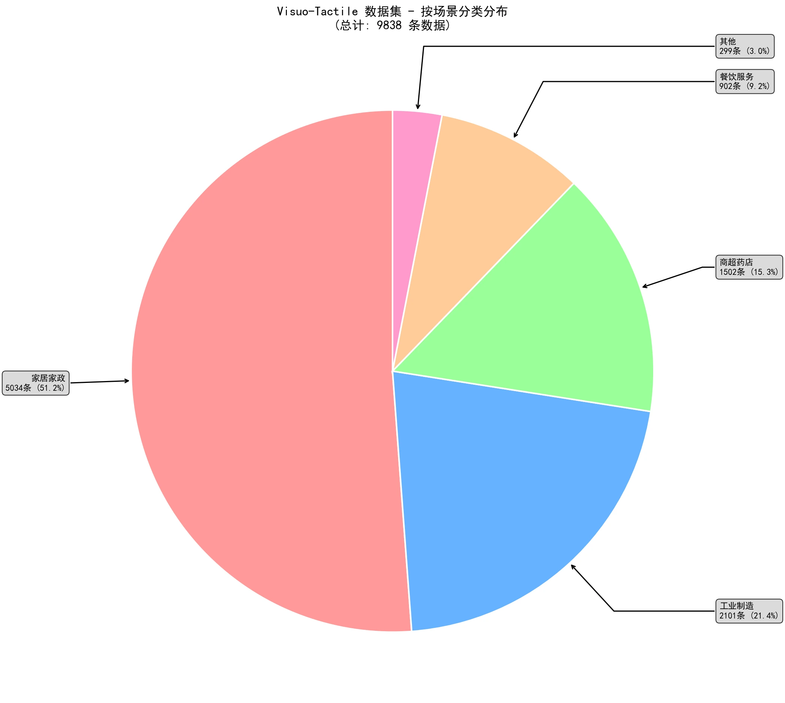</a>
<figcaption>白虎-VTouch官方数据卡的采集场景分布图；这是场景统计，不是逐条轨迹质量或完整触觉覆盖的证明。<span class="figure-links"><a href="https://www.modelscope.cn/datasets/OpenLoong-Community/visuo-tactile.md" target="_blank" rel="noopener">来源：作者项目／论文</a><a href="https://openloong-apps-dev-public.obs.cn-east-3.myhuaweicloud.com/videos/visuo_tactile_readme/scenario.png" target="_blank" rel="noopener">原图／视频／PDF</a></span></figcaption>
</figure>
<figure class="dataset-figure" id="fig-r15-02">
<div class="figure-type"><strong>R15 · 图2</strong><span>触觉样例</span><small>点击图片放大</small></div>
<a class="figure-open" href="figures/r15-02.webp" target="_blank" rel="noopener" aria-label="放大：VTouch官方左手左指光学触觉视频的截帧；这是传感器内部接触图像，不能当成外部场景RGB。">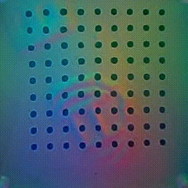</a>
<figcaption>VTouch官方左手左指光学触觉视频的截帧；这是传感器内部接触图像，不能当成外部场景RGB。<span class="figure-links"><a href="https://www.modelscope.cn/datasets/OpenLoong-Community/visuo-tactile.md" target="_blank" rel="noopener">来源：作者项目／论文</a><a href="https://openloong-apps-dev-public.obs.cn-east-3.myhuaweicloud.com/videos/visuo_tactile_readme/hand_left_left.gif" target="_blank" rel="noopener">原图／视频／PDF</a></span></figcaption>
</figure>
</div>


<a id="R16"></a>

### R16 · SharpaDex v1.0 / Sharpa North（关联FTP旧发布）

**分类：**机器人真机触觉　**参考年份：**2026　**证据：**A（已核实实际数据文件目录；计入主统计）

**数据／项目链接：**[SharpaDex官方发布](https://huggingface.co/datasets/Sharpa-Robotics/SharpaDex-v1.0)；[本轮固定版本](https://huggingface.co/datasets/Sharpa-Robotics/SharpaDex-v1.0/tree/c8032fd891e3f6f19b0d4886793579c1dce5eea7)；[关联FTP旧发布](https://huggingface.co/datasets/MJJJJ1064/FTP-1-Dataset/tree/main/sharpa)；[FTP论文与来源表](https://arxiv.org/abs/2606.13102)

| 项目 | 核实信息 |
|---|---|
| 规模与发布口径 | 2026-10-20读取全部495份v3.0 info：59任务、28,993条轨迹、32,396,172帧，全部30FPS，合计299.964556小时；逐任务与官方说明一致。 |
| 传感器、模态与时序 | 真实双7DoF机械臂、双22DoF灵巧手；4路480×480 RGB，480×1600触觉原图、480×1200形变图，以及10指×6轴的60维触觉信号。 |
| 动作与状态 | 65维状态与动作、65维关节力矩；观察/命令TCP pose各12维；全局语言与帧级阶段索引。完整样例1,250帧/41.667秒，六路视频已解码。 |
| 对触觉世界模型的用途 | 优先候选：动作条件视触觉世界模型、多指接触预测与语言阶段条件建模；先确认单位、手指图块映射及控制语义。 |
| 数据许可 | SharpaDex：CC BY-NC 4.0；FTP旧发布仍需保留其上游条款 |
| 限制、证据缺口与去重 | v2.1/v3.0是同一批示范，时长只计一次。与旧Sharpa North-FTP-1同采集家族，但轨迹交集未确认；保守保留R16一个来源家族，以SharpaDex为主统计范围，不额外加旧25.24h估计。这不表示已证实新版包含旧版。TCP force槽和7个torso torque槽为零；触觉单位/标定、TCP坐标旋转约定与硬件时延仍未独立核实。约300h是元数据录制量，不是净接触或全视频质量核验量。 |

<section id="sample-R16" class="sample-card complete_trajectory"><h4>实际数据样例 <span class="sample-status">完整时序样例</span></h4>
<div class="sample-player"><video controls playsinline preload="none" poster="supplements/sharpadex_v1/visualization/poster.jpg" src="supplements/sharpadex_v1/visualization/preview.mp4" aria-label="R16 实际数据可视化"></video></div>
<p class="sample-caption">SharpaDex真实清盘轨迹：左手握盘、右手持擦子擦拭。上排四路头/腕RGB，中排原始2×5触觉相机拼图与形变图，下排双手各5指fz存储值及当前时刻。实际六视频各1250帧/30Hz；触觉图块到手指的语义映射、数值单位及硬件时延未独立确认。</p>
<div class="sample-meta"><div><b>样例／文件</b>clean_plate_with_eraser/season_POC22027_2026_04_17_11_01_59_train/lerobot_v2.1 / episode 0</div><div><b>下载范围</b>完整录制/序列 · 1250 帧 / 30.000 Hz</div><div><b>原始样例时长</b>41.667 秒</div></div>
<p class="sample-caption"><strong>对齐方式：</strong>同一导出frame_index对齐六路视频及Parquet；各视频完整解码1250帧。只验证导出网格，不宣称原始硬件时延已独立审计。</p>
<p class="sample-caption">原始清盘完整轨迹41.667秒；合成预览每3帧取1帧、10FPS按1倍时间播放41.7秒。数据值不虚构单位、不做触觉插值。</p>
<p class="sample-caption"><strong>当前缺口：</strong>TCP force槽及7个torso torque槽为零；三条抽样触觉首帧全零，并有少量相邻重复行。；触觉单位/标定、TCP坐标与旋转约定仍不充分；无全库逐帧有效率保证。</p>
<p class="sample-links">
<a href="supplements/sharpadex_v1/review.html" target="_blank" rel="noopener">单独打开样例</a>
<a href="https://huggingface.co/datasets/Sharpa-Robotics/SharpaDex-v1.0" target="_blank" rel="noopener">数据源</a>
<a href="https://huggingface.co/datasets/Sharpa-Robotics/SharpaDex-v1.0/resolve/c8032fd891e3f6f19b0d4886793579c1dce5eea7/clean_plate_with_eraser/season_POC22027_2026_04_17_11_01_59_train/lerobot_v2.1/data/chunk-000/episode_000000.parquet" target="_blank" rel="noopener">原始下载入口</a>
<a href="trajectory_records/R16.json">下载／校验记录</a></p>
<p class="sample-links"><a href="supplements/sharpadex_v1/review.html">详细审计 1</a><a href="supplements/sharpadex_v1/video_audit.json">详细审计 2</a><a href="supplements/sharpadex_v1/quality_spotchecks/conclusion_zh.md">详细审计 3</a><a href="supplements/sharpadex_v1/metadata_audit/audit_totals.json">详细审计 4</a></p>
<div class="sample-duration"><strong>数据集时长：</strong>官方发布／公开范围 300.000 h；元数据推算 299.965 h<p><strong>覆盖范围：</strong>SharpaDex v1.0单一导出全部495seasons，59任务；原始FTP旧发布不额外叠加。</p><p>全部495份info实算32,396,172/30/3600=299.964556小时，非单条样例外推。v2.1/v3.0重复导出不相加。约300小时包含非接触阶段，尚未全量解码验证质量；旧FTP约4000条及原25.24小时估计保留历史附件。</p></div>
<details class="sample-evidence"><summary>时长及下载证据</summary><ul><li><a href="https://huggingface.co/datasets/Sharpa-Robotics/SharpaDex-v1.0" target="_blank" rel="noopener">来源 1</a>：官方数据卡：59任务、495seasons、28,993episodes、32,396,172frames、30FPS；两导出同源。</li><li><a href="https://huggingface.co/datasets/Sharpa-Robotics/SharpaDex-v1.0/blob/c8032fd891e3f6f19b0d4886793579c1dce5eea7/clean_plate_with_eraser/season_POC22027_2026_04_17_11_01_59_train/lerobot_v2.1/meta/info.json" target="_blank" rel="noopener">来源 2</a>：本轮逐一读取全部495份v3.0 info，响应commit均相同；样例v2.1结构及全局规模相符。</li><li><a href="https://huggingface.co/datasets/Sharpa-Robotics/SharpaDex-v1.0/blob/c8032fd891e3f6f19b0d4886793579c1dce5eea7/clean_plate_with_eraser/season_POC22027_2026_04_17_11_01_59_train/lerobot_v2.1/data/chunk-000/episode_000000.parquet" target="_blank" rel="noopener">来源 3</a>：真实Parquet1250帧、动作区别于观察、60维触觉变化；另抽查锤钉703帧及插插头335帧。</li></ul></details>
<div class="duration-estimate" id="duration-R16"><h5>本轮统计值：299.96 小时 <span class="estimate-tag metadata">元数据实算</span></h5><p>范围：299.96 小时 · 可信度：高 · 已验证文件入口</p><p><strong>覆盖：</strong>SharpaDex v1.0单一LeRobot导出的全部495个采集season；旧Sharpa FTP发布保留关联，不另加时长。</p><p><strong>计算：</strong>完整枚举59任务/495season，读取全部495份v3.0 meta/info.json；Σtotal_frames=32,396,172，全部fps=30，除以30×3600得到299.964556小时。</p><p>官方非门控公开入口，已读取495份元数据及实际Parquet/视频；许可CC BY-NC 4.0。</p><details><summary>估算假设与来源</summary><ul><li>上下界相同表示该元数据口径可确定计算，不意味着全库视频逐帧质量、物理同步或净接触时长均已审计。</li><li>v2.1和v3.0是同一批示范，只选一个导出；六视频流与十指不分别累计小时。</li><li>与Sharpa North-FTP-1属于同采集家族，轨迹交集尚未量化；保守只计本库，不额外加旧估计25.237778h，也不声称新版完整包含旧版。</li><li>全部495份元数据逐任务与README一致，来自固定commit；原始仓库信息接口100000文件上限已通过逐目录枚举绕开。</li><li>真实样例六路视频各1250帧/30Hz、导出时间网格一致；这不独立证明硬件零时延。</li></ul><ul><li><a href="https://huggingface.co/datasets/Sharpa-Robotics/SharpaDex-v1.0" target="_blank" rel="noopener">来源 1</a>：官方数据卡：59任务、495seasons、28,993episodes、32,396,172frames、30FPS；两导出同源。</li><li><a href="https://huggingface.co/datasets/Sharpa-Robotics/SharpaDex-v1.0/blob/c8032fd891e3f6f19b0d4886793579c1dce5eea7/clean_plate_with_eraser/season_POC22027_2026_04_17_11_01_59_train/lerobot_v2.1/meta/info.json" target="_blank" rel="noopener">来源 2</a>：本轮逐一读取全部495份v3.0 info，响应commit均相同；样例v2.1结构及全局规模相符。</li></ul><p>核查明细：<a href="supplements/sharpadex_v1/metadata_audit/audit_totals.json">[1]</a> <a href="supplements/sharpadex_v1/metadata_audit/season_metadata_summary.json">[2]</a> <a href="supplements/sharpadex_v1/metadata_audit/task_statistics.csv">[3]</a> <a href="supplements/sharpadex_v1/relation_notes.md">[4]</a> </p></details><p><a href="duration_estimates/R16.json">下载该条计算记录</a></p></div></section>

<div class="dataset-figures">
<figure class="dataset-figure wide" id="fig-r16-01">
<div class="figure-type"><strong>R16 · 图1</strong><span>Sharpa平台与触觉样例</span><small>点击图片放大</small></div>
<a class="figure-open" href="figures/r16-01.webp" target="_blank" rel="noopener" aria-label="放大：FTP-1论文图5的左侧Sharpa North面板：真实灵巧手平台、DTC触觉外观及任务展示。裁去了其他本体和仿真面板；图中的评测任务不自动等于公开包的训练轨迹。">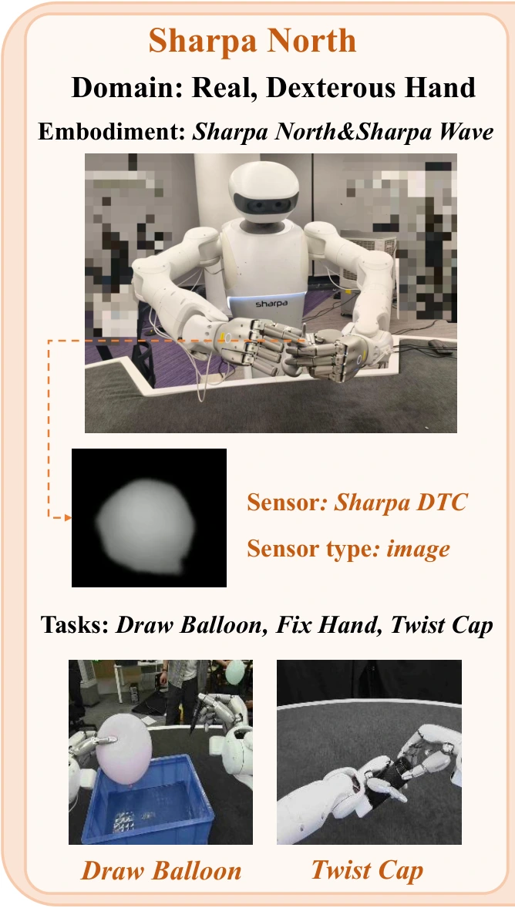</a>
<figcaption>FTP-1论文图5的左侧Sharpa North面板：真实灵巧手平台、DTC触觉外观及任务展示。裁去了其他本体和仿真面板；图中的评测任务不自动等于公开包的训练轨迹。<span class="figure-links"><a href="https://arxiv.org/html/2606.13102v2" target="_blank" rel="noopener">来源：作者项目／论文</a><a href="https://arxiv.org/html/2606.13102v2/hardware_settings_0519_seen.png" target="_blank" rel="noopener">原图／视频／PDF</a></span></figcaption>
</figure>
</div>

**2026-10-20专项核查：**[完整技术报告与六路视频](supplements/sharpadex_v1/review.html) · [59任务时长CSV](supplements/sharpadex_v1/metadata_audit/task_statistics.csv) · [495批次元数据总计](supplements/sharpadex_v1/metadata_audit/audit_totals.json)。已完整解码清盘轨迹的四路RGB、触觉原图和形变视频，并另抽查锤钉、插插头的数值与语言数据。

**关联历史发布：**[旧FTP Sharpa样例](trajectories/R16/index.html) · [旧样例下载记录](trajectory_records/history/R16-ftp-20261019.json) · [旧25.24小时估算](duration_estimates/history/R16-ftp-20261019.json) · [新旧关系核查](supplements/sharpadex_v1/relation_notes.md)。旧版估计不再额外相加，也不因此声称其已被新版全部包含。目录仍按一个来源家族计数，稳定编号R16不变。


<a id="R17"></a>

### R17 · Tactile MNIST（Real）

**分类：**机器人真机触觉　**参考年份：**2025　**证据：**A（已核实实际数据文件目录；计入主统计）

**数据／项目链接：**[真实序列数据](https://huggingface.co/datasets/TimSchneider42/tactile-mnist-touch-real-seq-t256-320x240)；[官方工具](https://github.com/TimSchneider42/tactile-mnist)

| 项目 | 核实信息 |
|---|---|
| 规模与发布口径 | Franka在3D打印MNIST数字上采集；真实单帧/序列和不同分辨率是同一来源的不同表示。 |
| 传感器、模态与时序 | 真实光学触觉图像/序列、数字形状分类标签；套件还含独立仿真任务。 |
| 动作与状态 | 适合主动感知/形状识别；不等于多任务操作指令数据。 |
| 对触觉世界模型的用途 | 受控几何感知基准、主动触摸与接触覆盖。 |
| 数据许可 | CC BY 2.0（真实序列数据卡）；代码MIT |
| 限制、证据缺口与去重 | 仅Real计数；synthetic、ABC mesh、Starstruck和缩放图像版不增加真实数据集数量。 |

<section id="sample-R17" class="sample-card tactile_only"><h4>实际数据样例 <span class="sample-status">触觉样例／缺场景RGB</span></h4>
<div class="sample-player"><video controls playsinline preload="none" poster="trajectories/R17/poster.webp" src="trajectories/R17/preview.mp4" aria-label="R17 实际数据可视化"></video></div>
<p class="sample-caption">下载并保存一个完整256次触碰记录（id=2023-09-29_10-00-57_3-1，数字7），包含256个真实GelSight视频。播放器展示第0次完整触碰，54帧、容器24.000fps；原库未提供外部RGB。256次触碰起始时间跨度1045.834秒包含移动间隔，不能当作有效接触时长。</p>
<div class="sample-meta"><div><b>样例／文件</b>2023-09-29_10-00-57_3-1 / touch0</div><div><b>下载范围</b>完整录制/序列 · 54 帧 / 24.000 Hz</div><div><b>原始样例时长</b>2.250 秒</div></div>
<p class="sample-caption">one full256touch record downloaded; preview only first complete touch</p>
<p class="sample-links">
<a href="trajectories/R17/index.html" target="_blank" rel="noopener">单独打开样例</a>
<a href="https://huggingface.co/datasets/TimSchneider42/tactile-mnist-touch-real-seq-t256-320x240" target="_blank" rel="noopener">数据源</a>
<a href="https://hf-mirror.com/datasets/TimSchneider42/tactile-mnist-touch-real-seq-t256-320x240/resolve/main/data/test-00007-of-00008.parquet" target="_blank" rel="noopener">原始下载入口</a>
<a href="trajectory_records/R17.json">下载／校验记录</a></p>
<p class="sample-links"><a href="trajectory_audits/R17/duration_audit.json">详细审计 1</a></p>
<div class="sample-duration"><strong>数据集时长：</strong>元数据推算 120.903 h；有效接触窗口 10.713 h<p><strong>覆盖范围：</strong>该真实序列版本全部48个公开Parquet分片，600个唯一记录</p><p>读取48个分片全部时间字段，600个唯一ID、153,600次触碰。按每视频真实帧数取time_stamp_rel_seq最后有效帧减首帧，累计120.903小时；touch_end_time_rel-start累计有效接触10.713小时。前者含接近/退离，后者仅接触窗口；不含跨触碰移动间隔，不能与单帧/其它分辨率副本重复相加。</p></div>
<details class="sample-evidence"><summary>时长及下载证据</summary><ul><li><a href="https://huggingface.co/datasets/TimSchneider42/tactile-mnist-touch-real-seq-t256-320x240/tree/main/data" target="_blank" rel="noopener">来源 1</a>：all48shards: unique rows=600, contacts=153600; sum(actual video timestamp spans)=435251.126728s; sum(contact windows)=38567.014168s</li></ul></details>
<div class="duration-estimate" id="duration-R17"><h5>本轮统计值：120.90 小时 <span class="estimate-tag metadata">元数据实算</span></h5><p>范围：120.90 小时 · 可信度：高 · 已验证文件入口</p><p><strong>覆盖：</strong>Tactile MNIST Real全部48个序列分片、600个唯一记录、153,600次触碰视频的录制窗口。</p><p><strong>计算：</strong>逐次视频读取video_length_frames限定的time_stamp_rel_seq首尾跨度，153,600次求和120.903091h；不包含各次视频之间的机器人移动间隔。另计净接触10.713059h，二者不相加。</p><p>公开下载入口已核查，已有真实样本下载。</p><p>其中净接触窗口：10.71 小时，已包含于上述录制范围，不额外相加。</p><details><summary>估算假设与来源</summary><ul><li>与其他数据集统一按实际传感器录制窗口计时，包含视频内接近/离开等未接触帧。</li><li>逐视频时间戳首尾差不包含跨触碰视频的等待/移动间隔。</li><li>不同分辨率、单帧版和序列版是同一来源表示，不重复相加。</li></ul><ul><li><a href="https://huggingface.co/datasets/TimSchneider42/tactile-mnist-touch-real-seq-t256-320x240" target="_blank" rel="noopener">来源 1</a>：全部48Parquet已读metadata；600uniqueIDs×256touches。</li></ul><p>核查明细：<a href="duration_audits/R17/duration_audit.json">[1]</a> </p></details><p><a href="duration_estimates/R17.json">下载该条计算记录</a></p></div></section>

<div class="dataset-figures">
<figure class="dataset-figure wide" id="fig-r17-01">
<div class="figure-type"><strong>R17 · 图1</strong><span>真实采集装置</span><small>点击图片放大</small></div>
<a class="figure-open" href="figures/r17-01.webp" target="_blank" rel="noopener" aria-label="放大：Tactile MNIST官方标为Real Interactions的采集图：机器人探测3D打印数字，下方展示触觉观测。未将同项目的模拟环境或CycleGAN生成图冒充真实录制。">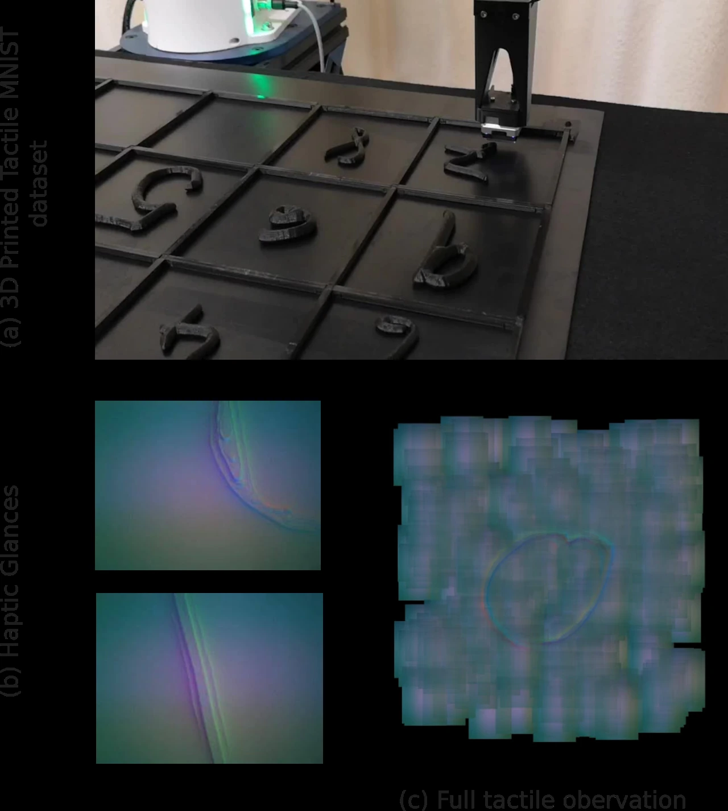</a>
<figcaption>Tactile MNIST官方标为Real Interactions的采集图：机器人探测3D打印数字，下方展示触觉观测。未将同项目的模拟环境或CycleGAN生成图冒充真实录制。<span class="figure-links"><a href="https://timschneider42.github.io/tactile-mnist/" target="_blank" rel="noopener">来源：作者项目／论文</a><a href="https://timschneider42.github.io/tactile-mnist/img/dataset/data_collection.png" target="_blank" rel="noopener">原图／视频／PDF</a></span></figcaption>
</figure>
</div>


<a id="R18"></a>

### R18 · ARQ-CRISP Slip Detection Dataset

**分类：**机器人真机触觉　**参考年份：**2021　**证据：**A（已核实实际数据文件目录；计入主统计）

**数据／项目链接：**[数据及协议](https://github.com/ARQ-CRISP/slip_detection_dataset_2021)

| 项目 | 核实信息 |
|---|---|
| 规模与发布口径 | 3物体×3摆放姿态×10次，合计90次抓取。 |
| 传感器、模态与时序 | 真实自主pick-and-place中的触觉与滑移标签，官方HDF5按物体组织。 |
| 动作与状态 | 抓取过程时序；公开读取脚本可分离各试验。 |
| 对触觉世界模型的用途 | 滑移事件预测、接触状态切换和稳定性评估。 |
| 数据许可 | 本次未确认数据专用许可 |
| 限制、证据缺口与去重 | 物体多样性较小，不适合作为通用操作世界模型唯一来源。 |

<section id="sample-R18" class="sample-card tactile_only"><h4>实际数据样例 <span class="sample-status">触觉样例／缺场景RGB</span></h4>
<div class="sample-player"><video controls playsinline preload="none" poster="trajectories/R18/poster.webp" src="trajectories/R18/preview.mp4" aria-label="R18 实际数据可视化"></video></div>
<p class="sample-caption">完整brush抓取试验635帧，展示18个uSkin通道Z读数；单位为原始传感器响应。原HDF5不含RGB，只发布触觉和事件标签。 红色游标按原时间推进；无对应RGB，未用项目图片冒充同步视觉。</p>
<div class="sample-meta"><div><b>样例／文件</b>GGCNN2/brush/Pose1/Exp1</div><div><b>下载范围</b>完整录制/序列 · 635 帧 / 原始采样率未确认</div><div><b>原始样例时长</b>3.522 秒</div></div>
<p class="sample-links">
<a href="trajectories/R18/index.html" target="_blank" rel="noopener">单独打开样例</a>
<a href="https://github.com/ARQ-CRISP/slip_detection_dataset_2021" target="_blank" rel="noopener">数据源</a>
<a href="https://github.com/ARQ-CRISP/slip_detection_dataset_2021/raw/refs/heads/main/data/slipDataset_brush_tactile.h5" target="_blank" rel="noopener">原始下载入口</a>
<a href="trajectory_records/R18.json">下载／校验记录</a></p>
<div class="sample-duration"><strong>数据集时长：</strong>元数据推算 0.064 h<p><strong>覆盖范围：</strong>brush物体的30条试验，非3物体全库</p><p>完整brush.h5读取30条试验时间戳，合计231.539秒（0.064小时）。其余两物体未按文件汇总，不外推。</p></div>
<details class="sample-evidence"><summary>时长及下载证据</summary><ul><li><a href="https://github.com/ARQ-CRISP/slip_detection_dataset_2021/tree/main/data" target="_blank" rel="noopener">来源 1</a>：brush: 30 experiment timestamp spans sum=231.53903102874756 seconds</li></ul></details>
<div class="duration-estimate" id="duration-R18"><h5>本轮统计值：0.353 小时 <span class="estimate-tag metadata">元数据实算</span></h5><p>范围：0.353 小时 · 可信度：高 · 已验证文件入口</p><p><strong>覆盖：</strong>ARQ-CRISP三物体×30试验=90条的全部公开触觉记录。</p><p><strong>计算：</strong>完整三个HDF5逐试验对tactile_timestamps毫秒首尾差求和。</p><p>公开下载入口已核查，已有真实样本下载。</p><details><summary>估算假设与来源</summary><ul><li>三个物体brush/SpoolSolder/screwDriver各30条；每条只计一次，滑移标签不增加时间。</li><li>记录跨度包括试验内非滑移时段，不是仅滑移事件持续时间。</li></ul><ul><li><a href="https://github.com/ARQ-CRISP/slip_detection_dataset_2021/tree/main/data" target="_blank" rel="noopener">来源 1</a>：三原始HDF5均已下载审计；brush0.064316h、solder0.145260h、screwdriver0.142957h。</li></ul><p>核查明细：<a href="duration_estimates/work_robot/R18_audit.json">[1]</a> </p></details><p><a href="duration_estimates/R18.json">下载该条计算记录</a></p></div></section>


<a id="R19"></a>

### R19 · iCub Hybrid Touch Texture Dataset

**分类：**机器人真机触觉　**参考年份：**2019　**证据：**A（已核实实际数据文件目录；计入主统计）

**数据／项目链接：**[官方数据](https://github.com/clear-nus/TactileLearning)

| 项目 | 核实信息 |
|---|---|
| 规模与发布口径 | 23种材质，提供touch和slide试验。 |
| 传感器、模态与时序 | iCub前臂触觉皮肤、15DoF机械臂编码器、skin_events力相关信号。 |
| 动作与状态 | 机器人状态与探索过程；主要面向材质识别。 |
| 对触觉世界模型的用途 | 非光学触觉动态、静态接触与滑动联合建模。 |
| 数据许可 | 本次未确认数据专用许可 |
| 限制、证据缺口与去重 | 与后续加工后的iCub材质数据需按原始采集来源去重。 |

<section id="sample-R19" class="sample-card tactile_only"><h4>实际数据样例 <span class="sample-status">触觉样例／缺场景RGB</span></h4>
<div class="sample-player"><video controls playsinline preload="none" poster="trajectories/R19/poster.webp" src="trajectories/R19/preview.mp4" aria-label="R19 实际数据可视化"></video></div>
<p class="sample-caption">完整下载bathTowel/touch_raw/right_forearm_comp/data.log：4167条、384个皮肤通道，时间戳跨度84.186秒。图像横轴为原时间、纵轴为通道，热图是完整序列；30秒游标加速浏览。发布包没有对应RGB。颜色范围0–73.67（99.9分位截断显示，原文件未截断），单位未转换为牛顿。 官方touch_raw包含10次触摸，此处展示完整记录流，未假定单次试验边界。</p>
<div class="sample-meta"><div><b>样例／文件</b>data/bathTowel/touch_raw/right_forearm_comp/data.log</div><div><b>下载范围</b>部分记录或静态样本 · 4167 帧 / 原始采样率未确认</div><div><b>原始样例时长</b>84.186 秒</div></div>
<p class="sample-caption">完整touch_raw记录流，官方README说明该目录含10次触摸；缺少显式单试验分段，本次没有虚构episode边界。</p>
<p class="sample-links">
<a href="trajectories/R19/index.html" target="_blank" rel="noopener">单独打开样例</a>
<a href="https://github.com/clear-nus/TactileLearning" target="_blank" rel="noopener">数据源</a>
<a href="trajectory_records/R19.json">下载／校验记录</a></p>
<div class="sample-duration"><strong>数据集时长：</strong>总时长未核实<p><strong>覆盖范围：</strong>完整发布数据</p><p>未找到可可靠汇总的总时长；不以样本数或文件体积推算。</p></div>
<div class="duration-estimate" id="duration-R19"><h5>本轮统计值：6.99 小时 <span class="estimate-tag estimated">估算</span></h5><p>范围：5.59–8.38 小时 · 可信度：中 · 已验证文件入口</p><p><strong>覆盖：</strong>iCub当前可见19种材料的56个带skin_events录制流：19slide、19touch、18touch_raw2。</p><p><strong>计算：</strong>各模式完整读取bathTowel对应encoder流，得到764.5705/84.1830/470.4638s；其余同模式按encoder文本字节数比例外推。每种模式只计一次时间，不再叠加forearm/events通道。</p><p>公开下载入口已核查，已有真实样本下载。</p><details><summary>估算假设与来源</summary><ul><li>论文23材料不等于当前公开目录19材料；只对实际有skin_events文件的流求和。</li><li>编码器固定列数/约50Hz使文本字节率可作粗代理，但数字长度和采样抖动会改变字节率；±20%敏感性范围。</li><li>主值是完整记录跨度，包含多次触摸间的等待，不等于有效接触时长。</li></ul><ul><li><a href="https://github.com/clear-nus/TactileLearning" target="_blank" rel="noopener">来源 1</a>：README23种材料；当前完整GitHub树实际19材质目录，touch_raw说明每流10次触摸。</li></ul><p>核查明细：<a href="duration_estimates/work_robot/R19_audit.json">[1]</a> </p></details><p><a href="duration_estimates/R19.json">下载该条计算记录</a></p></div></section>

<div class="dataset-figures">
<figure class="dataset-figure wide" id="fig-r19-01">
<div class="figure-type"><strong>R19 · 图1</strong><span>采集对象</span><small>点击图片放大</small></div>
<a class="figure-open" href="figures/r19-01.webp" target="_blank" rel="noopener" aria-label="放大：iCub Hybrid Touch官方材料与编号图，覆盖23种纹理；编号对应触碰／滑动试验目录。">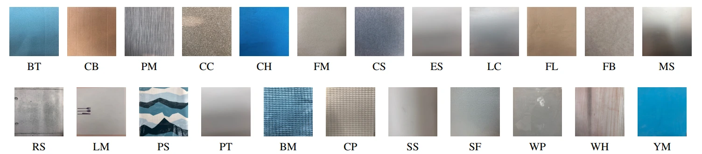</a>
<figcaption>iCub Hybrid Touch官方材料与编号图，覆盖23种纹理；编号对应触碰／滑动试验目录。<span class="figure-links"><a href="https://github.com/clear-nus/TactileLearning" target="_blank" rel="noopener">来源：作者项目／论文</a><a href="https://raw.githubusercontent.com/crslab/TactileLearning/master/materials_with_id.png" target="_blank" rel="noopener">原图／视频／PDF</a></span></figcaption>
</figure>
</div>


<a id="R20"></a>

### R20 · Doro/Jaco OptoForce Object Classification

**分类：**机器人真机触觉　**参考年份：**2021　**证据：**A（已核实实际数据文件目录；计入主统计）

**数据／项目链接：**[原作者数据仓库](https://github.com/philipmaus/Tactile_Object_Classification)

| 项目 | 核实信息 |
|---|---|
| 规模与发布口径 | 作者仓库Test目录提供real-life dataset；本次未确认总试验数。 |
| 传感器、模态与时序 | Doro平台Jaco机械臂、3个OptoForce传感器的物体触觉分类数据。 |
| 动作与状态 | 触觉物体识别；不默认具有长序列控制命令。 |
| 对触觉世界模型的用途 | 少通道/力式触觉的跨传感器表征补充。 |
| 数据许可 | 数据许可未明确；作者说明允许使用/修改代码不能替代数据许可 |
| 限制、证据缺口与去重 | 规模与标注粒度需读取manual.py和数据；优先级低于有完整动作的操作库。 |

<section id="sample-R20" class="sample-card tactile_only"><h4>实际数据样例 <span class="sample-status">触觉样例／缺场景RGB</span></h4>
<div class="sample-player"><video controls playsinline preload="none" poster="trajectories/R20/poster.webp" src="trajectories/R20/preview.mp4" aria-label="R20 实际数据可视化"></video></div>
<p class="sample-caption">完整下载公开real-life测试文件（120个样本），展示seq0的50个时间步、3个OptoForce传感器xyz与模长。样本起止时间来自header；样本内部无逐帧时间戳，以等间隔插值仅作播放。 红色游标按header起止时长的插值时间推进；无对应RGB，未用项目图片冒充同步视觉。</p>
<div class="sample-meta"><div><b>样例／文件</b>000_real_life_data.csv / seq0</div><div><b>下载范围</b>完整录制/序列 · 50 帧 / 原始采样率未确认</div><div><b>原始样例时长</b>13.040 秒</div></div>
<p class="sample-links">
<a href="trajectories/R20/index.html" target="_blank" rel="noopener">单独打开样例</a>
<a href="https://github.com/philipmaus/Tactile_Object_Classification" target="_blank" rel="noopener">数据源</a>
<a href="trajectory_records/R20.json">下载／校验记录</a></p>
<div class="sample-duration"><strong>数据集时长：</strong>元数据推算 0.435 h<p><strong>覆盖范围：</strong>公开real-life测试文件120个样本，非全训练库</p><p>对120个header的stamp end-start求和：1564.618秒（0.435小时）；50为每样本重采样点数，不能当成50Hz。</p></div>
<details class="sample-evidence"><summary>时长及下载证据</summary><ul><li><a href="https://github.com/philipmaus/Tactile_Object_Classification/blob/main/000_real_life_data.csv" target="_blank" rel="noopener">来源 1</a>：120 header rows: sum((stamp end-stamp start)/1e9)</li></ul></details>
<div class="duration-estimate" id="duration-R20"><h5>本轮统计值：7.75 小时 <span class="estimate-tag metadata">元数据实算</span></h5><p>范围：7.75 小时 · 可信度：高 · 已验证文件入口</p><p><strong>覆盖：</strong>Doro/Jaco OptoForce原始训练2,000条+real-life测试120条；增强版不重复计。</p><p><strong>计算：</strong>两个完整CSV共2,120个header的stamp end−stamp start(ns)用Decimal计算后求和=7.745537h。</p><p>公开下载入口已核查，已有真实样本下载。</p><details><summary>估算假设与来源</summary><ul><li>每条50个数值是重采样点，不是50Hz。</li><li>训练与测试按不同原始header时间区间计；未加入Data augmentation的副本。</li></ul><ul><li><a href="https://github.com/philipmaus/Tactile_Object_Classification/blob/main/000_training_data.csv" target="_blank" rel="noopener">来源 1</a>：2,000条原始训练，7.310921h。</li><li><a href="https://github.com/philipmaus/Tactile_Object_Classification/blob/main/000_real_life_data.csv" target="_blank" rel="noopener">来源 2</a>：120条真实测试，0.434616h。</li></ul><p>核查明细：<a href="duration_estimates/work_robot/R20_audit.json">[1]</a> </p></details><p><a href="duration_estimates/R20.json">下载该条计算记录</a></p></div></section>

<div class="dataset-figures">
<figure class="dataset-figure wide" id="fig-r20-01">
<div class="figure-type"><strong>R20 · 图1</strong><span>采集装置</span><small>点击图片放大</small></div>
<a class="figure-open" href="figures/r20-01.webp" target="_blank" rel="noopener" aria-label="放大：Doro/Jaco官方仓库采集装置：Jaco机械臂和3个OptoForce接触传感器。">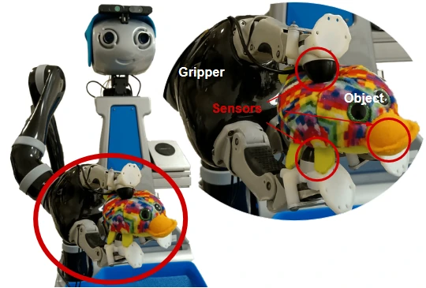</a>
<figcaption>Doro/Jaco官方仓库采集装置：Jaco机械臂和3个OptoForce接触传感器。<span class="figure-links"><a href="https://github.com/philipmaus/Tactile_Object_Classification/blob/main/README.md" target="_blank" rel="noopener">来源：作者项目／论文</a><a href="https://github.com/philipmaus/Tactile_Object_Classification/blob/main/doro_setup.PNG" target="_blank" rel="noopener">原图／视频／PDF</a></span></figcaption>
</figure>
</div>


<a id="R21"></a>

### R21 · BioTac_slide_20_50

**分类：**机器人真机触觉　**参考年份：**2021　**证据：**A（已核实实际数据文件目录；计入主统计）

**数据／项目链接：**[官方数据](https://github.com/dexrob/BioTac_slide_20_50)

| 项目 | 核实信息 |
|---|---|
| 规模与发布口径 | 20种材料，每类50条，合计1,000条滑动试验；预处理单例400×44。 |
| 传感器、模态与时序 | BioTac原始传感通道，机械臂笛卡尔位置/速度/wrench、关节位置/速度/力矩CSV；并有预切分训练数据。 |
| 动作与状态 | 包含机器人状态与控制实验上下文；不应把状态/力矩直接等同目标action。 |
| 对触觉世界模型的用途 | 传统多物理触觉、滑动材质建模、跨传感器预训练。 |
| 数据许可 | 本次未确认数据专用许可 |
| 限制、证据缺口与去重 | BioTac原始44字段不都是同一种力学量；与其compiled_data和后续论文预处理包合并为一个来源。 |

<section id="sample-R21" class="sample-card tactile_only"><h4>实际数据样例 <span class="sample-status">触觉样例／缺场景RGB</span></h4>
<div class="sample-player"><video controls playsinline preload="none" poster="trajectories/R21/poster.webp" src="trajectories/R21/preview.mp4" aria-label="R21 实际数据可视化"></video></div>
<p class="sample-caption">下载完整mat1_10_bio.csv；展示19个电极通道，其余温度/压力/振动字段保留在原CSV。电极值为原始读数，不混称为力。 红色游标按原时间推进；无对应RGB，未用项目图片冒充同步视觉。</p>
<div class="sample-meta"><div><b>样例／文件</b>raw_data/mat1/mat1_10_bio.csv</div><div><b>下载范围</b>完整录制/序列 · 600 帧 / 原始采样率未确认</div><div><b>原始样例时长</b>5.991 秒</div></div>
<p class="sample-links">
<a href="trajectories/R21/index.html" target="_blank" rel="noopener">单独打开样例</a>
<a href="https://github.com/dexrob/BioTac_slide_20_50" target="_blank" rel="noopener">数据源</a>
<a href="trajectory_records/R21.json">下载／校验记录</a></p>
<div class="sample-duration"><strong>数据集时长：</strong>总时长未核实<p><strong>覆盖范围：</strong>完整发布数据</p><p>未找到可可靠汇总的总时长；不以样本数或文件体积推算。</p></div>
<div class="duration-estimate" id="duration-R21"><h5>本轮统计值：2.11 小时 <span class="estimate-tag estimated">估算</span></h5><p>范围：1.66–2.22 小时 · 可信度：中 · 已验证文件入口</p><p><strong>覆盖：</strong>BioTac20材料×50条=1,000条原始_bio.csv序列；不重复计processed400×44张量。</p><p><strong>计算：</strong>从材料1/5/10/15/20各读取第10次试验，真实时间戳约6–8s；样本均值×1,000，样本最短/最长作为规划范围。</p><p>公开下载入口已核查，已有真实样本下载。</p><details><summary>估算假设与来源</summary><ul><li>5条跨材料系统抽样，不能保证覆盖全部长短轨迹；范围不是统计置信区间。</li><li>原始序列有600或约800帧，处理后400帧不是原始全部时长。</li></ul><ul><li><a href="https://github.com/dexrob/BioTac_slide_20_50" target="_blank" rel="noopener">来源 1</a>：README20classes×50；完整tree确有1,000个_bio.csv；5材料已实读。</li></ul></details><p><a href="duration_estimates/R21.json">下载该条计算记录</a></p></div></section>

<div class="dataset-figures">
<figure class="dataset-figure wide" id="fig-r21-01">
<div class="figure-type"><strong>R21 · 图1</strong><span>采集对象</span><small>点击图片放大</small></div>
<a class="figure-open" href="figures/r21-01.webp" target="_blank" rel="noopener" aria-label="放大：BioTac_slide_20_50官方材料集合图；数据由机器人在这些材料上执行滑动接触获得。">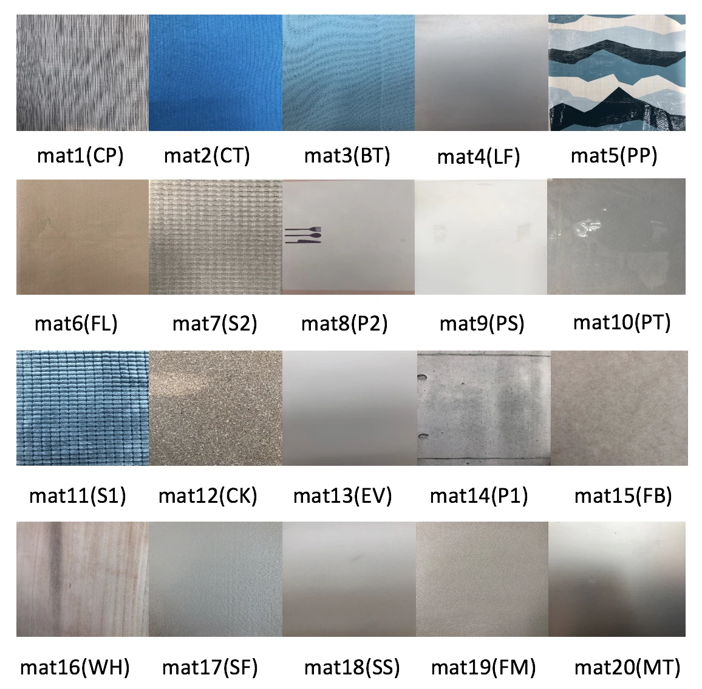</a>
<figcaption>BioTac_slide_20_50官方材料集合图；数据由机器人在这些材料上执行滑动接触获得。<span class="figure-links"><a href="https://github.com/dexrob/BioTac_slide_20_50/blob/master/README.md" target="_blank" rel="noopener">来源：作者项目／论文</a><a href="https://github.com/dexrob/BioTac_slide_20_50/blob/master/matx_collage.png" target="_blank" rel="noopener">原图／视频／PDF</a></span></figcaption>
</figure>
</div>


<a id="R22"></a>

### R22 · Active Clothing Material Perception（Yuan18）

**分类：**机器人真机触觉　**参考年份：**2018　**证据：**A（已核实实际数据文件目录；计入主统计）

**数据／项目链接：**[原始数据归档](http://data.csail.mit.edu/active_clothing/Data_ICRA18.tar)；[公开汇编](https://huggingface.co/datasets/alanz-mit/FoundationTactile)；[下游数据说明](https://github.com/facebookresearch/sparsh)

| 项目 | 核实信息 |
|---|---|
| 规模与发布口径 | Sparsh官方说明其使用版有4,467段短片、每段10–25帧、20类衣物材质。 |
| 传感器、模态与时序 | 机器人GelSight抓取衣物的触觉短视频、材料/属性相关标签。 |
| 动作与状态 | 短程抓取过程；并非通用任务动作库。 |
| 对触觉世界模型的用途 | 柔性物体与材质表征，接触形变辨识。 |
| 数据许可 | 本次未确认数据专用许可 |
| 限制、证据缺口与去重 | 本条合并Yuan18/Clothing处理版本；不把未核实的GelFabric、ViTac Cloth一概当成其别名。FoTa可作为已发布数据的补充入口。 |

<section id="sample-R22" class="sample-card complete_trajectory"><h4>实际数据样例 <span class="sample-status">完整时序样例</span></h4>
<div class="sample-player"><video controls playsinline preload="none" poster="trajectories/R22/poster.webp" src="trajectories/R22/preview.mp4" aria-label="R22 实际数据可视化"></video></div>
<p class="sample-caption">从官方70.65GB tar远程抽取Data/133/12完整试验文件。右为真实GelSight视频（120帧、30.00fps），左是同试验Kinect RGB抓取上下文快照；它不是同步视频，整个播放过程中保持静止。背景参考图和深度/抓取位姿保留在原文件。</p>
<div class="sample-meta"><div><b>样例／文件</b>Data_ICRA18/Data/133/12</div><div><b>下载范围</b>完整录制/序列 · 120 帧 / 30.000 Hz</div><div><b>原始样例时长</b>4.000 秒</div></div>
<p class="sample-caption"><strong>对齐方式：</strong>同试验视觉快照+触觉视频；不是逐帧同步</p>
<p class="sample-links">
<a href="trajectories/R22/index.html" target="_blank" rel="noopener">单独打开样例</a>
<a href="https://data.csail.mit.edu/active_clothing/Data_ICRA18.tar" target="_blank" rel="noopener">数据源</a>
<a href="https://data.csail.mit.edu/active_clothing/Data_ICRA18.tar" target="_blank" rel="noopener">原始下载入口</a>
<a href="trajectory_records/R22.json">下载／校验记录</a></p>
<div class="sample-duration"><strong>数据集时长：</strong>总时长未核实<p><strong>覆盖范围：</strong>完整发布数据</p><p>未找到可可靠汇总的总时长；不以样本数或文件体积推算。</p></div>
<div class="duration-estimate" id="duration-R22"><h5>本轮统计值：4.58 小时 <span class="estimate-tag metadata">元数据实算</span></h5><p>范围：4.54–4.62 小时 · 可信度：中 · 已验证文件入口</p><p><strong>覆盖：</strong>Active Clothing原始GelSight视频经FoTa全帧抽取的覆盖范围。</p><p><strong>计算：</strong>FoTa清单494,655帧，官方预处理源码逐视频ffmpeg -vf fps=30，因此总视频时间约494655/(30×3600)=4.580139h；容许每个约4,467视频一帧的取整误差。</p><p>公开下载入口已核查，已有真实样本下载。</p><details><summary>估算假设与来源</summary><ul><li>这不是Sparsh每视频只取10–25帧版本的时长换算；使用全帧FoTa处理。</li><li>原始train/test索引实数3554+871=4425条，与下游4467视频口径不同；小时数来自完整抽帧清单，不依赖二者相等。</li><li>同试验Kinect静态照片不额外增加视频小时数。</li></ul><ul><li><a href="https://github.com/alanzjl/t3/blob/main/dataset_preproc/README.md" target="_blank" rel="noopener">来源 1</a>：yuan18-cloth494,655images。</li><li><a href="https://github.com/alanzjl/t3/blob/main/dataset_preproc/preprocess_yuan18_images.py" target="_blank" rel="noopener">来源 2</a>：所有GelSight_video.mp4通过ffmpeg -vf fps=30抽帧后写入WebDataset。</li><li><a href="https://data.csail.mit.edu/active_clothing/Data_ICRA18.tar" target="_blank" rel="noopener">来源 3</a>：实际sample120帧/30fps=4s；train/test根索引已下载。</li></ul></details><p><a href="duration_estimates/R22.json">下载该条计算记录</a></p></div></section>


<a id="R23"></a>

### R23 · SSVTP

**分类：**机器人真机触觉　**参考年份：**2023　**证据：**A（已核实实际数据文件目录；计入主统计）

**数据／项目链接：**[公开数据（TVL内ssvtp）](https://huggingface.co/datasets/mlfu7/Touch-Vision-Language-Dataset)；[来源与采集协议](https://arxiv.org/abs/2402.13232)

| 项目 | 核实信息 |
|---|---|
| 规模与发布口径 | 4,587组image-touch pairs（TVL论文明确说明其上游SSVTP部分）。 |
| 传感器、模态与时序 | UR5机器人、DIGIT触觉与台面RGB；机器人先拍视觉再到对应位置接触。 |
| 动作与状态 | 主要是单次触碰的视觉—触觉对，不是同步动态操作序列。 |
| 对触觉世界模型的用途 | 视觉与局部触觉表征对齐。 |
| 数据许可 | 原始数据专用许可本次未确认 |
| 限制、证据缺口与去重 | 图像与触觉并非同时拍摄；TVL包内ssvtp目录是该来源，单独计源后不把TVL全包另计。 |

<section id="sample-R23" class="sample-card static_sample"><h4>实际数据样例 <span class="sample-status">静态样本</span></h4>
<div class="sample-player">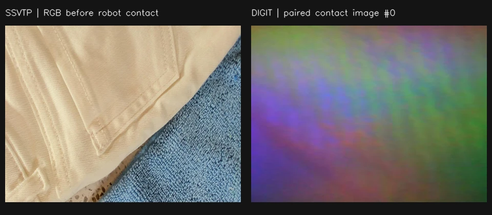</div>
<p class="sample-caption">从TVL官方split ZIP实际抽取ssvtp/image_0的视觉、DIGIT触觉和文字标签。它是静态对应样本：机器人先拍RGB、再移动到对应位置接触，不是同步轨迹；不虚构视频或时长。</p>
<div class="sample-meta"><div><b>样例／文件</b>tvl_dataset/ssvtp/image_0</div><div><b>下载范围</b>部分记录或静态样本 · 1 帧 / 原始采样率未确认</div><div><b>原始样例时长</b>真实秒数未确认</div></div>
<p class="sample-caption"><strong>对齐方式：</strong>same sample ID; vision acquired before touch, not simultaneous</p>
<p class="sample-links">
<a href="trajectories/R23/index.html" target="_blank" rel="noopener">单独打开样例</a>
<a href="https://huggingface.co/datasets/mlfu7/Touch-Vision-Language-Dataset" target="_blank" rel="noopener">数据源</a>
<a href="trajectory_records/R23.json">下载／校验记录</a></p>
<div class="sample-duration"><strong>数据集时长：</strong>不适用（静态/混编）<p><strong>覆盖范围：</strong>完整发布数据</p><p>4,587组静态视觉—触觉对应对，未发布连续时间轴；小时数不适用，不按FPS换算。</p></div>
<div class="duration-estimate" id="duration-R23"><h5>本轮统计值：0.042 等效小时 <span class="estimate-tag static_equivalent">静态帧等效</span></h5><p>范围：0.021–0.127 等效小时 · 可信度：中 · 公开镜像／派生入口</p><p><strong>覆盖：</strong>SSVTP4,587组静态视觉触觉对应对，TVL官方镜像。</p><p><strong>计算：</strong>仅作静态训练帧量等价：4,587/(30×3600)；10–60fps给出范围。</p><p class="estimate-warning">静态图没有连续时间轴，此数是帧预算等效值；连续录制总量贡献为 0。</p><p>TVL官方再发布，原始来源家族SSVTP计一次。</p><details><summary>估算假设与来源</summary><ul><li>非同时采集，机器人先拍视觉，再移动到接触点；没有连续轨迹时间轴。</li><li>不将视觉与触觉各计一次，不与TVL或FoTa汇编再次相加。</li><li>该数值不是录制时长。</li></ul><ul><li><a href="https://arxiv.org/abs/2402.13232" target="_blank" rel="noopener">来源 1</a>：上游SSVTP4,587image-touchpairs及先视觉后接触协议。</li><li><a href="https://huggingface.co/datasets/mlfu7/Touch-Vision-Language-Dataset" target="_blank" rel="noopener">来源 2</a>：ssvtp目录已实际提取同ID视觉、DIGIT、标签。</li></ul></details><p><a href="duration_estimates/R23.json">下载该条计算记录</a></p></div></section>

<div class="dataset-figures">
<figure class="dataset-figure wide" id="fig-r23-01">
<div class="figure-type"><strong>R23 · 图1</strong><span>数据来源对照</span><small>点击图片放大</small></div>
<a class="figure-open" href="figures/r23-01.webp" target="_blank" rel="noopener" aria-label="放大：TVL论文图3：上游SSVTP的人工语言标注样例与新增HCT的GPT-4V标注样例，后者还展示标注错误。两种采集来源已在正文分别计数。">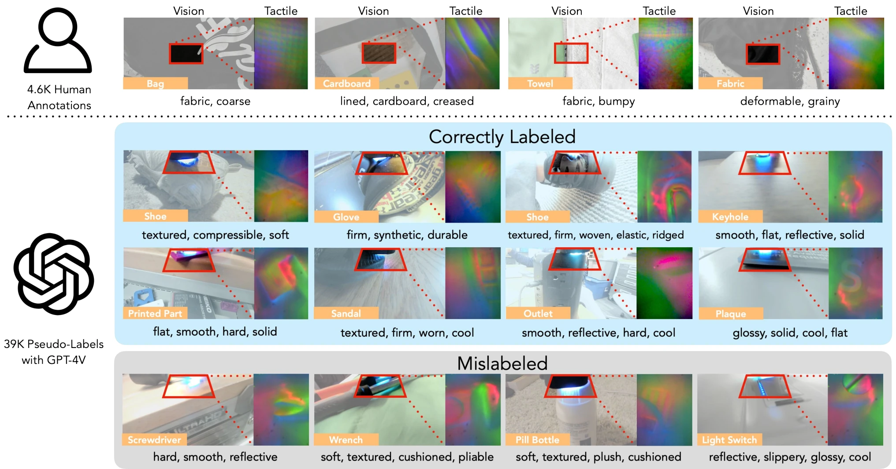</a>
<figcaption>TVL论文图3：上游SSVTP的人工语言标注样例与新增HCT的GPT-4V标注样例，后者还展示标注错误。两种采集来源已在正文分别计数。<span class="figure-links"><a href="https://arxiv.org/html/2402.13232" target="_blank" rel="noopener">来源：作者项目／论文</a><a href="https://arxiv.org/html/2402.13232v1/dataset_figure_new.png" target="_blank" rel="noopener">原图／视频／PDF</a></span></figcaption>
</figure>
</div>


<a id="X04"></a>

### X04 · Tactile Grasp and Move / Action-Conditioned Tactile Prediction

**分类：**机器人真机触觉　**参考年份：**2022　**证据：**A（已核实实际数据文件目录；计入主统计）

**数据／项目链接：**[作者仓库](https://github.com/WillMandil001/Tactile_Grasp_and_Move_Dataset)

| 项目 | 核实信息 |
|---|---|
| 规模与发布口径 | 作者仓库真实含75条录制的metadata及Xela/机器人状态CSV；已下载一条完整触觉序列，时长约4.64秒，并审计全部75份metadata的录制时长。 |
| 传感器、模态与时序 | 双指触觉、机器人本体和任务空间运动、物体相对腕部位姿。 |
| 动作与状态 | 对动作条件预测很相关。 |
| 对触觉世界模型的用途 | 后续数据获取优先核查。 |
| 数据许可 | 待确认 |
| 限制、证据缺口与去重 | 2026-10-19已读取实际CSV，从待核实移入R类；保留X04编号。仓库没有配对RGB，传感器通道单位/几何需继续核对；数据许可仍待确认。 |

<section id="sample-X04" class="sample-card tactile_only"><h4>实际数据样例 <span class="sample-status">触觉样例／缺场景RGB</span></h4>
<div class="sample-player"><video controls playsinline preload="none" poster="trajectories/X04/poster.webp" src="trajectories/X04/preview.mp4" aria-label="X04 实际数据可视化"></video></div>
<p class="sample-caption">完整下载一次抓取移动记录的触觉、机器人状态及metadata。此仓库未提供RGB，展示Xela传感器1的16税元XYZ三轴相对首帧变化；4×4仅按CSV通道序排列，不推断物理布置，单位未标定为牛顿。</p>
<div class="sample-meta"><div><b>样例／文件</b>flat_objects_only/test/data_sample_2021-11-25-13-07-20</div><div><b>下载范围</b>完整录制/序列 · 171 帧 / 36.820 Hz</div><div><b>原始样例时长</b>4.644 秒</div></div>
<p class="sample-caption"><strong>对齐方式：</strong>CSV同一录制；无RGB。</p>
<p class="sample-caption">已下载传感器1完整序列；传感器2下载入口返回403，本次展示传感器1；已保留完整传感器1及机器人状态。</p>
<p class="sample-links">
<a href="trajectories/X04/index.html" target="_blank" rel="noopener">单独打开样例</a>
<a href="https://github.com/WillMandil001/Tactile_Grasp_and_Move_Dataset" target="_blank" rel="noopener">数据源</a>
<a href="https://cdn.jsdelivr.net/gh/WillMandil001/Tactile_Grasp_and_Move_Dataset@main/" target="_blank" rel="noopener">原始下载入口</a>
<a href="trajectory_records/X04.json">下载／校验记录</a></p>
<p class="sample-links"><a href="trajectory_audits/X04/duration-audit.json">详细审计 1</a></p>
<div class="sample-duration"><strong>数据集时长：</strong>元数据推算 0.241 h<p><strong>覆盖范围：</strong>已读取的48/75条metadata子集</p><p>按各记录stop_time-start_time求和，无法外推未读取部分。</p></div>
<details class="sample-evidence"><summary>时长及下载证据</summary><ul><li><a href="https://github.com/WillMandil001/Tactile_Grasp_and_Move_Dataset" target="_blank" rel="noopener">来源 1</a>：实际48条meta_data.csv的时间跨度</li><li><a href="https://github.com/WillMandil001/Tactile_Grasp_and_Move_Dataset" target="_blank" rel="noopener">来源 2</a>：递归树含实际CSV；读取元数据及171帧触觉。</li></ul></details>
<div class="duration-estimate" id="duration-X04"><h5>本轮统计值：0.364 小时 <span class="estimate-tag metadata">元数据实算</span></h5><p>范围：0.364 小时 · 可信度：高 · 已验证文件入口</p><p><strong>覆盖：</strong>官方75条不同录制全部metadata；不含多传感器重复</p><p><strong>计算：</strong>对75个唯一录制stop_time-start_time求和=1309.949852秒，再除3600。</p><p>官方文件可读取，75条全量时长核算完成。</p><details><summary>估算假设与来源</summary><ul><li>每个录制只计一次，双Xela传感器不累计双倍小时。</li><li>这是录制窗口，不是阈值筛选后的净接触时间；无场景RGB。</li></ul><ul><li><a href="https://github.com/WillMandil001/Tactile_Grasp_and_Move_Dataset" target="_blank" rel="noopener">来源 1</a>：本轮读取全部75个meta_data.csv；唯一recording id=75。</li></ul><p>核查明细：<a href="duration_audits/X04/audit.json">[1]</a> </p></details><p><a href="duration_estimates/X04.json">下载该条计算记录</a></p></div></section>


## 6. 人操持工具／UMI触觉（6个）


<a id="U01"></a>

### U01 · FreeTacMan

**分类：**人操持工具／UMI　**参考年份：**2025　**证据：**A（已核实实际数据文件目录；计入主统计）

**数据／项目链接：**[官方数据](https://huggingface.co/datasets/OpenDriveLab/FreeTacMan)；[官方代码](https://github.com/OpenDriveLab/FreeTacMan)

| 项目 | 核实信息 |
|---|---|
| 规模与发布口径 | 3M+视触觉图像对、10K+轨迹、50任务。 |
| 传感器、模态与时序 | 人操持的双指视触觉采集装置；腕视角与双指触觉视频，TCP位姿/四元数/夹爪距离和时间戳。 |
| 动作与状态 | 工具轨迹与夹爪开合；可映射到机器人，但不是机器人本体实际执行数据。 |
| 对触觉世界模型的用途 | 优先：规模较大的动作/运动条件触觉动态预训练。 |
| 数据许可 | 数据MIT；代码仓库Apache 2.0 |
| 限制、证据缺口与去重 | 每路、每帧、pair的计数不可直接换算小时；FTP内的同名包不再计数。 |

<section id="sample-U01" class="sample-card complete_trajectory"><h4>实际数据样例 <span class="sample-status">完整时序样例</span></h4>
<div class="sample-player"><video controls playsinline preload="none" poster="trajectories/U01/poster.webp" src="trajectories/U01/preview.mp4" aria-label="U01 实际数据可视化"></video></div>
<p class="sample-caption">完整下载 ArrangeFruit_100：240帧、30 fps、8秒，含腕部RGB和两路光学触觉。按同名轨迹及相同帧号配对，预览降采样为10 fps；保留三路原视频与动作CSV。</p>
<div class="sample-meta"><div><b>样例／文件</b>ArrangeFruit/ArrangeFruit_100</div><div><b>下载范围</b>完整录制/序列 · 240 帧 / 30.000 Hz</div><div><b>原始样例时长</b>8.000 秒</div></div>
<p class="sample-caption"><strong>对齐方式：</strong>同轨迹编号、相同帧数与30fps；按帧号对齐。</p>
<p class="sample-caption">CSV中有重复timestamp，样例展示以三路视频共有帧号为准。</p>
<p class="sample-links">
<a href="trajectories/U01/index.html" target="_blank" rel="noopener">单独打开样例</a>
<a href="https://www.modelscope.cn/datasets/OpenDriveLab/FreeTacMan" target="_blank" rel="noopener">数据源</a>
<a href="https://www.modelscope.cn/datasets/OpenDriveLab/FreeTacMan" target="_blank" rel="noopener">原始下载入口</a>
<a href="trajectory_records/U01.json">下载／校验记录</a></p>
<div class="sample-duration"><strong>数据集时长：</strong>派生索引名义值 15.697 h<p><strong>覆盖范围：</strong>yxma转换索引覆盖的6,337个FreeTacMan RGB记录，非原库完整实测</p><p>按同一RGB路径合并左右指流后，duration_s累计约15.697小时；原11,965指流累计29.708小时不能视作行为时长。转换范围与原官方完整发布覆盖尚未一一核对。</p></div>
<details class="sample-evidence"><summary>时长及下载证据</summary><ul><li><a href="https://huggingface.co/datasets/yxma/tactile-video-pretrain" target="_blank" rel="noopener">来源 1</a>：配对索引，source=freetacman，rgb_video去重；不是官方全库总时长</li></ul></details>
<div class="duration-estimate" id="duration-U01"><h5>本轮统计值：15.70 小时 <span class="estimate-tag metadata">元数据实算</span></h5><p>范围：15.70 小时 · 可信度：中 · 公开镜像／派生入口</p><p><strong>覆盖：</strong>当前可取得的派生包覆盖：6,337个唯一RGB录制；原始库全量仍可能更大</p><p><strong>计算：</strong>Σ各唯一rgb_video的max(duration_s)=56,509.5667秒；11,965双指视频流不重复累计。官方3M+ pairs未明确是否双指重复，不据此放大。</p><p>主值对应公开派生覆盖；官方样例也已读取，许可证仍遵守上游。</p><details><summary>估算假设与来源</summary><ul><li>采用已公开、可读取的配对索引覆盖量，非论文10K+轨迹全量；duration_s为n_frames/fps名义值，未逐视频核对。</li><li>本次官方HF目录6,428 CSV，其中按camera3+至少一指检查5,628组能匹配，派生包另覆盖709组；不声称原官方目录与派生包完全一致。</li><li>完整仓库18,591项文件清单已核对：FreeTacMan索引11,965对所指RGB及触觉文件全部存在，去重6,337个RGB录制；时长仍取索引值，未逐视频审计时钟。</li></ul><ul><li><a href="https://huggingface.co/datasets/yxma/tactile-video-pretrain" target="_blank" rel="noopener">来源 1</a>：已读12,103行配对索引；FreeTacMan去重后6,337 RGB文件。</li><li><a href="https://huggingface.co/datasets/OpenDriveLab/FreeTacMan" target="_blank" rel="noopener">来源 2</a>：官方发布入口；原始样例三路240帧/30fps=8秒已核验。</li><li><a href="https://arxiv.org/html/2506.01941" target="_blank" rel="noopener">来源 3</a>：论文同步30Hz；3M+图像对和10K+轨迹为论文规模，不能直接视作当前可取的独立时序数。</li></ul><p>核查明细：<a href="duration_estimates/evidence/A05_full_repository_files.json">[1]</a> </p></details><p><a href="duration_estimates/U01.json">下载该条计算记录</a></p></div></section>

<div class="dataset-figures">
<figure class="dataset-figure wide" id="fig-u01-01">
<div class="figure-type"><strong>U01 · 图1</strong><span>采集与样例</span><small>点击图片放大</small></div>
<a class="figure-open" href="figures/u01-01.webp" target="_blank" rel="noopener" aria-label="放大：FreeTacMan官方系统演示截帧：人操持触觉夹爪的多模态采集与任务示例。该图包含系统／部署展示，不将全部画面当成原始训练样本。">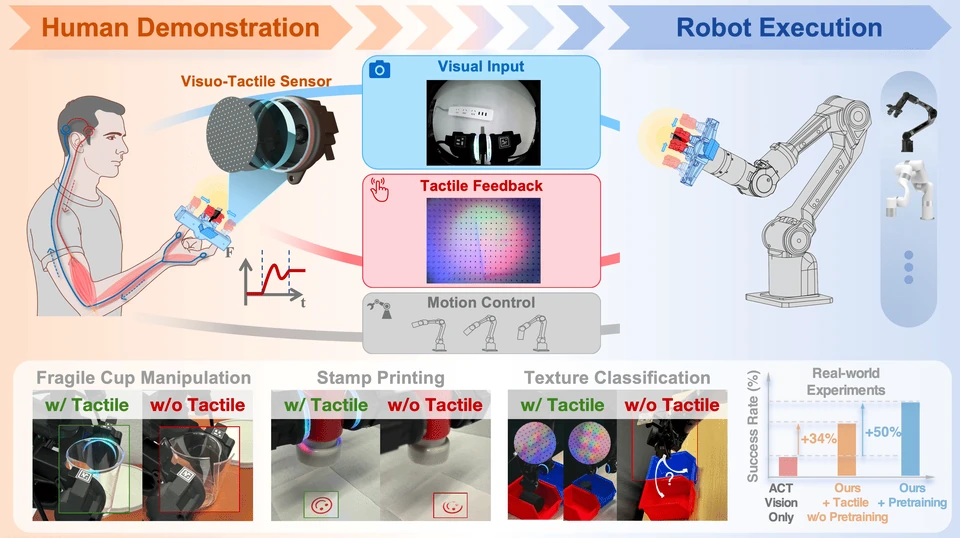</a>
<figcaption>FreeTacMan官方系统演示截帧：人操持触觉夹爪的多模态采集与任务示例。该图包含系统／部署展示，不将全部画面当成原始训练样本。<span class="figure-links"><a href="https://github.com/OpenDriveLab/FreeTacMan" target="_blank" rel="noopener">来源：作者项目／论文</a><a href="https://github.com/OpenDriveLab/FreeTacMan/blob/main/figure/FreeTacMan_teaser.gif" target="_blank" rel="noopener">原图／视频／PDF</a></span></figcaption>
</figure>
</div>


<a id="U02"></a>

### U02 · Touch in the Wild

**分类：**人操持工具／UMI　**参考年份：**2025　**证据：**A（已核实实际数据文件目录；计入主统计）

**数据／项目链接：**[官方数据](https://huggingface.co/datasets/binghaohuang-robot/touch_in_the_wild-dataset)；[代码/数据管线](https://github.com/XinyueZhuXY/touch_in_the_wild)

| 项目 | 核实信息 |
|---|---|
| 规模与发布口径 | 官方发布示范与预训练Zarr包；本次未核实统一总时长。 |
| 传感器、模态与时序 | 人手持触觉夹爪、GoPro、数值式触觉阵列、SLAM工具位姿；有完整SLAM和仅视觉—触觉两种处理管线。 |
| 动作与状态 | 完整操作包有运动/夹爪信息；visuo-tactile-only预训练包没有相同动作监督。 |
| 对触觉世界模型的用途 | 优先：阵列触觉运动条件建模、自然场景操作泛化。 |
| 数据许可 | MIT |
| 限制、证据缺口与去重 | 不是自由人手全手压力录制；只含视觉触觉的预训练子集不能冒充动作条件样本。 |

<section id="sample-U02" class="sample-card complete_trajectory"><h4>实际数据样例 <span class="sample-status">完整时序样例</span></h4>
<div class="sample-player"><video controls playsinline preload="none" poster="trajectories/U02/poster.webp" src="trajectories/U02/preview.mp4" aria-label="U02 实际数据可视化"></video></div>
<p class="sample-caption">完整读取Touch in the Wild选定任务的第0条episode（1242帧），按Zarr同一索引并排显示RGB与触觉；公开处理数组没有提供可核实的逐帧时间戳/FPS。预览每3帧取1帧、10个展示帧/秒，仅为帧序浏览，播放秒数不能当交互秒数。 触觉为12×64已发布处理数组（本例0–1，多数通道为0），色标按本条全程最小/最大值固定，不推断N/Pa。 网格按存储顺序展示，不代表已经核实的物理压力面。</p>
<div class="sample-meta"><div><b>样例／文件</b>fluid_transfer.zarr.zip / episode0</div><div><b>下载范围</b>完整录制/序列 · 1242 帧 / 原始采样率未确认</div><div><b>原始样例时长</b>真实秒数未确认</div></div>
<p class="sample-caption"><strong>对齐方式：</strong>处理后Zarr相同索引；原始时间同步精度和处理后FPS未确认。</p>
<p class="sample-caption">当前所取任务meta显示186条episode、252508帧；这不是整个来源的全量计时。 发布的12×64处理数组范围为0–1，本样例多数通道为0、非零主要集中前4列；传感器空间映射和处理方法未核实，不能把整张网格当作均匀有效压力面。</p>
<p class="sample-links">
<a href="trajectories/U02/index.html" target="_blank" rel="noopener">单独打开样例</a>
<a href="https://huggingface.co/datasets/binghaohuang-robot/touch_in_the_wild-dataset" target="_blank" rel="noopener">数据源</a>
<a href="https://hf-mirror.com/datasets/binghaohuang-robot/touch_in_the_wild-dataset/resolve/main/four_tasks/fluid_transfer/fluid_transfer.zarr.zip" target="_blank" rel="noopener">原始下载入口</a>
<a href="trajectory_records/U02.json">下载／校验记录</a></p>
<p class="sample-links"><a href="trajectory_audits/U02/extracted.json">详细审计 1</a></p>
<div class="sample-duration"><strong>数据集时长：</strong>总时长未核实<p><strong>覆盖范围：</strong>公开数据集总时长</p><p>未找到可核实的总时长；样例长度不外推全库。</p></div>
<details class="sample-evidence"><summary>时长及下载证据</summary><ul><li><a href="https://huggingface.co/datasets/binghaohuang-robot/touch_in_the_wild-dataset" target="_blank" rel="noopener">来源 1</a>：实际Range提取并解码JPEG-XL chunks，episode_ends确定完整序列边界；未以缺失chunk的fill_value当观测。</li></ul></details>
<div class="duration-estimate" id="duration-U02"><h5>本轮统计值：12.04 小时 <span class="estimate-tag estimated">估算</span></h5><p>范围：12.04–31.40 小时 · 可信度：中 · 已验证文件入口</p><p><strong>覆盖：</strong>约2.6M视触觉配对帧的公开预训练范围；与任务Zarr去重计一次</p><p><strong>计算：</strong>主估计2,600,000/60/3600=12.037h；敏感性范围按60–23Hz为12.037–31.401h。</p><p class="estimate-warning"><strong>全量发布覆盖待确认：</strong>公开归档及样例存在，但主值依赖论文全量已发布这一条件；分类汇总中单列，不混入已确认发布覆盖的主估计。</p><p>发布入口与样例可读；本轮全ZIP头请求受网络影响，仍是有依据估算而非全库时间审计。</p><details><summary>估算假设与来源</summary><ul><li>论文称over 2.6M，不是精确文件计数；取2.6M作保守基数。</li><li>论文GoPro为60Hz，生成脚本逐视频帧保存，故主假设60Hz；尚未验证全部Zarr的实际时钟，23Hz下界采样率对应触觉硬件。</li><li>预训练集合包括四个主要任务、室内与野外任务，不重复叠加这些任务归档；双指12×64数组每时刻只计一次。</li></ul><ul><li><a href="https://arxiv.org/html/2507.15062" target="_blank" rel="noopener">来源 1</a>：2.6M+ pairs，2,700+ demonstrations，43 tasks；GoPro60Hz，tactile23Hz。</li><li><a href="https://github.com/XinyueZhuXY/touch_in_the_wild/blob/main/scripts_slam_pipeline/07_generate_replay_buffer.py" target="_blank" rel="noopener">来源 2</a>：按视频frame_start/end逐帧写入，无额外时间降采样参数。</li><li><a href="https://huggingface.co/datasets/binghaohuang-robot/touch_in_the_wild-dataset" target="_blank" rel="noopener">来源 3</a>：公开pretrain.zarr.zip及任务归档；已解码fluid_transfer真实样例。</li></ul></details><p><a href="duration_estimates/U02.json">下载该条计算记录</a></p></div></section>

<div class="dataset-figures">
<figure class="dataset-figure wide" id="fig-u02-01">
<div class="figure-type"><strong>U02 · 图1</strong><span>采集与样例</span><small>点击图片放大</small></div>
<a class="figure-open" href="figures/u02-01.webp" target="_blank" rel="noopener" aria-label="放大：Touch in the Wild论文图2：便携式夹爪、相机、双指阵列触觉与真实场景样例。"></a>
<figcaption>Touch in the Wild论文图2：便携式夹爪、相机、双指阵列触觉与真实场景样例。<span class="figure-links"><a href="https://arxiv.org/html/2507.15062v2" target="_blank" rel="noopener">来源：作者项目／论文</a><a href="https://arxiv.org/html/2507.15062v2/system.png" target="_blank" rel="noopener">原图／视频／PDF</a></span></figcaption>
</figure>
</div>


<a id="U03"></a>

### U03 · exUMI

**分类：**人操持工具／UMI　**参考年份：**2025　**证据：**A（已核实实际数据文件目录；计入主统计）

**数据／项目链接：**[官方数据](https://huggingface.co/datasets/silicx/exUMI)；[代码](https://github.com/silicx/exUMI)；[论文](https://arxiv.org/abs/2509.14688)

| 项目 | 核实信息 |
|---|---|
| 规模与发布口径 | 论文表征采集约5小时、480K触觉帧；公开任务Zarr覆盖范围与这两个数字不可默认相同。 |
| 传感器、模态与时序 | 扩展式人操持工具、GoPro、视触觉传感器；camera0_rgb、EEF位置/轴角、夹爪宽度、tactile_combined。 |
| 动作与状态 | 工具运动与抓口轨迹，episode_ends保存序列边界。 |
| 对触觉世界模型的用途 | 动作/运动条件触觉表示和工具到机器人迁移。 |
| 数据许可 | 本次未确认数据专用许可 |
| 限制、证据缺口与去重 | 实际文件抽样发现pick_cube ZIP没有README所列tactile_combined，改取含RGB与触觉的open_bottle完整episode。公开处理数组FPS未确认，不用原始相机速率推算任务时长；论文约5小时表征采集与任务Zarr覆盖不同。 |

<section id="sample-U03" class="sample-card complete_trajectory"><h4>实际数据样例 <span class="sample-status">完整时序样例</span></h4>
<div class="sample-player"><video controls playsinline preload="none" poster="trajectories/U03/poster.webp" src="trajectories/U03/preview.mp4" aria-label="U03 实际数据可视化"></video></div>
<p class="sample-caption">完整读取exUMI选定任务的第0条episode（717帧），按Zarr同一索引并排显示RGB与触觉；公开处理数组没有提供可核实的逐帧时间戳/FPS。预览每2帧取1帧、10个展示帧/秒，仅为帧序浏览，播放秒数不能当交互秒数。</p>
<div class="sample-meta"><div><b>样例／文件</b>open_bottle.zarr.zip / episode0</div><div><b>下载范围</b>完整录制/序列 · 717 帧 / 原始采样率未确认</div><div><b>原始样例时长</b>真实秒数未确认</div></div>
<p class="sample-caption"><strong>对齐方式：</strong>处理后Zarr相同索引；原始时间同步精度和处理后FPS未确认。</p>
<p class="sample-caption">当前所取任务meta显示270条episode、126291帧；这不是整个来源的全量计时。</p>
<p class="sample-links">
<a href="trajectories/U03/index.html" target="_blank" rel="noopener">单独打开样例</a>
<a href="https://huggingface.co/datasets/silicx/exUMI" target="_blank" rel="noopener">数据源</a>
<a href="https://hf-mirror.com/datasets/silicx/exUMI/resolve/main/open_bottle.zarr.zip" target="_blank" rel="noopener">原始下载入口</a>
<a href="trajectory_records/U03.json">下载／校验记录</a></p>
<p class="sample-links"><a href="trajectory_audits/U03/extracted.json">详细审计 1</a></p>
<div class="sample-duration"><strong>数据集时长：</strong>论文范围 5.000 h<p><strong>覆盖范围：</strong>论文触觉表征采集约5小时；不等于当前所有任务Zarr</p><p>论文480K触觉帧/约5小时属于表征采集口径。当前open_bottle包含270条、126291帧，缺处理后采样率，不将论文或原始相机FPS直接用于任务时长换算。另发现pick_cube ZIP不含README所列tactile_combined，故改取实际有触觉的open_bottle。</p></div>
<details class="sample-evidence"><summary>时长及下载证据</summary><ul><li><a href="https://arxiv.org/abs/2509.14688" target="_blank" rel="noopener">来源 1</a>：representation dataset: 480K tactile frames, approximately five hours</li><li><a href="https://huggingface.co/datasets/silicx/exUMI" target="_blank" rel="noopener">来源 2</a>：实际Range提取并解码JPEG-XL chunks，episode_ends确定完整序列边界；未以缺失chunk的fill_value当观测。</li></ul></details>
<div class="duration-estimate" id="duration-U03"><h5>本轮统计值：2.77 小时 <span class="estimate-tag estimated">估算</span></h5><p>范围：0.585–6.15 小时 · 可信度：低 · 已验证文件入口</p><p><strong>覆盖：</strong>7个候选含触觉公开任务；排除已证实不含tactile_combined的pick_cube及未列出的put_ball</p><p><strong>计算：</strong>已核实open_bottle 270条/126,291帧，以其平均467.744帧外推论文7任务1,280条；按GoPro60Hz得2.772h。下界只算已核实open_bottle约0.585h，上界用这7任务含重置的369分钟=6.15h作为规划上限。</p><p class="estimate-warning"><strong>全量发布覆盖待确认：</strong>公开归档及样例存在，但主值依赖论文全量已发布这一条件；分类汇总中单列，不混入已确认发布覆盖的主估计。</p><p>主值是当前任务release的规划估计，非论文表征5小时。</p><details><summary>估算假设与来源</summary><ul><li>其他6归档触觉完整性及任务时长分布未逐条确认，外推具有任务偏倚。</li><li>60Hz来自作者采集配置QR命名Tp60及GoPro逐帧生成管线，仍需原视频时钟验证。</li><li>论文480K触觉帧/5h属于另一表征采集集，当前8个任务ZIP未证实包含该全量，不额外相加。</li><li>论文表2时间明确包含环境重置，6.15h仅为相关论文任务的敏感性上限，不能当可训练轨迹时长。</li></ul><ul><li><a href="https://arxiv.org/html/2509.14688" target="_blank" rel="noopener">来源 1</a>：表2：7任务demos=139+270+163+170+135+202+201=1,280；采集分钟=60+79+56+47+31+70+26=369，含重置。</li><li><a href="https://huggingface.co/datasets/silicx/exUMI" target="_blank" rel="noopener">来源 2</a>：8任务ZIP目录；实读open_bottle 126,291帧/270条，pick_cube无触觉。</li><li><a href="https://github.com/silicx/exUMI/blob/main/DATA_COLLECTION.md" target="_blank" rel="noopener">来源 3</a>：GoPro配置QR文件含Tp60；引用逐帧处理脚本。</li></ul></details><p><a href="duration_estimates/U03.json">下载该条计算记录</a></p></div></section>

<div class="dataset-figures">
<figure class="dataset-figure wide" id="fig-u03-01">
<div class="figure-type"><strong>U03 · 图1</strong><span>采集装置</span><small>点击图片放大</small></div>
<a class="figure-open" href="figures/u03-01.webp" target="_blank" rel="noopener" aria-label="放大：exUMI官方硬件系统图，展示工具位姿、夹爪开合和视触觉采集所用部件。"></a>
<figcaption>exUMI官方硬件系统图，展示工具位姿、夹爪开合和视触觉采集所用部件。<span class="figure-links"><a href="https://github.com/silicx/exUMI/blob/main/README.md" target="_blank" rel="noopener">来源：作者项目／论文</a><a href="https://github.com/silicx/exUMI/blob/main/assets/exUMI-system.png" target="_blank" rel="noopener">原图／视频／PDF</a></span></figcaption>
</figure>
</div>


<a id="U04"></a>

### U04 · ViTaMIn

**分类：**人操持工具／UMI　**参考年份：**2025　**证据：**A（已核实实际数据文件目录；计入主统计）

**数据／项目链接：**[作者数据](https://huggingface.co/datasets/chuanyune/ViTaMIn_dataset)；[项目](https://chuanyune.github.io/ViTaMIn_page/)；[论文](https://arxiv.org/abs/2504.06156)

| 项目 | 核实信息 |
|---|---|
| 规模与发布口径 | 作者HF提供8个文件条目；数据规模/时长本文不根据文件数推断。 |
| 传感器、模态与时序 | robot-free视触觉操控夹爪，视觉、触觉与工具运动信息。 |
| 动作与状态 | 工具演示轨迹用于策略学习。 |
| 对触觉世界模型的用途 | 接触丰富任务运动条件模型、UMI到机器人迁移。 |
| 数据许可 | MIT（作者HF数据卡） |
| 限制、证据缺口与去重 | 项目页Code coming soon不等于数据未公开：HF及FTP均有数据。ViTaMIn-B/后续版本需按新旧采集部分另审，本文不额外计数。 |

<section id="sample-U04" class="sample-card complete_trajectory"><h4>实际数据样例 <span class="sample-status">完整时序样例</span></h4>
<div class="sample-player"><video controls playsinline preload="none" poster="trajectories/U04/poster.webp" src="trajectories/U04/preview.mp4" aria-label="U04 实际数据可视化"></video></div>
<p class="sample-caption">完整读取ViTaMIn选定任务的第0条episode（283帧），按Zarr同一索引并排显示RGB与触觉；公开处理数组没有提供可核实的逐帧时间戳/FPS。预览每1帧取1帧、10个展示帧/秒，仅为帧序浏览，播放秒数不能当交互秒数。</p>
<div class="sample-meta"><div><b>样例／文件</b>Articulated_Object_Manipulation_dataset.zarr.zip / episode0</div><div><b>下载范围</b>完整录制/序列 · 283 帧 / 原始采样率未确认</div><div><b>原始样例时长</b>真实秒数未确认</div></div>
<p class="sample-caption"><strong>对齐方式：</strong>处理后Zarr相同索引；原始时间同步精度和处理后FPS未确认。</p>
<p class="sample-caption">当前所取任务meta显示75条episode、22848帧；这不是整个来源的全量计时。</p>
<p class="sample-links">
<a href="trajectories/U04/index.html" target="_blank" rel="noopener">单独打开样例</a>
<a href="https://huggingface.co/datasets/chuanyune/ViTaMIn_dataset" target="_blank" rel="noopener">数据源</a>
<a href="https://hf-mirror.com/datasets/chuanyune/ViTaMIn_dataset/resolve/main/Articulated_Object_Manipulation_dataset.zarr.zip" target="_blank" rel="noopener">原始下载入口</a>
<a href="trajectory_records/U04.json">下载／校验记录</a></p>
<p class="sample-links"><a href="trajectory_audits/U04/extracted.json">详细审计 1</a></p>
<div class="sample-duration"><strong>数据集时长：</strong>总时长未核实<p><strong>覆盖范围：</strong>公开数据集总时长</p><p>未找到可核实的总时长；样例长度不外推全库。</p></div>
<details class="sample-evidence"><summary>时长及下载证据</summary><ul><li><a href="https://huggingface.co/datasets/chuanyune/ViTaMIn_dataset" target="_blank" rel="noopener">来源 1</a>：实际Range提取并解码JPEG-XL chunks，episode_ends确定完整序列边界；未以缺失chunk的fill_value当观测。</li></ul></details>
<div class="duration-estimate" id="duration-U04"><h5>本轮统计值：3.19 小时 <span class="estimate-tag estimated">估算</span></h5><p>范围：0.106–9.57 小时 · 可信度：低 · 已验证文件入口</p><p><strong>覆盖：</strong>公开6个单臂任务；不额外计未列出的双臂Knife Pulling</p><p><strong>计算：</strong>论文表VI六任务Σ(valid demos×avg length)=355029帧；以实际Articulated任务22,848帧替换该任务论文83×403帧，得到344428帧。主假设30Hz；下界仅已审计任务按60Hz，上界全部候选帧按10Hz。</p><p class="estimate-warning"><strong>全量发布覆盖待确认：</strong>公开归档及样例存在，但主值依赖论文全量已发布这一条件；分类汇总中单列，不混入已确认发布覆盖的主估计。</p><p>全部归档列出可下载，已读一个完整episode；全库主值为规划估计。</p><details><summary>估算假设与来源</summary><ul><li>表VI avg length按帧数解释；原文表格未明确单位，这是估算假设。</li><li>论文相机60Hz、同步相机30Hz、控制10Hz，但未证明发布数组使用哪一时钟，因此必须给宽范围。</li><li>只有Articulated归档的75条/22,848帧实际核过；其余5任务按论文valid数量估计，不能称全量元数据实算。</li></ul><ul><li><a href="https://arxiv.org/html/2504.06156v1" target="_blank" rel="noopener">来源 1</a>：表VI任务valid数量/avg length；同步相机30Hz，GoPro60Hz，控制10Hz。</li><li><a href="https://huggingface.co/datasets/chuanyune/ViTaMIn_dataset" target="_blank" rel="noopener">来源 2</a>：当前6个Zarr任务ZIP；实际Articulated75条、22,848帧。</li></ul></details><p><a href="duration_estimates/U04.json">下载该条计算记录</a></p></div></section>

<div class="dataset-figures">
<figure class="dataset-figure wide" id="fig-u04-01">
<div class="figure-type"><strong>U04 · 图1</strong><span>采集装置</span><small>点击图片放大</small></div>
<a class="figure-open" href="figures/u04-01.webp" target="_blank" rel="noopener" aria-label="放大：ViTaMIn论文图1：手持装置、GoPro、双触觉传感器与同步相机。该图展示采集硬件，机器人部署平台是另一个阶段。"></a>
<figcaption>ViTaMIn论文图1：手持装置、GoPro、双触觉传感器与同步相机。该图展示采集硬件，机器人部署平台是另一个阶段。<span class="figure-links"><a href="https://arxiv.org/html/2504.06156v2" target="_blank" rel="noopener">来源：作者项目／论文</a><a href="https://arxiv.org/html/2504.06156v2/system-8.0.png" target="_blank" rel="noopener">原图／视频／PDF</a></span></figcaption>
</figure>
</div>


<a id="U05"></a>

### U05 · Daimon-Infinity

**分类：**人操持工具／UMI　**参考年份：**2026　**证据：**B（已核实官方下载入口／脚本，归档未验证；计入主统计）

**数据／项目链接：**[官方说明/许可](https://github.com/dmrobot-admin/Daimon-Infinity)；[数据入口](https://modelscope.cn/datasets/daimonrobotics/Daimon-Infinity)；[样例](https://modelscope.cn/datasets/daimonrobotics/Daimon-Infinity-Lite)

| 项目 | 核实信息 |
|---|---|
| 规模与发布口径 | 作者README称首批发布1,000小时，另用约1,209小时已采集数据做统计；10,000小时是后续开放目标。 |
| 传感器、模态与时序 | 主要DM-DataClaw手持夹爪，少量DM-DataDex外骨骼；视觉、指尖触觉形变/剪切/深度、运动和语言，LeRobot式格式。 |
| 动作与状态 | 工具/外骨骼运动轨迹；按设备解释，不能统称自主机器人执行。 |
| 对触觉世界模型的用途 | 大规模接触动态预训练的重点候选，先抽样核对原始触觉编码。 |
| 数据许可 | CC BY-NC-SA 4.0 |
| 限制、证据缺口与去重 | 本次可读取官方发布声明与Lite卡片，但实际文件/目录接口匿名返回403「无权访问该数据集」。1000小时是作者发布声明，未经逐轨迹核验；未拿介绍视频替代真实样例。Lite仍与主库按一个来源计数。 |

<section id="sample-U05" class="sample-card blocked"><h4>实际数据样例 <span class="sample-status">本次未能下载</span></h4>
<p class="sample-caption"><strong>当前缺口：</strong>官方ModelScope卡片可读；实际文件与目录接口匿名HTTP 403，Code 10020101037，Message：无权访问该数据集。未下载原始轨迹，未将官方演示视频冒充样例。</p>
<p class="sample-links">
<a href="https://www.modelscope.cn/datasets/daimonrobotics/Daimon-Infinity-Lite" target="_blank" rel="noopener">数据源</a>
<a href="https://www.modelscope.cn/api/v1/datasets/daimonrobotics/Daimon-Infinity-Lite/repo?Revision=master&amp;FilePath=datasets/dm_dataClaw/meta/info.json" target="_blank" rel="noopener">原始下载入口</a>
<a href="trajectory_records/U05.json">下载／校验记录</a></p>
<div class="sample-duration"><strong>数据集时长：</strong>官方发布／公开范围 1,000.000 h；论文范围 1,209.000 h<p><strong>覆盖范围：</strong>官方完整Daimon-Infinity发布声明；不是Lite实测</p><p>作者称首批发布1000小时，统计已采1209小时；本次Lite和数据文件接口返回403『无权访问该数据集』，没有独立验证公开文件实际时长。10000小时是未来目标。</p></div>
<details class="sample-evidence"><summary>时长及下载证据</summary><ul><li><a href="https://github.com/dmrobot-admin/Daimon-Infinity" target="_blank" rel="noopener">来源 1</a>：README首批1000小时、已采集1209小时、目标10000小时</li><li><a href="https://www.modelscope.cn/api/v1/datasets/daimonrobotics/Daimon-Infinity-Lite/repo?Revision=master&amp;FilePath=datasets/dm_dataClaw/meta/info.json" target="_blank" rel="noopener">来源 2</a>：无权访问该数据集；响应保存在trajectory_work/U05/download-response.json</li></ul></details>
<div class="duration-estimate" id="duration-U05"><h5>本轮统计值：1,000.00 小时 <span class="estimate-tag reported">作者报告</span></h5><p>范围：1,000.00 小时 · 可信度：中 · 待权限／条件开放</p><p><strong>覆盖：</strong>作者首批发布声明；当前匿名文件接口403</p><p><strong>计算：</strong>直接引用官方首批1,000小时；不是实测值。当前可直接获取统计贡献为0，另列待权限量。</p><p class="estimate-warning">当前未验证可直接获取，以上规模不进入直接可获取总量。</p><p>当前未取得文件访问权限，不计直接可取总量。</p><details><summary>估算假设与来源</summary><ul><li>已采1,209小时与未来10,000小时目标均不计入首批公开量。</li><li>区间相同表示作者给出单一发布数字，不意味着1,000小时经过逐轨迹审计。</li></ul><ul><li><a href="https://github.com/dmrobot-admin/Daimon-Infinity" target="_blank" rel="noopener">来源 1</a>：作者README首批1000h；实际ModelScope文件接口403「无权访问该数据集」。</li></ul></details><p><a href="duration_estimates/U05.json">下载该条计算记录</a></p></div></section>

<div class="dataset-figures">
<figure class="dataset-figure wide" id="fig-u05-02">
<div class="figure-type"><strong>U05 · 图1</strong><span>数据样例</span><small>点击图片放大</small></div>
<a class="figure-open" href="figures/u05-02.webp" target="_blank" rel="noopener" aria-label="放大：Daimon-Infinity官方DataClaw多模态样例；发布小时数仍以正文所列的发布口径为准。"></a>
<figcaption>Daimon-Infinity官方DataClaw多模态样例；发布小时数仍以正文所列的发布口径为准。<span class="figure-links"><a href="https://github.com/dmrobot-admin/Daimon-Infinity/blob/main/README.md" target="_blank" rel="noopener">来源：作者项目／论文</a><a href="https://github.com/dmrobot-admin/Daimon-Infinity/blob/main/assets/images/DataClawSample.png" target="_blank" rel="noopener">原图／视频／PDF</a></span></figcaption>
</figure>
</div>


<a id="X01"></a>

### X01 · DexUMI

**分类：**人操持工具／UMI　**参考年份：**2025　**证据：**A（已核实实际数据文件目录；计入主统计）

**数据／项目链接：**[官方项目](https://dex-umi.github.io/)；[官方仓库](https://github.com/real-stanford/DexUMI)；[官方样例ZIP](https://real.stanford.edu/dexumi/sample_data.zip)

| 项目 | 核实信息 |
|---|---|
| 规模与发布口径 | 官方公开sample_data.zip（544,417,783字节）含采集、重放和XHand参考记录；已读取完整参考录制731帧RGB及三组FSR。全量任务时长未核实。 |
| 传感器、模态与时序 | 人手外骨骼、手指力/触觉与视觉转换。 |
| 动作与状态 | 系统能采集并重定向动作，但能力描述不等于数据已发布。 |
| 对触觉世界模型的用途 | 采集系统/人手到灵巧手迁移参考。 |
| 数据许可 | 代码MIT；数据许可/完整下载待核实 |
| 限制、证据缺口与去重 | 2026-10-19实际文件核验后从待核实移入U类；保留X01稳定编号。已展示的是参考／校准记录，不代表完整训练库或任务示范覆盖。FTP的DexumiInspire/XHand仍不可据此视为全量开放。 |

<section id="sample-X01" class="sample-card complete_trajectory"><h4>实际数据样例 <span class="sample-status">完整时序样例</span></h4>
<div class="sample-player"><video controls playsinline preload="none" poster="trajectories/X01/poster.webp" src="trajectories/X01/preview.mp4" aria-label="X01 实际数据可视化"></video></div>
<p class="sample-caption">下载官方sample_data.zip中的完整xhand_reference_5_14/reference_episode（731帧RGB，约16.29秒），其中235帧的训练valid_indices为true。预览裁去开头约0.6秒无FSR覆盖的相机帧；三组FSR按capture_time最近邻匹配，误差逐帧显示，保留带符号原始单位。参考／校准录制不代表操作任务轨迹或全库规模。</p>
<div class="sample-meta"><div><b>样例／文件</b>sample_data/xhand_reference_5_14/reference_episode</div><div><b>下载范围</b>完整录制/序列 · 731 帧 / 时间戳平均 44.816 帧/秒</div><div><b>原始样例时长</b>16.289 秒</div></div>
<p class="sample-caption"><strong>对齐方式：</strong>按各传感器capture_time最近邻匹配；预览每4帧采1帧。</p>
<p class="sample-caption">完整参考/校准录制；不是完整训练集，也不是任务执行样例。 此帧率是时间戳估算平均帧率，不是硬件标称频率。</p>
<p class="sample-links">
<a href="trajectories/X01/index.html" target="_blank" rel="noopener">单独打开样例</a>
<a href="https://github.com/real-stanford/DexUMI" target="_blank" rel="noopener">数据源</a>
<a href="https://real.stanford.edu/dexumi/sample_data.zip" target="_blank" rel="noopener">原始下载入口</a>
<a href="trajectory_records/X01.json">下载／校验记录</a></p>
<p class="sample-links"><a href="trajectory_audits/X01/extracted.json">详细审计 1</a></p>
<div class="sample-duration"><strong>数据集时长：</strong>总时长未核实<p><strong>覆盖范围：</strong>公开数据集总时长</p><p>未找到可核实的总时长；样例长度不外推全库。</p></div>
<details class="sample-evidence"><summary>时长及下载证据</summary><ul><li><a href="https://real.stanford.edu/dexumi/sample_data.zip" target="_blank" rel="noopener">来源 1</a>：已读取实际MP4及Zarr FSR数组；公开ZIP内含参考记录和软件采集/重放示例。</li></ul></details>
<div class="duration-estimate" id="duration-X01"><h5>本轮统计值：0.004 小时 <span class="estimate-tag metadata">元数据实算</span></h5><p>范围：0.004 小时 · 可信度：高 · 已验证文件入口</p><p><strong>覆盖：</strong>作者官方样例ZIP中已确认包含RGB与三组FSR的参考录制交集；不是完整任务库</p><p><strong>计算：</strong>按四条capture_time流求交集：min(末帧)-max(首帧)=15.689361秒。</p><p>官方样例可直接下载；仅参考/校准录制进入时长，不代表任务数据量。</p><details><summary>估算假设与来源</summary><ul><li>software_go_through两条采集示例的numeric_0为关节/电压；未证实包含FSR，不混入触觉小时。</li><li>采集、重放、渲染副本去重；仅计已证实公开的触觉范围。</li><li>独立任务训练库的总时长仍未知，主值是可获取范围，不外推成整篇论文规模。</li></ul><ul><li><a href="https://real.stanford.edu/dexumi/sample_data.zip" target="_blank" rel="noopener">来源 1</a>：已读官方Zarr capture_time与fsr_values；731相机帧，训练valid_indices235帧。</li><li><a href="https://github.com/real-stanford/DexUMI" target="_blank" rel="noopener">来源 2</a>：作者提供sample_data用于处理流程测试，支持可选FSR。</li></ul></details><p><a href="duration_estimates/X01.json">下载该条计算记录</a></p></div></section>


## 7. 其他人类真实触觉（6个）


<a id="H01"></a>

### H01 · STAG

**分类：**其他人类实测（非ego或视角未确认）　**参考年份：**2019　**证据：**A（已核实实际数据文件目录；计入主统计）

**数据／项目链接：**[官方项目与下载](https://stag.csail.mit.edu/)；[数据轻量版](https://stag.csail.mit.edu/datasets/classification_lite.zip)

| 项目 | 核实信息 |
|---|---|
| 规模与发布口径 | 548传感点、135,000帧、26物体；另有蒙眼、重量预测和手姿态子集。 |
| 传感器、模态与时序 | 真实人类全手压阻织物手套触觉。 |
| 动作与状态 | 没有已核实的ego视频与机器人动作组合。 |
| 对触觉世界模型的用途 | 全手压力空间结构、抓型/物体识别、压力编码器。 |
| 数据许可 | 本次未确认数据专用许可 |
| 限制、证据缺口与去重 | 不能因采集者是人就算ego视频数据；同站多个任务ZIP按一个来源家族计。 |

<section id="sample-H01" class="sample-card complete_trajectory"><h4>实际数据样例 <span class="sample-status">完整时序样例</span></h4>
<div class="sample-player"><video controls playsinline preload="none" poster="trajectories/H01/poster.webp" src="trajectories/H01/preview.mp4" aria-label="H01 实际数据可视化"></video></div>
<p class="sample-caption">STAG classification/000/016-allen_key_set：通过官方ZIP的HTTP Range实际下载该完整记录819张原始RGB及pressuredata.mat；metadata对应819帧、145.989秒。展示前45秒，按真实相对时间戳选择对应JPEG与32×32压力矩阵。548个有效感知点存储于32×32阵列中；颜色为原始500–1024读数，矩阵不是手掌轮廓。</p>
<div class="sample-meta"><div><b>样例／文件</b>classification/000/016-allen_key_set</div><div><b>下载范围</b>完整录制/序列 · 819 帧 / 原始采样率未确认</div><div><b>原始样例时长</b>145.989 秒</div></div>
<p class="sample-caption"><strong>对齐方式：</strong>metadata.frame对应JPEG文件名，metadata.ts用于时序</p>
<p class="sample-links">
<a href="trajectories/H01/index.html" target="_blank" rel="noopener">单独打开样例</a>
<a href="https://stag.csail.mit.edu/" target="_blank" rel="noopener">数据源</a>
<a href="https://stag.csail.mit.edu/datasets/classification.zip" target="_blank" rel="noopener">原始下载入口</a>
<a href="trajectory_records/H01.json">下载／校验记录</a></p>
<div class="sample-duration"><strong>数据集时长：</strong>元数据推算 5.276 h<p><strong>覆盖范围：</strong>分类子集实测5.2764小时（仅classification）</p><p>按metadata.mat中的(batchId,recordingId)逐录制求max(ts)-min(ts)再相加，135187帧、82条记录，共18994.982秒。未含blindfolded/weights/handposes子集，不能写成整个STAG家族总时长。</p></div>
<details class="sample-evidence"><summary>时长及下载证据</summary><ul><li><a href="https://stag.csail.mit.edu/datasets/classification_lite.zip" target="_blank" rel="noopener">来源 1</a>：metadata.mat ts/frame/batchId/recordingId；逐录制时间跨度求和</li><li><a href="https://stag.csail.mit.edu/datasets/readme_classification.html" target="_blank" rel="noopener">来源 2</a>：ts relative timestamp seconds; frame corresponds JPEG</li></ul></details>
<div class="duration-estimate" id="duration-H01"><h5>本轮统计值：6.91 小时 <span class="estimate-tag metadata">元数据实算</span></h5><p>范围：6.91–6.91 小时 · 可信度：高 · 已验证文件入口</p><p><strong>覆盖：</strong>STAG四个官方子集classification、blindfolded、weights、handposes的发布录制总时长。</p><p><strong>计算：</strong>已下载四个lite.zip，按各metadata.mat的(batchId,recordingId)分组求max(ts)−min(ts)再相加。177592帧、221条记录，合计6.905708小时；为每条补一个中位采样间隔后6.914331小时。</p><p>全部四个公开压力lite归档已下载解包，分类子集配对RGB样本已读。</p><details><summary>估算假设与来源</summary><ul><li>每个子集内部按录制去重；压力lite版与带图像完整版是同一来源，不重复计时。</li><li>统计录制跨度，包含动作前后静止时段，不等于接触有效时长。</li><li>此前5.276384h只含classification，现已补齐其他三个发布子集。</li></ul><ul><li><a href="https://stag.csail.mit.edu/" target="_blank" rel="noopener">来源 1</a>：官方提供4套完整版/lite下载入口</li><li><a href="https://stag.csail.mit.edu/datasets/classification_lite.zip" target="_blank" rel="noopener">来源 2</a>：classification=5.276384h、135187帧</li><li><a href="https://stag.csail.mit.edu/datasets/blindfolded_lite.zip" target="_blank" rel="noopener">来源 3</a>：blindfolded=0.257232h、6686帧</li><li><a href="https://stag.csail.mit.edu/datasets/weights_lite.zip" target="_blank" rel="noopener">来源 4</a>：weights=0.454337h、11682帧</li><li><a href="https://stag.csail.mit.edu/datasets/handposes_lite.zip" target="_blank" rel="noopener">来源 5</a>：handposes=0.917755h、24037帧</li></ul><p>核查明细：<a href="duration_estimates/evidence/H01_all_durations.json">[1]</a> </p></details><p><a href="duration_estimates/H01.json">下载该条计算记录</a></p></div></section>

<div class="dataset-figures">
<figure class="dataset-figure" id="fig-h01-01">
<div class="figure-type"><strong>H01 · 图1</strong><span>采集与样例</span><small>点击图片放大</small></div>
<a class="figure-open" href="figures/h01-01.webp" target="_blank" rel="noopener" aria-label="放大：STAG官方概览：可伸缩触觉手套、物体抓握与压力读数。人类采集不自动意味着同步ego视频。"></a>
<figcaption>STAG官方概览：可伸缩触觉手套、物体抓握与压力读数。人类采集不自动意味着同步ego视频。<span class="figure-links"><a href="https://stag.csail.mit.edu/" target="_blank" rel="noopener">来源：作者项目／论文</a><a href="https://stag.csail.mit.edu/assets/teaser3_800.png" target="_blank" rel="noopener">原图／视频／PDF</a></span></figcaption>
</figure>
<figure class="dataset-figure" id="fig-h01-02">
<div class="figure-type"><strong>H01 · 图2</strong><span>手姿态样例</span><small>点击图片放大</small></div>
<a class="figure-open" href="figures/h01-02.webp" target="_blank" rel="noopener" aria-label="放大：STAG官方手姿态演示图，展示手部姿态与触觉分布之间的关系。"></a>
<figcaption>STAG官方手姿态演示图，展示手部姿态与触觉分布之间的关系。<span class="figure-links"><a href="https://stag.csail.mit.edu/" target="_blank" rel="noopener">来源：作者项目／论文</a><a href="https://stag.csail.mit.edu/assets/demo_poses.png" target="_blank" rel="noopener">原图／视频／PDF</a></span></figcaption>
</figure>
</div>


<a id="H02"></a>

### H02 · PressureVisionDB

**分类：**其他人类实测（非ego或视角未确认）　**参考年份：**2022　**证据：**B（已核实官方下载入口／脚本，归档未验证；计入主统计）

**数据／项目链接：**[官方代码/下载器/许可](https://github.com/facebookresearch/PressureVision)；[论文](https://arxiv.org/abs/2203.10385)

| 项目 | 核实信息 |
|---|---|
| 规模与发布口径 | 36人、4相机、16小时；全版15FPS约960GB，小版3FPS约140GB。 |
| 传感器、模态与时序 | 固定外部RGB与桌面压力传感器测得的压力图。 |
| 动作与状态 | 人手压力估计数据，非机器人控制示范。 |
| 对触觉世界模型的用途 | 皮肤外观—压力关系、压力图预测与校准基准。 |
| 数据许可 | MIT（明确覆盖数据与代码） |
| 限制、证据缺口与去重 | 不是ego；PressureVision++另有弱标签采集，不能将++所有样本当作压力传感器真值。 |

<section id="sample-H02" class="sample-card blocked"><h4>实际数据样例 <span class="sample-status">本次未能下载</span></h4>
<p class="sample-caption"><strong>当前缺口：</strong>已读取官方下载器并尝试小版test.zip；dropbox.com与dl.dropboxusercontent.com本机连接超时，4090也网络不可达，未取得原始RGB/压力配对。</p>
<p class="sample-links">
<a href="trajectory_records/H02.json">下载／校验记录</a></p>
<div class="sample-duration"><strong>数据集时长：</strong>官方发布／公开范围 16.000 h；论文范围 16.000 h<p><strong>覆盖范围：</strong>16小时（官方报告）</p><p>官方README描述36参与者、4相机、16小时；小版3FPS与原15FPS版是同来源降采样版本，不将时长相加或再乘4。</p></div>
<details class="sample-evidence"><summary>时长及下载证据</summary><ul><li><a href="https://github.com/facebookresearch/PressureVision" target="_blank" rel="noopener">来源 1</a>：36 participants recorded by4 cameras for16 hours; full15FPS/small3FPS</li><li><a href="https://www.dropbox.com/s/iofj8jonnvl1e7n/test.zip?dl=1" target="_blank" rel="noopener">来源 2</a>：</li><li><a href="https://dl.dropboxusercontent.com/s/iofj8jonnvl1e7n/test.zip" target="_blank" rel="noopener">来源 3</a>：</li><li><a href="https://gcore.jsdelivr.net/gh/facebookresearch/PressureVision@main/recording/downloader.py" target="_blank" rel="noopener">来源 4</a>：官方脚本指定test.zip下载地址</li></ul></details>
<div class="duration-estimate" id="duration-H02"><h5>本轮统计值：16.00 小时 <span class="estimate-tag reported">作者报告</span></h5><p>范围：16.00 小时 · 可信度：中 · 仅官方入口，下载未验证</p><p><strong>覆盖：</strong>PressureVision官方公开数据的16小时录制；原15fps与小版3fps为同源版本。</p><p><strong>计算：</strong>采用官方README“36 participants ... four cameras ...16 hours”的报告值；不乘4路相机，不把15fps和3fps版本时长相加。</p><p>官方GitHub提供Dropbox公开下载入口，但本机/4090本轮无法连接。</p><details><summary>估算假设与来源</summary><ul><li>作者未提供小时数误差范围，因此不杜撰区间；16–16是报告点值，并非独立精确审计。</li><li>当前网络Dropbox下载失败，仅能确认官方公开入口，未读取原始轨迹。</li></ul><ul><li><a href="https://github.com/facebookresearch/PressureVision" target="_blank" rel="noopener">来源 1</a>：36 participants recorded by4 cameras for16 hours; full15FPS/small3FPS</li></ul></details><p><a href="duration_estimates/H02.json">下载该条计算记录</a></p></div></section>

<div class="dataset-figures">
<figure class="dataset-figure wide" id="fig-h02-01">
<div class="figure-type"><strong>H02 · 图1</strong><span>采集与样例</span><small>点击图片放大</small></div>
<a class="figure-open" href="figures/h02-01.webp" target="_blank" rel="noopener" aria-label="放大：PressureVisionDB论文图3：固定多相机采集装置、压力平面与投影到图像的压力标注；这里是真实压力板监督，不是网络预测效果图。"></a>
<figcaption>PressureVisionDB论文图3：固定多相机采集装置、压力平面与投影到图像的压力标注；这里是真实压力板监督，不是网络预测效果图。<span class="figure-links"><a href="https://arxiv.org/html/2203.10385v3" target="_blank" rel="noopener">来源：作者项目／论文</a><a href="https://arxiv.org/html/2203.10385v3/DatasetMultifig.png" target="_blank" rel="noopener">原图／视频／PDF</a></span></figcaption>
</figure>
</div>


<a id="H03"></a>

### H03 · PX OmniSharing DB SampleData

**分类：**其他人类实测（非ego或视角未确认）　**参考年份：**2026　**证据：**A（已核实实际数据文件目录；计入主统计）

**数据／项目链接：**[官方样例数据](https://huggingface.co/datasets/paxini/Omnisharing_DB_SampleData)；[处理和重定向工具](https://github.com/px-DataCollection/px_omnisharing_dataprocess_kit)

| 项目 | 核实信息 |
|---|---|
| 规模与发布口径 | 公开样例；任务表列9项各100，正文又称10任务，且目录有1,002个文件条目，不据此给出未经核实的episode总数。 |
| 传感器、模态与时序 | 人类数据手套：双手29维关节、7维handpose、每手3465长度触觉字段、多视角RGB/RGB-D、音频/文字、物体位姿；DF-2 HDF5。 |
| 动作与状态 | 有action/observation结构和重定向工具；action的时序语义需核查。 |
| 对触觉世界模型的用途 | 优先：双手运动与触觉联合建模、重定向管线原型。 |
| 数据许可 | CC BY-NC-SA 4.0（数据卡正文） |
| 限制、证据缺口与去重 | 当前可读卡只明确multi-view，没有明确证明公开样例全为头戴ego，因此保守列H，不加到严格ego数。3465是存储向量长度，不等于3465独立taxels；样例不等于商业全库。 |

<section id="sample-H03" class="sample-card complete_trajectory"><h4>实际数据样例 <span class="sample-status">完整时序样例</span></h4>
<div class="sample-player"><video controls playsinline preload="none" poster="trajectories/H03/poster.webp" src="trajectories/H03/preview.mp4" aria-label="H03 实际数据可视化"></video></div>
<p class="sample-caption">PX OmniSharing：完整episode_1203_213135_115_110092_glove，207个对齐时间点，约7秒，将啤酒放入红色啤酒架。实际读取HDF5内RGBD_0彩色视频与双手tactile/data。嵌入视频容器写25fps，但真实aligned_timestamp约30Hz，因此按原时间戳逐帧重建，避免容器错误播放速度；右侧每手3465维按15×231展平显示，仅表示存储通道，不是3465个独立触点或物理手掌布局。</p>
<div class="sample-meta"><div><b>样例／文件</b>data/part_01/episode_1203_213135_115_110092_glove.hdf5</div><div><b>下载范围</b>完整录制/序列 · 207 帧 / 原始采样率未确认</div><div><b>原始样例时长</b>6.999 秒</div></div>
<p class="sample-caption"><strong>对齐方式：</strong>RGBD_0/timestamp与aligned_timestamp逐项相同；207视频帧匹配207触觉帧。忽略嵌入视频25fps，按原时间戳播放。</p>
<p class="sample-links">
<a href="trajectories/H03/index.html" target="_blank" rel="noopener">单独打开样例</a>
<a href="https://huggingface.co/datasets/paxini/Omnisharing_DB_SampleData" target="_blank" rel="noopener">数据源</a>
<a href="https://hf-mirror.com/datasets/paxini/Omnisharing_DB_SampleData/resolve/main/data/part_01/episode_1203_213135_115_110092_glove.hdf5" target="_blank" rel="noopener">原始下载入口</a>
<a href="trajectory_records/H03.json">下载／校验记录</a></p>
<div class="sample-duration"><strong>数据集时长：</strong>总时长未核实<p><strong>覆盖范围：</strong>1000个HDF5文件；未核实全库总时长</p><p>公开目录1000个独立HDF5，但未有全库duration索引；一个约7秒episode不能外推1000条时长。原任务表9×100与正文10任务矛盾保留。</p></div>
<details class="sample-evidence"><summary>时长及下载证据</summary><ul><li><a href="https://huggingface.co/datasets/paxini/Omnisharing_DB_SampleData" target="_blank" rel="noopener">来源 1</a>：API列1000个.hdf5；无聚合时长字段</li></ul></details>
<div class="duration-estimate" id="duration-H03"><h5>本轮统计值：4.84 小时 <span class="estimate-tag estimated">估算</span></h5><p>范围：3.97–5.73 小时 · 可信度：中 · 已验证文件入口</p><p><strong>覆盖：</strong>PX OmniSharing当前公开1000个HDF5的同步observation时间轴总时长估计。</p><p><strong>计算：</strong>10个part各100文件，固定种子20261019每part均匀随机抽3份，共30份，HTTP Range实际读aligned_timestamp首末值（毫秒）。Σ100×part样本平均跨度/3600=4.840750小时；分层bootstrap20000次约95%经验区间3.971509–5.731206小时。</p><p>30个公开HDF5已实际Range读取，另一个完整样例已下载。</p><details><summary>估算假设与来源</summary><ul><li>按真实毫秒时间戳计算，未采用内嵌MP4的25fps替代实际约30Hz同步时钟。</li><li>只有每part3条，且part不等于任务类别；任务时长长尾和part内组成会导致采样偏差，真实总量可能在区间外。</li><li>不包含商业全库；多相机/双手不重复计时。</li><li>区间只度量此次分层重采样波动，不包括数据丢帧、文件坏损等系统误差。</li></ul><ul><li><a href="https://huggingface.co/datasets/paxini/Omnisharing_DB_SampleData" target="_blank" rel="noopener">来源 1</a>：公开目录1000个HDF5，10个part各100</li><li><a href="https://huggingface.co/datasets/paxini/Omnisharing_DB_SampleData/resolve/main/data/part_01/episode_1227_213409_93_110056_glove.hdf5" target="_blank" rel="noopener">来源 2</a>：随机抽样实际读取dataset/observation/aligned_timestamp，示例跨度9634ms；30条时长见审计表</li></ul><p>核查明细：<a href="duration_estimates/evidence/H03_sample_plan.json">[1]</a> <a href="duration_estimates/evidence/H03_sample_durations.json">[2]</a> <a href="duration_estimates/evidence/H03_estimator.json">[3]</a> </p></details><p><a href="duration_estimates/H03.json">下载该条计算记录</a></p></div></section>

<div class="dataset-figures">
<figure class="dataset-figure wide" id="fig-h03-01">
<div class="figure-type"><strong>H03 · 图1</strong><span>数据处理流程</span><small>点击图片放大</small></div>
<a class="figure-open" href="figures/h03-01.webp" target="_blank" rel="noopener" aria-label="放大：PX官方数据处理流程：原始HDF5、触觉／姿态解析、重定向及LeRobot转换。重定向后的动作标签与原始人手观测需区分。"></a>
<figcaption>PX官方数据处理流程：原始HDF5、触觉／姿态解析、重定向及LeRobot转换。重定向后的动作标签与原始人手观测需区分。<span class="figure-links"><a href="https://github.com/px-DataCollection/px_omnisharing_dataprocess_kit" target="_blank" rel="noopener">来源：作者项目／论文</a><a href="https://github.com/px-DataCollection/px_omnisharing_dataprocess_kit/blob/main/images/data_flow.png" target="_blank" rel="noopener">原图／视频／PDF</a></span></figcaption>
</figure>
</div>


<a id="H04"></a>

### H04 · FusionX Multimodal Sample Dataset V3

**分类：**其他人类实测（非ego或视角未确认）　**参考年份：**2026　**证据：**A（已核实实际数据文件目录；计入主统计）

**数据／项目链接：**[发布方数据](https://huggingface.co/datasets/touchtronix/FusionX-Multimodal-Sample-Data-V3)

| 项目 | 核实信息 |
|---|---|
| 规模与发布口径 | 11项任务的公开样例。 |
| 传感器、模态与时序 | 双目灰度640×400、720p RGB、OAK IMU、同步触觉手套、calib.json与frames.parquet。 |
| 动作与状态 | 数据卡未确认连续可执行动作/完整手关节。 |
| 对触觉世界模型的用途 | 双目视觉与手套触觉融合、标定和时间对齐原型。 |
| 数据许可 | CC BY 4.0 |
| 限制、证据缺口与去重 | 卡片未明言相机安装为头戴ego，本条不放入严格E。另一个zhicao/egoforce录制库虽写ego，但来源重叠与授权未厘清，不能据其说明改变本条分类或直接重复加数。 |

<section id="sample-H04" class="sample-card complete_trajectory"><h4>实际数据样例 <span class="sample-status">完整时序样例</span></h4>
<div class="sample-player"><video controls playsinline preload="none" poster="trajectories/H04/poster.webp" src="trajectories/H04/preview.mp4" aria-label="H04 实际数据可视化"></video></div>
<p class="sample-caption">FusionX V3 water2：完整646帧RGB及双手触觉，原时间戳跨度21.463秒（含最后帧区间约21.496秒）。RGB路径与同一frames.parquet行严格对应；右侧每手thumb/index/middle/ring/little/palm的_pressure_cal依次拼接为10×12通道图，仅按存储顺序展示，不是手掌几何，也没有换算成牛顿。</p>
<div class="sample-meta"><div><b>样例／文件</b>water2</div><div><b>下载范围</b>完整录制/序列 · 646 帧 / 原始采样率未确认</div><div><b>原始样例时长</b>21.496 秒</div></div>
<p class="sample-caption"><strong>对齐方式：</strong>逐行rgb_path与pressure_cal对应，使用原始timestamp</p>
<p class="sample-links">
<a href="trajectories/H04/index.html" target="_blank" rel="noopener">单独打开样例</a>
<a href="https://huggingface.co/datasets/touchtronix/FusionX-Multimodal-Sample-Data-V3" target="_blank" rel="noopener">数据源</a>
<a href="https://huggingface.co/datasets/touchtronix/FusionX-Multimodal-Sample-Data-V3/resolve/main/water2/frames.parquet" target="_blank" rel="noopener">原始下载入口</a>
<a href="trajectory_records/H04.json">下载／校验记录</a></p>
<p class="sample-links"><a href="trajectory_audits/H04/durations.json">详细审计 1</a></p>
<div class="sample-duration"><strong>数据集时长：</strong>元数据推算 0.146 h<p><strong>覆盖范围：</strong>公开11条录制合计8.761分钟（0.14602小时）</p><p>已读取11个frames.parquet，各录制末timestamp−首timestamp再求和；不重复加双目/双手流。首末跨度口径略少于包含最后帧的容器播放时长。</p></div>
<details class="sample-evidence"><summary>时长及下载证据</summary><ul><li><a href="https://huggingface.co/datasets/touchtronix/FusionX-Multimodal-Sample-Data-V3" target="_blank" rel="noopener">来源 1</a>：逐读取firstaid1–3/strap1–4/water1–4的frames.parquet.timestamp求和</li></ul></details>
<div class="duration-estimate" id="duration-H04"><h5>本轮统计值：0.146 小时 <span class="estimate-tag metadata">元数据实算</span></h5><p>范围：0.146–0.146 小时 · 可信度：高 · 已验证文件入口</p><p><strong>覆盖：</strong>FusionX V3公开11条sample录制的总时间跨度。</p><p><strong>计算：</strong>逐读11份frames.parquet，Σ(max(timestamp)−min(timestamp))/3600=0.146024小时（8.761459分钟）；每段补1个平均帧间隔得到约0.146126小时。</p><p>11份时间戳表全部读取；water2完整RGB/触觉样本已下载。</p><details><summary>估算假设与来源</summary><ul><li>当前公开sample范围，不外推发布方未公开数据。</li><li>双手/双目共享同一条录制时间轴，不重复累加。</li></ul><ul><li><a href="https://huggingface.co/datasets/touchtronix/FusionX-Multimodal-Sample-Data-V3" target="_blank" rel="noopener">来源 1</a>：逐读取firstaid1–3/strap1–4/water1–4的frames.parquet.timestamp求和</li></ul><p>核查明细：<a href="trajectory_audits/H04/durations.json">[1]</a> </p></details><p><a href="duration_estimates/H04.json">下载该条计算记录</a></p></div></section>

<div class="dataset-figures">
<figure class="dataset-figure wide" id="fig-h04-rgb">
<div class="figure-type"><strong>H04 · 图1</strong><span>真实RGB样例</span><small>点击图片放大</small></div>
<a class="figure-open" href="figures/h04-rgb.webp" target="_blank" rel="noopener" aria-label="放大：FusionX V3公开firstaid1/rgb/000580.jpg原始RGB帧，对应本条下方压力曲线所用的frame_idx=580。当前分类仍按已核实的发布说明保守列为人类实测。"></a>
<figcaption>FusionX V3公开firstaid1/rgb/000580.jpg原始RGB帧，对应本条下方压力曲线所用的frame_idx=580。当前分类仍按已核实的发布说明保守列为人类实测。<span class="figure-links"><a href="https://huggingface.co/datasets/touchtronix/FusionX-Multimodal-Sample-Data-V3" target="_blank" rel="noopener">来源：作者项目／论文</a><a href="https://huggingface.co/datasets/touchtronix/FusionX-Multimodal-Sample-Data-V3/resolve/main/firstaid1/rgb/000580.jpg" target="_blank" rel="noopener">原图／视频／PDF</a></span></figcaption>
</figure>
<figure class="dataset-figure wide" id="fig-h04-sample">
<div class="figure-type"><strong>H04 · 图2</strong><span>本报告据实测数据绘制</span><small>点击图片放大</small></div>
<a class="figure-open" href="figures/h04-sample.webp" target="_blank" rel="noopener" aria-label="放大：本报告从FusionX V3的firstaid1/frames.parquet第580行绘制双手压力字段（frame_idx=580）。横轴按拇指、食指、中指、无名指、小指、手掌的存储顺序拼接，不是手掌几何坐标；_cal字段保留原数值，未换算成力。"></a>
<figcaption>本报告从FusionX V3的firstaid1/frames.parquet第580行绘制双手压力字段（frame_idx=580）。横轴按拇指、食指、中指、无名指、小指、手掌的存储顺序拼接，不是手掌几何坐标；_cal字段保留原数值，未换算成力。<span class="figure-links"><a href="https://huggingface.co/datasets/touchtronix/FusionX-Multimodal-Sample-Data-V3/resolve/main/firstaid1/frames.parquet" target="_blank" rel="noopener">来源：公开数据文件</a><a href="https://huggingface.co/datasets/touchtronix/FusionX-Multimodal-Sample-Data-V3/resolve/main/firstaid1/frames.parquet" target="_blank" rel="noopener">查看原始数据</a></span></figcaption>
</figure>
</div>


<a id="H05"></a>

### H05 · Tachin Fixed Viewpoint Tactile Dataset

**分类：**其他人类实测（非ego或视角未确认）　**参考年份：**2026　**证据：**A（已核实实际数据文件目录；计入主统计）

**数据／项目链接：**[发布方数据/字段定义](https://huggingface.co/datasets/Tachintech/Fixed_Viewpoint_Tactile_Dataset)

| 项目 | 核实信息 |
|---|---|
| 规模与发布口径 | 160 episodes、59,158帧，20FPS。 |
| 传感器、模态与时序 | 固定机位RGB/深度、20路触觉、20个动捕点位置与四元数；LeRobot v3。 |
| 动作与状态 | action[140]明确等于当前帧动捕位置60⊕四元数80。 |
| 对触觉世界模型的用途 | 人手空间触觉与运动关系、时序预测。 |
| 数据许可 | Apache 2.0 |
| 限制、证据缺口与去重 | 字段叫action不代表控制命令；没有单独的未来控制目标。robot_type字符串也不能证明是机器人采集，按实际动捕说明列人手非ego。 |

<section id="sample-H05" class="sample-card complete_trajectory"><h4>实际数据样例 <span class="sample-status">完整时序样例</span></h4>
<div class="sample-player"><video controls playsinline preload="none" poster="trajectories/H05/poster.webp" src="trajectories/H05/preview.mp4" aria-label="H05 实际数据可视化"></video></div>
<p class="sample-caption">Tachin固定视角 episode 0：完整474帧、23.7秒，20Hz；从含3条episode的首个Parquet/MP4中按meta划定0–23.7秒。左侧真实固定机位RGB，右侧选择0/2/3/19号传感器并按官方tactile_2d_shapes还原网格；各传感器固定独立色标，无牛顿单位换算。预览10fps。</p>
<div class="sample-meta"><div><b>样例／文件</b>episode 0 in chunk-000/file-0000</div><div><b>下载范围</b>完整录制/序列 · 474 帧 / 20.000 Hz</div><div><b>原始样例时长</b>23.700 秒</div></div>
<p class="sample-caption"><strong>对齐方式：</strong>LeRobot v3 meta视频from/to_timestamp与episode_index匹配</p>
<p class="sample-links">
<a href="trajectories/H05/index.html" target="_blank" rel="noopener">单独打开样例</a>
<a href="https://huggingface.co/datasets/Tachintech/Fixed_Viewpoint_Tactile_Dataset" target="_blank" rel="noopener">数据源</a>
<a href="https://huggingface.co/datasets/Tachintech/Fixed_Viewpoint_Tactile_Dataset/resolve/main/videos/observation.images.color/chunk-000/file-0000.mp4" target="_blank" rel="noopener">原始下载入口</a>
<a href="trajectory_records/H05.json">下载／校验记录</a></p>
<div class="sample-duration"><strong>数据集时长：</strong>官方发布／公开范围 0.822 h；元数据推算 0.822 h<p><strong>覆盖范围：</strong>0.82164小时（49.298分钟）</p><p>官方59,158帧 /20fps；160条episode，单一交互时间不乘RGB/深度路数。</p></div>
<details class="sample-evidence"><summary>时长及下载证据</summary><ul><li><a href="https://huggingface.co/datasets/Tachintech/Fixed_Viewpoint_Tactile_Dataset/blob/main/meta/info.json" target="_blank" rel="noopener">来源 1</a>：total_frames=59158,fps=20,total_episodes=160</li></ul></details>
<div class="duration-estimate" id="duration-H05"><h5>本轮统计值：0.822 小时 <span class="estimate-tag metadata">元数据实算</span></h5><p>范围：0.819–0.822 小时 · 可信度：高 · 已验证文件入口</p><p><strong>覆盖：</strong>Tachin固定视角公开160条episode的RGB/触觉共同时间轴。</p><p><strong>计算：</strong>meta.total_frames=59158、fps=20：59158/20/3600=0.821639小时；只计首末帧间隔时(59158−160)/20/3600=0.819417小时。</p><p>官方公开HF元数据；完整episode0已下载。</p><details><summary>估算假设与来源</summary><ul><li>单一同步时间，不乘RGB/深度/触觉模态数。</li></ul><ul><li><a href="https://huggingface.co/datasets/Tachintech/Fixed_Viewpoint_Tactile_Dataset/blob/main/meta/info.json" target="_blank" rel="noopener">来源 1</a>：total_frames=59158,fps=20,total_episodes=160</li></ul></details><p><a href="duration_estimates/H05.json">下载该条计算记录</a></p></div></section>

<div class="dataset-figures">
<figure class="dataset-figure wide" id="fig-h05-sample">
<div class="figure-type"><strong>H05 · 图1</strong><span>本报告据实测数据绘制</span><small>点击图片放大</small></div>
<a class="figure-open" href="figures/h05-sample.webp" target="_blank" rel="noopener" aria-label="放大：本报告依据file-0000.parquet第100行绘制（episode=0，frame=100）。按官方info.json恢复4路触觉的二维形状；各子图使用各自色标，没有推断未提供的手部空间布局或物理单位。"></a>
<figcaption>本报告依据file-0000.parquet第100行绘制（episode=0，frame=100）。按官方info.json恢复4路触觉的二维形状；各子图使用各自色标，没有推断未提供的手部空间布局或物理单位。<span class="figure-links"><a href="https://huggingface.co/datasets/Tachintech/Fixed_Viewpoint_Tactile_Dataset/resolve/main/data/chunk-000/file-0000.parquet" target="_blank" rel="noopener">来源：公开数据文件</a><a href="https://huggingface.co/datasets/Tachintech/Fixed_Viewpoint_Tactile_Dataset/resolve/main/data/chunk-000/file-0000.parquet" target="_blank" rel="noopener">查看原始数据</a></span></figcaption>
</figure>
</div>


<a id="H06"></a>

### H06 · Tactile Gesture Language

**分类：**其他人类实测（非ego或视角未确认）　**参考年份：**2026　**证据：**A（已核实实际数据文件目录；计入主统计）

**数据／项目链接：**[发布方数据](https://huggingface.co/datasets/Tachintech/Tactile_Gesture_Language)

| 项目 | 核实信息 |
|---|---|
| 规模与发布口径 | 10位参与者、10类接触手势。 |
| 传感器、模态与时序 | 平面32×32触觉阵列；抚摸、敲击、按压、抓挠等时序，按参与者/手势组织。 |
| 动作与状态 | 手势分类与触觉动态，没有ego视频/机器人动作声明。 |
| 对触觉世界模型的用途 | 触觉事件、接触类型和时间模式预训练。 |
| 数据许可 | GPL 3.0（数据卡） |
| 限制、证据缺口与去重 | 名称含Language不等于逐帧自然语言指令；可读数据卡主要定义手势类别。 |

<section id="sample-H06" class="sample-card tactile_only"><h4>实际数据样例 <span class="sample-status">触觉样例／缺场景RGB</span></h4>
<div class="sample-player"><video controls playsinline preload="none" poster="trajectories/H06/poster.webp" src="trajectories/H06/preview.mp4" aria-label="H06 实际数据可视化"></video></div>
<p class="sample-caption">Tactile Gesture Language：实际下载man0/stroking_man0.npy（44×200×32×32），展示其中第0条完整200帧抚摸序列。原数据未提供RGB与时间戳/采样率，故只有真实触觉热图；以每秒10帧的演示速度播放，20秒是播放器时长，不代表真实采集时长。</p>
<div class="sample-meta"><div><b>样例／文件</b>dataset/man0/stroking_man0.npy / sample[0]</div><div><b>下载范围</b>完整录制/序列 · 200 帧 / 原始采样率未确认</div><div><b>原始样例时长</b>真实秒数未确认</div></div>
<p class="sample-caption"><strong>对齐方式：</strong>无RGB；保留原始帧顺序，演示10帧/秒并非实测采样率</p>
<p class="sample-caption"><strong>当前缺口：</strong>发布数据未包含视觉，无法形成视觉—触觉双模态轨迹；未公布FPS，不能给实测秒数。</p>
<p class="sample-links">
<a href="trajectories/H06/index.html" target="_blank" rel="noopener">单独打开样例</a>
<a href="https://huggingface.co/datasets/Tachintech/Tactile_Gesture_Language" target="_blank" rel="noopener">数据源</a>
<a href="https://huggingface.co/datasets/Tachintech/Tactile_Gesture_Language/resolve/main/dataset/man0/stroking_man0.npy" target="_blank" rel="noopener">原始下载入口</a>
<a href="trajectory_records/H06.json">下载／校验记录</a></p>
<div class="sample-duration"><strong>数据集时长：</strong>总时长未核实<p><strong>覆盖范围：</strong>总时长未知，不能从帧数推算秒</p><p>数据卡/加载器未标采样率；每样本200帧不足以推断真实接触时长。</p></div>
<details class="sample-evidence"><summary>时长及下载证据</summary><ul><li><a href="https://huggingface.co/datasets/Tachintech/Tactile_Gesture_Language/blob/main/README.md" target="_blank" rel="noopener">来源 1</a>：10 participants /10 gestures/32x32; no FPS or timestamps</li></ul></details>
<div class="duration-estimate" id="duration-H06"><h5>本轮统计值：20.35 小时 <span class="estimate-tag estimated">估算</span></h5><p>范围：10.18–61.06 小时 · 可信度：低 · 已验证文件入口</p><p><strong>覆盖：</strong>Tactile Gesture Language全部发布连续触觉序列的假设帧率录制时长估计，仅触觉。</p><p><strong>计算：</strong>实际Range读取10人×10手势共100个NPY头，shape均为(N,200,32,32)，总N=10991，合计2198200帧。中心假设30Hz：2198200/30/3600=20.353704小时；假设10–60Hz给出10.176852–61.061111小时。</p><p>所有100个NPY头读取成功；完整抚摸文件及一条200帧样本已解码。</p><details><summary>估算假设与来源</summary><ul><li>数据卡和官方加载器未公布FPS或时间戳；30Hz是统一规划换算假设，不是观测结果。</li><li>10–60Hz是显式宽敏感性范围，没有证据证明真实采样率必在范围内；并非统计置信区间。</li><li>假定每条200帧是等间隔连续采样且未被重采样/补零；若这些假设不成立，数值仅是该帧率下的播放尺度。</li><li>不把本报告10fps可视化速度当成原始采样率；数据没有发布RGB。</li></ul><ul><li><a href="https://huggingface.co/datasets/Tachintech/Tactile_Gesture_Language" target="_blank" rel="noopener">来源 1</a>：公开10参与者×10手势；无FPS字段</li><li><a href="https://huggingface.co/api/datasets/Tachintech/Tactile_Gesture_Language/tree/main?recursive=true&amp;limit=1000" target="_blank" rel="noopener">来源 2</a>：100个NPY文件，逐读NPY header，合计10991×200帧</li><li><a href="https://huggingface.co/datasets/Tachintech/Tactile_Gesture_Language/blob/main/load_sample.py" target="_blank" rel="noopener">来源 3</a>：官方加载器仅逐样本读取数组，没有时间戳或FPS</li></ul><p>核查明细：<a href="duration_estimates/evidence/H06_frame_counts.json">[1]</a> </p></details><p><a href="duration_estimates/H06.json">下载该条计算记录</a></p></div></section>

<div class="dataset-figures">
<figure class="dataset-figure wide" id="fig-h06-sample">
<div class="figure-type"><strong>H06 · 图1</strong><span>本报告据实测数据绘制</span><small>点击图片放大</small></div>
<a class="figure-open" href="figures/h06-sample.webp" target="_blank" rel="noopener" aria-label="放大：本报告从stroking_man0.npy的首个试验绘制。通过HTTP Range读取文件开头，得到前127帧，展示帧0, 94, 110, 118, 126；这是32×32实测阵列响应，不是ego视频。保留存储数值，未将其解释为已标定力。"></a>
<figcaption>本报告从stroking_man0.npy的首个试验绘制。通过HTTP Range读取文件开头，得到前127帧，展示帧0, 94, 110, 118, 126；这是32×32实测阵列响应，不是ego视频。保留存储数值，未将其解释为已标定力。<span class="figure-links"><a href="https://huggingface.co/datasets/Tachintech/Tactile_Gesture_Language/resolve/main/dataset/man0/stroking_man0.npy" target="_blank" rel="noopener">来源：公开数据文件</a><a href="https://huggingface.co/datasets/Tachintech/Tactile_Gesture_Language/resolve/main/dataset/man0/stroking_man0.npy" target="_blank" rel="noopener">查看原始数据</a></span></figcaption>
</figure>
</div>


## 8. 实物探测、标定和实验台触觉（15个）


<a id="P01"></a>

### P01 · TVL-HCT（TVL新增人采部分）

**分类：**实物探测／标定／混合实验台　**参考年份：**2024　**证据：**A（已核实实际数据文件目录；计入主统计）

**数据／项目链接：**[官方数据及修复说明](https://huggingface.co/datasets/mlfu7/Touch-Vision-Language-Dataset)；[论文](https://arxiv.org/abs/2402.13232)

| 项目 | 核实信息 |
|---|---|
| 规模与发布口径 | 原论文：39,154组接触图像对、169,292组无接触对；另复用SSVTP的4,587组。 |
| 传感器、模态与时序 | 人手持DIGIT与RGB采集装置，同步视觉—触觉，触觉形容词/文本。 |
| 动作与状态 | 没有机器人动作；多数接触语言标签由GPT-4V生成。 |
| 对触觉世界模型的用途 | 触觉—视觉—语言编码器、接触语义对齐。 |
| 数据许可 | 代码Apache 2.0；数据独立许可本次未确认 |
| 限制、证据缺口与去重 | 本条只为新增HCT采集计数，SSVTP已列R23，TVL全包不再加1。官方提示原版视觉/触觉文件夹交换问题并链接修正版；人采相机不直接等同头戴ego。 |

<section id="sample-P01" class="sample-card complete_trajectory"><h4>实际数据样例 <span class="sample-status">完整时序样例</span></h4>
<div class="sample-player"><video controls playsinline preload="none" poster="trajectories/P01/poster.webp" src="trajectories/P01/preview.mp4" aria-label="P01 实际数据可视化"></video></div>
<p class="sample-caption">从官方原版分卷ZIP远程提取data1/0-1704802440.4735959的全部63组同名视觉—触觉帧。画面按原始帧号排序，10fps仅方便浏览；此处不把文件名中的数值擅自解释为采集FPS。原作者提示全库存在部分vision/tactile目录交换问题，本样本已按图像内容核对。</p>
<div class="sample-meta"><div><b>样例／文件</b>TVL-HCT · data1 / 0-1704802440.4735959</div><div><b>下载范围</b>完整录制/序列 · 63 帧 / 原始采样率未确认</div><div><b>原始样例时长</b>真实秒数未确认</div></div>
<p class="sample-caption"><strong>对齐方式：</strong>同一原发布文件夹63对完全相同文件名，按原始帧号256..318配对；原生时间语义未证实。</p>
<p class="sample-caption">同一原发布文件夹63对完全相同文件名，按原始帧号256..318配对；原生时间语义未证实。</p>
<p class="sample-links">
<a href="trajectories/P01/index.html" target="_blank" rel="noopener">单独打开样例</a>
<a href="https://huggingface.co/datasets/mlfu7/Touch-Vision-Language-Dataset" target="_blank" rel="noopener">数据源</a>
<a href="https://hf-mirror.com/datasets/mlfu7/Touch-Vision-Language-Dataset/resolve/main/tvl_dataset_sharded.z01" target="_blank" rel="noopener">原始下载入口</a>
<a href="trajectory_records/P01.json">下载／校验记录</a></p>
<div class="sample-duration"><strong>数据集时长：</strong>总时长未核实<p><strong>覆盖范围：</strong>全库</p><p>公开集为采样后的接触/无接触图像对；虽有按帧号组织的短段，未找到全库唯一连续交互时长。图像对总数不可直接除以演示帧率。</p></div>
<details class="sample-evidence"><summary>时长及下载证据</summary><ul><li><a href="https://huggingface.co/datasets/mlfu7/Touch-Vision-Language-Dataset" target="_blank" rel="noopener">来源 1</a>：公开集为采样后的接触/无接触图像对；虽有按帧号组织的短段，未找到全库唯一连续交互时长。图像对总数不可直接除以演示帧率。</li><li><a href="https://huggingface.co/datasets/mlfu7/Touch-Vision-Language-Dataset" target="_blank" rel="noopener">来源 2</a>：已下载并实际解读所列原始文件。</li></ul></details>
<div class="duration-estimate" id="duration-P01"><h5>本轮统计值：1.93 小时 <span class="estimate-tag metadata">元数据实算</span></h5><p>范围：1.93 小时 · 可信度：高 · 已验证文件入口</p><p><strong>覆盖：</strong>原版公开ZIP的HCT部分：1,472个实际文件夹、208,446个同步帧时间点；不含SSVTP。</p><p><strong>计算：</strong>全ZIP目录逐帧核对HCT/vision与tactile各208,446张；每个文件夹帧号连续、无缺号。论文给定30Hz，因此208,446/30/3600=1.930056小时。</p><p>官方公开数据入口可匿名访问。</p><details><summary>估算假设与来源</summary><ul><li>视觉与触觉配对仅计一次；背景图、SSVTP复用图不计。</li><li>论文提到5名采集者20小时采集工作与1,486 trajectories；当前归档核验1,472文件夹。20小时不等于已公开的有效连续帧时长。</li></ul><ul><li><a href="https://arxiv.org/html/2402.13232" target="_blank" rel="noopener">来源 1</a>：§3.1：records both visual and tactile observations at 30 Hz；§3.4：39,154 in-contact +169,292 out-of-contact pairs。</li><li><a href="https://huggingface.co/datasets/mlfu7/Touch-Vision-Language-Dataset" target="_blank" rel="noopener">来源 2</a>：归档ZIP实核208,446帧/模态，1,472文件夹全部帧号连续；见work_probe/P01-frame-count-audit.json。</li></ul></details><p><a href="duration_estimates/P01.json">下载该条计算记录</a></p></div></section>

<div class="dataset-figures">
<figure class="dataset-figure wide" id="fig-p01-01">
<div class="figure-type"><strong>P01 · 图1</strong><span>采集装置</span><small>点击图片放大</small></div>
<a class="figure-open" href="figures/p01-01.webp" target="_blank" rel="noopener" aria-label="放大：TVL论文图2：DIGIT与webcam组合的手持装置，用于同步采集HCT视觉—触觉接触样本。"></a>
<figcaption>TVL论文图2：DIGIT与webcam组合的手持装置，用于同步采集HCT视觉—触觉接触样本。<span class="figure-links"><a href="https://arxiv.org/html/2402.13232" target="_blank" rel="noopener">来源：作者项目／论文</a><a href="https://arxiv.org/html/2402.13232v1/sensor_device.png" target="_blank" rel="noopener">原图／视频／PDF</a></span></figcaption>
</figure>
<figure class="dataset-figure" id="fig-p01-02">
<div class="figure-type"><strong>P01 · 图2</strong><span>数据与模型概览</span><small>点击图片放大</small></div>
<a class="figure-open" href="figures/p01-02.webp" target="_blank" rel="noopener" aria-label="放大：TVL论文图1展示视觉、触觉和语言对齐目标；图内模型响应属于任务展示，HCT大部分语言标签由模型生成。"></a>
<figcaption>TVL论文图1展示视觉、触觉和语言对齐目标；图内模型响应属于任务展示，HCT大部分语言标签由模型生成。<span class="figure-links"><a href="https://arxiv.org/html/2402.13232" target="_blank" rel="noopener">来源：作者项目／论文</a><a href="https://arxiv.org/html/2402.13232v1/splash_figure_alt.png" target="_blank" rel="noopener">原图／视频／PDF</a></span></figcaption>
</figure>
</div>


<a id="P02"></a>

### P02 · TacQuad（AnyTouch）

**分类：**实物探测／标定／混合实验台　**参考年份：**2025　**证据：**A（已核实实际数据文件目录；计入主统计）

**数据／项目链接：**[官方数据](https://huggingface.co/datasets/xxuan01/TacQuad)；[方法/加载器](https://github.com/GeWu-Lab/AnyTouch)

| 项目 | 核实信息 |
|---|---|
| 规模与发布口径 | 精细时空对齐：25物体/17,524接触帧；粗空间对齐：99物体/55,082接触帧。 |
| 传感器、模态与时序 | GelSight Mini、DIGIT、DuraGel、Tac3D四种传感器，视觉与文本。 |
| 动作与状态 | 有对应接触位置/过程，非通用机器人动作序列。 |
| 对触觉世界模型的用途 | 优先：跨传感器对齐、传感器迁移和统一触觉编码。 |
| 数据许可 | MIT |
| 限制、证据缺口与去重 | 粗对齐子集不保证时间对齐；不要把四种传感器的同一接触视为4条独立行为。text_other.zip是其他数据的派生标注，不是新的原始采集。 |

<section id="sample-P02" class="sample-card complete_trajectory"><h4>实际数据样例 <span class="sample-status">完整时序样例</span></h4>
<div class="sample-player"><video controls playsinline preload="none" poster="trajectories/P02/poster.webp" src="trajectories/P02/preview.mp4" aria-label="P02 实际数据可视化"></video></div>
<p class="sample-caption">远程抽取精细对齐子集nail的完整DIGIT流及其场景相机流，各240帧，并下载两条CSV时间戳。预览按30fps共同时间轴取最近邻，逐帧显示配对时间差；不是按相同文件序号强行同步。此样本只覆盖四传感器中的DIGIT一路。</p>
<div class="sample-meta"><div><b>样例／文件</b>TacQuad · fine/nail · DIGIT + scene RGB</div><div><b>下载范围</b>完整录制/序列 · 240 帧 / 原始采样率未确认</div><div><b>原始样例时长</b>7.968 秒</div></div>
<p class="sample-caption"><strong>对齐方式：</strong>两流独立时间戳，公共区间0.028297..7.996109秒；30Hz仅为重采样预览，最近邻误差最大0.027000秒。</p>
<p class="sample-caption">两流独立时间戳，公共区间0.028297..7.996109秒；30Hz仅为重采样预览，最近邻误差最大0.027000秒。</p>
<p class="sample-links">
<a href="trajectories/P02/index.html" target="_blank" rel="noopener">单独打开样例</a>
<a href="https://huggingface.co/datasets/xxuan01/TacQuad" target="_blank" rel="noopener">数据源</a>
<a href="https://hf-mirror.com/datasets/xxuan01/TacQuad/resolve/main/tacquad.zip.001" target="_blank" rel="noopener">原始下载入口</a>
<a href="trajectory_records/P02.json">下载／校验记录</a></p>
<div class="sample-duration"><strong>数据集时长：</strong>总时长未核实<p><strong>覆盖范围：</strong>全库</p><p>样例两流有独立时间戳，公共覆盖约8秒。全库含粗/精对齐及不同传感器录制，尚未逐序列去重汇总时间；不将跨传感器帧数相加后除以30。</p></div>
<details class="sample-evidence"><summary>时长及下载证据</summary><ul><li><a href="https://huggingface.co/datasets/xxuan01/TacQuad" target="_blank" rel="noopener">来源 1</a>：样例两流有独立时间戳，公共覆盖约8秒。全库含粗/精对齐及不同传感器录制，尚未逐序列去重汇总时间；不将跨传感器帧数相加后除以30。</li><li><a href="https://huggingface.co/datasets/xxuan01/TacQuad" target="_blank" rel="noopener">来源 2</a>：已下载并实际解读所列原始文件。</li></ul></details>
<div class="duration-estimate" id="duration-P02"><h5>本轮统计值：1.04 小时 <span class="estimate-tag estimated">估算</span></h5><p>范围：0.518–2.07 小时 · 可信度：中 · 已验证文件入口</p><p><strong>覆盖：</strong>TacQuad完整原始归档中四类传感器各次采集的RGB时间轴；含未接触阶段。</p><p><strong>计算：</strong>ZIP索引核得img_digit 29,842、img_gelsight 29,824、img_duragel 29,704、img_tac3d 22,498，共111,868帧。以已下载完整片段时间戳约30Hz外推；15–60Hz作敏感性范围。</p><p>官方公开数据入口可匿名访问。</p><details><summary>估算假设与来源</summary><ul><li>同一物理采集的RGB和触觉不重复加和；传感器在同物体同位置的不同采集分别计入。</li><li>接触帧17,524+55,082不是全录制长度，故使用原始RGB时间轴；test_tac3d派生图不再累加。</li><li>本次仅一个完整240帧片段核验时间戳，全库675个RGB CSV未全部读到，其他采集可能有不同采样率。</li></ul><ul><li><a href="https://huggingface.co/datasets/xxuan01/TacQuad" target="_blank" rel="noopener">来源 1</a>：完整tacquad.zip中央目录逐流计数111,868帧；data_fine/nail/digit.csv与img_digit.csv已下载。</li><li><a href="https://github.com/GeWu-Lab/AnyTouch" target="_blank" rel="noopener">来源 2</a>：TacQuad细粒度同地点同速度采集；粗粒度手持采集不保证跨传感器时间对齐。</li></ul></details><p><a href="duration_estimates/P02.json">下载该条计算记录</a></p></div></section>

<div class="dataset-figures">
<figure class="dataset-figure wide" id="fig-p02-01">
<div class="figure-type"><strong>P02 · 图1</strong><span>采集与样例</span><small>点击图片放大</small></div>
<a class="figure-open" href="figures/p02-01.webp" target="_blank" rel="noopener" aria-label="放大：TacQuad论文图1：GelSight Mini、DIGIT、DuraGel、Tac3D四类传感器及对齐样例。精细与粗对齐子集的同步保证不同。"></a>
<figcaption>TacQuad论文图1：GelSight Mini、DIGIT、DuraGel、Tac3D四类传感器及对齐样例。精细与粗对齐子集的同步保证不同。<span class="figure-links"><a href="https://arxiv.org/html/2502.12191v3" target="_blank" rel="noopener">来源：作者项目／论文</a><a href="https://arxiv.org/html/2502.12191v3/DATASET.png" target="_blank" rel="noopener">原图／视频／PDF</a></span></figcaption>
</figure>
</div>


<a id="P03"></a>

### P03 · HPT / HTT Dataset

**分类：**实物探测／标定／混合实验台　**参考年份：**2026　**证据：**A（已核实实际数据文件目录；计入主统计）

**数据／项目链接：**[官方数据/manifest](https://huggingface.co/datasets/AllenBi21/HTT-dataset)；[代码](https://github.com/jxbi1010/HTT)

| 项目 | 核实信息 |
|---|---|
| 规模与发布口径 | 卡片称约1.59M frames；pretrain 1,789 episodes、classification 599；static/sliding各401/405。 |
| 传感器、模态与时序 | GelSight Mini、9DTact图像，Xela uSkin 72维、TAC-02 66维阵列；力/滑移标签、同步配对。 |
| 动作与状态 | 静态探测与滑动试验，无通用操作控制动作声明。 |
| 对触觉世界模型的用途 | 优先：光学与数值阵列统一表示、6D力估计与滑移识别。 |
| 数据许可 | CC BY-NC 4.0 |
| 限制、证据缺口与去重 | 卡片的frame合计跨光学/阵列采样率，且force统计含sliding、slip也统计该sliding；1.59M不是独立接触事件或唯一同步时间点，必须去重。 |

<section id="sample-P03" class="sample-card tactile_only"><h4>实际数据样例 <span class="sample-status">触觉样例／缺场景RGB</span></h4>
<div class="sample-player"><video controls playsinline preload="none" poster="trajectories/P03/poster.webp" src="trajectories/P03/preview.mp4" aria-label="P03 实际数据可视化"></video></div>
<p class="sample-caption">完整读取0_press_1触觉按压试验（249帧）。左为GelSight Mini内部触觉图像，右为同帧6维ATI力/力矩字段；它不含外部场景RGB。文件无时间戳，10fps仅为可视化播放速度。</p>
<div class="sample-meta"><div><b>样例／文件</b>HTT · force/gsmini/p1_static/0_press_1</div><div><b>下载范围</b>完整录制/序列 · 249 帧 / 原始采样率未确认</div><div><b>原始样例时长</b>真实秒数未确认</div></div>
<p class="sample-caption"><strong>对齐方式：</strong>tactile_img与6d_force均249条，按同一行同步。</p>
<p class="sample-caption">tactile_img与6d_force均249条，按同一行同步。</p>
<p class="sample-caption"><strong>当前缺口：</strong>源数据无外部场景RGB。</p>
<p class="sample-links">
<a href="trajectories/P03/index.html" target="_blank" rel="noopener">单独打开样例</a>
<a href="https://huggingface.co/datasets/AllenBi21/HTT-dataset" target="_blank" rel="noopener">数据源</a>
<a href="trajectory_records/P03.json">下载／校验记录</a></p>
<div class="sample-duration"><strong>数据集时长：</strong>总时长未核实<p><strong>覆盖范围：</strong>全库</p><p>1.59M为跨传感器/任务帧实例，包含重复sliding任务；本次NPZ无FPS和时间戳，不能从总帧数可靠换算唯一交互小时。</p></div>
<details class="sample-evidence"><summary>时长及下载证据</summary><ul><li><a href="https://huggingface.co/datasets/AllenBi21/HTT-dataset" target="_blank" rel="noopener">来源 1</a>：1.59M为跨传感器/任务帧实例，包含重复sliding任务；本次NPZ无FPS和时间戳，不能从总帧数可靠换算唯一交互小时。</li><li><a href="https://huggingface.co/datasets/AllenBi21/HTT-dataset" target="_blank" rel="noopener">来源 2</a>：已下载并实际解读所列原始文件。</li></ul></details>
<div class="duration-estimate" id="duration-P03"><h5>本轮统计值：2.09 小时 <span class="estimate-tag estimated">估算</span></h5><p>范围：1.30–5.69 小时 · 可信度：低 · 已验证文件入口</p><p><strong>覆盖：</strong>公开HPT全部pretrain/classification连续episodes，加force/slip独立episodes；sliding只计一次。</p><p><strong>计算：</strong>force与slip共401+405=806条，按4秒协议得0.895556小时；paired预训练/分类共86,347个光学时间点，假设20Hz得1.199264小时，主值2.094819小时。paired部分按5–60Hz给敏感性范围。</p><p>官方公开数据入口可匿名访问。</p><details><summary>估算假设与来源</summary><ul><li>数据结构证明paired样本属于连续episodes；1光学帧与10阵列帧同步，不累加为11倍时长。</li><li>20Hz是根据论文0.2秒输入窗含4光学帧作的规划假设，未证实就是公开预处理序列存储频率；故宽范围并标低置信。</li><li>4秒明确写在force protocol；sliding沿同采集装置且每episode帧数相近，暂假设同样4秒，实际需全时间戳复核。</li><li>force任务总数含sliding、slip再统计同批sliding；这里只加一次806条。</li></ul><ul><li><a href="https://huggingface.co/datasets/AllenBi21/HTT-dataset/raw/main/STATS.json" target="_blank" rel="noopener">来源 1</a>：pretrain 64,603 optical +646,030 array；classification21,744 optical +217,440 array；static401、sliding405 episodes。</li><li><a href="https://arxiv.org/html/2606.29948" target="_blank" rel="noopener">来源 2</a>：§4.1时间窗τ=0.2s；Appendix A.1 optical输入2 tubelets×2 frames；Appendix D Force per-episode protocol 4-second duration。</li></ul></details><p><a href="duration_estimates/P03.json">下载该条计算记录</a></p></div></section>

<div class="dataset-figures">
<figure class="dataset-figure wide" id="fig-p03-01">
<div class="figure-type"><strong>P03 · 图1</strong><span>采集装置</span><small>点击图片放大</small></div>
<a class="figure-open" href="figures/p03-01.webp" target="_blank" rel="noopener" aria-label="放大：HPT／HTT论文图2：真实力／滑移数据采集和统计。图中不同频率、任务重用的帧量仍需按正文去重解释。"></a>
<figcaption>HPT／HTT论文图2：真实力／滑移数据采集和统计。图中不同频率、任务重用的帧量仍需按正文去重解释。<span class="figure-links"><a href="https://arxiv.org/html/2606.29948v2" target="_blank" rel="noopener">来源：作者项目／论文</a><a href="https://arxiv.org/html/2606.29948v2/dataset.png" target="_blank" rel="noopener">原图／视频／PDF</a></span></figcaption>
</figure>
<figure class="dataset-figure wide" id="fig-p03-02">
<div class="figure-type"><strong>P03 · 图2</strong><span>真实触觉样例</span><small>点击图片放大</small></div>
<a class="figure-open" href="figures/p03-02.webp" target="_blank" rel="noopener" aria-label="放大：HPT论文图6：GelSight Mini与9DTact上的物体分类和受控施力触觉图。"></a>
<figcaption>HPT论文图6：GelSight Mini与9DTact上的物体分类和受控施力触觉图。<span class="figure-links"><a href="https://arxiv.org/html/2606.29948v2" target="_blank" rel="noopener">来源：作者项目／论文</a><a href="https://arxiv.org/html/2606.29948v2/data_samples.png" target="_blank" rel="noopener">原图／视频／PDF</a></span></figcaption>
</figure>
</div>


<a id="P04"></a>

### P04 · TaF-Dataset

**分类：**实物探测／标定／混合实验台　**参考年份：**2026　**证据：**A（已核实实际数据文件目录；计入主统计）

**数据／项目链接：**[官方数据/字段/许可](https://huggingface.co/datasets/jiamig/taf-dataset)；[方法代码](https://github.com/mrHuangyz/TaF-VLA)

| 项目 | 核实信息 |
|---|---|
| 规模与发布口径 | 数据卡：10,053,265同步帧、3,592 episodes、408 object/sensor sequences、6传感器配置。 |
| 传感器、模态与时序 | 240×320触觉图像、12×12压力矩阵、ATI六维F/T和时间戳；LeRobot v3。 |
| 动作与状态 | 卡片列出的核心字段没有外部场景RGB/robot action；不是自动可用的完整VLA轨迹。 |
| 对触觉世界模型的用途 | 优先：触觉与真实力学信号对齐，跨传感器触觉编码与物理辅助损失。 |
| 数据许可 | MIT |
| 限制、证据缺口与去重 | 408是物体/传感器序列组合，不是408个独立物体；observation.image是触觉传感器内部图，不是场景相机。 |

<section id="sample-P04" class="sample-card tactile_only"><h4>实际数据样例 <span class="sample-status">触觉样例／缺场景RGB</span></h4>
<div class="sample-player"><video controls playsinline preload="none" poster="trajectories/P04/poster.webp" src="trajectories/P04/preview.mp4" aria-label="P04 实际数据可视化"></video></div>
<p class="sample-caption">完整下载gs_mini_obj1的原始视频与数值表，并提取episode 0（3,000帧、100秒）。预览前40秒：左为光学触觉；右为同时间戳12×12压力阵列与ATI力。压力色标为原始读数，未擅自换算Pa；该库没有外部场景RGB。</p>
<div class="sample-meta"><div><b>样例／文件</b>TaF · gs_mini_obj1 / episode 0</div><div><b>下载范围</b>完整录制/序列 · 3000 帧 / 30.000 Hz</div><div><b>原始样例时长</b>100.000 秒</div></div>
<p class="sample-caption"><strong>对齐方式：</strong>episode index=0, timestamps0..99.9667；视频区间0..100秒，原生30fps。</p>
<p class="sample-caption">episode index=0, timestamps0..99.9667；视频区间0..100秒，原生30fps。</p>
<p class="sample-caption"><strong>当前缺口：</strong>源数据没有外部场景RGB。</p>
<p class="sample-links">
<a href="trajectories/P04/index.html" target="_blank" rel="noopener">单独打开样例</a>
<a href="https://huggingface.co/datasets/jiamig/taf-dataset" target="_blank" rel="noopener">数据源</a>
<a href="trajectory_records/P04.json">下载／校验记录</a></p>
<p class="sample-links"><a href="trajectory_audits/P04/duration-audit.json">详细审计 1</a></p>
<div class="sample-duration"><strong>数据集时长：</strong>官方发布／公开范围 93.086 h；元数据推算 93.086 h<p><strong>覆盖范围：</strong>全部408个公开object/sensor sequences，按每库info.json计时</p><p>逐个读取全部408份meta/info.json，均30fps，total_frames之和10,053,265，total_episodes之和3,592；时长=Σframes/fps=335,108.833秒≈93.086小时。不重复计触觉图、压力和ATI同步模态。</p></div>
<details class="sample-evidence"><summary>时长及下载证据</summary><ul><li><a href="https://huggingface.co/datasets/jiamig/taf-dataset" target="_blank" rel="noopener">来源 1</a>：408份info.json实际审计汇总：10,053,265frames，3,592episodes，所有fps=30。</li><li><a href="https://huggingface.co/datasets/jiamig/taf-dataset" target="_blank" rel="noopener">来源 2</a>：已下载并实际解读所列原始文件。</li></ul></details>
<div class="duration-estimate" id="duration-P04"><h5>本轮统计值：93.09 小时 <span class="estimate-tag metadata">元数据实算</span></h5><p>范围：93.09 小时 · 可信度：高 · 已验证文件入口</p><p><strong>覆盖：</strong>公开TaF全部408份metadata对应的3,592 episodes。</p><p><strong>计算：</strong>逐一读取408份metadata，10,053,265 frames；每份fps均为30，Σframes/fps/3600=93.085787小时。</p><p>官方公开数据入口可匿名访问。</p><details><summary>估算假设与来源</summary><ul><li>依据文件帧覆盖计算时长；同步多相机/触觉流不重复累加。</li></ul><ul><li><a href="https://huggingface.co/datasets/jiamig/taf-dataset" target="_blank" rel="noopener">来源 1</a>：本地审计trajectory_work/P04/duration-audit.json：408 metadata、10,053,265 frames、3,592 episodes、30 FPS。</li></ul></details><p><a href="duration_estimates/P04.json">下载该条计算记录</a></p></div></section>

<div class="dataset-figures">
<figure class="dataset-figure wide" id="fig-p04-01">
<div class="figure-type"><strong>P04 · 图1</strong><span>采集装置</span><small>点击图片放大</small></div>
<a class="figure-open" href="figures/p04-01.webp" target="_blank" rel="noopener" aria-label="放大：TaF论文图2：自动触觉—力采集平台及其运动机构、触觉传感器和ATI力传感器。"></a>
<figcaption>TaF论文图2：自动触觉—力采集平台及其运动机构、触觉传感器和ATI力传感器。<span class="figure-links"><a href="https://arxiv.org/html/2601.20321v2" target="_blank" rel="noopener">来源：作者项目／论文</a><a href="https://arxiv.org/html/2601.20321v2/figures/fig2-hardware.png" target="_blank" rel="noopener">原图／视频／PDF</a></span></figcaption>
</figure>
</div>


<a id="P05"></a>

### P05 · Touch-Slide

**分类：**实物探测／标定／混合实验台　**参考年份：**2024　**证据：**A（已核实实际数据文件目录；计入主统计）

**数据／项目链接：**[官方数据](https://huggingface.co/datasets/facebook/touch-slide)

| 项目 | 核实信息 |
|---|---|
| 规模与发布口径 | 9物体×5轨迹，约180K帧。 |
| 传感器、模态与时序 | 人手操持多个DIGIT在厨房玩具物体表面滑动的触觉图像。 |
| 动作与状态 | 官方明确无标签，主要做SSL。 |
| 对触觉世界模型的用途 | 触觉时序/表征预训练、传感器背景鲁棒性。 |
| 数据许可 | CC BY-NC 4.0 |
| 限制、证据缺口与去重 | 不是YCB-Slide的另一名称；是Sparsh新增独立采集，但Sparsh汇编不再重复计。 |

<section id="sample-P05" class="sample-card tactile_only"><h4>实际数据样例 <span class="sample-status">触觉样例／缺场景RGB</span></h4>
<div class="sample-player"><video controls playsinline preload="none" poster="trajectories/P05/poster.webp" src="trajectories/P05/preview.mp4" aria-label="P05 实际数据可视化"></video></div>
<p class="sample-caption">完整下载bread/dataset_0.pkl，共3,600帧DIGIT触觉图像。预览每12帧抽1帧，按10fps浏览；发布PKL没有外部RGB、原生FPS或时间戳，因此不宣称预览30秒等于真实采集30秒。</p>
<div class="sample-meta"><div><b>样例／文件</b>Touch-Slide · bread / dataset_0</div><div><b>下载范围</b>完整录制/序列 · 3600 帧 / 原始采样率未确认</div><div><b>原始样例时长</b>真实秒数未确认</div></div>
<p class="sample-caption"><strong>对齐方式：</strong>单一触觉序列。</p>
<p class="sample-caption">单一触觉序列。</p>
<p class="sample-caption"><strong>当前缺口：</strong>发布的轨迹PKL不含场景RGB。</p>
<p class="sample-links">
<a href="trajectories/P05/index.html" target="_blank" rel="noopener">单独打开样例</a>
<a href="https://huggingface.co/datasets/facebook/touch-slide" target="_blank" rel="noopener">数据源</a>
<a href="trajectory_records/P05.json">下载／校验记录</a></p>
<div class="sample-duration"><strong>数据集时长：</strong>总时长未核实<p><strong>覆盖范围：</strong>全库</p><p>官方9物体×5轨迹、约180K帧；PKL只有图像，没有原生FPS/时间戳。不能凭DIGIT的硬件帧率推定全部采集时长。</p></div>
<details class="sample-evidence"><summary>时长及下载证据</summary><ul><li><a href="https://huggingface.co/datasets/facebook/touch-slide" target="_blank" rel="noopener">来源 1</a>：官方9物体×5轨迹、约180K帧；PKL只有图像，没有原生FPS/时间戳。不能凭DIGIT的硬件帧率推定全部采集时长。</li><li><a href="https://huggingface.co/datasets/facebook/touch-slide" target="_blank" rel="noopener">来源 2</a>：已下载并实际解读所列原始文件。</li></ul></details>
<div class="duration-estimate" id="duration-P05"><h5>本轮统计值：1.67 小时 <span class="estimate-tag estimated">估算</span></h5><p>范围：0.833–3.33 小时 · 可信度：低 · 已验证文件入口</p><p><strong>覆盖：</strong>Touch-Slide全部45条有序触觉轨迹；不含YCB-Slide复用。</p><p><strong>计算：</strong>作者报告9物体×5轨迹、约180K帧；假设30Hz得约1.666667小时，15–60Hz得0.833333–3.333333小时。</p><p>官方公开数据入口可匿名访问。</p><details><summary>估算假设与来源</summary><ul><li>未核实原始保存FPS，30Hz只作规划假设；实际下载bread/dataset_0.pkl有3,600帧，不能据此把所有45条统一为3,600帧。</li><li>连续有序图像轨迹支持时长估计；此值不是实测时长。</li></ul><ul><li><a href="https://huggingface.co/datasets/facebook/touch-slide" target="_blank" rel="noopener">来源 1</a>：官方公开45条触觉轨迹；本次完整读取一条3,600帧序列。</li><li><a href="https://arxiv.org/html/2410.24090" target="_blank" rel="noopener">来源 2</a>：Appendix C：9 objects，5 trajectories each，180k frames in total。</li></ul></details><p><a href="duration_estimates/P05.json">下载该条计算记录</a></p></div></section>

<div class="dataset-figures">
<figure class="dataset-figure wide" id="fig-p05-01">
<div class="figure-type"><strong>P05 · 图1</strong><span>采集对象</span><small>点击图片放大</small></div>
<a class="figure-open" href="figures/p05-01.webp" target="_blank" rel="noopener" aria-label="放大：Touch-Slide官方对象集合；主要用于滑动触觉自监督，物体展示不代表公开了机器人action。"></a>
<figcaption>Touch-Slide官方对象集合；主要用于滑动触觉自监督，物体展示不代表公开了机器人action。<span class="figure-links"><a href="https://huggingface.co/datasets/facebook/touch-slide/raw/main/README.md" target="_blank" rel="noopener">来源：作者项目／论文</a><a href="https://huggingface.co/datasets/facebook/touch-slide/resolve/main/assets/touch_slide_objs.png" target="_blank" rel="noopener">原图／视频／PDF</a></span></figcaption>
</figure>
<figure class="dataset-figure" id="fig-p05-02">
<div class="figure-type"><strong>P05 · 图2</strong><span>真实触觉样例</span><small>点击图片放大</small></div>
<a class="figure-open" href="figures/p05-02.webp" target="_blank" rel="noopener" aria-label="放大：Touch-Slide官方bread-digit接触序列截帧，展示DIGIT内部的表面形变图像。"></a>
<figcaption>Touch-Slide官方bread-digit接触序列截帧，展示DIGIT内部的表面形变图像。<span class="figure-links"><a href="https://huggingface.co/datasets/facebook/touch-slide/raw/main/README.md" target="_blank" rel="noopener">来源：作者项目／论文</a><a href="https://huggingface.co/datasets/facebook/touch-slide/resolve/main/assets/bread-digit.gif" target="_blank" rel="noopener">原图／视频／PDF</a></span></figcaption>
</figure>
</div>


<a id="P06"></a>

### P06 · YCB-Slide（Real）

**分类：**实物探测／标定／混合实验台　**参考年份：**2022　**证据：**B（已核实官方下载入口／脚本，归档未验证；计入主统计）

**数据／项目链接：**[官方数据/下载](https://github.com/rpl-cmu/YCB-Slide)

| 项目 | 核实信息 |
|---|---|
| 规模与发布口径 | 10个YCB物体、每物体5条，合计50次真实滑动交互。 |
| 传感器、模态与时序 | DIGIT触觉、RGB视频、OptiTrack传感器位姿、物体mesh；另有TACTO仿真部分。 |
| 动作与状态 | 真实传感器运动轨迹；不等同于机器人控制命令。 |
| 对触觉世界模型的用途 | 运动条件触觉预测、触觉定位/建图。 |
| 数据许可 | MIT |
| 限制、证据缺口与去重 | 真实数据为传感器在固定物体上移动；仿真heightmap/contact mask不是真实采集额外测量。只计Real来源一次。 |

<section id="sample-P06" class="sample-card blocked"><h4>实际数据样例 <span class="sample-status">本次未能下载</span></h4>
<p class="sample-caption"><strong>当前缺口：</strong>官方真实数据仅提供GoogleDrive对象归档；本机与4090下载连接超时，未取得实际轨迹；不以项目演示GIF替代。</p>
<p class="sample-links">
<a href="https://github.com/rpl-cmu/YCB-Slide" target="_blank" rel="noopener">数据源</a>
<a href="https://drive.usercontent.google.com/download?id=1lgvUTAwj767dKUwIiEqlIpbkjvrfVVFq&amp;export=download&amp;confirm=t" target="_blank" rel="noopener">原始下载入口</a>
<a href="trajectory_records/P06.json">下载／校验记录</a></p>
<div class="sample-duration"><strong>数据集时长：</strong>官方发布／公开范围 0.833 h<p><strong>覆盖范围：</strong>真实Real子集50条交互，不含仿真</p><p>官方明确50条真实轨迹、每条60秒、30Hz，因此约3,000秒=50分钟≈0.833小时。</p></div>
<details class="sample-evidence"><summary>时长及下载证据</summary><ul><li><a href="https://github.com/rpl-cmu/YCB-Slide" target="_blank" rel="noopener">来源 1</a>：record60secs trajectories at30Hz;five logs per-object;50 sliding interactions</li><li><a href="https://drive.usercontent.google.com/download?id=1lgvUTAwj767dKUwIiEqlIpbkjvrfVVFq&amp;export=download&amp;confirm=t" target="_blank" rel="noopener">来源 2</a>：本机30秒连接超时；4090二次核验TLS握手15秒超时。HF检索ycb-slide无结果。</li></ul></details>
<div class="duration-estimate" id="duration-P06"><h5>本轮统计值：0.833 小时 <span class="estimate-tag reported">作者报告</span></h5><p>范围：0.833 小时 · 可信度：高 · 仅官方入口，下载未验证</p><p><strong>覆盖：</strong>YCB-Slide官方50条真实轨迹；不含仿真。</p><p><strong>计算：</strong>官方50条轨迹，每条60秒，合计3,000秒=0.833333小时。</p><p>作者已提供Google Drive归档；本次本机与4090下载都超时，未将网络失败视作未发布。</p><details><summary>估算假设与来源</summary><ul><li>使用官方完整轨迹协议；未通过全量视频时间戳复核。</li></ul><ul><li><a href="https://github.com/rpl-cmu/YCB-Slide" target="_blank" rel="noopener">来源 1</a>：README报告50 real trajectories、60 seconds each、30 Hz。</li></ul></details><p><a href="duration_estimates/P06.json">下载该条计算记录</a></p></div></section>

<div class="dataset-figures">
<figure class="dataset-figure wide" id="fig-p06-01">
<div class="figure-type"><strong>P06 · 图1</strong><span>真实数据样例</span><small>点击图片放大</small></div>
<a class="figure-open" href="figures/p06-01.webp" target="_blank" rel="noopener" aria-label="放大：YCB-Slide官方dataset_real_full图：真实物体上的滑动轨迹／接触覆盖可视化。图中的物体模型渲染用于定位接触，不应误认成原始RGB或真实触觉图。"></a>
<figcaption>YCB-Slide官方dataset_real_full图：真实物体上的滑动轨迹／接触覆盖可视化。图中的物体模型渲染用于定位接触，不应误认成原始RGB或真实触觉图。<span class="figure-links"><a href="https://github.com/rpl-cmu/YCB-Slide/blob/master/README.md" target="_blank" rel="noopener">来源：作者项目／论文</a><a href="https://github.com/rpl-cmu/YCB-Slide/blob/master/media/dataset_real_full.jpg " target="_blank" rel="noopener">原图／视频／PDF</a></span></figcaption>
</figure>
</div>


<a id="P07"></a>

### P07 · Sparsh / TacBench原创监督数据

**分类：**实物探测／标定／混合实验台　**参考年份：**2024　**证据：**A（已核实实际数据文件目录；计入主统计）

**数据／项目链接：**[DIGIT力/滑移](https://huggingface.co/datasets/facebook/digit-force-estimation)；[GelSight力/滑移](https://huggingface.co/datasets/facebook/gelsight-force-estimation)；[DIGIT姿态](https://huggingface.co/datasets/facebook/digit-pose-estimation)；[采集协议](https://github.com/facebookresearch/sparsh)

| 项目 | 核实信息 |
|---|---|
| 规模与发布口径 | 原创DIGIT/GelSight力—滑移试验与DIGIT手内姿态试验，按同一发布家族计1。 |
| 传感器、模态与时序 | 3种探针形状、ATI nano17力真值、法向/剪切/滑移；三指DIGIT+物体SE(3)位姿、机器人手关节。 |
| 动作与状态 | 受控施力与人扰动物体的序列；姿态变化/力监督不等于可执行动作。 |
| 对触觉世界模型的用途 | 优先：力、滑移和姿态探针任务，验证编码器是否保留控制相关信息。 |
| 数据许可 | CC BY-NC 4.0 |
| 限制、证据缺口与去重 | TacBench还复用抓取/衣物数据，不把整个6项任务各算新数据；本条只计作者新增采集，两种sensor不是两个独立家族。 |

<section id="sample-P07" class="sample-card tactile_only"><h4>实际数据样例 <span class="sample-status">触觉样例／缺场景RGB</span></h4>
<div class="sample-player"><video controls playsinline preload="none" poster="trajectories/P07/poster.webp" src="trajectories/P07/preview.mp4" aria-label="P07 实际数据可视化"></video></div>
<p class="sample-caption">完整提取flat/batch_1的trajectory 1：561个触觉帧索引。左侧每2帧取1帧浏览，右侧为该轨迹556行力数据概览。原文件图像索引与force长度相差5，未确认逐帧对齐规则，因此右侧不画同步游标、不声称精确同步；没有外部RGB。</p>
<div class="sample-meta"><div><b>样例／文件</b>Sparsh / TacBench · DIGIT flat / trajectory 1</div><div><b>下载范围</b>完整录制/序列 · 561 帧 / 原始采样率未确认</div><div><b>原始样例时长</b>真实秒数未确认</div></div>
<p class="sample-caption"><strong>对齐方式：</strong>图像按trajectory.indexes提取；forces长度556与indexes561不同，只展示整段概览。</p>
<p class="sample-caption">图像按trajectory.indexes提取；forces长度556与indexes561不同，只展示整段概览。</p>
<p class="sample-caption"><strong>当前缺口：</strong>没有外部场景RGB。；原始force与图像索引长度不同；精确同步尚未确认。</p>
<p class="sample-links">
<a href="trajectories/P07/index.html" target="_blank" rel="noopener">单独打开样例</a>
<a href="https://huggingface.co/datasets/facebook/digit-force-estimation" target="_blank" rel="noopener">数据源</a>
<a href="https://hf-mirror.com/datasets/facebook/digit-force-estimation/resolve/main/flat/batch_1/dataset_digit_00.pkl" target="_blank" rel="noopener">原始下载入口</a>
<a href="trajectory_records/P07.json">下载／校验记录</a></p>
<div class="sample-duration"><strong>数据集时长：</strong>总时长未核实<p><strong>覆盖范围：</strong>全库</p><p>当前PKL不含原生采样时间戳；TacBench家族包含不同传感器/子任务，不能把样本数或公开GIF速度当唯一采集时长。</p></div>
<details class="sample-evidence"><summary>时长及下载证据</summary><ul><li><a href="https://huggingface.co/datasets/facebook/digit-force-estimation" target="_blank" rel="noopener">来源 1</a>：当前PKL不含原生采样时间戳；TacBench家族包含不同传感器/子任务，不能把样本数或公开GIF速度当唯一采集时长。</li><li><a href="https://huggingface.co/datasets/facebook/digit-force-estimation" target="_blank" rel="noopener">来源 2</a>：已下载并实际解读所列原始文件。</li></ul></details>
<div class="duration-estimate" id="duration-P07"><h5>本轮统计值：26.82 小时 <span class="estimate-tag estimated">估算</span></h5><p>范围：22.62–31.10 小时 · 可信度：低 · 已验证文件入口</p><p><strong>覆盖：</strong>Sparsh公开原创DIGIT/GelSight力滑移库全部图像shards（含无接触），加论文49K姿态样本覆盖估算。</p><p><strong>计算：</strong>DIGIT API列39个图像PKL/12 batches；GelSight列39个处理后图像PKL/10 batches。已读DIGIT首shard=50,000帧、flat/batch_1总189,561帧。假定其余每个非末shard50K、未知末shard主值25K（1–50K范围），得DIGIT约1,664,561帧、GelSight约1,700,000帧。分别除论文原生60/25FPS；姿态49K按60Hz主值，合计约26.822h。</p><p>官方公开数据入口可匿名访问。</p><details><summary>估算假设与来源</summary><ul><li>50K上限/分块方式只实读验证一个图像shard；外推到全部两种传感器shards是核心假设，若分块规则不同，本范围也会失效。</li><li>范围是未知末shard1–50K的条件情景，非统计置信区间；不意味着全量帧数已经实测。</li><li>GelSight org_dataset_*与dataset_*为同源版本，计处理版一次；force/slip复用同批轨迹，按图像一次计。</li><li>论文T3的49K可能是单指展开样本或同步时间点；姿态低值按3指共享49K/3，高值按49K个时间点、30Hz，主值假设49K个60Hz时间点。</li><li>公开包保留大量无接触帧，因此不能把论文用于T1/T2评测的75K/125K标注样本直接作为全库大小。</li></ul><ul><li><a href="https://huggingface.co/datasets/facebook/digit-force-estimation" target="_blank" rel="noopener">来源 1</a>：官方API：39图像PKL、12 batches；本次实读flat/batch_1第一PKL50,000图像，标签in_contact长189,561。</li><li><a href="https://huggingface.co/datasets/facebook/gelsight-force-estimation" target="_blank" rel="noopener">来源 2</a>：官方API：39个dataset_gelsight_*.pkl、10 batches；org_dataset_gelsight_*为另一版本，未重复计。</li><li><a href="https://arxiv.org/html/2410.24090" target="_blank" rel="noopener">来源 3</a>：§5 T1：DIGIT60fps、GelSight25fps；Table3 T3 pose49K samples。</li></ul></details><p><a href="duration_estimates/P07.json">下载该条计算记录</a></p></div></section>

<div class="dataset-figures">
<figure class="dataset-figure wide" id="fig-p07-01">
<div class="figure-type"><strong>P07 · 图1</strong><span>采集装置</span><small>点击图片放大</small></div>
<a class="figure-open" href="figures/p07-01.webp" target="_blank" rel="noopener" aria-label="放大：Sparsh／TacBench论文图3：力估计、滑移和位姿等监督采集装置。任务数不等于新增独立数据来源数。"></a>
<figcaption>Sparsh／TacBench论文图3：力估计、滑移和位姿等监督采集装置。任务数不等于新增独立数据来源数。<span class="figure-links"><a href="https://arxiv.org/html/2410.24090v1" target="_blank" rel="noopener">来源：作者项目／论文</a><a href="https://arxiv.org/html/2410.24090v1/figB_data_benchmark.png" target="_blank" rel="noopener">原图／视频／PDF</a></span></figcaption>
</figure>
</div>


<a id="P08"></a>

### P08 · TactileTracking / NormalFlow Dataset

**分类：**实物探测／标定／混合实验台　**参考年份：**2024　**证据：**A（已核实实际数据文件目录；计入主统计）

**数据／项目链接：**[官方数据](https://huggingface.co/datasets/joehjhuang/TactileTracking)

| 项目 | 核实信息 |
|---|---|
| 规模与发布口径 | 12物体、84次试验、每物体7次，平均每次10.2秒。 |
| 传感器、模态与时序 | 无marker GelSight Mini触觉视频、外部webcam、动捕逐帧6DoF传感器位姿、派生接触mask/梯度。 |
| 动作与状态 | 有真实位姿轨迹；无通用机器人控制动作。 |
| 对触觉世界模型的用途 | 局部触觉运动预测、接触跟踪与几何表示。 |
| 数据许可 | MIT |
| 限制、证据缺口与去重 | 目标是短程连续重叠接触；mask/梯度由触觉图像计算，不是第二套独立传感器真值。 |

<section id="sample-P08" class="sample-card complete_trajectory"><h4>实际数据样例 <span class="sample-status">完整时序样例</span></h4>
<div class="sample-player"><video controls playsinline preload="none" poster="trajectories/P08/poster.webp" src="trajectories/P08/preview.mp4" aria-label="P08 实际数据可视化"></video></div>
<p class="sample-caption">完整下载hammer0试验的外部webcam、GelSight触觉视频和6DoF位姿。两个原始AVI均116帧、8.472fps、13.692秒；按同序号并排播放，无插帧。</p>
<div class="sample-meta"><div><b>样例／文件</b>NormalFlow · hammer0</div><div><b>下载范围</b>完整录制/序列 · 116 帧 / 8.472 Hz</div><div><b>原始样例时长</b>13.692 秒</div></div>
<p class="sample-caption"><strong>对齐方式：</strong>同一trial双AVI帧数与容器FPS完全一致，按帧号同步；未提供独立硬件同步误差。</p>
<p class="sample-caption">同一trial双AVI帧数与容器FPS完全一致，按帧号同步；未提供独立硬件同步误差。</p>
<p class="sample-links">
<a href="trajectories/P08/index.html" target="_blank" rel="noopener">单独打开样例</a>
<a href="https://huggingface.co/datasets/joehjhuang/TactileTracking" target="_blank" rel="noopener">数据源</a>
<a href="https://hf-mirror.com/datasets/joehjhuang/TactileTracking/resolve/main/dataset.zip" target="_blank" rel="noopener">原始下载入口</a>
<a href="trajectory_records/P08.json">下载／校验记录</a></p>
<p class="sample-links"><a href="trajectory_audits/P08/extracted.json">详细审计 1</a></p>
<div class="sample-duration"><strong>数据集时长：</strong>官方发布／公开范围 0.238 h<p><strong>覆盖范围：</strong>全部84次跟踪试验，按官方平均时长估计</p><p>84次×平均10.2秒≈856.8秒=14.28分钟≈0.238小时；平均值经四舍五入，因此是近似值。</p></div>
<details class="sample-evidence"><summary>时长及下载证据</summary><ul><li><a href="https://huggingface.co/datasets/joehjhuang/TactileTracking" target="_blank" rel="noopener">来源 1</a>：84 tracking trials; average 10.2 seconds</li><li><a href="https://huggingface.co/datasets/joehjhuang/TactileTracking" target="_blank" rel="noopener">来源 2</a>：已下载并实际解读所列原始文件。</li></ul></details>
<div class="duration-estimate" id="duration-P08"><h5>本轮统计值：0.238 小时 <span class="estimate-tag reported">作者报告</span></h5><p>范围：0.237–0.239 小时 · 可信度：高 · 已验证文件入口</p><p><strong>覆盖：</strong>TactileTracking / NormalFlow全部84次试验。</p><p><strong>计算：</strong>84 trials×平均10.2秒=0.238小时；范围仅反映均值保留一位小数的舍入。</p><p>官方公开数据入口可匿名访问。</p><details><summary>估算假设与来源</summary><ul><li>假设10.2秒是按0.1秒四舍五入后的全体平均值。</li></ul><ul><li><a href="https://huggingface.co/datasets/joehjhuang/TactileTracking" target="_blank" rel="noopener">来源 1</a>：README：84 trials，mean duration 10.2 seconds。</li></ul></details><p><a href="duration_estimates/P08.json">下载该条计算记录</a></p></div></section>

<div class="dataset-figures">
<figure class="dataset-figure" id="fig-p08-01">
<div class="figure-type"><strong>P08 · 图1</strong><span>采集装置</span><small>点击图片放大</small></div>
<a class="figure-open" href="figures/p08-01.webp" target="_blank" rel="noopener" aria-label="放大：NormalFlow／TactileTracking官方采集设置：GelSight Mini触觉、外部视觉与动捕位姿。"></a>
<figcaption>NormalFlow／TactileTracking官方采集设置：GelSight Mini触觉、外部视觉与动捕位姿。<span class="figure-links"><a href="https://huggingface.co/datasets/joehjhuang/TactileTracking/raw/main/README.md" target="_blank" rel="noopener">来源：作者项目／论文</a><a href="https://huggingface.co/datasets/joehjhuang/TactileTracking/resolve/main/assets/setup.jpg" target="_blank" rel="noopener">原图／视频／PDF</a></span></figcaption>
</figure>
<figure class="dataset-figure" id="fig-p08-02">
<div class="figure-type"><strong>P08 · 图2</strong><span>接触样例</span><small>点击图片放大</small></div>
<a class="figure-open" href="figures/p08-02.webp" target="_blank" rel="noopener" aria-label="放大：TactileTracking官方接触位置图；有助于理解物体表面局部接触和跟踪轨迹的覆盖范围。"></a>
<figcaption>TactileTracking官方接触位置图；有助于理解物体表面局部接触和跟踪轨迹的覆盖范围。<span class="figure-links"><a href="https://huggingface.co/datasets/joehjhuang/TactileTracking/raw/main/README.md" target="_blank" rel="noopener">来源：作者项目／论文</a><a href="https://huggingface.co/datasets/joehjhuang/TactileTracking/resolve/main/assets/contact_locations.png" target="_blank" rel="noopener">原图／视频／PDF</a></span></figcaption>
</figure>
</div>


<a id="P09"></a>

### P09 · GelSLAM Dataset

**分类：**实物探测／标定／混合实验台　**参考年份：**2025　**证据：**A（已核实实际数据文件目录；计入主统计）

**数据／项目链接：**[官方数据及局限](https://huggingface.co/datasets/joehjhuang/GelSLAM_dataset)

| 项目 | 核实信息 |
|---|---|
| 规模与发布口径 | 长程跟踪20物体/140 episodes，平均约21秒；重建另有15物体扫描。 |
| 传感器、模态与时序 | GelSight Mini视频、跟踪部分的动捕6DoF轨迹、背景/标定；重建部分人手持物体与传感器扫描。 |
| 动作与状态 | 跟踪部分有位姿；重建部分不能默认有相同运动真值。 |
| 对触觉世界模型的用途 | 长程触觉预测、跨接触断开重初始化、触觉几何记忆。 |
| 数据许可 | MIT |
| 限制、证据缺口与去重 | 重建子集官方明确不提供GT mesh；跟踪和重建按一个发布家族计，NormalFlow是另一采集来源。 |

<section id="sample-P09" class="sample-card tactile_only"><h4>实际数据样例 <span class="sample-status">触觉样例／缺场景RGB</span></h4>
<div class="sample-player"><video controls playsinline preload="none" poster="trajectories/P09/poster.webp" src="trajectories/P09/preview.mp4" aria-label="P09 实际数据可视化"></video></div>
<p class="sample-caption">完整下载GelSLAM tracking/hammer0（647帧、25fps、25.88秒）。左为原始GelSight视频；右为同帧动捕相对位姿的平移分量。发布归档中未找到外部webcam流，右侧不是场景视频。</p>
<div class="sample-meta"><div><b>样例／文件</b>GelSLAM · tracking / hammer0</div><div><b>下载范围</b>完整录制/序列 · 647 帧 / 25.000 Hz</div><div><b>原始样例时长</b>25.880 秒</div></div>
<p class="sample-caption"><strong>对齐方式：</strong>true_start_T_currs.npy形状(647,4,4)，逐帧对应原始触觉视频。</p>
<p class="sample-caption">true_start_T_currs.npy形状(647,4,4)，逐帧对应原始触觉视频。</p>
<p class="sample-caption"><strong>当前缺口：</strong>归档跟踪数据没有外部场景RGB。</p>
<p class="sample-links">
<a href="trajectories/P09/index.html" target="_blank" rel="noopener">单独打开样例</a>
<a href="https://huggingface.co/datasets/joehjhuang/GelSLAM_dataset" target="_blank" rel="noopener">数据源</a>
<a href="https://hf-mirror.com/datasets/joehjhuang/GelSLAM_dataset/resolve/main/dataset.zip" target="_blank" rel="noopener">原始下载入口</a>
<a href="trajectory_records/P09.json">下载／校验记录</a></p>
<p class="sample-links"><a href="trajectory_audits/P09/extracted.json">详细审计 1</a></p>
<div class="sample-duration"><strong>数据集时长：</strong>官方发布／公开范围 0.817 h<p><strong>覆盖范围：</strong>仅140条long-horizon tracking；不含15条重建扫描</p><p>原作者tracking子集140条×平均约21秒≈0.817h，不含重建。此次另核对完整镜像155视频，发布方报告tracking0.81h、reconstruction2.47h，合计3.28h；见下方统计记录，不把tracking和总量重复相加。</p></div>
<details class="sample-evidence"><summary>时长及下载证据</summary><ul><li><a href="https://huggingface.co/datasets/joehjhuang/GelSLAM_dataset" target="_blank" rel="noopener">来源 1</a>：140 tracking episodes; average approximately21 seconds;15 reconstruction objects</li><li><a href="https://huggingface.co/datasets/joehjhuang/GelSLAM_dataset" target="_blank" rel="noopener">来源 2</a>：已下载并实际解读所列原始文件。</li></ul></details>
<div class="duration-estimate" id="duration-P09"><h5>本轮统计值：3.28 小时 <span class="estimate-tag reported">作者报告</span></h5><p>范围：3.27–3.29 小时 · 可信度：中 · 已验证文件入口</p><p><strong>覆盖：</strong>GelSLAM公开140条tracking与15条reconstruction扫描；使用可下载重编码镜像统计。</p><p><strong>计算：</strong>镜像卡列tracking 0.81小时、reconstruction 2.47小时，总3.28小时。两项均按0.01小时公布，范围仅反映相加舍入误差。</p><p>原作者归档及第三方重编码镜像均已公开；本次原始样本已成功读到，后续批量元数据请求遇429，故总量采用镜像报告。</p><details><summary>估算假设与来源</summary><ul><li>原版ZIP索引确认恰有140+15=155条gelsight.avi，与镜像条目数吻合。</li><li>镜像将AVI转成25FPS MP4；未逐个重新解码155条视频核对是否保持全部帧。</li><li>原作者的平均约21秒仅针对tracking；不能遗漏1–30分钟每条的reconstruction扫描。</li></ul><ul><li><a href="https://huggingface.co/datasets/yxma/tactile-video-pretrain" target="_blank" rel="noopener">来源 1</a>：Composition表：gelslam_tracking 140 clips、0.81h；gelslam_recon 15 clips、2.47h；均25FPS。</li><li><a href="https://huggingface.co/datasets/joehjhuang/GelSLAM_dataset" target="_blank" rel="noopener">来源 2</a>：官方140 tracking episodes+15 reconstruction scans；重建视频时长1–30分钟。</li></ul></details><p><a href="duration_estimates/P09.json">下载该条计算记录</a></p></div></section>

<div class="dataset-figures">
<figure class="dataset-figure" id="fig-p09-01">
<div class="figure-type"><strong>P09 · 图1</strong><span>采集装置</span><small>点击图片放大</small></div>
<a class="figure-open" href="figures/p09-01.webp" target="_blank" rel="noopener" aria-label="放大：GelSLAM官方跟踪数据采集装置，包含触觉与动捕；重建子集的真值覆盖与此不同。"></a>
<figcaption>GelSLAM官方跟踪数据采集装置，包含触觉与动捕；重建子集的真值覆盖与此不同。<span class="figure-links"><a href="https://huggingface.co/datasets/joehjhuang/GelSLAM_dataset/resolve/main/README.md" target="_blank" rel="noopener">来源：作者项目／论文</a><a href="https://huggingface.co/datasets/joehjhuang/GelSLAM_dataset/resolve/main/assets/tracking_setup.jpg" target="_blank" rel="noopener">原图／视频／PDF</a></span></figcaption>
</figure>
<figure class="dataset-figure wide" id="fig-p09-02">
<div class="figure-type"><strong>P09 · 图2</strong><span>接触样例</span><small>点击图片放大</small></div>
<a class="figure-open" href="figures/p09-02.webp" target="_blank" rel="noopener" aria-label="放大：GelSLAM官方跟踪物体与初始接触位置。图中物体展示不能视为重建子集提供了GT mesh。"></a>
<figcaption>GelSLAM官方跟踪物体与初始接触位置。图中物体展示不能视为重建子集提供了GT mesh。<span class="figure-links"><a href="https://huggingface.co/datasets/joehjhuang/GelSLAM_dataset/resolve/main/README.md" target="_blank" rel="noopener">来源：作者项目／论文</a><a href="https://huggingface.co/datasets/joehjhuang/GelSLAM_dataset/resolve/main/assets/tracking_objects.jpg" target="_blank" rel="noopener">原图／视频／PDF</a></span></figcaption>
</figure>
</div>


<a id="P10"></a>

### P10 · GelSight Sim2Real（真实A域）

**分类：**实物探测／标定／混合实验台　**参考年份：**2022　**证据：**A（已核实实际数据文件目录；计入主统计）

**数据／项目链接：**[官方数据/协议](https://github.com/RVSATHU/GelSight-Sim2Real)

| 项目 | 核实信息 |
|---|---|
| 规模与发布口径 | 每物体真实/仿真各1,200触觉图，作者提供完整归档。 |
| 传感器、模态与时序 | 真实GelSight系图像和仿真图像，支持CycleGAN域转换及深度重建。 |
| 动作与状态 | 不是操作动作轨迹库。 |
| 对触觉世界模型的用途 | 传感器域适配、光照/背景鲁棒性、sim-to-real。 |
| 数据许可 | 本次未确认数据专用许可 |
| 限制、证据缺口与去重 | 归档A为真实、B为仿真；CycleGAN不要求样本逐一配对，不能把它称作精确同姿态真实—仿真真值对。 |

<section id="sample-P10" class="sample-card static_sample"><h4>实际数据样例 <span class="sample-status">静态样本</span></h4>
<div class="sample-player"></div>
<p class="sample-caption">下载作者GitHub仓库中的真实背景background_real.png和真实球接触sphere_0.5_real.png，来自深度重建定量试验输入；*_real为实测图，未用GAN输出冒充真实触觉。该数据为静态样本，不是轨迹，也没有外部RGB。完整A域Drive归档本次连接超时。</p>
<div class="sample-meta"><div><b>样例／文件</b>depth_reconstruction/quantitative_real_gan/*_real.png</div><div><b>下载范围</b>部分记录或静态样本 · 1 帧 / 原始采样率未确认</div><div><b>原始样例时长</b>真实秒数未确认</div></div>
<p class="sample-caption">作者同论文公开的定量重建输入样本；并非已下载完整训练A域。</p>
<p class="sample-caption"><strong>当前缺口：</strong>原始A域Drive归档连接超时。；静态样本，无场景RGB或轨迹。</p>
<p class="sample-links">
<a href="trajectories/P10/index.html" target="_blank" rel="noopener">单独打开样例</a>
<a href="https://github.com/RVSATHU/GelSight-Sim2Real" target="_blank" rel="noopener">数据源</a>
<a href="https://api.github.com/repos/RVSATHU/GelSight-Sim2Real/contents/depth_reconstruction/quantitative_real_gan/sphere_0.5_real.png?ref=master" target="_blank" rel="noopener">原始下载入口</a>
<a href="trajectory_records/P10.json">下载／校验记录</a></p>
<div class="sample-duration"><strong>数据集时长：</strong>不适用（静态/混编）<p><strong>覆盖范围：</strong>全库</p><p>发布协议为每物体1,200张真实/仿真静态触觉图，CycleGAN不要求配对连续序列；不存在可直接定义的轨迹总时长。</p></div>
<details class="sample-evidence"><summary>时长及下载证据</summary><ul><li><a href="https://github.com/RVSATHU/GelSight-Sim2Real" target="_blank" rel="noopener">来源 1</a>：发布协议为每物体1,200张真实/仿真静态触觉图，CycleGAN不要求配对连续序列；不存在可直接定义的轨迹总时长。</li><li><a href="https://api.github.com/repos/RVSATHU/GelSight-Sim2Real/contents/depth_reconstruction/quantitative_real_gan/sphere_0.5_real.png?ref=master" target="_blank" rel="noopener">来源 2</a>：通过GitHub contents API读取真实PNG字节。</li></ul></details>
<div class="duration-estimate" id="duration-P10"><h5>本轮统计值：0.000352 等效小时 <span class="estimate-tag static_equivalent">静态帧等效</span></h5><p>范围：0.000176–0.001 等效小时 · 可信度：低 · 已验证文件入口</p><p><strong>覆盖：</strong>仅官方GitHub可核实38张真实接触示例/标定图；是完整归档的已核实公开子集下界。</p><p><strong>计算：</strong>官方树中*_real.png去掉背景图共38张。此数只覆盖可直接核实子集，完整归档真实图公式为1,200×N_objects，N_objects尚未核实。 以30帧/秒作统一播放等效值，10–60帧/秒给出敏感性范围；均不代表已经证实的连续交互时长。</p><p class="estimate-warning">静态图没有连续时间轴，此数是帧预算等效值；连续录制总量贡献为 0。</p><p>官方公开数据入口可匿名访问。</p><details><summary>估算假设与来源</summary><ul><li>静态实验图没有连续轨迹；完整归档Google Drive已发布但本次下载超时，不能将38张当全库规模。</li><li>每物体真实1,200张与仿真1,200张；只计真实A域，仿真B域不计。</li><li>30 FPS仅是便于横向比较的假设；范围不是统计置信区间，不能并入实录小时。</li></ul><ul><li><a href="https://github.com/RVSATHU/GelSight-Sim2Real" target="_blank" rel="noopener">来源 1</a>：README：每物体真实与仿真各1,200张，Google Drive完整归档；GitHub tree的quantitative_real_gan可核实38张非背景*_real.png。</li></ul></details><p><a href="duration_estimates/P10.json">下载该条计算记录</a></p></div></section>


<a id="P11"></a>

### P11 · PhysiCLeAR（Octopi 1.0/1.5）

**分类：**实物探测／标定／混合实验台　**参考年份：**2024　**证据：**A（已核实实际数据文件目录；计入主统计）

**数据／项目链接：**[官方数据下载说明](https://github.com/clear-nus/octopi-1.5)；[数据归档](https://drive.google.com/file/d/1ckSzE4DxSiq4U34gWBIUGreImryLw94c/view)；[原项目](https://octopi-tactile-lvlm.github.io/)

| 项目 | 核实信息 |
|---|---|
| 规模与发布口径 | 日常物体接触视频及物理属性/语言任务；本文不把抽帧数当原始接触数。 |
| 传感器、模态与时序 | 人手持GelSight Mini按压/旋转，硬度、粗糙度、凹凸等物理标签；后续含不同表面marker版本。 |
| 动作与状态 | 无通用机器人动作监督。 |
| 对触觉世界模型的用途 | 触觉语言语义、物理属性辨识与多物体比较。 |
| 数据许可 | 本次未确认数据专用许可 |
| 限制、证据缺口与去重 | 原Octopi README主要列模型权重；本次以Octopi1.5明确标为tactile datasets的Drive入口确认数据，合并版本不重复计数。 |

<section id="sample-P11" class="sample-card partial_trajectory"><h4>实际数据样例 <span class="sample-status">部分时序样例</span></h4>
<div class="sample-player"><video controls playsinline preload="none" poster="trajectories/P11/poster.webp" src="trajectories/P11/preview.mp4" aria-label="P11 实际数据可视化"></video></div>
<p class="sample-caption">原作者Google Drive归档在当前两台机器均连接超时；改从AnyTouch官方数据仓库的octopi.zip实际提取physiclear_paper_towel_5，共126张已处理触觉帧。这是可核实的公开派生帧序列，不等同完整原始视频；无场景RGB和原生时间戳，10fps仅方便浏览。</p>
<div class="sample-meta"><div><b>样例／文件</b>PhysiCLeAR · paper_towel_5（AnyTouch公开处理版）</div><div><b>下载范围</b>部分记录或静态样本 · 126 帧 / 原始采样率未确认</div><div><b>原始样例时长</b>真实秒数未确认</div></div>
<p class="sample-caption"><strong>对齐方式：</strong>按原文件数值帧号排序；派生序列是否筛帧/降采样未完整核验。</p>
<p class="sample-caption">按原文件数值帧号排序；派生序列是否筛帧/降采样未完整核验。</p>
<p class="sample-caption"><strong>当前缺口：</strong>原作者Drive下载端点连接超时。；该公开处理序列没有场景RGB/原生时间戳。</p>
<p class="sample-caption">同源复用：AnyTouch官方发布的PhysiCLeAR处理数据，仍归P11来源，不计为TacQuad原创。；不作为新增独立来源计数。</p>
<p class="sample-links">
<a href="trajectories/P11/index.html" target="_blank" rel="noopener">单独打开样例</a>
<a href="https://github.com/clear-nus/octopi-1.5" target="_blank" rel="noopener">数据源</a>
<a href="https://hf-mirror.com/datasets/xxuan01/TacQuad/resolve/main/octopi.zip" target="_blank" rel="noopener">原始下载入口</a>
<a href="trajectory_records/P11.json">下载／校验记录</a></p>
<div class="sample-duration"><strong>数据集时长：</strong>总时长未核实<p><strong>覆盖范围：</strong>全库</p><p>公开处理版有帧号但未提供原生FPS/采样筛选规律；原始视频归档本次连接超时，总交互时长未知。</p></div>
<details class="sample-evidence"><summary>时长及下载证据</summary><ul><li><a href="https://github.com/clear-nus/octopi-1.5" target="_blank" rel="noopener">来源 1</a>：公开处理版有帧号但未提供原生FPS/采样筛选规律；原始视频归档本次连接超时，总交互时长未知。</li><li><a href="https://huggingface.co/datasets/xxuan01/TacQuad" target="_blank" rel="noopener">来源 2</a>：已下载并实际解读所列原始文件。</li><li><a href="https://hf-mirror.com/datasets/xxuan01/TacQuad/resolve/main/octopi.zip" target="_blank" rel="noopener">来源 3</a>：ZIP目录和实际JPEG内容均已解读；选定文件夹126张图。</li></ul></details>
<div class="duration-estimate" id="duration-P11"><h5>本轮统计值：0.497 小时 <span class="estimate-tag estimated">估算</span></h5><p>范围：0.248–0.993 小时 · 可信度：低 · 公开镜像／派生入口</p><p><strong>覆盖：</strong>AnyTouch发布的PhysiCLeAR/Octopi处理版镜像：476个连续帧文件夹、53,643张图。</p><p><strong>计算：</strong>完整octopi.zip中央目录计数53,643张JPEG；假设30Hz得0.496694小时，15–60Hz得0.248347–0.993389小时。</p><p>可匿名下载AnyTouch提供的处理版；原项目Drive入口存在，本次连接超时。</p><details><summary>估算假设与来源</summary><ul><li>原始论文报告74物体408个视频，镜像476文件夹不可强行认作同样408条；数值只代表该可下载镜像。</li><li>已下载样本含按序编号的126帧，但未核实该镜像所有文件夹的原始/抽帧FPS。</li><li>论文用于模型训练的top30%显著帧与5帧输入策略不应再乘为全时长；本次以发布的全部处理图像作序列估计。</li></ul><ul><li><a href="https://huggingface.co/datasets/xxuan01/TacQuad/tree/main" target="_blank" rel="noopener">来源 1</a>：octopi.zip完整索引实核476文件夹、53,643帧；样本physiclear_paper_towel_5含126帧。</li><li><a href="https://arxiv.org/html/2405.02794" target="_blank" rel="noopener">来源 2</a>：原PhysiCLeAR：74 objects、408 videos；Table A9平均112.30帧、范围50–126帧。</li></ul></details><p><a href="duration_estimates/P11.json">下载该条计算记录</a></p></div></section>

<div class="dataset-figures">
<figure class="dataset-figure" id="fig-p11-01">
<div class="figure-type"><strong>P11 · 图1</strong><span>采集对象</span><small>点击图片放大</small></div>
<a class="figure-open" href="figures/p11-01.webp" target="_blank" rel="noopener" aria-label="放大：PhysiCLeAR／Octopi官方物体集合，用于触觉物理属性和语言任务。"></a>
<figcaption>PhysiCLeAR／Octopi官方物体集合，用于触觉物理属性和语言任务。<span class="figure-links"><a href="https://octopi-tactile-lvlm.github.io/" target="_blank" rel="noopener">来源：作者项目／论文</a><a href="https://octopi-tactile-lvlm.github.io/media/items.png" target="_blank" rel="noopener">原图／视频／PDF</a></span></figcaption>
</figure>
<figure class="dataset-figure" id="fig-p11-02">
<div class="figure-type"><strong>P11 · 图2</strong><span>真实触觉样例</span><small>点击图片放大</small></div>
<a class="figure-open" href="figures/p11-02.webp" target="_blank" rel="noopener" aria-label="放大：Octopi官方egg触觉图像：GelSight接触鸡蛋表面的局部形变。"></a>
<figcaption>Octopi官方egg触觉图像：GelSight接触鸡蛋表面的局部形变。<span class="figure-links"><a href="https://octopi-tactile-lvlm.github.io/" target="_blank" rel="noopener">来源：作者项目／论文</a><a href="https://octopi-tactile-lvlm.github.io/media/tactile_images/egg.jpg" target="_blank" rel="noopener">原图／视频／PDF</a></span></figcaption>
</figure>
</div>


<a id="P12"></a>

### P12 · Touch-Ex

**分类：**实物探测／标定／混合实验台　**参考年份：**2026　**证据：**A（已核实实际数据文件目录；计入主统计）

**数据／项目链接：**[发布方数据及采集说明](https://huggingface.co/datasets/gemixin/touch-ex)

| 项目 | 核实信息 |
|---|---|
| 规模与发布口径 | 135K+触觉帧、1,128接触、23家居物体；14训练物体、9未见测试物体。 |
| 传感器、模态与时序 | 人手持DIGIT，背面FSR402测施加力，滑动/旋转序列，区域/材质/硬度/文字标注。 |
| 动作与状态 | 没有机器人控制轨迹，也不含外部物体RGB。 |
| 对触觉世界模型的用途 | 区域级材质语义、触觉力等级、短序列预测。 |
| 数据许可 | CC BY 4.0 |
| 限制、证据缺口与去重 | 标题visuo-tactile指传感器内部图像；背面FSR提供按压力估计，不能当物体接触面全分布力或精确6D wrench。 |

<section id="sample-P12" class="sample-card tactile_only"><h4>实际数据样例 <span class="sample-status">触觉样例／缺场景RGB</span></h4>
<div class="sample-player"><video controls playsinline preload="none" poster="trajectories/P12/poster.webp" src="trajectories/P12/preview.mp4" aria-label="P12 实际数据可视化"></video></div>
<p class="sample-caption">从官方测试Parquet提取完整beaker_body_force1_interaction0001（120帧）。左为DIGIT触觉图，右为同一行force_n字段；这是背面FSR估计的按压力，不是像素力分布。没有场景RGB；原始采集会按力区间筛帧，10fps播放不能换算真实接触时长。</p>
<div class="sample-meta"><div><b>样例／文件</b>Touch-Ex · beaker / body / interaction0001</div><div><b>下载范围</b>完整录制/序列 · 120 帧 / 原始采样率未确认</div><div><b>原始样例时长</b>真实秒数未确认</div></div>
<p class="sample-caption"><strong>对齐方式：</strong>image和force_n使用同一Parquet行；完整120帧interaction。</p>
<p class="sample-caption">image和force_n使用同一Parquet行；完整120帧interaction。</p>
<p class="sample-caption"><strong>当前缺口：</strong>源数据未提供外部场景RGB。</p>
<p class="sample-links">
<a href="trajectories/P12/index.html" target="_blank" rel="noopener">单独打开样例</a>
<a href="https://huggingface.co/datasets/gemixin/touch-ex" target="_blank" rel="noopener">数据源</a>
<a href="https://hf-mirror.com/datasets/gemixin/touch-ex/resolve/main/data/test_unseen-00000-of-00001.parquet" target="_blank" rel="noopener">原始下载入口</a>
<a href="trajectory_records/P12.json">下载／校验记录</a></p>
<div class="sample-duration"><strong>数据集时长：</strong>总时长未核实<p><strong>覆盖范围：</strong>全库</p><p>135,360帧/1,128接触。官方明确只保留力落在目标区间内的帧，且无每帧时间戳/FPS，不能将120帧视为固定秒数。</p></div>
<details class="sample-evidence"><summary>时长及下载证据</summary><ul><li><a href="https://huggingface.co/datasets/gemixin/touch-ex" target="_blank" rel="noopener">来源 1</a>：135,360帧/1,128接触。官方明确只保留力落在目标区间内的帧，且无每帧时间戳/FPS，不能将120帧视为固定秒数。</li><li><a href="https://huggingface.co/datasets/gemixin/touch-ex" target="_blank" rel="noopener">来源 2</a>：已下载并实际解读所列原始文件。</li></ul></details>
<div class="duration-estimate" id="duration-P12"><h5>本轮统计值：1.25 等效小时 <span class="estimate-tag static_equivalent">静态帧等效</span></h5><p>范围：0.627–3.76 等效小时 · 可信度：低 · 已验证文件入口</p><p><strong>覆盖：</strong>公开Touch-Ex全部1,128 contacts×120帧。</p><p><strong>计算：</strong>135,360帧÷假设FPS÷3600。 以30帧/秒作统一播放等效值，10–60帧/秒给出敏感性范围；均不代表已经证实的连续交互时长。</p><p class="estimate-warning">静态图没有连续时间轴，此数是帧预算等效值；连续录制总量贡献为 0。</p><p>官方公开数据入口可匿名访问。</p><details><summary>估算假设与来源</summary><ul><li>采集按力类别过滤样本，120帧并非已验证的连续采样片段，不能按传感器标称FPS当实录时间。</li><li>30 FPS仅是便于横向比较的假设；范围不是统计置信区间，不能并入实录小时。</li></ul><ul><li><a href="https://huggingface.co/datasets/gemixin/touch-ex" target="_blank" rel="noopener">来源 1</a>：README：1,128 contacts，每条120帧，共135,360帧；描述按force类别筛选。</li></ul></details><p><a href="duration_estimates/P12.json">下载该条计算记录</a></p></div></section>

<div class="dataset-figures">
<figure class="dataset-figure" id="fig-p12-01">
<div class="figure-type"><strong>P12 · 图1</strong><span>真实触觉样例</span><small>点击图片放大</small></div>
<a class="figure-open" href="figures/p12-01.webp" target="_blank" rel="noopener" aria-label="放大：Touch-Ex官方hammer_handle_sliding_fl3样例：锤柄局部滑动接触。图像来自DIGIT内部，不是外部物体相机。"></a>
<figcaption>Touch-Ex官方hammer_handle_sliding_fl3样例：锤柄局部滑动接触。图像来自DIGIT内部，不是外部物体相机。<span class="figure-links"><a href="https://huggingface.co/datasets/gemixin/touch-ex/raw/main/README.md" target="_blank" rel="noopener">来源：作者项目／论文</a><a href="https://huggingface.co/datasets/gemixin/touch-ex/resolve/main/images/examples/hammer_handle_sliding_fl3.jpg" target="_blank" rel="noopener">原图／视频／PDF</a></span></figcaption>
</figure>
<figure class="dataset-figure" id="fig-p12-02">
<div class="figure-type"><strong>P12 · 图2</strong><span>采集对象</span><small>点击图片放大</small></div>
<a class="figure-open" href="figures/p12-02.webp" target="_blank" rel="noopener" aria-label="放大：Touch-Ex官方训练集物体及区域标记；未见物体测试集合另列，正文保留训练／测试划分。"></a>
<figcaption>Touch-Ex官方训练集物体及区域标记；未见物体测试集合另列，正文保留训练／测试划分。<span class="figure-links"><a href="https://huggingface.co/datasets/gemixin/touch-ex/raw/main/README.md" target="_blank" rel="noopener">来源：作者项目／论文</a><a href="https://huggingface.co/datasets/gemixin/touch-ex/resolve/main/images/objects/labelled_objects.jpg" target="_blank" rel="noopener">原图／视频／PDF</a></span></figcaption>
</figure>
</div>


<a id="P13"></a>

### P13 · Tactile Deformation Response

**分类：**实物探测／标定／混合实验台　**参考年份：**2026　**证据：**A（已核实实际数据文件目录；计入主统计）

**数据／项目链接：**[发布方数据](https://huggingface.co/datasets/Tachintech/tactile-deformation-response)

| 项目 | 核实信息 |
|---|---|
| 规模与发布口径 | 32×32阵列，每样本64时刻；任务为rigid/deformable分类；未报未经核对的独立物体数。 |
| 传感器、模态与时序 | 去基线、归一化触觉响应时序，NPZ+JSON metadata，官方提供train/validation/test。 |
| 动作与状态 | 无动作或场景视频声明。 |
| 对触觉世界模型的用途 | 数值触觉序列编码、刚柔响应辨识。 |
| 数据许可 | GPL 3.0 |
| 限制、证据缺口与去重 | 归一化响应不等于牛顿/帕斯卡物理量；stiffness为人工估计/实验参考，非标定刚度真值。64×32×32第一维是时间，不是64个传感器。 |

<section id="sample-P13" class="sample-card tactile_only"><h4>实际数据样例 <span class="sample-status">触觉样例／缺场景RGB</span></h4>
<div class="sample-player"><button class="sample-load" data-src="trajectories/P13/index.html" data-title="P13 同步样例播放器"><span>点击加载互动播放器</span></button></div>
<p class="sample-caption">完整读取一条64帧、32×32触觉阵列序列。左：归一化去基线响应，整条序列统一色标；右：响应总和及当前帧。数据不含场景RGB与采样时间；以10帧/秒播放仅方便浏览，不代表真实采样率。</p>
<div class="sample-meta"><div><b>样例／文件</b>data/test/20260712_103545_027153_rigid_70.npz</div><div><b>下载范围</b>完整录制/序列 · 64 帧 / 原始采样率未确认</div><div><b>原始样例时长</b>真实秒数未确认</div></div>
<p class="sample-caption"><strong>对齐方式：</strong>单一触觉时序，无视觉流。</p>
<p class="sample-caption">复用2026-10-16已从官方公开仓库下载并校验的完整NPZ。</p>
<p class="sample-caption"><strong>当前缺口：</strong>源数据未提供场景RGB。；未提供原生采样时间。</p>
<p class="sample-links">
<a href="trajectories/P13/index.html" target="_blank" rel="noopener">单独打开样例</a>
<a href="https://huggingface.co/datasets/Tachintech/tactile-deformation-response" target="_blank" rel="noopener">数据源</a>
<a href="https://hf-mirror.com/datasets/Tachintech/tactile-deformation-response/resolve/main/data/test/20260712_103545_027153_rigid_70.npz" target="_blank" rel="noopener">原始下载入口</a>
<a href="trajectory_records/P13.json">下载／校验记录</a></p>
<div class="sample-duration"><strong>数据集时长：</strong>总时长未核实<p><strong>覆盖范围：</strong>全库</p><p>每条64帧，但数据/metadata未提供原生FPS或时间戳；不能将演示动画的80ms间隔当作采集周期。无法可靠换算全库小时数。</p></div>
<details class="sample-evidence"><summary>时长及下载证据</summary><ul><li><a href="https://huggingface.co/datasets/Tachintech/tactile-deformation-response" target="_blank" rel="noopener">来源 1</a>：frames.shape (64,32,32); temporal frame index; animation interval is a visualization example</li><li><a href="https://hf-mirror.com/datasets/Tachintech/tactile-deformation-response/resolve/main/data/test/20260712_103545_027153_rigid_70.npz" target="_blank" rel="noopener">来源 2</a>：实际读取NPZ frames=(64,32,32), float32。</li></ul></details>
<div class="duration-estimate" id="duration-P13"><h5>本轮统计值：0.571 小时 <span class="estimate-tag estimated">估算</span></h5><p>范围：0.285–1.71 小时 · 可信度：低 · 已验证文件入口</p><p><strong>覆盖：</strong>公开963条连续触觉序列（train484/validation275/test204），每条64时刻。</p><p><strong>计算：</strong>API精确计数963×64=61,632时间步；假设30Hz得0.570667小时，10–60Hz得0.285333–1.712小时。</p><p>官方公开数据入口可匿名访问。</p><details><summary>估算假设与来源</summary><ul><li>README明确首维是时间；未提供采样率/真实时间戳，30Hz仅作规划假设。</li><li>README演示动画interval=80ms只是播放设定，不当真实采样周期。</li></ul><ul><li><a href="https://huggingface.co/api/datasets/Tachintech/tactile-deformation-response" target="_blank" rel="noopener">来源 1</a>：siblings精确含963个.npz；train484、validation275、test204。</li><li><a href="https://huggingface.co/datasets/Tachintech/tactile-deformation-response" target="_blank" rel="noopener">来源 2</a>：每个NPZ frames.shape=(64,32,32)，首维为有序时间。</li></ul></details><p><a href="duration_estimates/P13.json">下载该条计算记录</a></p></div></section>

<div class="dataset-figures">
<figure class="dataset-figure wide" id="fig-p13-sample">
<div class="figure-type"><strong>P13 · 图1</strong><span>本报告据实测数据绘制</span><small>点击图片放大</small></div>
<a class="figure-open" href="figures/p13-sample.webp" target="_blank" rel="noopener" aria-label="放大：本报告依据公开NPZ绘制的真实样例：测试文件20260712_103545_027153_rigid_70中第0、16、32、48、63帧，所有子图共用色标。颜色是数据存储的去基线归一化响应，不是牛顿／帕斯卡，也不是材料刚度真值。"></a>
<figcaption>本报告依据公开NPZ绘制的真实样例：测试文件20260712_103545_027153_rigid_70中第0、16、32、48、63帧，所有子图共用色标。颜色是数据存储的去基线归一化响应，不是牛顿／帕斯卡，也不是材料刚度真值。<span class="figure-links"><a href="https://huggingface.co/datasets/Tachintech/tactile-deformation-response/resolve/main/data/test/20260712_103545_027153_rigid_70.npz" target="_blank" rel="noopener">来源：公开数据文件</a><a href="https://huggingface.co/datasets/Tachintech/tactile-deformation-response/resolve/main/data/test/20260712_103545_027153_rigid_70.npz" target="_blank" rel="noopener">查看原始数据</a></span></figcaption>
</figure>
</div>


<a id="X05"></a>

### X05 · Touch-GS Dataset

**分类：**实物探测／标定／混合实验台　**参考年份：**2024　**证据：**A（已核实实际数据文件目录；计入主统计）

**数据／项目链接：**[作者数据仓库](https://github.com/armlabstanford/touch-gs-data)

| 项目 | 核实信息 |
|---|---|
| 规模与发布口径 | 官方GitHub实际包含block/bunny/mirror等场景RGB、原始触觉图、深度及变换参数；本次读取block场景真实RGB与原始触觉图。 |
| 传感器、模态与时序 | DenseTact真实触觉图/深度、相机与几何。 |
| 动作与状态 | 主要重建视角/触点，不是连续操作控制。 |
| 对触觉世界模型的用途 | 几何世界表示候选。 |
| 数据许可 | 待确认 |
| 限制、证据缺口与去重 | 2026-10-19实数据核验后移入P类（重建/探测），保留X05编号。多视图/触点不是连续操作轨迹；同数字文件名不表示同步，不能据图像数推算小时。 |

<section id="sample-X05" class="sample-card static_sample"><h4>实际数据样例 <span class="sample-status">静态样本</span></h4>
<div class="sample-player"></div>
<p class="sample-caption">从官方数据仓库下载block场景的RGB c_0.png和原始触觉t_0.png。两者属于同一重建场景，文件数字相同并不证明同步；因此作为静态样本展示，不伪装成时间轨迹。</p>
<div class="sample-meta"><div><b>样例／文件</b>block_data: c_0.png + touch_raw/train/t_0.png</div><div><b>下载范围</b>部分记录或静态样本 · 1 帧 / 原始采样率未确认</div><div><b>原始样例时长</b>真实秒数未确认</div></div>
<p class="sample-caption"><strong>对齐方式：</strong>同场景，不宣称时间同步。</p>
<p class="sample-caption">从官方数据仓库下载block场景的RGB c_0.png和原始触觉t_0.png。两者属于同一重建场景，文件数字相同并不证明同步；因此作为静态样本展示，不伪装成时间轨迹。</p>
<p class="sample-links">
<a href="trajectories/X05/index.html" target="_blank" rel="noopener">单独打开样例</a>
<a href="https://github.com/armlabstanford/touch-gs-data" target="_blank" rel="noopener">数据源</a>
<a href="https://cdn.jsdelivr.net/gh/armlabstanford/touch-gs-data@main/" target="_blank" rel="noopener">原始下载入口</a>
<a href="trajectory_records/X05.json">下载／校验记录</a></p>
<div class="sample-duration"><strong>数据集时长：</strong>不适用（静态/混编）<p><strong>覆盖范围：</strong>三维重建场景的静态视图/触点</p><p>仓库发布多视图图像、触觉图及相机参数，没有可核实连续采集时长。</p></div>
<details class="sample-evidence"><summary>时长及下载证据</summary><ul><li><a href="https://github.com/armlabstanford/touch-gs-data" target="_blank" rel="noopener">来源 1</a>：实际图像文件、变换JSON目录</li></ul></details>
<div class="duration-estimate" id="duration-X05"><h5>本轮统计值：0.004 等效小时 <span class="estimate-tag static_equivalent">静态帧等效</span></h5><p>范围：0.002–0.011 等效小时 · 可信度：低 · 已验证文件入口</p><p><strong>覆盖：</strong>三个真实场景413张原始触觉图的帧等效量</p><p><strong>计算：</strong>实际目录touch_raw/train：block166+bunny_real134+mirror113=413；按30fps等效0.003824h，10–60fps范围0.001912–0.011472h。</p><p class="estimate-warning">静态图没有连续时间轴，此数是帧预算等效值；连续录制总量贡献为 0。</p><p>静态重建触点可取，连续轨迹总量贡献0。</p><details><summary>估算假设与来源</summary><ul><li>等效秒数仅用于统一帧预算，不是实际采集持续时间。</li><li>只计原始真实触觉图；排除blender仿真、深度/变换副本、视觉图及处理后触觉副本。</li></ul><ul><li><a href="https://github.com/armlabstanford/touch-gs-data" target="_blank" rel="noopener">来源 1</a>：递归Git树实际413张touch_raw/train图。</li></ul></details><p><a href="duration_estimates/X05.json">下载该条计算记录</a></p></div></section>


<a id="X06"></a>

### X06 · HUST-Tactile

**分类：**实物探测／标定／混合实验台　**参考年份：**2025　**证据：**A（已核实实际数据文件目录；计入主统计）

**数据／项目链接：**[作者仓库](https://github.com/HUSTOROP/Hust-Tac-Dataset)

| 项目 | 核实信息 |
|---|---|
| 规模与发布口径 | 官方HUST-Tac.zip已下载解压：实际3,946张PNG、4类（README称3,949）；按文件SHA-256有3,513个不同内容，存在重复图。 |
| 传感器、模态与时序 | GelSight微缺陷接触图像。 |
| 动作与状态 | 无动作监督声明。 |
| 对触觉世界模型的用途 | 触觉精细纹理/表面异常补充。 |
| 数据许可 | 待确认 |
| 限制、证据缺口与去重 | 2026-10-19实际ZIP核验后移入P类，保留X06编号。静态触觉图无配对场景RGB、时间戳或episode；时长不适用，数据专用许可仍待核实。 |

<section id="sample-X06" class="sample-card static_sample"><h4>实际数据样例 <span class="sample-status">静态样本</span></h4>
<div class="sample-player"></div>
<p class="sample-caption">下载并解压官方HUST-Tac.zip，实际包含3946张分类触觉图；展示各类别一张真实样例。没有RGB、时间戳或episode，不能制作同步操作轨迹，也不能换算小时。</p>
<div class="sample-meta"><div><b>样例／文件</b>HUST-Tac classification samples</div><div><b>下载范围</b>部分记录或静态样本 · 3946 帧 / 原始采样率未确认</div><div><b>原始样例时长</b>真实秒数未确认</div></div>
<p class="sample-caption">下载并解压官方HUST-Tac.zip，实际包含3946张分类触觉图；展示各类别一张真实样例。没有RGB、时间戳或episode，不能制作同步操作轨迹，也不能换算小时。 实际3946张PNG与README称3949不一致；按文件SHA-256有3513个不同内容，存在重复图。</p>
<p class="sample-links">
<a href="trajectories/X06/index.html" target="_blank" rel="noopener">单独打开样例</a>
<a href="https://github.com/HUSTOROP/Hust-Tac-Dataset" target="_blank" rel="noopener">数据源</a>
<a href="https://cdn.jsdelivr.net/gh/HUSTOROP/Hust-Tac-Dataset@main/HUST-Tac.zip" target="_blank" rel="noopener">原始下载入口</a>
<a href="trajectory_records/X06.json">下载／校验记录</a></p>
<div class="sample-duration"><strong>数据集时长：</strong>不适用（静态/混编）<p><strong>覆盖范围：</strong>静态分类图像</p><p>3946张PNG，不含轨迹/采样率，时长不适用。 README称3949张，实际ZIP枚举3946张；3513个唯一文件哈希。</p></div>
<details class="sample-evidence"><summary>时长及下载证据</summary><ul><li><a href="https://github.com/HUSTOROP/Hust-Tac-Dataset" target="_blank" rel="noopener">来源 1</a>：已解压实际ZIP并枚举PNG</li></ul></details>
<div class="duration-estimate" id="duration-X06"><h5>本轮统计值：0.033 等效小时 <span class="estimate-tag static_equivalent">静态帧等效</span></h5><p>范围：0.016–0.098 等效小时 · 可信度：低 · 已验证文件入口</p><p><strong>覆盖：</strong>公开HUST-Tac.zip按内容去重后3,513张触觉图</p><p><strong>计算：</strong>3,946个PNG文件按SHA-256去重3,513内容；以30fps算0.032528等效小时，10–60fps敏感性范围0.016264–0.097583h。</p><p class="estimate-warning">静态图没有连续时间轴，此数是帧预算等效值；连续录制总量贡献为 0。</p><p>可直接取得静态图；连续轨迹总量贡献0。</p><details><summary>估算假设与来源</summary><ul><li>静态分类数据没有真实时间轴；这里只给帧预算等效时长，不计连续录制。</li></ul><ul><li><a href="https://github.com/HUSTOROP/Hust-Tac-Dataset" target="_blank" rel="noopener">来源 1</a>：实际ZIP枚举3,946 PNG，3,513个唯一SHA-256；README称3,949与文件不完全一致。</li></ul></details><p><a href="duration_estimates/X06.json">下载该条计算记录</a></p></div></section>


## 9. 条件开放（另列2个）

此处公开卡片可见不等于原始归档可匿名读取；不混入A+B主数。


<a id="C01"></a>

### C01 · TouchScale

**分类：**人类ego＋实测触觉　**参考年份：**2026　**证据：**C（条件开放，已见卡片／目录但数据需接受条款；不计入主统计）

**数据／项目链接：**[发布状态及数据](https://huggingface.co/datasets/2077AIDataFoundation/TouchScale)；[项目](https://touch-scale.github.io/)

| 项目 | 核实信息 |
|---|---|
| 规模与发布口径 | 2026-10-09数据卡：当前100小时；完整500小时计划2026年11月前发布。卡片并列15,324 episodes、929任务、22场景，应进一步确认这些总量与100小时子集的对应关系。 |
| 传感器、模态与时序 | 头戴RGB-D、双腕RGB、双手各880taxels；30Hz视频；自然语言任务。 |
| 动作与状态 | 人类演示；不能因论文有机器人后训练就认为公开100小时全为机器人动作轨迹。 |
| 对触觉世界模型的用途 | 高优先级条件开放候选：扩大人类视觉—触觉预训练。 |
| 数据许可 | CC BY-NC 4.0；HF自动条款门控 |
| 限制、证据缺口与去重 | API gated=auto；公共README经blob/resolve路径可读，不代表payload无门控。仅核实卡片/文件目录，未接受条款或下载受限数据。论文/网页500小时不能写成当前开放500小时。 |

<section id="sample-C01" class="sample-card blocked"><h4>实际数据样例 <span class="sample-status">本次未能下载</span></h4>
<p class="sample-caption"><strong>当前缺口：</strong>HF API明确gated=auto；实际请求首个数据tar返回403，提示不在授权名单。未接受新条款、未绕过门控，无法下载原始轨迹。</p>
<p class="sample-links">
<a href="trajectory_records/C01.json">下载／校验记录</a></p>
<div class="sample-duration"><strong>数据集时长：</strong>官方发布／公开范围 100.000 h；论文范围 500.000 h<p><strong>覆盖范围：</strong>当前条件开放100小时；论文全量500小时</p><p>发布卡称100小时、全500小时计划11月前开放。门控原始数据尚未授权，无法独立求和确认有效同步时长。</p></div>
<details class="sample-evidence"><summary>时长及下载证据</summary><ul><li><a href="https://huggingface.co/datasets/2077AIDataFoundation/TouchScale" target="_blank" rel="noopener">来源 1</a>：release100h of500h;gated=auto;unauth raw file403</li><li><a href="https://hf-mirror.com/datasets/2077AIDataFoundation/TouchScale/resolve/main/data/train-00000-of-00430.tar" target="_blank" rel="noopener">来源 2</a>：</li></ul></details>
<div class="duration-estimate" id="duration-C01"><h5>本轮统计值：100.00 小时 <span class="estimate-tag reported">作者报告</span></h5><p>范围：100.00 小时 · 可信度：中 · 待权限／条件开放</p><p><strong>覆盖：</strong>TouchScale当前条件开放100小时；不计未来计划发布的剩余400小时。</p><p><strong>计算：</strong>数据卡明确release100h of500h；主值取100，论文/全量500仅另列。</p><p class="estimate-warning">当前未验证可直接获取，以上规模不进入直接可获取总量。</p><p>首个tar实际请求403，需获授权后下载；本轮没有原始数据访问权限。</p><details><summary>估算假设与来源</summary><ul><li>100–100是作者报告点值，不表示已独立核验准确有效时长；无依据构造误差范围。</li><li>该数据有访问门控，未授权时本机实际可下载小时为0，不应并入无申请直接可取的小时总量。</li></ul><ul><li><a href="https://huggingface.co/datasets/2077AIDataFoundation/TouchScale" target="_blank" rel="noopener">来源 1</a>：release100h of500h;gated=auto;unauth raw file403</li></ul></details><p><a href="duration_estimates/C01.json">下载该条计算记录</a></p></div></section>

<div class="dataset-figures">
<figure class="dataset-figure wide" id="fig-c01-01">
<div class="figure-type"><strong>C01 · 图1</strong><span>采集与样例</span><small>点击图片放大</small></div>
<a class="figure-open" href="figures/c01-01.webp" target="_blank" rel="noopener" aria-label="放大：TouchScale官方完整采集图：头戴RGB-D、双腕相机、全手触觉与拧布过程。配图来自公开项目，不表示受门控原始数据已下载；发布规模仍采用2026-10-09核查口径。"></a>
<figcaption>TouchScale官方完整采集图：头戴RGB-D、双腕相机、全手触觉与拧布过程。配图来自公开项目，不表示受门控原始数据已下载；发布规模仍采用2026-10-09核查口径。<span class="figure-links"><a href="https://touch-scale.github.io/" target="_blank" rel="noopener">来源：作者项目／论文</a><a href="https://touch-scale.github.io/assets/images/paper/data-collection.svg?v=public-release-1" target="_blank" rel="noopener">原图／视频／PDF</a></span></figcaption>
</figure>
<figure class="dataset-figure wide" id="fig-c01-02">
<div class="figure-type"><strong>C01 · 图2</strong><span>传感器布局</span><small>点击图片放大</small></div>
<a class="figure-open" href="figures/c01-02.webp" target="_blank" rel="noopener" aria-label="放大：TouchScale官方右手触点布局图，标出880taxels及手部区域索引；双手对应字段仍须分别读取。"></a>
<figcaption>TouchScale官方右手触点布局图，标出880taxels及手部区域索引；双手对应字段仍须分别读取。<span class="figure-links"><a href="https://huggingface.co/datasets/2077AIDataFoundation/TouchScale/blob/main/README.md" target="_blank" rel="noopener">来源：作者项目／论文</a><a href="https://huggingface.co/datasets/SingleBicycle/TouchScale-assets/resolve/main/glove_layout.png" target="_blank" rel="noopener">原图／视频／PDF</a></span></figcaption>
</figure>
</div>


<a id="C02"></a>

### C02 · ToucHD（AnyTouch 2，真实Force/Mani）

**分类：**实物探测／标定／混合实验台　**参考年份：**2026　**证据：**C（条件开放，已见卡片／目录但数据需接受条款；不计入主统计）

**数据／项目链接：**[Force](https://huggingface.co/datasets/BAAI/ToucHD-Force)；[Mani](https://huggingface.co/datasets/BAAI/ToucHD-Mani)；[项目](https://gewu-lab.github.io/AnyTouch2/)

| 项目 | 核实信息 |
|---|---|
| 规模与发布口径 | 全套2,426,174 contact samples包含仿真；Force为722,436 touch-force pairs，Mani约585K；其余约1,119K为Sim。 |
| 传感器、模态与时序 | 多类光学触觉、力、动态操控序列；Force涉及71种压头及受控滑动。 |
| 动作与状态 | Force是受控物理过程；Mani的动作字段要逐文件确认。 |
| 对触觉世界模型的用途 | 高优先级：动态触觉/力对齐与跨传感器预训练。 |
| 数据许可 | MIT；HF自动条款门控，要求联系方式/单位/国家 |
| 限制、证据缺口与去重 | Force/Mani按一个数据集家族计；不能把包含Sim的2.43M全部当真实触觉。匿名raw为401，仅条件开放统计加1。 |

<section id="sample-C02" class="sample-card blocked"><h4>实际数据样例 <span class="sample-status">本次未能下载</span></h4>
<p class="sample-caption"><strong>当前缺口：</strong>官方HF需同意条款并填写联系方式/单位等；匿名请求403。本次未接受新条款、未使用凭据。</p>
<p class="sample-links">
<a href="https://huggingface.co/datasets/BAAI/ToucHD-Force" target="_blank" rel="noopener">数据源</a>
<a href="https://hf-mirror.com/datasets/BAAI/ToucHD-Force/resolve/main/all_data_direction.json" target="_blank" rel="noopener">原始下载入口</a>
<a href="trajectory_records/C02.json">下载／校验记录</a></p>
<div class="sample-duration"><strong>数据集时长：</strong>总时长未核实<p><strong>覆盖范围：</strong>全库</p><p>全套2,426,174是含Sim的contact samples；Force/Mani时间戳文件受门控，不能从接触对数可靠计算真实交互小时。</p></div>
<details class="sample-evidence"><summary>时长及下载证据</summary><ul><li><a href="https://huggingface.co/datasets/BAAI/ToucHD-Force" target="_blank" rel="noopener">来源 1</a>：722,436touch-force pairs;gated auto</li><li><a href="https://huggingface.co/datasets/BAAI/ToucHD-Mani" target="_blank" rel="noopener">来源 2</a>：约585K samples；门控</li><li><a href="https://hf-mirror.com/datasets/BAAI/ToucHD-Force/resolve/main/all_data_direction.json?download=true" target="_blank" rel="noopener">来源 3</a>：匿名读取Force实际数据返回403；现有Hub审计gated=auto。</li></ul></details>
<div class="duration-estimate" id="duration-C02"><h5>本轮统计值：12.10 等效小时 <span class="estimate-tag static_equivalent">静态帧等效</span></h5><p>范围：6.05–36.31 等效小时 · 可信度：低 · 待权限／条件开放</p><p><strong>覆盖：</strong>ToucHD真实Force+Mani两部分；不含仿真Sim。</p><p><strong>计算：</strong>(722,436 Force pairs+584,842 Mani contact frames)=1,307,278帧÷假设FPS÷3600。 以30帧/秒作统一播放等效值，10–60帧/秒给出敏感性范围；均不代表已经证实的连续交互时长。</p><p class="estimate-warning">静态图没有连续时间轴，此数是帧预算等效值；连续录制总量贡献为 0。</p><p class="estimate-warning">当前未验证可直接获取，以上规模不进入直接可获取总量。</p><p>自动条款门控，需同意联系方式/单位/国家；未登录数据文件返回401/403。该等效数单列，不计入本次直接可获得总量。</p><details><summary>估算假设与来源</summary><ul><li>两个同步触觉/视觉流的帧对不应作为双倍时长；接触帧筛选及多传感器计数口径尚不足以还原原始录制时间。</li><li>30 FPS仅是便于横向比较的假设；范围不是统计置信区间，不能并入实录小时。</li></ul><ul><li><a href="https://huggingface.co/datasets/BAAI/ToucHD-Force" target="_blank" rel="noopener">来源 1</a>：公开卡片报告722,436 touch-force pairs；匿名下载需认证。</li><li><a href="https://huggingface.co/datasets/BAAI/ToucHD-Mani/blob/main/README.md" target="_blank" rel="noopener">来源 2</a>：卡片报告584,842 contact frames，46 manipulation tasks。</li></ul></details><p><a href="duration_estimates/C02.json">下载该条计算记录</a></p></div></section>

<div class="dataset-figures">
<figure class="dataset-figure" id="fig-c02-01">
<div class="figure-type"><strong>C02 · 图1</strong><span>真实数据样例</span><small>点击图片放大</small></div>
<a class="figure-open" href="figures/c02-01.webp" target="_blank" rel="noopener" aria-label="放大：ToucHD论文图6：真实操作部分的视觉—触觉时间序列，包括套笔帽与放置试管等。这里展示Mani真实部分，不把Sim数量算入真实触觉。"></a>
<figcaption>ToucHD论文图6：真实操作部分的视觉—触觉时间序列，包括套笔帽与放置试管等。这里展示Mani真实部分，不把Sim数量算入真实触觉。<span class="figure-links"><a href="https://arxiv.org/html/2602.09617v1" target="_blank" rel="noopener">来源：作者项目／论文</a><a href="https://arxiv.org/html/2602.09617v1/mani-time.png" target="_blank" rel="noopener">原图／视频／PDF</a></span></figcaption>
</figure>
<figure class="dataset-figure wide" id="fig-c02-02">
<div class="figure-type"><strong>C02 · 图2</strong><span>数据层级</span><small>点击图片放大</small></div>
<a class="figure-open" href="figures/c02-02.webp" target="_blank" rel="noopener" aria-label="放大：ToucHD论文图1：动态触觉数据层级。原图包含真实与仿真数据；它描述整套框架，不是全部公开真实样本的数量证明。"></a>
<figcaption>ToucHD论文图1：动态触觉数据层级。原图包含真实与仿真数据；它描述整套框架，不是全部公开真实样本的数量证明。<span class="figure-links"><a href="https://arxiv.org/html/2602.09617v1" target="_blank" rel="noopener">来源：作者项目／论文</a><a href="https://arxiv.org/html/2602.09617v1/data2_cropped.png" target="_blank" rel="noopener">原图／视频／PDF</a></span></figcaption>
</figure>
</div>


## 10. 汇编与再处理包（5个，不新增独立采集数）

这些包能节省工程时间，但首先要建立与上游来源的对应关系；转换可能丢失时间戳、动作或高频信号。


<a id="A01"></a>

### A01 · Foundation Tactile / FoTa

**分类：**汇编／再处理包（不重复计数）　**参考年份：**2024　**证据：**A（已核实实际数据文件目录；不计入主统计）

**数据／项目链接：**[官方数据](https://huggingface.co/datasets/alanz-mit/FoundationTactile)；[论文/代码](https://github.com/alanzjl/t3)

| 项目 | 核实信息 |
|---|---|
| 规模与发布口径 | 3M+图像、13种传感器、11任务。 |
| 传感器、模态与时序 | 多种光学触觉与任务标签，WebDataset tar格式。 |
| 动作与状态 | 主要表征数据；各来源动作和时序信息不一致。 |
| 对触觉世界模型的用途 | 统一加载/编码器基线。 |
| 数据许可 | 汇编卡MIT；原始来源许可仍须逐项保留 |
| 限制、证据缺口与去重 | 汇编VisGel、TVL、Touch and Go、Calandra、Yuan18、YCB-Sight、ObjectFolder等，并含作者新增采集。主统计不把整个包再加1；新增部分未单独审计为完整来源，故暂不加数。 |

<section id="sample-A01" class="sample-card static_sample"><h4>实际数据样例 <span class="sample-status">静态样本</span></h4>
<div class="sample-player"></div>
<p class="sample-caption">从FoTa分卷归档远程解出ycbsight_real验证tar，读取一张004_sugar_box真实GelSight图及同名JSON位姿/类别标签。右侧为发布的数值标签，不是场景RGB。本汇编将样本按WebDataset划分，单张图不能称作完整轨迹；YCB-Sight也不能混称DIGIT版YCB-Slide。</p>
<div class="sample-meta"><div><b>样例／文件</b>FoundationTactile/ycbsight_real/val/data-000000.tar::004_sugar_box_gelsight_30_1630695247053154.jpg</div><div><b>下载范围</b>部分记录或静态样本 · 1 帧 / 原始采样率未确认</div><div><b>原始样例时长</b>真实秒数未确认</div></div>
<p class="sample-caption"><strong>对齐方式：</strong>同名JPEG和JSON组成同一样本，无场景RGB。</p>
<p class="sample-caption"><strong>当前缺口：</strong>所选公开WDS样本不含场景RGB或完整连续轨迹。</p>
<p class="sample-caption">同源复用：FoTa复用YCB-Sight，不计作新原始采集。；不作为新增独立来源计数。</p>
<p class="sample-links">
<a href="trajectories/A01/index.html" target="_blank" rel="noopener">单独打开样例</a>
<a href="https://huggingface.co/datasets/alanz-mit/FoundationTactile" target="_blank" rel="noopener">数据源</a>
<a href="https://hf-mirror.com/datasets/alanz-mit/FoundationTactile/resolve/main/dataset/FoTa_dataset.zip" target="_blank" rel="noopener">原始下载入口</a>
<a href="trajectory_records/A01.json">下载／校验记录</a></p>
<div class="sample-duration"><strong>数据集时长：</strong>不适用（静态/混编）<p><strong>覆盖范围：</strong>汇编，不能作为独立交互时长再相加</p><p>3M+是来自多个上游/传感器的混合图像规模；处理代码按WebDataset重排并分训练/验证，未提供唯一去重交互时长。不同模态与上游重复不能相加。</p></div>
<details class="sample-evidence"><summary>时长及下载证据</summary><ul><li><a href="https://github.com/alanzjl/t3/tree/main/dataset_preproc" target="_blank" rel="noopener">来源 1</a>：preprocess_ycbsight_images.py读取GelSight图像及pose并保存WDS；preprocess_tvl_images.py仅保留触觉图和caption。</li><li><a href="https://hf-mirror.com/datasets/alanz-mit/FoundationTactile/resolve/main/dataset/FoTa_dataset.zip" target="_blank" rel="noopener">来源 2</a>：解析分卷ZIP central-directory并解压真实验证tar(3,573,760字节)，读取JPEG/JSON。</li></ul></details>
<div class="duration-estimate" id="duration-A01"><h5>本轮统计值：27.78 小时 <span class="estimate-tag reuse">上游复用</span></h5><p>范围：13.89–83.33 小时 · 可信度：低 · 已验证文件入口</p><p><strong>覆盖：</strong>FoTa所称3M+静态/派生触觉图像汇编；仅覆盖规模等效。</p><p><strong>计算：</strong>约3,000,000幅/组样本÷假设30FPS÷3600作为覆盖等效；10–60FPS为敏感性范围。汇编在总量中新增贡献固定为0。</p><p>官方汇编已公开；不同上游保留各自许可。</p><details><summary>估算假设与来源</summary><ul><li>这是样本播放等效覆盖，不是实录连续时长。</li><li>上游来源重复，不把本包小时再加入独立数据集总量；样本规模可能为约数/下界。</li></ul><ul><li><a href="https://huggingface.co/datasets/alanz-mit/FoundationTactile" target="_blank" rel="noopener">来源 1</a>：卡片：3M+ images、13 sensors、11 tasks；目录含VisGel、ObjectFolder、Calandra、Yuan18、TVL、Touch and Go、YCB-Sight等。</li></ul></details><p><a href="duration_estimates/A01.json">下载该条计算记录</a></p></div></section>

<div class="dataset-figures">
<figure class="dataset-figure wide" id="fig-a01-01">
<div class="figure-type"><strong>A01 · 图1</strong><span>汇编数据概览</span><small>点击图片放大</small></div>
<a class="figure-open" href="figures/a01-01.webp" target="_blank" rel="noopener" aria-label="放大：FoTa论文图2：汇编来源、传感器与任务分布及触觉外观。图中的原始来源已经分别计数，FoTa不再新增一个采集来源。"></a>
<figcaption>FoTa论文图2：汇编来源、传感器与任务分布及触觉外观。图中的原始来源已经分别计数，FoTa不再新增一个采集来源。<span class="figure-links"><a href="https://arxiv.org/html/2406.13640v3" target="_blank" rel="noopener">来源：作者项目／论文</a><a href="https://arxiv.org/html/2406.13640v3/data_pie_plots.png" target="_blank" rel="noopener">原图／视频／PDF</a></span></figcaption>
</figure>
</div>


<a id="A02"></a>

### A02 · Sparsh预训练混合与TacBench

**分类：**汇编／再处理包（不重复计数）　**参考年份：**2024　**证据：**A（已核实实际数据文件目录；不计入主统计）

**数据／项目链接：**[官方来源清单/下载](https://github.com/facebookresearch/sparsh)

| 项目 | 核实信息 |
|---|---|
| 规模与发布口径 | 多来源光学触觉预训练与6项下游任务。 |
| 传感器、模态与时序 | DIGIT/GelSight图像；力、滑移、姿态、抓取和衣物标签。 |
| 动作与状态 | 任务特定监督。 |
| 对触觉世界模型的用途 | 成熟自监督触觉编码器和评价基线。 |
| 数据许可 | 分来源：部分CC BY-NC 4.0；须保留上游条款 |
| 限制、证据缺口与去重 | Touch-Slide与TacBench原创子集已经单列；借用数据不新增计数。Sparsh代码许可不是所有数据的统一许可。 |

<section id="sample-A02" class="sample-card no_independent_sample"><h4>实际数据样例 <span class="sample-status">复用上游样例</span></h4>
<div class="sample-player"><video controls playsinline preload="none" poster="trajectories/P07/poster.webp" src="trajectories/P07/preview.mp4" aria-label="A02 实际数据可视化"></video></div>
<p class="sample-caption">汇编展示复用P07已下载的真实DIGIT序列与力数据概览；图像561个索引、力556行，未确认逐帧同步；不增加独立样例来源数量。</p>
<div class="sample-meta"><div><b>样例／文件</b>Sparsh / TacBench · DIGIT flat / trajectory 1</div><div><b>下载范围</b>部分记录或静态样本 · 561 帧 / 原始采样率未确认</div><div><b>原始样例时长</b>真实秒数未确认</div></div>
<p class="sample-caption"><strong>对齐方式：</strong>图像按trajectory.indexes提取；forces长度556与indexes561不同，只展示整段概览。</p>
<p class="sample-caption">本条为汇编入口，直接复用P07已下载的原始监督样例；没有另造一个独立采集轨迹。</p>
<p class="sample-caption"><strong>当前缺口：</strong>没有外部场景RGB。；原始force与图像索引长度不同；精确同步尚未确认。</p>
<p class="sample-caption">同源复用：<a href="#sample-P07">P07</a>、<a href="#sample-P05">P05</a>；不作为新增独立来源计数。</p>
<p class="sample-links">
<a href="trajectories/P07/index.html" target="_blank" rel="noopener">单独打开样例</a>
<a href="https://huggingface.co/datasets/facebook/digit-force-estimation" target="_blank" rel="noopener">数据源</a>
<a href="https://hf-mirror.com/datasets/facebook/digit-force-estimation/resolve/main/flat/batch_1/dataset_digit_00.pkl" target="_blank" rel="noopener">原始下载入口</a>
<a href="trajectory_records/A02.json">下载／校验记录</a></p>
<div class="sample-duration"><strong>数据集时长：</strong>不适用（静态/混编）<p><strong>覆盖范围：</strong>Sparsh预训练混合与TacBench汇编</p><p>包括多上游静态图像与时序任务，未发布统一去重交互小时；不能与P05/P07等上游再次相加。</p></div>
<details class="sample-evidence"><summary>时长及下载证据</summary><ul><li><a href="https://github.com/facebookresearch/sparsh" target="_blank" rel="noopener">来源 1</a>：multi-sensor self-supervised pretraining and TacBench</li><li><a href="https://huggingface.co/datasets/facebook/digit-force-estimation" target="_blank" rel="noopener">来源 2</a>：已下载并实际解读所列原始文件。</li></ul></details>
<div class="duration-estimate" id="duration-A02"><h5>本轮统计值：6.12 小时 <span class="estimate-tag reuse">上游复用</span></h5><p>范围：3.06–18.36 小时 · 可信度：低 · 已验证文件入口</p><p><strong>覆盖：</strong>Sparsh预训练汇编约661K图像覆盖；70%即462.7K用于预训练；TacBench上游另见独立条目。</p><p><strong>计算：</strong>约661,000幅/组样本÷假设30FPS÷3600作为覆盖等效；10–60FPS为敏感性范围。汇编在总量中新增贡献固定为0。</p><p>官方汇编已公开；不同上游保留各自许可。</p><details><summary>估算假设与来源</summary><ul><li>这是样本播放等效覆盖，不是实录连续时长。</li><li>上游来源重复，不把本包小时再加入独立数据集总量；样本规模可能为约数/下界。</li></ul><ul><li><a href="https://arxiv.org/html/2410.24090" target="_blank" rel="noopener">来源 1</a>：§4.1/Appendix C：约661K images，70%=462.7K用于SSL；Touch-Slide180K、YCB-Slide180K、Touch and Go220K、ObjectFolder81K。</li><li><a href="https://github.com/facebookresearch/sparsh" target="_blank" rel="noopener">来源 2</a>：预训练与TacBench来源清单；force/slip同源试验不得再相加。</li></ul></details><p><a href="duration_estimates/A02.json">下载该条计算记录</a></p></div></section>


<a id="A03"></a>

### A03 · FTP-1 Dataset

**分类：**汇编／再处理包（不重复计数）　**参考年份：**2026　**证据：**A（已核实实际数据文件目录；不计入主统计）

**数据／项目链接：**[HF公开目录](https://huggingface.co/datasets/MJJJJ1064/FTP-1-Dataset)；[官方仓库](https://github.com/michaelyuancb/ftp1-policy)；[论文](https://arxiv.org/abs/2606.13102)

| 项目 | 核实信息 |
|---|---|
| 规模与发布口径 | 论文约3,000小时、26来源；本次HF根目录仍有15个一级来源目录；数据卡声称18 archives。 |
| 传感器、模态与时序 | 图像/阵列/state混合，人类/灵巧手/夹爪/UMI。 |
| 动作与状态 | 统一转换后的操作数据。 |
| 对触觉世界模型的用途 | 多来源操作数据入口和格式参考。 |
| 数据许可 | ModelScope汇编标MIT；HF卡无统一许可字段；保留各上游许可 |
| 限制、证据缺口与去重 | 26论文来源≠已公开26个独立集；15目录≠15个独立来源（RDP/RH20T/Unit拆配置）。不把3,000小时当已开放小时；EgoTac/OpenTouch等在根目录未见同名归档。 |

<section id="sample-A03" class="sample-card no_independent_sample"><h4>实际数据样例 <span class="sample-status">复用上游样例</span></h4>
<div class="sample-player"><video controls playsinline preload="none" poster="trajectories/R07/poster.webp" src="trajectories/R07/preview.mp4" aria-label="A03 实际数据可视化"></video></div>
<p class="sample-caption">FTP公开归档实际样例：复用R07（RH20T Cfg7）已提取的完整260帧序列。展示转换包中的相机图与触觉；对应上游来源不重复计数。</p>
<div class="sample-meta"><div><b>样例／文件</b>task_0050_Dish_on_rack.zarr / episode0</div><div><b>下载范围</b>部分记录或静态样本 · 260 帧 / 原始采样率未确认</div><div><b>原始样例时长</b>26.595 秒</div></div>
<p class="sample-caption"><strong>对齐方式：</strong>same FTP processed frame index</p>
<p class="sample-caption">直接复用从FTP官方归档提取的R07首条完整数据，属于同一公开文件，不新增独立交互/来源。</p>
<p class="sample-caption">同源复用：<a href="#sample-R07">R07</a>；不作为新增独立来源计数。</p>
<p class="sample-links">
<a href="trajectories/R07/index.html" target="_blank" rel="noopener">单独打开样例</a>
<a href="https://huggingface.co/datasets/MJJJJ1064/FTP-1-Dataset/tree/main/RH20TCfg7Tactile" target="_blank" rel="noopener">数据源</a>
<a href="https://www.modelscope.cn/api/v1/datasets/Eureka1064/FTP-1-Dataset/repo?Revision=master&amp;FilePath=RH20TCfg7Tactile%2FRH20TCfg7Tactile.tar.part-0000" target="_blank" rel="noopener">原始下载入口</a>
<a href="trajectory_records/A03.json">下载／校验记录</a></p>
<div class="sample-duration"><strong>数据集时长：</strong>论文范围 3,000.000 h<p><strong>覆盖范围：</strong>论文训练混合约3000小时；当前公开目录不是3000小时全量证据</p><p>本轮原始审计见15个来源文件夹（存在拆配置/同源）；未获得公开全量去重时长。R07单任务样例可验证转换格式，不能证明26个论文来源均已发布。</p></div>
<details class="sample-evidence"><summary>时长及下载证据</summary><ul><li><a href="https://arxiv.org/abs/2606.13102" target="_blank" rel="noopener">来源 1</a>：paper training mixture approximately 3000 hours</li><li><a href="https://huggingface.co/datasets/MJJJJ1064/FTP-1-Dataset" target="_blank" rel="noopener">来源 2</a>：当前目录与已下载R07原始转换文件</li></ul></details>
<div class="duration-estimate" id="duration-A03"><h5>本轮统计值：178.18 小时 <span class="estimate-tag reuse">上游复用</span></h5><p>范围：110.37–375.61 小时 · 可信度：低 · 已验证文件入口</p><p><strong>覆盖：</strong>FTP公开15个一级目录可映射的10个上游数据家族“覆盖包络”；不是FTP自身已核实逐轨迹总时长。</p><p><strong>计算：</strong>按2026-10-19上游估计快照U01/F02/R08/R07/R09/R10/U04/R15/U03/旧R16各计一次，形成覆盖包络；Sharpa项固定为FTP旧发布25.237778h，不因R16主入口更新而替换成SharpaDex299.964556h。它不是FTP全量实测库存，新增独立小时固定0。</p><p>官方公开数据入口可匿名访问。</p><details><summary>估算假设与来源</summary><ul><li>FTP各目录不保证包含这些上游当前全部版本；部分上游可能只有子集，双臂新增配置也可能在上游主估计之外，所以覆盖包络不是精确FTP库存。</li><li>论文3,000小时/26来源属于训练语料范围，不是已公开15目录的总时长；保留为source_total_hours，绝不填入已开放小时。</li><li>该包同时包含触觉和力/state来源，继承上游分类，不整体当纯触觉小时。</li><li>2026-10-20新SharpaDex与FTP Sharpa的轨迹重叠未核实，不能声称FTP已包含新库全部300小时；本条保持历史上游快照。</li></ul><ul><li><a href="https://huggingface.co/datasets/MJJJJ1064/FTP-1-Dataset" target="_blank" rel="noopener">来源 1</a>：README实际列15个一级来源目录：FreeTacMan、MotionTrans、RDP/RDP_Bimanual、RH20T三个配置、Unit/Unit_Bimanual、VLA_touch、ViTaMIn、两种VisuoTactile、exUMI、sharpa。</li><li><a href="https://arxiv.org/abs/2606.13102" target="_blank" rel="noopener">来源 2</a>：论文约3,000小时/26来源，不能等同公开归档范围。</li></ul><p>核查明细：<a href="duration_estimates/history/R16-ftp-20261019.json">[1]</a> </p></details><p><a href="duration_estimates/A03.json">下载该条计算记录</a></p></div></section>

<div class="dataset-figures">
<figure class="dataset-figure wide" id="fig-a03-01">
<div class="figure-type"><strong>A03 · 图1</strong><span>汇编数据概览</span><small>点击图片放大</small></div>
<a class="figure-open" href="figures/a03-01.webp" target="_blank" rel="noopener" aria-label="放大：FTP-1论文图4：论文使用的26个来源和不同触觉模态。此为论文全量概览，不代表当前可下载目录覆盖全部26个来源。"></a>
<figcaption>FTP-1论文图4：论文使用的26个来源和不同触觉模态。此为论文全量概览，不代表当前可下载目录覆盖全部26个来源。<span class="figure-links"><a href="https://arxiv.org/html/2606.13102v2" target="_blank" rel="noopener">来源：作者项目／论文</a><a href="https://arxiv.org/html/2606.13102v2/datasets_main_0520_v1.png" target="_blank" rel="noopener">原图／视频／PDF</a></span></figcaption>
</figure>
</div>


<a id="A04"></a>

### A04 · Touch100k

**分类：**汇编／再处理包（不重复计数）　**参考年份：**2024　**证据：**B（已核实官方下载入口／脚本，归档未验证；不计入主统计）

**数据／项目链接：**[官方项目/数据](https://cocacola-lab.github.io/Touch100k/)；[代码](https://github.com/cocacola-lab/TLV-Link)

| 项目 | 核实信息 |
|---|---|
| 规模与发布口径 | 约100K触觉—语言—视觉配对/标注规模。 |
| 传感器、模态与时序 | 触觉、视觉、多粒度文字描述。 |
| 动作与状态 | 主要是语言/表征监督。 |
| 对触觉世界模型的用途 | 触觉语义对齐、指令理解补充。 |
| 数据许可 | 本次未确认各上游与派生文本许可 |
| 限制、证据缺口与去重 | 此类派生标注包不应直接作为100K条全新实测接触，也不再增加独立原始采集数；原始来源应逐项去重。 |

<section id="sample-A04" class="sample-card blocked"><h4>实际数据样例 <span class="sample-status">本次未能下载</span></h4>
<p class="sample-caption"><strong>当前缺口：</strong>官方GoogleDrive目录无法从当前网络读取，未取得实际数据；论文图与data_present.svg不作为真实轨迹。</p>
<p class="sample-links">
<a href="https://cocacola-lab.github.io/Touch100k/" target="_blank" rel="noopener">数据源</a>
<a href="https://drive.google.com/drive/folders/1QOvbkIZtpJpz4Ry_Zg3ouXX-zLJNqu9m?usp=sharing" target="_blank" rel="noopener">原始下载入口</a>
<a href="trajectory_records/A04.json">下载／校验记录</a></p>
<div class="sample-duration"><strong>数据集时长：</strong>总时长未核实<p><strong>覆盖范围：</strong>派生标注/汇编，不独立叠加上游时长</p><p>约100K指触觉—语言—视觉配对样本，不是100K条连续轨迹；未获得原始时间戳或可去重总交互时长。</p></div>
<details class="sample-evidence"><summary>时长及下载证据</summary><ul><li><a href="https://cocacola-lab.github.io/Touch100k/" target="_blank" rel="noopener">来源 1</a>：Touch100k touch-language-vision dataset;公开入口为Drive目录。</li><li><a href="https://drive.google.com/drive/folders/1QOvbkIZtpJpz4Ry_Zg3ouXX-zLJNqu9m?usp=sharing" target="_blank" rel="noopener">来源 2</a>：官方数据目录链接；本机连接超时20秒。</li><li><a href="https://api.github.com/repos/cocacola-lab/TLV-Link/git/trees/main?recursive=1" target="_blank" rel="noopener">来源 3</a>：实际读取代码仓库树；只有展示SVG/代码/模型配置，未找到真实样例数据文件。</li><li><a href="https://hf-mirror.com/api/datasets?search=Touch100k&amp;limit=20" target="_blank" rel="noopener">来源 4</a>：检索结果为空，未发现可核实官方镜像。</li></ul></details>
<div class="duration-estimate" id="duration-A04"><h5>本轮统计值：0.926 小时 <span class="estimate-tag reuse">上游复用</span></h5><p>范围：0.463–2.78 小时 · 可信度：低 · 仅官方入口，下载未验证</p><p><strong>覆盖：</strong>Touch100k约100K派生视觉—触觉—语言标注覆盖；不代表新增采集。</p><p><strong>计算：</strong>约100,000幅/组样本÷假设30FPS÷3600作为覆盖等效；10–60FPS为敏感性范围。汇编在总量中新增贡献固定为0。</p><p>Touch100k官方Drive入口存在但本次未能下载。</p><details><summary>估算假设与来源</summary><ul><li>这是样本播放等效覆盖，不是实录连续时长。</li><li>上游来源重复，不把本包小时再加入独立数据集总量；样本规模可能为约数/下界。</li></ul><ul><li><a href="https://cocacola-lab.github.io/Touch100k/" target="_blank" rel="noopener">来源 1</a>：项目称100k规模触觉—语言—视觉配对标注。</li></ul></details><p><a href="duration_estimates/A04.json">下载该条计算记录</a></p></div></section>

<div class="dataset-figures">
<figure class="dataset-figure wide" id="fig-a04-01">
<div class="figure-type"><strong>A04 · 图1</strong><span>汇编样例</span><small>点击图片放大</small></div>
<a class="figure-open" href="figures/a04-01.webp" target="_blank" rel="noopener" aria-label="放大：Touch100k官方数据展示图：视觉、触觉与不同粒度语言描述。派生语言／汇编不增加原始采集来源数。"></a>
<figcaption>Touch100k官方数据展示图：视觉、触觉与不同粒度语言描述。派生语言／汇编不增加原始采集来源数。<span class="figure-links"><a href="https://github.com/cocacola-lab/TLV-Link/blob/main/README.md" target="_blank" rel="noopener">来源：作者项目／论文</a><a href="https://github.com/cocacola-lab/TLV-Link/blob/main/assets/data_present.svg" target="_blank" rel="noopener">原图／视频／PDF</a></span></figcaption>
</figure>
</div>


<a id="A05"></a>

### A05 · Tactile Video Pretrain（yxma）

**分类：**汇编／再处理包（不重复计数）　**参考年份：**2026　**证据：**A（已核实实际数据文件目录；不计入主统计）

**数据／项目链接：**[主库](https://huggingface.co/datasets/yxma/tactile-video-pretrain)；[NC库](https://huggingface.co/datasets/yxma/tactile-video-pretrain-nc)

| 项目 | 核实信息 |
|---|---|
| 规模与发布口径 | 主卡报告47.65小时视频流；NC兄弟库含VTouch子集。 |
| 传感器、模态与时序 | FreeTacMan、Touch and Go、GelSLAM等重新编码视频，tactile_only/tactile_rgb配置。 |
| 动作与状态 | 训练方便但不保证保留全部原始动作/高频触觉字段。 |
| 对触觉世界模型的用途 | 快速搭建视频触觉预训练加载器。 |
| 数据许可 | 按源保留MIT/CC BY及NC-SA等原始条款 |
| 限制、证据缺口与去重 | 两配置共享视频，双指/多视角stream-hour不能当行为小时；主卡整体MIT不能覆盖Touch and Go的署名义务；不另加独立数据源。 |

<section id="sample-A05" class="sample-card complete_trajectory"><h4>实际数据样例 <span class="sample-status">完整时序样例</span></h4>
<div class="sample-player"><video controls playsinline preload="none" poster="trajectories/A05/poster.webp" src="trajectories/A05/preview.mp4" aria-label="A05 实际数据可视化"></video></div>
<p class="sample-caption">实际下载yxma再编码包中的ArrangeFruit_100三路MP4：240帧、30fps、8秒。与U01是同一上游交互，展示该包的实际文件，不额外增加独立采集来源或行为时长。</p>
<div class="sample-meta"><div><b>样例／文件</b>videos/freetacman/ArrangeFruit/ArrangeFruit_100</div><div><b>下载范围</b>完整录制/序列 · 240 帧 / 30.000 Hz</div><div><b>原始样例时长</b>8.000 秒</div></div>
<p class="sample-caption"><strong>对齐方式：</strong>同一clip/demonstration、匹配帧号；预览10fps</p>
<p class="sample-caption">与U01同源；汇编不新增独立来源。</p>
<p class="sample-caption">同源复用：<a href="#sample-U01">U01</a>、<a href="#sample-E07">E07</a>、<a href="#sample-P09">P09</a>；不作为新增独立来源计数。</p>
<p class="sample-links">
<a href="trajectories/A05/index.html" target="_blank" rel="noopener">单独打开样例</a>
<a href="https://huggingface.co/datasets/yxma/tactile-video-pretrain" target="_blank" rel="noopener">数据源</a>
<a href="https://hf-mirror.com/datasets/yxma/tactile-video-pretrain/resolve/main/videos/freetacman/ArrangeFruit/ArrangeFruit_100_scene.mp4" target="_blank" rel="noopener">原始下载入口</a>
<a href="trajectory_records/A05.json">下载／校验记录</a></p>
<p class="sample-links"><a href="trajectory_audits/A05/duration-audit.json">详细审计 1</a></p>
<div class="sample-duration"><strong>数据集时长：</strong>派生索引名义值 30.305 h<p><strong>覆盖范围：</strong>tactile_rgb配置、按唯一RGB路径去除双指重复后的名义时间</p><p>原12,103行配对索引去重合计30.305h：FreeTacMan15.697h及Touch and Go14.607h；但后者索引包含缺失文件。本轮按真实文件核查后的配对覆盖约19.072h，加仅触觉及GelSLAM后汇编约24.429h，详见下方统计记录。所有部分与上游去重，新增0h。</p></div>
<details class="sample-evidence"><summary>时长及下载证据</summary><ul><li><a href="https://huggingface.co/datasets/yxma/tactile-video-pretrain" target="_blank" rel="noopener">来源 1</a>：tactile_rgb/train-00000-of-00001.parquet，按rgb_video分组取max(duration_s)</li></ul></details>
<div class="duration-estimate" id="duration-A05"><h5>本轮统计值：24.43 小时 <span class="estimate-tag reuse">上游复用</span></h5><p>范围：24.42–24.44 小时 · 可信度：中 · 已验证文件入口</p><p><strong>覆盖：</strong>实际存在文件的公开汇编覆盖：FreeTacMan、Touch and Go、GelSLAM三个上游；含仅触觉记录，新增独立小时为0。</p><p><strong>计算：</strong>FreeTacMan 6,337个唯一RGB录制15.697102h + Touch and Go 54条可取触觉5.451587h + GelSLAM 155视频约3.28h = 24.428689h。配对配置实际可取部分只含FreeTacMan与39条Touch and Go，约19.072022h。</p><p>已逐路径核查公开文件存在性；汇编的小时与上游重叠，不额外加入分类总量。</p><details><summary>估算假设与来源</summary><ul><li>完整18591项文件清单确认：FreeTacMan全部11965对存在；Touch and Go索引138条中39条双模态、15条仅触觉、14条仅RGB；只计54条含触觉记录。</li><li>GelSLAM实际存在140条tracking和15条reconstruction的MP4；3.28h取镜像卡四舍五入报告，范围只反映其舍入误差。</li><li>各source计时方法不同：FreeTacMan为索引名义时长，Touch and Go为逐帧时间戳，GelSLAM为发布方报告，均未逐文件做完整可解码审计。</li><li>原卡47.65触觉stream-hours及配对索引30.3045h包含双指重复或缺失文件，不能当当前可取的独立录制量。</li><li>与U01、E07、P09同源，新增独立小时为0；NC兄弟库未审计范围不加入。</li></ul><ul><li><a href="https://huggingface.co/datasets/yxma/tactile-video-pretrain" target="_blank" rel="noopener">来源 1</a>：完整仓库文件清单、配对Parquet与README的GelSLAM分项；已区分索引条目和实际文件。</li></ul><p>核查明细：<a href="duration_estimates/evidence/A05_full_repository_files.json">[1]</a> <a href="duration_estimates/evidence/E07_all_clock_spans.json">[2]</a> </p></details><p><a href="duration_estimates/A05.json">下载该条计算记录</a></p></div></section>


## 11. 力觉扩展（2个，不混入主触觉数）

若目标是接触力学世界模型，腕部wrench同样值得利用；只是其空间分辨率和物理意义与指尖触觉不同。


<a id="F01"></a>

### F01 · REASSEMBLE

**分类：**力觉扩展（不计主触觉数量）　**参考年份：**2025　**证据：**A（已核实实际数据文件目录；不计入主统计）

**数据／项目链接：**[官方数据](https://researchdata.tuwien.ac.at/records/0ewrv-8cb44)；[字段/作者说明](https://github.com/TUWIEN-ASL/REASSEMBLE)

| 项目 | 核实信息 |
|---|---|
| 规模与发布口径 | 4,551示范、4,035成功、781分钟；17物体，pick/insert/remove/place。 |
| 传感器、模态与时序 | 机器人RGB、多视角、事件相机、麦克风、六维F/T、本体状态。 |
| 动作与状态 | 机器人时序、分段、成败和语言标签。 |
| 对触觉世界模型的用途 | 接触丰富装配的力觉世界模型。 |
| 数据许可 | CC BY 4.0（官方TU Wien数据记录） |
| 限制、证据缺口与去重 | 腕部六维力/力矩不等于指尖触觉阵列/触觉图像，故不进入主触觉计数；与FTP内重打包去重。 |

<section id="sample-F01" class="sample-card complete_trajectory"><h4>实际数据样例 <span class="sample-status">完整时序样例</span></h4>
<div class="sample-player"><video controls playsinline preload="none" poster="trajectories/F01/poster.webp" src="trajectories/F01/preview.mp4" aria-label="F01 实际数据可视化"></video></div>
<p class="sample-caption">完整读取一个HDF5录制（含分段标注），解码hama1 RGB并按各自timestamps最近邻匹配measured_force/torque。展示腕部六维力／力矩；它属于力觉扩展，不是指尖触觉阵列。预览每3帧取1帧。</p>
<div class="sample-meta"><div><b>样例／文件</b>2025-01-11-14-43-37.h5</div><div><b>下载范围</b>完整录制/序列 · 697 帧 / 时间戳平均 29.997 帧/秒</div><div><b>原始样例时长</b>23.202 秒</div></div>
<p class="sample-caption"><strong>对齐方式：</strong>原始各传感器时间戳最近邻匹配</p>
<p class="sample-caption">完整录制包含多个动作分段；不是单个指尖触觉episode。 帧率为(n−1)/时间戳跨度得到的平均到帧率，不是硬件标称采样率。</p>
<p class="sample-links">
<a href="trajectories/F01/index.html" target="_blank" rel="noopener">单独打开样例</a>
<a href="https://researchdata.tuwien.ac.at/records/0ewrv-8cb44" target="_blank" rel="noopener">数据源</a>
<a href="https://researchdata.tuwien.ac.at/api/records/0ewrv-8cb44/files/data.zip/content" target="_blank" rel="noopener">原始下载入口</a>
<a href="trajectory_records/F01.json">下载／校验记录</a></p>
<p class="sample-links"><a href="trajectory_audits/F01/extracted.json">详细审计 1</a></p>
<div class="sample-duration"><strong>数据集时长：</strong>官方发布／公开范围 13.017 h；论文范围 13.017 h<p><strong>覆盖范围：</strong>公开REASSEMBLE全库（腕部力/矩扩展）</p><p>官方记录说明781分钟、4551条示范；本次只读取一份HDF5，不是全库时长重算。</p></div>
<details class="sample-evidence"><summary>时长及下载证据</summary><ul><li><a href="https://researchdata.tuwien.ac.at/records/0ewrv-8cb44" target="_blank" rel="noopener">来源 1</a>：781 minutes; 4551 demonstrations</li></ul></details>
<div class="duration-estimate" id="duration-F01"><h5>本轮统计值：13.02 小时 <span class="estimate-tag reported">作者报告</span></h5><p>范围：13.02 小时 · 可信度：高 · 已验证文件入口</p><p><strong>覆盖：</strong>REASSEMBLE公开示范全部；单列力/力矩扩展类别。</p><p><strong>计算：</strong>官方报告781分钟，即13.016667小时。</p><p>官方公开数据入口可匿名访问。</p><details><summary>估算假设与来源</summary><ul><li>同步视觉、机器人状态、六维力/力矩只计一份轨迹时间。</li></ul><ul><li><a href="https://researchdata.tuwien.ac.at/records/0ewrv-8cb44" target="_blank" rel="noopener">来源 1</a>：发布记录报告4,551 demonstrations、781 minutes。</li></ul></details><p><a href="duration_estimates/F01.json">下载该条计算记录</a></p></div></section>


<a id="F02"></a>

### F02 · MotionTrans（FTP公开机器人部分）

**分类：**力觉扩展（不计主触觉数量）　**参考年份：**2025　**证据：**A（已核实实际数据文件目录；不计入主统计）

**数据／项目链接：**[项目](https://motiontrans.github.io/)；[公开包](https://huggingface.co/datasets/MJJJJ1064/FTP-1-Dataset/tree/main/MotionTrans)

| 项目 | 核实信息 |
|---|---|
| 规模与发布口径 | 论文3,213条为人类/机器人混合示范；不能作为公开触觉轨迹数量。 |
| 传感器、模态与时序 | 跨本体动作；FTP收录InspireHand state类型力学信号。 |
| 动作与状态 | 有运动迁移轨迹；触觉/力字段物理含义需看Inspire接口。 |
| 对触觉世界模型的用途 | 动作空间迁移、力学状态辅助。 |
| 数据许可 | 原始数据许可本次未确认 |
| 限制、证据缺口与去重 | 未在本次证据中确认公开部分为可与压力阵列等同的直接触觉，保守列扩展力觉类，不混入R。 |

<section id="sample-F02" class="sample-card complete_trajectory"><h4>实际数据样例 <span class="sample-status">完整时序样例</span></h4>
<div class="sample-player"><video controls playsinline preload="none" poster="trajectories/F02/poster.webp" src="trajectories/F02/preview.mp4" aria-label="F02 实际数据可视化"></video></div>
<p class="sample-caption">实际读取FTP公开MotionTrans包中“按压红色骰子使其转动”的完整第0条episode：89帧，原始时间戳跨度4.400秒。左为机器人场景RGB，右为同一记录行的6维Inspire手力反馈转档值（可能经对齐插值，不是原始整数寄存器转储）。已追溯代码：fingertorque/thumbtorque来自gripper0_gripper_force，驱动读取forceAct寄存器，FTP显式标type=state；不把它当接触压力阵列，也不把这些转档状态值称为N或N·m。保持F扩展类。</p>
<div class="sample-meta"><div><b>样例／文件</b>MotionTrans/robot_finetune+press_red_dice_to_make_it_rotation+.zarr/episode_000</div><div><b>下载范围</b>完整录制/序列 · 89 帧 / 20.000 Hz</div><div><b>原始样例时长</b>4.400 秒</div></div>
<p class="sample-caption"><strong>对齐方式：</strong>同一转档Zarr行，89帧；相机与公共时间戳差值范围0.005399..0.056399秒。</p>
<p class="sample-caption">只下载首条episode的完整视觉/状态模态，以及同任务20条episode的timestamps；未下载全库。forceAct读数的传感机制/物理标定未足够公开，保留F类。</p>
<p class="sample-caption"><strong>当前缺口：</strong>六维力反馈为手部state；不是已确认的分布式接触触觉。；全库时长未逐任务汇总。</p>
<p class="sample-links">
<a href="trajectories/F02/index.html" target="_blank" rel="noopener">单独打开样例</a>
<a href="https://huggingface.co/datasets/michaelyuanqwq/motiontrans" target="_blank" rel="noopener">数据源</a>
<a href="https://hf-mirror.com/datasets/MJJJJ1064/FTP-1-Dataset/resolve/main/MotionTrans/MotionTrans.tar" target="_blank" rel="noopener">原始下载入口</a>
<a href="trajectory_records/F02.json">下载／校验记录</a></p>
<p class="sample-links"><a href="trajectory_audits/F02/duration-audit.json">详细审计 1</a></p>
<div class="sample-duration"><strong>数据集时长：</strong>元数据推算 0.026 h<p><strong>覆盖范围：</strong>仅press_red_dice_to_make_it_rotation任务的20条机器人微调示范</p><p>按已读取meta/episode_ends分段，对20条timestamps首末跨度求和，合计93.950000秒≈0.026097小时（1899帧）。该数字仅对应一个任务；论文3,213条为人类/机器人混合示范，不能据此推算公开力觉数据全库时长。</p></div>
<details class="sample-evidence"><summary>时长及下载证据</summary><ul><li><a href="https://hf-mirror.com/datasets/MJJJJ1064/FTP-1-Dataset/resolve/main/MotionTrans/MotionTrans.tar" target="_blank" rel="noopener">来源 1</a>：首任务episode_ends含20条、末值1899；完整读取timestamps，按每条末帧减首帧求和。</li><li><a href="https://hf-mirror.com/datasets/MJJJJ1064/FTP-1-Dataset/resolve/main/MotionTrans/MotionTrans.tar" target="_blank" rel="noopener">来源 2</a>：远程Tar索引提取并实际解码第一条89帧RGB/力反馈/时间戳。</li><li><a href="https://github.com/michaelyuancb/ftp1-policy/blob/main/data_processing/parse_data_module/parse_data_motiontrans.py" target="_blank" rel="noopener">来源 3</a>：281–288行：gripper0_gripper_force拆分4+2维，tactile_type=state；timestamps直接保存episode.timestamp。</li><li><a href="https://github.com/michaelyuancb/motiontrans/blob/main/real/inspire_hand_utils/inspire_hand_agent.py" target="_blank" rel="noopener">来源 4</a>：read_joint_force调用read6(...,forceAct)并处理有符号寄存器值。</li></ul></details>
<div class="duration-estimate" id="duration-F02"><h5>本轮统计值：4.63 小时 <span class="estimate-tag estimated">估算</span></h5><p>范围：1.16–18.51 小时 · 可信度：低 · 已验证文件入口</p><p><strong>覆盖：</strong>FTP公开MotionTrans/MotionTrans.tar机器人力学state归档的容量外推；单列F扩展类。</p><p><strong>计算：</strong>已完整审计首个机器人任务20 episodes，1,899帧，累计有效时间93.9499996秒，该任务TAR占144,192,000字节。公开归档25,571,297,280字节；按相同每秒压缩字节密度外推得4.628小时。假设全库每秒存储密度为该任务0.25–4倍，给1.157–18.513小时规划范围。</p><p>官方公开数据入口可匿名访问。</p><details><summary>估算假设与来源</summary><ul><li>本值高度依赖图像内容、压缩率、相机分辨率、空闲帧和任务字段是否与首任务一致；范围是工程敏感性情景，不是统计置信区间。</li><li>只将已下载首任务20条的0.026097小时视为实测；全归档时长不是直接读出的。</li><li>不使用原论文3,213人类/机器人混合示范作为机器人触觉数量；不将Simulation_inspire.tar混入当前归档。</li><li>该字段来自InspireHand forceAct/joint-force state，不是空间压力阵列，物理单位未确认。</li></ul><ul><li><a href="https://huggingface.co/datasets/MJJJJ1064/FTP-1-Dataset/tree/main/MotionTrans" target="_blank" rel="noopener">来源 1</a>：API精确公开MotionTrans.tar大小25,571,297,280字节；本地TAR索引与首任务episode时间戳已核实。</li><li><a href="https://github.com/michaelyuancb/ftp1-policy" target="_blank" rel="noopener">来源 2</a>：parse_data_motiontrans.py将gripper0_gripper_force按4指+2拇指转换为type=state；原Inspire驱动读forceAct。</li></ul></details><p><a href="duration_estimates/F02.json">下载该条计算记录</a></p></div></section>


## 12. 待核实来源（3个，不计数）

“未确认”不等于“确定未公开”。SC和EgoForce已读取真实样例，但来源家族对应仍不清；3D-ViTac尚未取得对应原始真实数据归档。


<a id="X02"></a>

### X02 · EgoTac-Open / Kitchen / Hotel及EgoTac-SC

**分类：**待核实（不计数）　**参考年份：**2026　**证据：**D（下载、来源或分类依据尚不足；不计入主统计）

**数据／项目链接：**[新发现的公开包](https://huggingface.co/datasets/wkzhang/EgoTac-SC)；[FTP原始来源依据](https://arxiv.org/abs/2606.13102)

| 项目 | 核实信息 |
|---|---|
| 规模与发布口径 | FTP论文使用AetherGlove三域；另找到wkzhang/EgoTac-SC，卡称857个Zarr录制、45ZIP、约458GB。 |
| 传感器、模态与时序 | SC卡只说明aether_v1归档，未充分公开传感器字段/视频视角/与FTP三域的对应关系。 |
| 动作与状态 | 未验证。 |
| 对触觉世界模型的用途 | 值得后续追溯的新线索。 |
| 数据许可 | EgoTac-SC卡Apache 2.0；三项FTP来源授权未确认 |
| 限制、证据缺口与去重 | 已实际读取SC完整录制的RGB与双手压力，并统计首ZIP的40/857条录制子集时长；这不证明SC就是FTP的三个EgoTac域，独立来源对应仍待核实，因此暂不计主数量。 |

<section id="sample-X02" class="sample-card complete_trajectory"><h4>实际数据样例 <span class="sample-status">完整时序样例</span></h4>
<div class="sample-player"><video controls playsinline preload="none" poster="trajectories/X02/poster.webp" src="trajectories/X02/preview.mp4" aria-label="X02 实际数据可视化"></video></div>
<p class="sample-caption">实际下载EgoTac-SC中1763700794737的一条完整219帧记录，时间戳首末跨度7.233秒。左为原始ego_cam_rgb（未用重着色视频），中/右为双手原始finger与palm触觉通道，整段统一色标；手掌72通道仅排成6×12格方便观察，不是手掌几何布局。按同一记录行展示，画面列出相机与公共时间戳差值（约0.03–46ms）；触觉值单位未提供，不能称为N或Pa。SC与FTP三个来源的对应关系仍未核实，保持X类待核实。</p>
<div class="sample-meta"><div><b>样例／文件</b>aether_v1/1763700794737.zarr</div><div><b>下载范围</b>完整录制/序列 · 219 帧 / 原始采样率未确认</div><div><b>原始样例时长</b>7.233 秒</div></div>
<p class="sample-caption"><strong>对齐方式：</strong>同一Zarr行配对；相机与公共timestamp的差值约0.03–46ms；原始RGB与触觉均完整219帧。</p>
<p class="sample-caption">下载了整条记录的视觉/触觉与时间戳；未下载其他MANO/pose派生模态。未证明SC与FTP三域对应关系。</p>
<p class="sample-caption"><strong>当前缺口：</strong>与EgoTac-Open/Kitchen/Hotel的对应关系及独立采集来源身份尚未核实。</p>
<p class="sample-links">
<a href="trajectories/X02/index.html" target="_blank" rel="noopener">单独打开样例</a>
<a href="https://huggingface.co/datasets/wkzhang/EgoTac-SC" target="_blank" rel="noopener">数据源</a>
<a href="https://hf-mirror.com/datasets/wkzhang/EgoTac-SC/resolve/main/aether_v1/aether_v1-part-0001.zip" target="_blank" rel="noopener">原始下载入口</a>
<a href="trajectory_records/X02.json">下载／校验记录</a></p>
<p class="sample-links"><a href="trajectory_audits/X02/duration-audit.json">详细审计 1</a></p>
<div class="sample-duration"><strong>数据集时长：</strong>元数据推算 0.461 h<p><strong>覆盖范围：</strong>仅aether_v1-part-0001.zip中40条录制；全库857条总时长未知</p><p>逐条读取首个ZIP全部40个Zarr的timestamps，均为Unix毫秒且严格递增；Σ末帧减首帧=1660.850695秒≈0.461347小时（约27.68分钟），40条记录时间区间无相互重叠。仅核验40/857条，不能把此值当全库时长；也不外推45个ZIP。</p></div>
<details class="sample-evidence"><summary>时长及下载证据</summary><ul><li><a href="https://hf-mirror.com/datasets/wkzhang/EgoTac-SC/resolve/main/aether_v1/aether_v1-part-0001.zip" target="_blank" rel="noopener">来源 1</a>：实际审计40条timestamps数组，详见trajectory_work/X02/duration-audit.json；毫秒单位按13位Unixepoch与约33ms步长确认。</li><li><a href="https://hf-mirror.com/datasets/wkzhang/EgoTac-SC/resolve/main/aether_v1/aether_v1-part-0001.zip" target="_blank" rel="noopener">来源 2</a>：ZIP Range提取、Zarr Blosc解码；episode_ends=[219]；所选7项数组全部完整读取。</li></ul></details>
<div class="duration-estimate" id="duration-X02"><h5>本轮统计值：9.88 小时 <span class="estimate-tag estimated">估算</span></h5><p>范围：3.69–20.47 小时 · 可信度：低 · 已验证文件入口</p><p><strong>覆盖：</strong>EgoTac-SC公开857条录制的外推；尚未核实与其他EgoTac来源的独立关系。</p><p><strong>计算：</strong>首个ZIP全部40条录制，Σ(t_last−t_first)=1,660.850695秒；40条平均41.521267秒×857=约9.884小时。范围用这40条时长的P10/P90（15.499/85.999秒）代表全库平均时长的敏感性情景。</p><p>官方公开数据入口可匿名访问。</p><details><summary>估算假设与来源</summary><ul><li>首ZIP并非随机抽样，范围不是置信区间，任务偏倚可能超出范围。</li><li>采用各条ego_cam_real_timestamp的毫秒时间戳，全部单调；40条之间没有时间区间重叠。</li><li>没有把SC直接认定为FTP的EgoTac-Open/Kitchen/Hotel；统计中保留待确认来源类别。</li></ul><ul><li><a href="https://huggingface.co/datasets/wkzhang/EgoTac-SC" target="_blank" rel="noopener">来源 1</a>：卡片：857 Zarr recordings，45 ZIP archives；本地duration-audit.json已读取首ZIP全部40条时间戳，共49,524帧。</li></ul></details><p><a href="duration_estimates/X02.json">下载该条计算记录</a></p></div></section>


<a id="X03"></a>

### X03 · 3D-ViTac

**分类：**待核实（不计数）　**参考年份：**2024　**证据：**D（下载、来源或分类依据尚不足；不计入主统计）

**数据／项目链接：**[官方项目](https://binghao-huang.github.io/3D-ViTac/)；[训练代码](https://github.com/binghao-huang/3d-vitac-training-code)

| 项目 | 核实信息 |
|---|---|
| 规模与发布口径 | 官方有硬件/训练代码和真实实验。 |
| 传感器、模态与时序 | 机器人3D视觉与数值触觉阵列。 |
| 动作与状态 | 方法需要动作示范，但本次未确认独立完整数据释放。 |
| 对触觉世界模型的用途 | 统一3D触觉表示的直接参考。 |
| 数据许可 | 代码开放；数据下载本次未确认 |
| 限制、证据缺口与去重 | Touch in the Wild使用相关触觉硬件不意味着3D-ViTac论文数据已经公开；不重复/推断计数。 |

<section id="sample-X03" class="sample-card blocked"><h4>实际数据样例 <span class="sample-status">本次未能下载</span></h4>
<p class="sample-caption"><strong>当前缺口：</strong>官方项目和训练仓库可读，但尚未取得对应真实数据的可下载归档。README引导VT-Refine预训练代码并明确该代码在仿真运行；不能拿仿真或Touch in the Wild替代3D-ViTac论文原始数据。</p>
<p class="sample-links">
<a href="https://github.com/binghao-huang/3d-vitac-training-code" target="_blank" rel="noopener">数据源</a>
<a href="https://binghao-huang.github.io/3D-ViTac/" target="_blank" rel="noopener">原始下载入口</a>
<a href="trajectory_records/X03.json">下载／校验记录</a></p>
<div class="sample-duration"><strong>数据集时长：</strong>总时长未核实<p><strong>覆盖范围：</strong>公开数据集总时长</p><p>未找到可核实的总时长；样例长度不外推全库。</p></div>
<details class="sample-evidence"><summary>时长及下载证据</summary><ul><li><a href="https://github.com/binghao-huang/3d-vitac-training-code" target="_blank" rel="noopener">来源 1</a>：README: VT-Refine pretraining ... only difference is it runs in simulation; cleaned 3D-ViTac-only code soon.</li></ul></details>
<div class="duration-estimate" id="duration-X03"><h5>本轮统计值：3.33 小时 <span class="estimate-tag estimated">估算</span></h5><p>范围：1.11–6.67 小时 · 可信度：低 · 未取得发布归档</p><p><strong>覆盖：</strong>论文200条任务示范的采集规模估计；当前未证实发布原始数据</p><p><strong>计算：</strong>论文6任务demos=30+30+30+50+30+30=200；以每条60秒规划，范围20–120秒，即3.333h（1.111–6.667h）。</p><p class="estimate-warning">当前未验证可直接获取，以上规模不进入直接可获取总量。</p><p>估计的是论文采集量；不进入可获取总量。</p><details><summary>估算假设与来源</summary><ul><li>每条20–120秒是本报告的任务级预算假设，不是论文测得均值。</li><li>未取得真实数据发布归档，当前可直接获取贡献为0。</li><li>不能使用Touch in the Wild或VT-Refine仿真数据代替该论文原始数据。</li></ul><ul><li><a href="https://arxiv.org/html/2410.24091v1" target="_blank" rel="noopener">来源 1</a>：表1四任务140示范，表3两任务60示范；采集10Hz。</li><li><a href="https://github.com/binghao-huang/3d-vitac-training-code" target="_blank" rel="noopener">来源 2</a>：README引导VT-Refine预训练，声明该实现运行在仿真；未取得原数据。</li></ul></details><p><a href="duration_estimates/X03.json">下载该条计算记录</a></p></div></section>


<a id="X07"></a>

### X07 · zhicao/egoforce（FusionX录制）

**分类：**待核实（不计数）　**参考年份：**2026　**证据：**D（下载、来源或分类依据尚不足；不计入主统计）

**数据／项目链接：**[候选录制库](https://huggingface.co/datasets/zhicao/egoforce)

| 项目 | 核实信息 |
|---|---|
| 规模与发布口径 | 公开库两条MCAP及可视化资源；本次完整下载LEGO录制49,407,446字节，解码432帧RGB与双手原始ADC压力。全库有效时长未核实。 |
| 传感器、模态与时序 | 头/腕相机、FusionX双手压力与IMU；卡片列死通道、偏置、部分录制缺腕相机等问题。 |
| 动作与状态 | 有人手姿态/语义topic，覆盖度未审计。 |
| 对触觉世界模型的用途 | 进一步扩大ego来源的候选。 |
| 数据许可 | 未见数据专用许可 |
| 限制、证据缺口与去重 | 作者身份/来源授权、与FusionX V3样本是否重叠仍不清；不进入已确认独立来源数。不要与DFKI的EgoForce姿态模型数据混淆。 |

<section id="sample-X07" class="sample-card complete_trajectory"><h4>实际数据样例 <span class="sample-status">完整时序样例</span></h4>
<div class="sample-player"><video controls playsinline preload="none" poster="trajectories/X07/poster.webp" src="trajectories/X07/preview.mp4" aria-label="X07 实际数据可视化"></video></div>
<p class="sample-caption">完整下载公开LEGO录制MCAP，解码432帧头部RGB，并重绘左右手指与手掌原始压力（ADC 0–255）。按MCAP log_time最近邻同步；手掌网格仅为通道排布。本仓库的采集家族归属仍未确认，不新增独立家族计数。</p>
<div class="sample-meta"><div><b>样例／文件</b>06142026/Placing_Lego_Blocks/Alina_4010/recording_000</div><div><b>下载范围</b>完整录制/序列 · 432 帧 / 时间戳平均 30.104 帧/秒</div><div><b>原始样例时长</b>14.317 秒</div></div>
<p class="sample-caption"><strong>对齐方式：</strong>各topic按MCAP log_time最近邻</p>
<p class="sample-caption">LEGO无标定力、无腕部相机。源家族与FusionX关系仍待核实。 此帧率是时间戳估算平均帧率，不是硬件标称频率。</p>
<p class="sample-links">
<a href="trajectories/X07/index.html" target="_blank" rel="noopener">单独打开样例</a>
<a href="https://huggingface.co/datasets/zhicao/egoforce" target="_blank" rel="noopener">数据源</a>
<a href="https://hf-mirror.com/datasets/zhicao/egoforce/resolve/main/06142026/Placing_Lego_Blocks/Alina_4010/recording_000/recording_000.mcap" target="_blank" rel="noopener">原始下载入口</a>
<a href="trajectory_records/X07.json">下载／校验记录</a></p>
<p class="sample-links"><a href="trajectory_audits/X07/mcap-summary.json">详细审计 1</a></p>
<div class="sample-duration"><strong>数据集时长：</strong>总时长未核实<p><strong>覆盖范围：</strong>公开数据集总时长</p><p>未找到可核实的总时长；样例长度不外推全库。</p></div>
<div class="duration-estimate" id="duration-X07"><h5>本轮统计值：0.088 小时 <span class="estimate-tag estimated">估算</span></h5><p>范围：0.046–0.129 小时 · 可信度：低 · 已验证文件入口</p><p><strong>覆盖：</strong>公开两条MCAP：LEGO与Nailing；候选来源独立性仍未确认</p><p><strong>计算：</strong>LEGO消息时间跨度实算15.515925秒；Nailing官方manifest记录9,000 RGB帧，以30fps估计300秒；合计0.087643h，按20–60fps敏感性范围。</p><p>候选库可读；与H04同源关系未定，不新增主统计。</p><details><summary>估算假设与来源</summary><ul><li>Nailing尚未逐消息核验帧率，30fps是假设。</li><li>同一记录多视频、多只手不重复相加。</li><li>与FusionX是否重叠未排除，主统计外单列。</li></ul><ul><li><a href="https://huggingface.co/datasets/zhicao/egoforce" target="_blank" rel="noopener">来源 1</a>：两条录制manifest：432与9,000 RGB帧；LEGO完整MCAP已解码。</li></ul></details><p><a href="duration_estimates/X07.json">下载该条计算记录</a></p></div></section>


### 12.1 历史数据的检索缺口

本轮未完成PHAC／PHAC-2（Penn Haptic Adjective Corpus）、HaTT（Penn Haptic Texture Toolkit）、LMT Haptic Texture、21ADL，以及ViTac Cloth／GelFabric的原始数据入口、现有可访问性与独立来源关系复核。这些是重要补核线索，不能因为旧站失联就断言数据不存在，也不能仅据综述名称加入已确认总数。

PHAC／HaTT旧站候选分别为[PHAC](https://haptics.seas.upenn.edu/index.php/Research/PHAC)、[PHAC-2](https://haptics.seas.upenn.edu/index.php/Research/PHAC-2)、[HaTT](https://haptics.seas.upenn.edu/index.php/Research/HaTT)，本次访问超时，**这些是待验证历史路径，不是已确认可用下载链接**。其余线索不提供未经核实的下载地址。ViTac Cloth与Active Clothing不能仅因作者／传感器相近就认定同一采集库；GelFabric与Touch100k的派生关系也需继续追溯。

## 13. 有价值但不应冒充触觉真值的ego／接触数据

以下用于视觉、动作和几何预训练，不增加上面的实测触觉数量。

| 数据 | 官方链接 | 可以学什么 | 为什么不纳入真实触觉主统计 |
|---|---|---|---|
| Ego4D | [官网](https://ego4d-data.org/) | 大规模ego行为、时序、手物交互 | 公开模态不等于带同步触觉传感器读数 |
| Ego-Exo4D | [官网](https://ego-exo4d-data.org/) | ego／exo对齐、技能和身体运动 | 多视角／姿态监督不能替代压力真值 |
| EgoDex | [作者仓库](https://github.com/apple/ml-egodex) | 灵巧人手操作与手部运动 | 运动跟踪数据不自动包含触觉压力；本次仓库直连超时 |
| HOT3D | [官网及下载](https://facebookresearch.github.io/hot3d/) | 精确手／物体三维跟踪、头戴视角 | 手物接近和接触几何不是直接测得的力／形变 |
| ARCTIC | [官网](https://arctic.is.tue.mpg.de/) | 双手操作关节物体、运动与接触几何 | 几何接触标注不是触觉传感器读数 |
| GRAB | [官网](https://grab.is.tue.mpg.de/) | 全身／手物运动、几何接触 | 不是带真实触觉信号的ego录制 |
| ContactDB | [官网及下载](https://contactdb.cc.gatech.edu/) | 热成像恢复的物体表面接触区域 | 接触留下的热印迹不等于同步逐帧压力或力 |
| ContactPose | [官网及下载](https://contactpose.cc.gatech.edu/) | 抓型、手姿态、物体表面接触 | 接触区域适合几何先验，不能直接当动态压力目标 |

视频模型生成的压力图／触觉词语应保存为独立的弱监督字段，例如`pseudo_tactile`，并记录生成模型及置信度。不能与压力板、手套或光学传感器实测混在同一“GT”列中。EgoTactile裸手子集也应单独打标，因为其参考压力来自另一只手。

## 14. 对自建触觉世界模型的具体建议

### 14.1 先明确模型要预测什么

建议区分三种任务，数据要求由低到高：

| 模型任务 | 最小数据条件 | 适合的来源 | 尚缺的关键信息 |
|---|---|---|---|
| 触觉表征／跨模态对齐 | 触觉读数，可选视觉、语言、力标签 | TacQuad、HPT、TaF、TVL、ObjectFolder-Real、Touch and Go | 很多没有动作，不能直接作为可控制世界模型 |
| 运动条件触觉预测 | 连续触觉＋同一时间轴的手／工具／传感器运动 | HumanTouch、OpenTouch、ActionSense、FreeTacMan、Touch in the Wild完整包、exUMI、YCB-Slide、NormalFlow | 观测到的运动是行为结果；需区分真实控制与重定向动作 |
| 机器人动作条件世界模型 | 连续视觉／触觉／状态＋有明确执行时间和坐标的控制命令 | RDP、HapTile、SharpaDex优先候选；UniT、VLA-Touch、LET-Dex、VTouch继续按任务核验 | SharpaDex已核算约300h并下载完整六路样例；各源单位、命令语义、硬件时延与缺失槽仍须统一 |

一个合理的训练目标是预测下一段视觉／触觉／状态：`p(v[t+1:t+k], tactile[t+1:t+k], state[t+1:t+k] | history, action[t:t+k-1])`。若没有真实action，可训练被动时序模型或以观测运动为条件的模型，但不能仅靠把位姿字段改名为action，就声称获得了控制响应模型。Tachin的140维action等于当前帧动捕，是这个区别的具体例子。

### 14.2 第一批接入顺序

| 优先级／路线 | 建议接入 | 选择理由 | 第一次抽样检查 |
|---|---|---|---|
| P0：先跑通机器人动作预测 | RDP＋HapTile | 官方字段明确包含动作／控制；保留连续接触过程 | action是否在下一帧生效、delta pose坐标、触觉／相机时延 |
| P0：人手压力与姿态 | HumanTouch公开子集＋OpenTouch／ActionSense；OpenGraph做轻量管线样例 | HumanTouch提供60Hz多视角视频、双手压力和手部跟踪；OpenGraph便于快速调试 | HumanTouch的460原始／360早期有效／320论文选点、目录与meta差异、NC许可；各源同步有效区间 |
| P1：扩大人手自然操作 | EgoTouch、EgoTactile；条件允许再接TouchScale | 多任务、多环境或跨人泛化 | EgoTouch上传覆盖与WiLoR置信度；EgoTactile裸手参考标签；TouchScale实际开放100小时 |
| P1：扩大操作分布 | FreeTacMan、Touch in the Wild、exUMI、ViTaMIn | 人操持工具保留触觉和运动，更容易对接夹爪动作空间 | 完整轨迹与仅预训练子包分开、工具坐标到机器人坐标映射 |
| P1：跨传感器物理表示 | TacQuad＋HPT＋TaF＋TacBench | 传感器对齐、压力／ATI力、滑移与姿态监督 | 时间同步、标定单位、真实力标签与派生标签区分 |
| P2：灵巧手与大库 | SharpaDex、LET-Dex、VTouch、Humanoid Everyday；Daimon-Infinity | 多指、多本体或更大操作覆盖 | SharpaDex已有495批次metadata时长及三条数值抽查；其余按各自覆盖证据处理，不以TB／任务数替代小时 |

人手压力阵列与机器人GelSight／DIGIT图像的观测空间差异很大。更合理的起步方案是分别使用传感器编码器，再对齐接触位置、法向／剪切、滑移、物体局部几何等中间表示；传感器类型、标定和本体信息作为条件。跨模态迁移是否有效应通过固定机器人测试集验证，不能仅凭预训练规模推断。

### 14.3 数据接入时必须核实的字段

这部分是模型可训练性的检查，不是泛泛的质量清单。建议先从每个候选源抽取少量完整episode：

1. **序列和时钟：**保存原始时间戳、episode边界、相机曝光／触觉采样／动作发送时间；先测偏移，再决定重采样。30Hz处理输出不证明原始传感器都以30Hz采集。
2. **物理量和空间：**分别保存原始读数、零点、标定、单位、传感器在手指／工具上的变换、相机外参；压力、总法向力、wrench、marker位移和像素颜色各自建字段。
3. **控制语义：**区分command、target、measured state、estimated pose、retargeted action；保留absolute／delta、位置／速度／力控、关节／TCP及坐标系。
4. **缺失与估计：**给坏触点、丢帧、遮挡手姿态、未同步相机和伪标签显式mask。既不能把未观测压力当零压力，也不能把估计姿态当硬件真值。
5. **来源与切分：**维护`source_family / original_episode / release_version / sensor_id / subject / object / scene`，原始和FTP／FoTa副本共用来源标识。按参与者、物体或场景分割；不要相邻视频帧随机切分造成泄漏。
6. **接触平衡：**记录无接触、静态稳定接触、滑移、碰撞、释放等阶段的有效时长。仅重建大部分平坦背景的低误差，不能代表接触动力学已经学好。

可先用下面的中间格式，不要求所有库都填满：

```text
source_family, episode_id, timestamp, sensor_id, embodiment_id
vision[view], tactile_raw[sensor], tactile_calibrated[sensor], tactile_mask
state, command, command_timestamp, human_or_tool_pose, pose_confidence
camera_calibration, sensor_extrinsics, contact_labels, label_origin
```

### 14.4 评价与规模汇总

评价至少包含接触起止、压力／力误差（有标定真值时）、滑移事件、触觉几何变化、动作改变后的未来预测差异，以及跨物体／传感器泛化。光学触觉只看图像重建分数容易被背景主导，宜另报接触区域指标。长时rollout和策略控制收益应在有动作的真机子集单独测试。

本报告**不提供一个将所有库帧数／小时简单相加的“总训练规模”**。合理的汇总单位是去重后的有效episode和单次交互时间：多相机、多指、不同采样率不重复贡献行为小时；独立保留各传感器的观测量。比如HPT的1.59M混合统计、FTP的论文3,000小时与当前15个来源目录、TouchScale的100／500小时，以及Daimon的发布1,000／已采1,209／目标10,000小时，都不具备直接相加的条件。

## 15. 交付文件与结论边界

| 文件 | 内容 |
|---|---|
| [report.html](report.html) | 便于阅读、带目录和筛选索引的完整报告，可由浏览器打印 |
| [report.md](report.md) | 中文报告源文档，适合版本管理和继续修订 |
| [datasets.csv](datasets.csv) | UTF-8 BOM表格，含全部72条、链接、分类、规模、模态、动作、许可、证据与限制 |
| [datasets.json](datasets.json) | 同一条目库的机器可读版本 |
| [summary.json](summary.json) | 从条目库自动计算的统计，避免正文与总表手算不一致 |
| [source_index.csv](source_index.csv) | 请求URL、检查时间、状态、访问路径与本地缓存路径；含失败请求 |
| [hub_audit.json](hub_audit.json) | HF仓库SHA、门控状态、许可、文件目录及样例路径快照 |
| [humantouch_audit.json](humantouch_audit.json) | 2026-10-19增补核验：HumanTouch仓库版本、10个任务的meta与文件数、抽样读取结果 |

**最终统计：人类ego 9个，机器人真机24个，UMI／人操持工具6个，其他真实触觉21个，共60个具有公开发布证据的独立来源家族；另有2个条件开放，共62个。** 如果只接受已经看到实际文件目录的主类条目，则为55个；如果只接受本次确认数据许可且无非商业限制的主类条目，则为23个。两者是不同筛选条件，不能互相替代。

检索无法证明全网穷尽；历史站点失联、新库持续发布、同源版本关系和部分数据许可仍有缺口。数字应与2026-10-09基础检索、2026-10-19实际文件抽样范围、A／B／C证据口径及来源家族去重规则一起引用。后续补核应修改同一目录并重算统计，不把尚未确认的条目提前纳入。


## 16. 配图来源与覆盖（2026-10-19）

配图更新：2026-10-19。本版共83张图片，覆盖57个目录条目，其中52个属于主统计来源，9个人类ego来源均已配图。5组数值触觉样例由本报告读取公开数据后绘制。基础核验日期为2026-10-09；2026-10-19另增真实文件抽样与时长核验，参见各条目样例卡；这里的图片统计独立于新增轨迹统计。

每张图都在对应条目下给出原始链接。项目图、论文图、视频截帧与实测数据重绘使用不同图注；不能据一张介绍图推断公开数据的全量覆盖。

[配图来源CSV](figure_sources.csv) · [逐图元信息](figures/manifest.json) · [全部条目配图覆盖](figure_coverage.json)

本轮主统计条目中，以下来源暂未取得可核实且适合展示的图片，继续保留官方下载／项目入口：R04 Eagle Shoal / Visual-Tactile Dataset、R18 ARQ-CRISP Slip Detection Dataset、R22 Active Clothing Material Perception（Yuan18）、P10 GelSight Sim2Real（真实A域）、X01 DexUMI、X04 Tactile Grasp and Move / Action-Conditioned Tactile Prediction、X05 Touch-GS Dataset、X06 HUST-Tactile。没有用其他数据集或生成图代替。


<h2 id="duration-audit">17. 全部数据集时长与样例结果</h2><p class="duration-note">“—”表示未取得该口径的可靠数字。元数据推算可能只覆盖子集；请连同覆盖范围阅读。本表原始证据口径不直接相加；分类规划汇总与估算公式见第18节，避免重复来源、双指流、未发布部分和时间定义混用。</p><p><a href="dataset_durations.csv">完整CSV（含来源链接）</a> · <a href="trajectory_summary.json">样例覆盖统计</a></p><div class="duration-scroll"><table><thead><tr><th>条目</th><th>样例</th><th>官方发布／公开范围</th><th>元数据推算</th><th>论文范围</th><th>派生索引名义值</th><th>覆盖范围与限制</th></tr></thead><tbody><tr><td><a href="#sample-E01">E01 ActionSense</a></td><td>部分时序样例</td><td>—</td><td>—</td><td>12.967 h</td><td>—</td><td>总录制778分钟（12.967小时）；厨房活动543.5分钟<br>778分钟是整个多模态项目录制量，含无触觉的S06–S09，不能作为触觉总量。本轮已遍历S00–S05的12个HDF5：双手触觉共同覆盖6.679502小时，其中可核对ego时间戳的三流共同覆盖5.683252小时，见下方统计记录。</td></tr><tr><td><a href="#sample-E02">E02 EgoPressure</a></td><td>完整时序样例</td><td>—</td><td>5.833 h</td><td>—</td><td>—</td><td>约5.83小时（由官方约630K单路帧/30Hz推算）<br>官网每路约630K帧、8个同步相机。只计算单路时间，不能用约5M多相机帧除30Hz；含校准及无接触序列，非全部接触有效时长。</td></tr><tr><td><a href="#sample-E03">E03 OpenTouch</a></td><td>同名候选／来源未证实</td><td>—</td><td>—</td><td>5.100 h</td><td>—</td><td>论文5.1小时录制，其中约3小时精选标注<br>官方项目页约5小时录制，其中约3小时密集标注片段；未审计原Drive全量时长。下方候选样例约5秒仅属候选仓库，不能验证官方数据集总量或可下载性。</td></tr><tr><td><a href="#sample-E04">E04 EgoTouch（TouchAnything数据）</a></td><td>完整时序样例</td><td>—</td><td>18.519 h</td><td>—</td><td>—</td><td>约18.5小时（仅按作者约2M帧/30fps粗估）<br>作者README约2M帧与30FPS处理规格给出约18.5小时名义等效时长，仍在上传且未逐episode审计，不能当成已验证完整发布时长。</td></tr><tr><td><a href="#sample-E05">E05 EgoTactile</a></td><td>完整时序样例</td><td>—</td><td>—</td><td>—</td><td>—</td><td>未公开可核实的全库总时长<br>数据卡只给12人、63物体、15Hz；不能用人数×物体×单个样例时长外推总时长。当前实际样例26.6秒。</td></tr><tr><td><a href="#sample-E06">E06 OpenGraph Ego-Tactile Manipulation</a></td><td>完整时序样例</td><td>1.280 h</td><td>1.284 h</td><td>—</td><td>—</td><td>1.28360小时（官网四舍五入1.28小时）<br>138,629帧/30Hz，不将90Hz原始压力或双手重复相加。</td></tr><tr><td><a href="#sample-E07">E07 Touch and Go</a></td><td>完整时序样例</td><td>—</td><td>—</td><td>—</td><td>14.607 h</td><td>转换副本138条名义时长合计14.607小时，非官方有效时间审计<br>138行索引的duration_s名义合计14.607h包含未发布文件。本轮核查完整文件清单，只有39条双模态及15条仅触觉可取；配对时间戳口径3.374920h，另有仅触觉2.076667h，见下方统计记录。原索引值保留用于追溯，不进入分类总量。</td></tr><tr><td><a href="#sample-E08">E08 VTDexManip（真实人类预训练数据）</a></td><td>完整时序样例</td><td>—</td><td>—</td><td>—</td><td>—</td><td>未核实真实总时长<br>公开镜像含10任务/182物体原结构；JSON/PNG仅帧序，未找到原始采样时钟。官方可视化使用30fps，不能据此把全库帧数换算为实测小时。</td></tr><tr><td><a href="#sample-E09">E09 HumanTouch（Xspark-HumanTouch；Spark-0人类触觉预训练数据）</a></td><td>完整时序样例</td><td>100.000 h</td><td>132.754 h</td><td>1,000.000 h</td><td>—</td><td>首版官方约100小时；meta推算132.754小时；论文1000小时<br>十个任务meta.total_frames/60总和为132.754小时，但文件数量与meta episodes不一致，未审计全量同步有效时长，因此发布规模沿用官方约100小时。</td></tr><tr><td><a href="#sample-R01">R01 VisGel</a></td><td>静态样本</td><td>—</td><td>—</td><td>—</td><td>—</td><td>完整发布数据<br>原论文Table1：12000次触碰、每次250帧，共300万视觉—触觉配对帧；论文未给可核对的记录FPS，故不能据此可靠换算小时数。FoTa抽样图不保留完整时间轴。</td></tr><tr><td><a href="#sample-R02">R02 Calandra抓取数据 / The Feeling of Success</a></td><td>静态样本</td><td>—</td><td>—</td><td>—</td><td>—</td><td>完整发布数据<br>未找到可可靠汇总的总时长；不以样本数或文件体积推算。</td></tr><tr><td><a href="#sample-R03">R03 ObjectFolder-Real</a></td><td>静态样本</td><td>—</td><td>—</td><td>—</td><td>—</td><td>完整发布数据<br>未找到可可靠汇总的总时长；不以样本数或文件体积推算。</td></tr><tr><td><a href="#sample-R04">R04 Eagle Shoal / Visual-Tactile Dataset</a></td><td>完整时序样例</td><td>—</td><td>—</td><td>—</td><td>—</td><td>完整发布数据<br>官方共2550组，其中1650组有视频；本次RGB样例19.389秒，但触觉采样率及全库视频总时长未核实，不外推。</td></tr><tr><td><a href="#sample-R05">R05 PoseIt</a></td><td>本次未能下载</td><td>—</td><td>—</td><td>—</td><td>—</td><td>完整发布数据<br>未取得可汇总的完整时间戳或官方总小时数；试验/图像数量不能直接换算时长。</td></tr><tr><td><a href="#sample-R06">R06 YCB-Sight（真实部分）</a></td><td>静态样本</td><td>—</td><td>—</td><td>—</td><td>—</td><td>完整发布数据<br>未取得可汇总的完整时间戳或官方总小时数；试验/图像数量不能直接换算时长。</td></tr><tr><td><a href="#sample-R07">R07 RH20T（触觉配置）</a></td><td>完整时序样例</td><td>—</td><td>0.206 h</td><td>—</td><td>—</td><td>FTP-Cfg7中task_0050单任务20条，非Cfg7全库<br>读取该任务20条episode全部timestamps，首尾跨度合计740.664秒（0.206小时）；RH20T全库时长不能代替触觉Cfg7。</td></tr><tr><td><a href="#sample-R08">R08 Reactive Diffusion Policy（RDP）数据</a></td><td>完整时序样例</td><td>—</td><td>—</td><td>—</td><td>—</td><td>完整发布数据<br>不能用本次processed timestamp推时长：Unix秒存float32，样例相邻帧时间被舍入到同值。公开full/mini不可重复累加；尚无可信全库小时总计。</td></tr><tr><td><a href="#sample-R09">R09 UniT数据</a></td><td>完整时序样例</td><td>—</td><td>1.070 h</td><td>—</td><td>—</td><td>FTP-UniT中allenkey_insertion单任务170条，近似时长<br>读取该任务170条全部整数秒timestamps，首末跨度合计约3851秒（1.070小时）；逐条时间量化误差&lt;1秒，总量保守误差&lt;170秒。不是UniT全部任务总时长。</td></tr><tr><td><a href="#sample-R10">R10 VLA-Touch数据</a></td><td>完整时序样例</td><td>—</td><td>—</td><td>—</td><td>—</td><td>完整发布数据<br>未找到可可靠汇总的总时长；不以样本数或文件体积推算。</td></tr><tr><td><a href="#sample-R11">R11 OmniViTac（OmniVTA数据）</a></td><td>完整时序样例</td><td>—</td><td>—</td><td>—</td><td>—</td><td>完整发布数据<br>论文报告21,879条、86任务，但没有可直接采用的全库小时总计；30–60Hz是采样率范围，不能乘一个固定平均长度推全库。</td></tr><tr><td><a href="#sample-R12">R12 HapTile</a></td><td>完整时序样例</td><td>—</td><td>0.144 h</td><td>—</td><td>—</td><td>仅本次下载move_toy_car任务包<br>对该包30条episode的首尾ISO时间戳求和，519.607秒（0.144小时）。这只是一个任务，不能代表整个HapTile全库。</td></tr><tr><td><a href="#sample-R13">R13 LET-Dex Dataset</a></td><td>完整时序样例</td><td>—</td><td>—</td><td>—</td><td>—</td><td>完整发布数据<br>未找到可可靠汇总的总时长；不以样本数或文件体积推算。</td></tr><tr><td><a href="#sample-R14">R14 Humanoid Everyday（触觉部分）</a></td><td>完整时序样例</td><td>—</td><td>31.816 h</td><td>—</td><td>—</td><td>混合机器人全库，非逐条确认有触觉的子集<br>官方meta/info.json：3,436,171帧 ÷ 30Hz ÷3600 = 31.816小时、8949条。含触觉字段不保证每条有效，不能把全库31.82小时全算成有效触觉。</td></tr><tr><td><a href="#sample-R15">R15 白虎-VTouch / OpenLoong visuo-tactile</a></td><td>完整时序样例</td><td>—</td><td>—</td><td>—</td><td>—</td><td>完整发布数据<br>原数据metadata可逐episode统计时长；本次仅核实23.600秒样例，16TB文件体积不能换算为小时。</td></tr><tr><td><a href="#sample-R16">R16 SharpaDex v1.0 / Sharpa North（关联FTP旧发布）</a></td><td>完整时序样例</td><td>300.000 h</td><td>299.965 h</td><td>—</td><td>—</td><td>SharpaDex v1.0单一导出全部495seasons，59任务；原始FTP旧发布不额外叠加。<br>全部495份info实算32,396,172/30/3600=299.964556小时，非单条样例外推。v2.1/v3.0重复导出不相加。约300小时包含非接触阶段，尚未全量解码验证质量；旧FTP约4000条及原25.24小时估计保留历史附件。</td></tr><tr><td><a href="#sample-R17">R17 Tactile MNIST（Real）</a></td><td>触觉样例／缺场景RGB</td><td>—</td><td>120.903 h</td><td>—</td><td>—</td><td>该真实序列版本全部48个公开Parquet分片，600个唯一记录<br>读取48个分片全部时间字段，600个唯一ID、153,600次触碰。按每视频真实帧数取time_stamp_rel_seq最后有效帧减首帧，累计120.903小时；touch_end_time_rel-start累计有效接触10.713小时。前者含接近/退离，后者仅接触窗口；不含跨触碰移动间隔，不能与单帧/其它分辨率副本重复相加。</td></tr><tr><td><a href="#sample-R18">R18 ARQ-CRISP Slip Detection Dataset</a></td><td>触觉样例／缺场景RGB</td><td>—</td><td>0.064 h</td><td>—</td><td>—</td><td>brush物体的30条试验，非3物体全库<br>完整brush.h5读取30条试验时间戳，合计231.539秒（0.064小时）。其余两物体未按文件汇总，不外推。</td></tr><tr><td><a href="#sample-R19">R19 iCub Hybrid Touch Texture Dataset</a></td><td>触觉样例／缺场景RGB</td><td>—</td><td>—</td><td>—</td><td>—</td><td>完整发布数据<br>未找到可可靠汇总的总时长；不以样本数或文件体积推算。</td></tr><tr><td><a href="#sample-R20">R20 Doro/Jaco OptoForce Object Classification</a></td><td>触觉样例／缺场景RGB</td><td>—</td><td>0.435 h</td><td>—</td><td>—</td><td>公开real-life测试文件120个样本，非全训练库<br>对120个header的stamp end-start求和：1564.618秒（0.435小时）；50为每样本重采样点数，不能当成50Hz。</td></tr><tr><td><a href="#sample-R21">R21 BioTac_slide_20_50</a></td><td>触觉样例／缺场景RGB</td><td>—</td><td>—</td><td>—</td><td>—</td><td>完整发布数据<br>未找到可可靠汇总的总时长；不以样本数或文件体积推算。</td></tr><tr><td><a href="#sample-R22">R22 Active Clothing Material Perception（Yuan18）</a></td><td>完整时序样例</td><td>—</td><td>—</td><td>—</td><td>—</td><td>完整发布数据<br>未找到可可靠汇总的总时长；不以样本数或文件体积推算。</td></tr><tr><td><a href="#sample-R23">R23 SSVTP</a></td><td>静态样本</td><td>—</td><td>—</td><td>—</td><td>—</td><td>完整发布数据<br>4,587组静态视觉—触觉对应对，未发布连续时间轴；小时数不适用，不按FPS换算。</td></tr><tr><td><a href="#sample-U01">U01 FreeTacMan</a></td><td>完整时序样例</td><td>—</td><td>—</td><td>—</td><td>15.697 h</td><td>yxma转换索引覆盖的6,337个FreeTacMan RGB记录，非原库完整实测<br>按同一RGB路径合并左右指流后，duration_s累计约15.697小时；原11,965指流累计29.708小时不能视作行为时长。转换范围与原官方完整发布覆盖尚未一一核对。</td></tr><tr><td><a href="#sample-U02">U02 Touch in the Wild</a></td><td>完整时序样例</td><td>—</td><td>—</td><td>—</td><td>—</td><td>公开数据集总时长<br>未找到可核实的总时长；样例长度不外推全库。</td></tr><tr><td><a href="#sample-U03">U03 exUMI</a></td><td>完整时序样例</td><td>—</td><td>—</td><td>5.000 h</td><td>—</td><td>论文触觉表征采集约5小时；不等于当前所有任务Zarr<br>论文480K触觉帧/约5小时属于表征采集口径。当前open_bottle包含270条、126291帧，缺处理后采样率，不将论文或原始相机FPS直接用于任务时长换算。另发现pick_cube ZIP不含README所列tactile_combined，故改取实际有触觉的open_bottle。</td></tr><tr><td><a href="#sample-U04">U04 ViTaMIn</a></td><td>完整时序样例</td><td>—</td><td>—</td><td>—</td><td>—</td><td>公开数据集总时长<br>未找到可核实的总时长；样例长度不外推全库。</td></tr><tr><td><a href="#sample-U05">U05 Daimon-Infinity</a></td><td>本次未能下载</td><td>1,000.000 h</td><td>—</td><td>1,209.000 h</td><td>—</td><td>官方完整Daimon-Infinity发布声明；不是Lite实测<br>作者称首批发布1000小时，统计已采1209小时；本次Lite和数据文件接口返回403『无权访问该数据集』，没有独立验证公开文件实际时长。10000小时是未来目标。</td></tr><tr><td><a href="#sample-H01">H01 STAG</a></td><td>完整时序样例</td><td>—</td><td>5.276 h</td><td>—</td><td>—</td><td>分类子集实测5.2764小时（仅classification）<br>按metadata.mat中的(batchId,recordingId)逐录制求max(ts)-min(ts)再相加，135187帧、82条记录，共18994.982秒。未含blindfolded/weights/handposes子集，不能写成整个STAG家族总时长。</td></tr><tr><td><a href="#sample-H02">H02 PressureVisionDB</a></td><td>本次未能下载</td><td>16.000 h</td><td>—</td><td>16.000 h</td><td>—</td><td>16小时（官方报告）<br>官方README描述36参与者、4相机、16小时；小版3FPS与原15FPS版是同来源降采样版本，不将时长相加或再乘4。</td></tr><tr><td><a href="#sample-H03">H03 PX OmniSharing DB SampleData</a></td><td>完整时序样例</td><td>—</td><td>—</td><td>—</td><td>—</td><td>1000个HDF5文件；未核实全库总时长<br>公开目录1000个独立HDF5，但未有全库duration索引；一个约7秒episode不能外推1000条时长。原任务表9×100与正文10任务矛盾保留。</td></tr><tr><td><a href="#sample-H04">H04 FusionX Multimodal Sample Dataset V3</a></td><td>完整时序样例</td><td>—</td><td>0.146 h</td><td>—</td><td>—</td><td>公开11条录制合计8.761分钟（0.14602小时）<br>已读取11个frames.parquet，各录制末timestamp−首timestamp再求和；不重复加双目/双手流。首末跨度口径略少于包含最后帧的容器播放时长。</td></tr><tr><td><a href="#sample-H05">H05 Tachin Fixed Viewpoint Tactile Dataset</a></td><td>完整时序样例</td><td>0.822 h</td><td>0.822 h</td><td>—</td><td>—</td><td>0.82164小时（49.298分钟）<br>官方59,158帧 /20fps；160条episode，单一交互时间不乘RGB/深度路数。</td></tr><tr><td><a href="#sample-H06">H06 Tactile Gesture Language</a></td><td>触觉样例／缺场景RGB</td><td>—</td><td>—</td><td>—</td><td>—</td><td>总时长未知，不能从帧数推算秒<br>数据卡/加载器未标采样率；每样本200帧不足以推断真实接触时长。</td></tr><tr><td><a href="#sample-P01">P01 TVL-HCT（TVL新增人采部分）</a></td><td>完整时序样例</td><td>—</td><td>—</td><td>—</td><td>—</td><td>全库<br>公开集为采样后的接触/无接触图像对；虽有按帧号组织的短段，未找到全库唯一连续交互时长。图像对总数不可直接除以演示帧率。</td></tr><tr><td><a href="#sample-P02">P02 TacQuad（AnyTouch）</a></td><td>完整时序样例</td><td>—</td><td>—</td><td>—</td><td>—</td><td>全库<br>样例两流有独立时间戳，公共覆盖约8秒。全库含粗/精对齐及不同传感器录制，尚未逐序列去重汇总时间；不将跨传感器帧数相加后除以30。</td></tr><tr><td><a href="#sample-P03">P03 HPT / HTT Dataset</a></td><td>触觉样例／缺场景RGB</td><td>—</td><td>—</td><td>—</td><td>—</td><td>全库<br>1.59M为跨传感器/任务帧实例，包含重复sliding任务；本次NPZ无FPS和时间戳，不能从总帧数可靠换算唯一交互小时。</td></tr><tr><td><a href="#sample-P04">P04 TaF-Dataset</a></td><td>触觉样例／缺场景RGB</td><td>93.086 h</td><td>93.086 h</td><td>—</td><td>—</td><td>全部408个公开object/sensor sequences，按每库info.json计时<br>逐个读取全部408份meta/info.json，均30fps，total_frames之和10,053,265，total_episodes之和3,592；时长=Σframes/fps=335,108.833秒≈93.086小时。不重复计触觉图、压力和ATI同步模态。</td></tr><tr><td><a href="#sample-P05">P05 Touch-Slide</a></td><td>触觉样例／缺场景RGB</td><td>—</td><td>—</td><td>—</td><td>—</td><td>全库<br>官方9物体×5轨迹、约180K帧；PKL只有图像，没有原生FPS/时间戳。不能凭DIGIT的硬件帧率推定全部采集时长。</td></tr><tr><td><a href="#sample-P06">P06 YCB-Slide（Real）</a></td><td>本次未能下载</td><td>0.833 h</td><td>—</td><td>—</td><td>—</td><td>真实Real子集50条交互，不含仿真<br>官方明确50条真实轨迹、每条60秒、30Hz，因此约3,000秒=50分钟≈0.833小时。</td></tr><tr><td><a href="#sample-P07">P07 Sparsh / TacBench原创监督数据</a></td><td>触觉样例／缺场景RGB</td><td>—</td><td>—</td><td>—</td><td>—</td><td>全库<br>当前PKL不含原生采样时间戳；TacBench家族包含不同传感器/子任务，不能把样本数或公开GIF速度当唯一采集时长。</td></tr><tr><td><a href="#sample-P08">P08 TactileTracking / NormalFlow Dataset</a></td><td>完整时序样例</td><td>0.238 h</td><td>—</td><td>—</td><td>—</td><td>全部84次跟踪试验，按官方平均时长估计<br>84次×平均10.2秒≈856.8秒=14.28分钟≈0.238小时；平均值经四舍五入，因此是近似值。</td></tr><tr><td><a href="#sample-P09">P09 GelSLAM Dataset</a></td><td>触觉样例／缺场景RGB</td><td>0.817 h</td><td>—</td><td>—</td><td>—</td><td>仅140条long-horizon tracking；不含15条重建扫描<br>原作者tracking子集140条×平均约21秒≈0.817h，不含重建。此次另核对完整镜像155视频，发布方报告tracking0.81h、reconstruction2.47h，合计3.28h；见下方统计记录，不把tracking和总量重复相加。</td></tr><tr><td><a href="#sample-P10">P10 GelSight Sim2Real（真实A域）</a></td><td>静态样本</td><td>—</td><td>—</td><td>—</td><td>—</td><td>全库<br>发布协议为每物体1,200张真实/仿真静态触觉图，CycleGAN不要求配对连续序列；不存在可直接定义的轨迹总时长。</td></tr><tr><td><a href="#sample-P11">P11 PhysiCLeAR（Octopi 1.0/1.5）</a></td><td>部分时序样例</td><td>—</td><td>—</td><td>—</td><td>—</td><td>全库<br>公开处理版有帧号但未提供原生FPS/采样筛选规律；原始视频归档本次连接超时，总交互时长未知。</td></tr><tr><td><a href="#sample-P12">P12 Touch-Ex</a></td><td>触觉样例／缺场景RGB</td><td>—</td><td>—</td><td>—</td><td>—</td><td>全库<br>135,360帧/1,128接触。官方明确只保留力落在目标区间内的帧，且无每帧时间戳/FPS，不能将120帧视为固定秒数。</td></tr><tr><td><a href="#sample-P13">P13 Tactile Deformation Response</a></td><td>触觉样例／缺场景RGB</td><td>—</td><td>—</td><td>—</td><td>—</td><td>全库<br>每条64帧，但数据/metadata未提供原生FPS或时间戳；不能将演示动画的80ms间隔当作采集周期。无法可靠换算全库小时数。</td></tr><tr><td><a href="#sample-C01">C01 TouchScale</a></td><td>本次未能下载</td><td>100.000 h</td><td>—</td><td>500.000 h</td><td>—</td><td>当前条件开放100小时；论文全量500小时<br>发布卡称100小时、全500小时计划11月前开放。门控原始数据尚未授权，无法独立求和确认有效同步时长。</td></tr><tr><td><a href="#sample-C02">C02 ToucHD（AnyTouch 2，真实Force/Mani）</a></td><td>本次未能下载</td><td>—</td><td>—</td><td>—</td><td>—</td><td>全库<br>全套2,426,174是含Sim的contact samples；Force/Mani时间戳文件受门控，不能从接触对数可靠计算真实交互小时。</td></tr><tr><td><a href="#sample-F01">F01 REASSEMBLE</a></td><td>完整时序样例</td><td>13.017 h</td><td>—</td><td>13.017 h</td><td>—</td><td>公开REASSEMBLE全库（腕部力/矩扩展）<br>官方记录说明781分钟、4551条示范；本次只读取一份HDF5，不是全库时长重算。</td></tr><tr><td><a href="#sample-F02">F02 MotionTrans（FTP公开机器人部分）</a></td><td>完整时序样例</td><td>—</td><td>0.026 h</td><td>—</td><td>—</td><td>仅press_red_dice_to_make_it_rotation任务的20条机器人微调示范<br>按已读取meta/episode_ends分段，对20条timestamps首末跨度求和，合计93.950000秒≈0.026097小时（1899帧）。该数字仅对应一个任务；论文3,213条为人类/机器人混合示范，不能据此推算公开力觉数据全库时长。</td></tr><tr><td><a href="#sample-A01">A01 Foundation Tactile / FoTa</a></td><td>静态样本</td><td>—</td><td>—</td><td>—</td><td>—</td><td>汇编，不能作为独立交互时长再相加<br>3M+是来自多个上游/传感器的混合图像规模；处理代码按WebDataset重排并分训练/验证，未提供唯一去重交互时长。不同模态与上游重复不能相加。</td></tr><tr><td><a href="#sample-A02">A02 Sparsh预训练混合与TacBench</a></td><td>复用上游样例</td><td>—</td><td>—</td><td>—</td><td>—</td><td>Sparsh预训练混合与TacBench汇编<br>包括多上游静态图像与时序任务，未发布统一去重交互小时；不能与P05/P07等上游再次相加。</td></tr><tr><td><a href="#sample-A03">A03 FTP-1 Dataset</a></td><td>复用上游样例</td><td>—</td><td>—</td><td>3,000.000 h</td><td>—</td><td>论文训练混合约3000小时；当前公开目录不是3000小时全量证据<br>本轮原始审计见15个来源文件夹（存在拆配置/同源）；未获得公开全量去重时长。R07单任务样例可验证转换格式，不能证明26个论文来源均已发布。</td></tr><tr><td><a href="#sample-A04">A04 Touch100k</a></td><td>本次未能下载</td><td>—</td><td>—</td><td>—</td><td>—</td><td>派生标注/汇编，不独立叠加上游时长<br>约100K指触觉—语言—视觉配对样本，不是100K条连续轨迹；未获得原始时间戳或可去重总交互时长。</td></tr><tr><td><a href="#sample-A05">A05 Tactile Video Pretrain（yxma）</a></td><td>完整时序样例</td><td>—</td><td>—</td><td>—</td><td>30.305 h</td><td>tactile_rgb配置、按唯一RGB路径去除双指重复后的名义时间<br>原12,103行配对索引去重合计30.305h：FreeTacMan15.697h及Touch and Go14.607h；但后者索引包含缺失文件。本轮按真实文件核查后的配对覆盖约19.072h，加仅触觉及GelSLAM后汇编约24.429h，详见下方统计记录。所有部分与上游去重，新增0h。</td></tr><tr><td><a href="#sample-X01">X01 DexUMI</a></td><td>完整时序样例</td><td>—</td><td>—</td><td>—</td><td>—</td><td>公开数据集总时长<br>未找到可核实的总时长；样例长度不外推全库。</td></tr><tr><td><a href="#sample-X02">X02 EgoTac-Open / Kitchen / Hotel及EgoTac-SC</a></td><td>完整时序样例</td><td>—</td><td>0.461 h</td><td>—</td><td>—</td><td>仅aether_v1-part-0001.zip中40条录制；全库857条总时长未知<br>逐条读取首个ZIP全部40个Zarr的timestamps，均为Unix毫秒且严格递增；Σ末帧减首帧=1660.850695秒≈0.461347小时（约27.68分钟），40条记录时间区间无相互重叠。仅核验40/857条，不能把此值当全库时长；也不外推45个ZIP。</td></tr><tr><td><a href="#sample-X03">X03 3D-ViTac</a></td><td>本次未能下载</td><td>—</td><td>—</td><td>—</td><td>—</td><td>公开数据集总时长<br>未找到可核实的总时长；样例长度不外推全库。</td></tr><tr><td><a href="#sample-X04">X04 Tactile Grasp and Move / Action-Conditioned Tactile Prediction</a></td><td>触觉样例／缺场景RGB</td><td>—</td><td>0.241 h</td><td>—</td><td>—</td><td>已读取的48/75条metadata子集<br>按各记录stop_time-start_time求和，无法外推未读取部分。</td></tr><tr><td><a href="#sample-X05">X05 Touch-GS Dataset</a></td><td>静态样本</td><td>—</td><td>—</td><td>—</td><td>—</td><td>三维重建场景的静态视图/触点<br>仓库发布多视图图像、触觉图及相机参数，没有可核实连续采集时长。</td></tr><tr><td><a href="#sample-X06">X06 HUST-Tactile</a></td><td>静态样本</td><td>—</td><td>—</td><td>—</td><td>—</td><td>静态分类图像<br>3946张PNG，不含轨迹/采样率，时长不适用。 README称3949张，实际ZIP枚举3946张；3513个唯一文件哈希。</td></tr><tr><td><a href="#sample-X07">X07 zhicao/egoforce（FusionX录制）</a></td><td>完整时序样例</td><td>—</td><td>—</td><td>—</td><td>—</td><td>公开数据集总时长<br>未找到可核实的总时长；样例长度不外推全库。</td></tr></tbody></table></div>


<h2 id="duration-complete">18. 每个条目的统计主值、估算范围与公式</h2><p>本表每条都有数值。请先看“口径”和“覆盖范围”：静态等效、已核实子集、条件开放、论文未发布量和汇编复用均不冒充可直接获取的完整录制。主值与上下界是规划参数；原始官方／元数据证据仍保留在第17节和各样例卡。</p><div class="duration-complete-table"><table><thead><tr><th>条目</th><th>主值 h</th><th>范围 h</th><th>口径／可信度</th><th>访问状态</th><th>覆盖与计算</th><th>来源</th></tr></thead><tbody><tr data-id="E01"><td><a href="#duration-E01">E01 ActionSense</a></td><td>5.68</td><td>5.68</td><td>元数据实算／高</td><td>已验证文件入口</td><td>已核对时间戳的第一视角RGB与双手触觉共同覆盖时长；含校准、等待及未标注时段。<br>遍历S00–S05全部12个官方HDF5，逐录制计算 max(0,min(三流末时间)−max(三流首时间))，仅10段具备三流时间戳，求和20459.70596秒/3600=5.683252小时。</td><td><a href="https://action-sense.csail.mit.edu/data.html" target="_blank" rel="noopener">[1]</a> <a href="https://data.csail.mit.edu/ActionNet/wearable_data/2022-06-13_experiment_S02/2022-06-13_21-47-57_actionNet-wearables_S02/2022-06-13_21-48-24_streamLog_actionNet-wearables_S02.hdf5" target="_blank" rel="noopener">[2]</a> </td></tr><tr data-id="E02"><td><a href="#duration-E02">E02 EgoPressure</a></td><td>5.83</td><td>5.79–5.88</td><td>估算／中</td><td>已验证文件入口</td><td>EgoPressure公开库的单一同步时间轴；不把8个相机累加。<br>作者约630K帧/相机÷30Hz÷3600≈5.833333小时；按630K为最接近10K的约数，625K–635K给出5.787037–5.879630小时的舍入敏感性区间。</td><td><a href="https://huggingface.co/datasets/eth-siplab/EgoPressure/blob/main/README.md" target="_blank" rel="noopener">[1]</a> </td></tr><tr data-id="E03"><td><a href="#duration-E03">E03 OpenTouch</a></td><td>5.10</td><td>5.05–5.15</td><td>作者报告／中</td><td>仅官方入口，下载未验证</td><td>原始OpenTouch官方Google Drive发布入口对应的5.1小时录制；其中约3小时精选标注。<br>采用论文5.1小时公开数据规模；5.05–5.15小时仅表示保留一位小数的舍入范围。</td><td><a href="https://arxiv.org/abs/2512.16842" target="_blank" rel="noopener">[1]</a> <a href="https://github.com/OpenTouch-MIT/opentouch/blob/main/scripts/download_data.sh" target="_blank" rel="noopener">[2]</a> </td></tr><tr data-id="E04"><td><a href="#duration-E04">E04 EgoTouch（TouchAnything数据）</a></td><td>15.08</td><td>12.04–18.72</td><td>估算／中</td><td>已验证文件入口</td><td>EgoTouch当前公开1933个pressure_grids.npz与chest.mp4配套目录的总时长估计。<br>公开目录分Home1145/Office191/Outdoor157/Retail127/Workbench313条；固定种子20261019在每场景均匀随机抽40条，共200条，实际Range解码NPZ内数组shape。估计Σ(场景条数×场景样本平均帧数)/30/3600=15.080688小时；场景内bootstrap20000次给出约95%经验区间12.037938–18.717731小时。</td><td><a href="https://huggingface.co/datasets/zhouzhoujy/EgoTouch/tree/main" target="_blank" rel="noopener">[1]</a> <a href="https://github.com/Jianyi2004/TouchAnything" target="_blank" rel="noopener">[2]</a> <a href="https://huggingface.co/datasets/zhouzhoujy/EgoTouch/resolve/main/Home/arrange_pillow/20260412_101243_753/pressure_grids.npz" target="_blank" rel="noopener">[3]</a> </td></tr><tr data-id="E05"><td><a href="#duration-E05">E05 EgoTactile</a></td><td>5.82</td><td>5.80–5.90</td><td>元数据实算／高</td><td>已验证文件入口</td><td>EgoTactile当前767个具有data.json及同目录视频的发布序列，含戴手套与裸手协调参考两子集。<br>逐下载并解析全部767份JSON，共314100帧；全部frame_id从首到尾连续。314100/15/3600=5.816667小时。下界按每段末−首帧间隔(314100−767)/15；上界按各camera_timestamp末−首再加1/15秒，合计5.900834小时。</td><td><a href="https://huggingface.co/datasets/HustleHard/EgoTactile" target="_blank" rel="noopener">[1]</a> <a href="https://huggingface.co/datasets/HustleHard/EgoTactile/raw/main/Raw_data/gloved_hand/p002/Apple/repeat0000/data.json" target="_blank" rel="noopener">[2]</a> </td></tr><tr data-id="E06"><td><a href="#duration-E06">E06 OpenGraph Ego-Tactile Manipulation</a></td><td>1.28</td><td>1.28–1.28</td><td>元数据实算／高</td><td>已验证文件入口</td><td>OpenGraph当前72条发布episode的同步RGB—触觉时间轴。<br>meta.total_frames=138629、fps=30：138629/30/3600=1.283602小时；按每段只计首末间隔的下界(138629−72)/30/3600=1.282935小时。</td><td><a href="https://huggingface.co/datasets/OpenGraphLabs-Research/ego-tactile-manipulation/blob/main/meta/info.json" target="_blank" rel="noopener">[1]</a> </td></tr><tr data-id="E07"><td><a href="#duration-E07">E07 Touch and Go</a></td><td>3.37</td><td>3.37–3.75</td><td>元数据实算／中</td><td>公开镜像／派生入口</td><td>Touch and Go公开转换副本中实际同时存在RGB与GelSight文件的39条记录。<br>逐核对完整仓库18591条siblings及touchandgo子树175项，无分页遗漏；138条索引中仅39条具备两个视频文件。对这39条逐求time_scene/time_tactile交集并加中位末帧间隔=3.374920小时；仅首末交集3.374573小时，下界；视频容器名义时长合计3.745610小时作为另一时钟口径上界。</td><td><a href="https://huggingface.co/api/datasets/yxma/tactile-video-pretrain" target="_blank" rel="noopener">[1]</a> <a href="https://huggingface.co/datasets/yxma/tactile-video-pretrain/blob/main/tactile_rgb/train-00000-of-00001.parquet" target="_blank" rel="noopener">[2]</a> <a href="https://touch-and-go.github.io/" target="_blank" rel="noopener">[3]</a> </td></tr><tr data-id="E08"><td><a href="#duration-E08">E08 VTDexManip（真实人类预训练数据）</a></td><td>5.23</td><td>2.62–15.70</td><td>估算／低</td><td>公开镜像／派生入口</td><td>VTDexManip非作者公开镜像中2032条连续触觉序列的假设帧率时长估计。<br>实际遍历整个tactile.tar.gz的2032个JSON，共565328帧。中心采用官方visualize.py演示帧率30作为计算假设：565328/30/3600=5.234519小时；假设10–60Hz给出2.617259–15.703556小时。</td><td><a href="https://huggingface.co/datasets/wuliwuling/VTDexmanip/resolve/main/tactile.tar.gz" target="_blank" rel="noopener">[1]</a> <a href="https://github.com/LQTS/VTDexManipPretraining/blob/master/vitac_pretrain/visualize.py" target="_blank" rel="noopener">[2]</a> </td></tr><tr data-id="E09"><td><a href="#duration-E09">E09 HumanTouch（Xspark-HumanTouch；Spark-0人类触觉预训练数据）</a></td><td>100.00</td><td>100.00</td><td>作者报告／高</td><td>已验证文件入口</td><td>HumanTouch官方首版约100小时、10任务的公开release规模。<br>保守沿用作者明确公布的initial release ~100 hours；不把论文1000小时、未来发布量或尚未全量核验的132.754小时meta推算代替公开主值。</td><td><a href="https://xsparkai.com/sparklab/humantouch/" target="_blank" rel="noopener">[1]</a> <a href="https://huggingface.co/datasets/chuqiaoLyu/Xspark-HumanTouch/blob/main/X001/meta/info.json" target="_blank" rel="noopener">[2]</a> </td></tr><tr data-id="R01"><td><a href="#duration-R01">R01 VisGel</a></td><td>29.36</td><td>14.68–58.72</td><td>估算／低</td><td>公开镜像／派生入口</td><td>可访问FoTa镜像中的VisGel完整版触觉序列范围；未恢复原同步场景RGB，不能把完整及下采样版本重复计入。<br>FoTa预处理清单报告原始3,170,795帧；假定原始30fps，小时数=N/(fps×3600)，15–60fps作为敏感性范围。</td><td><a href="https://github.com/alanzjl/t3/blob/main/dataset_preproc/README.md" target="_blank" rel="noopener">[1]</a> <a href="https://github.com/YunzhuLi/VisGel" target="_blank" rel="noopener">[2]</a> <a href="https://github.com/alanzjl/t3/blob/main/dataset_preproc/preprocess_visgel_images.py" target="_blank" rel="noopener">[3]</a> </td></tr><tr data-id="R02"><td><a href="#duration-R02">R02 Calandra抓取数据 / The Feeling of Success</a></td><td>0.223</td><td>0.112–0.670</td><td>静态帧等效／中</td><td>公开镜像／派生入口</td><td>FoTa公开Calandra17静态触觉图像子集24,118张。<br>仅作训练帧量等价：24,118/(30×3600)；10–60fps给出等价范围。</td><td><a href="https://github.com/alanzjl/t3/blob/main/dataset_preproc/README.md" target="_blank" rel="noopener">[1]</a> <a href="https://sites.google.com/view/the-feeling-of-success/" target="_blank" rel="noopener">[2]</a> </td></tr><tr data-id="R03"><td><a href="#duration-R03">R03 ObjectFolder-Real</a></td><td>13.13</td><td>6.56–26.25</td><td>估算／低</td><td>已验证文件入口</td><td>ObjectFolder-Real真实触觉视频的单路GelSight时间轴（FoTa预处理0/gelsight范围）。<br>公开FoTa清单1,417,600触觉帧÷假定30fps；15–60fps给出范围。</td><td><a href="https://github.com/alanzjl/t3/blob/main/dataset_preproc/README.md" target="_blank" rel="noopener">[1]</a> <a href="https://github.com/alanzjl/t3/blob/main/dataset_preproc/preprocess_objectfolder_real_images.py" target="_blank" rel="noopener">[2]</a> <a href="https://objectfolder.stanford.edu/objectfolder-real-download" target="_blank" rel="noopener">[3]</a> </td></tr><tr data-id="R04"><td><a href="#duration-R04">R04 Eagle Shoal / Visual-Tactile Dataset</a></td><td>13.73</td><td>7.08–21.25</td><td>估算／低</td><td>已验证文件入口</td><td>Eagle Shoal全部2,550次试验；其中1,650次有视觉视频。<br>2,550×已下载trial的RGB时长349/18=19.3889s；以平均每trial10–30s给出范围。</td><td><a href="https://github.com/tsinghua-rll/Visual-Tactile_Dataset/blob/master/dataset/README.md" target="_blank" rel="noopener">[1]</a> <a href="https://github.com/tsinghua-rll/Visual-Tactile_Dataset" target="_blank" rel="noopener">[2]</a> </td></tr><tr data-id="R05"><td><a href="#duration-R05">R05 PoseIt</a></td><td>12.78</td><td>6.64–20.44</td><td>估算／低</td><td>仅官方入口，下载未验证</td><td>PoseIt公开入口所指1,840次抓取的完整四阶段轨迹。<br>1,840×假定每次25s；按每次13–40s给出规划范围。论文只明确抓前1s及姿态后1s等待，其余运动时长未报告。</td><td><a href="https://arxiv.org/html/2209.05022" target="_blank" rel="noopener">[1]</a> <a href="https://github.com/Robo-Touch/PoseIt" target="_blank" rel="noopener">[2]</a> </td></tr><tr data-id="R06"><td><a href="#duration-R06">R06 YCB-Sight（真实部分）</a></td><td>0.004</td><td>0.002–0.013</td><td>静态帧等效／中</td><td>公开镜像／派生入口</td><td>YCB-Sight Real的6物体、480张真实GelSight接触图（不包含1,800张仿真图）。<br>480/(30×3600)仅作静态训练帧量等价；10–60fps给出范围。</td><td><a href="https://github.com/alanzjl/t3/blob/main/dataset_preproc/README.md" target="_blank" rel="noopener">[1]</a> <a href="https://github.com/Robo-Touch/YCB-Sight" target="_blank" rel="noopener">[2]</a> </td></tr><tr data-id="R07"><td><a href="#duration-R07">R07 RH20T（触觉配置）</a></td><td>9.43</td><td>4.72–18.87</td><td>估算／低</td><td>公开镜像／派生入口；全量覆盖待确认</td><td>RH20T触觉配置（Cfg7），按917条触觉轨迹估计，不含RH20T其他无触觉配置。<br>已审计Dish_on_rack的20条合计0.20574h；全触觉子集估计0.20574/20×917。跨任务均值设为审计任务的0.5–2倍。</td><td><a href="https://arxiv.org/html/2603.19201" target="_blank" rel="noopener">[1]</a> <a href="https://huggingface.co/datasets/MJJJJ1064/FTP-1-Dataset/tree/main/RH20TCfg7Tactile" target="_blank" rel="noopener">[2]</a> </td></tr><tr data-id="R08"><td><a href="#duration-R08">R08 Reactive Diffusion Policy（RDP）数据</a></td><td>1.00</td><td>1.00–1.91</td><td>元数据实算／高</td><td>已验证文件入口</td><td>RDP三任务full操作集190条；另40个触觉表征视频与操作集是否重叠待核实，仅进入上界。<br>三个downsample2的action.shape共43,351帧÷12Hz=1.003495h，作为主值与下界。另40个MP4 mvhd时长合计3,249.477s=0.902633h；无法证明独立采集，只有在全部不重叠情景下上界才为1.906128h。</td><td><a href="https://github.com/xiaoxiaoxh/reactive_diffusion_policy#data-postprocessing" target="_blank" rel="noopener">[1]</a> <a href="https://huggingface.co/datasets/WendiChen/reactive_diffusion_policy_dataset" target="_blank" rel="noopener">[2]</a> </td></tr><tr data-id="R09"><td><a href="#duration-R09">R09 UniT数据</a></td><td>4.21</td><td>2.48–7.67</td><td>估算／低</td><td>公开镜像／派生入口；全量覆盖待确认</td><td>UniT作者声明发布的三类原始数据：550条操作示范、15,685帧表征数据、11,340帧USB姿态数据；不再计YCB-Sight复用。<br>操作：allenkey170条合计1.069722h，按550/170外推为3.460866h（跨任务均值0.5–2倍）。表征：论文15,685帧/10Hz=0.435694h；USB姿态：11,340帧/10Hz=0.315000h。合计4.211560h；后两项为论文明确数量/频率换算，不是新增假设帧数。</td><td><a href="https://github.com/ZhengtongXu/UniT" target="_blank" rel="noopener">[1]</a> <a href="https://huggingface.co/datasets/MJJJJ1064/FTP-1-Dataset/tree/main/Unit" target="_blank" rel="noopener">[2]</a> <a href="https://arxiv.org/html/2408.06481" target="_blank" rel="noopener">[3]</a> </td></tr><tr data-id="R10"><td><a href="#duration-R10">R10 VLA-Touch数据</a></td><td>0.808</td><td>0.473–1.25</td><td>估算／中</td><td>已验证文件入口</td><td>HF公开380个processed HDF5 episode：mango179、watercup100、wipe101；rawZIP为副本不另加。<br>分任务读取episode0/50/99共9个HDF5的ee_poses.shape，均值按10Hz换算后乘各任务真实文件数。范围采用各任务样本最短/最长时长外推，再放宽20%。</td><td><a href="https://huggingface.co/datasets/AllenBi21/VLA-Touch" target="_blank" rel="noopener">[1]</a> <a href="https://arxiv.org/html/2603.19201" target="_blank" rel="noopener">[2]</a> </td></tr><tr data-id="R11"><td><a href="#duration-R11">R11 OmniViTac（OmniVTA数据）</a></td><td>119.33</td><td>59.66–238.65</td><td>估算／低</td><td>已验证文件入口；全量覆盖待确认</td><td>条件估计：按OmniViTac论文21,879条全部已公开的情景；本次未确认这些episode在发布文件中全部存在。<br>仅能确认官方仓库六类目录下736个压缩数据分卷，未提供逐episode清单，README仅含许可证。119.325635h=论文21,879条×已取得的一条完整触觉流19.634s/3600；59.662818–238.651270h是“全部21,879条发布且均值0.5–2倍”条件下的敏感性范围，不是已审计开放小时数。</td><td><a href="https://arxiv.org/html/2603.19201" target="_blank" rel="noopener">[1]</a> <a href="https://huggingface.co/datasets/tars-robotics/OmniVitac" target="_blank" rel="noopener">[2]</a> <a href="https://huggingface.co/datasets/tars-robotics/OmniVitac/tree/main" target="_blank" rel="noopener">[3]</a> </td></tr><tr data-id="R12"><td><a href="#duration-R12">R12 HapTile</a></td><td>8.18</td><td>4.09–16.36</td><td>估算／低</td><td>已验证文件入口</td><td>HapTile公开38个任务ZIP内全部1,700条trajectory.h5。<br>逐ZIP中央目录实数1,700条；move_toy_car30条时间戳总计519.606891s，均值17.32023s；1,700×该均值。范围均值0.5–2倍。</td><td><a href="https://huggingface.co/datasets/HapTile2026/HapTile" target="_blank" rel="noopener">[1]</a> <a href="https://haptile-dataset.github.io/" target="_blank" rel="noopener">[2]</a> </td></tr><tr data-id="R13"><td><a href="#duration-R13">R13 LET-Dex Dataset</a></td><td>6.89</td><td>3.45–13.78</td><td>估算／低</td><td>已验证文件入口</td><td>LET-Dex当前公开714个真机触觉ROSbag，不包括整个LET平台未发布数据。<br>公开714个ROSbag合计545.7GB；以完整实测sample228,702,187bytes/10.395954371s标定秒/字节，再乘全库字节数。</td><td><a href="https://huggingface.co/datasets/LejuRobotics/LET-Dex-Dataset" target="_blank" rel="noopener">[1]</a> </td></tr><tr data-id="R14"><td><a href="#duration-R14">R14 Humanoid Everyday（触觉部分）</a></td><td>16.47</td><td>16.44–16.47</td><td>元数据实算／中</td><td>已验证文件入口</td><td>Humanoid Everyday仅G1 Dex3-1触觉手平台：4,064条、1,779,287帧；排除H1。<br>官方每episode robot_type筛选g1，然后sum(length)/(30×3600)=16.47488h；下限每episode扣一个端点帧。</td><td><a href="https://arxiv.org/html/2510.08807" target="_blank" rel="noopener">[1]</a> <a href="https://huggingface.co/datasets/USC-PSI-Lab/humanoid-everyday/blob/main/meta/episodes.jsonl" target="_blank" rel="noopener">[2]</a> </td></tr><tr data-id="R15"><td><a href="#duration-R15">R15 白虎-VTouch / OpenLoong visuo-tactile</a></td><td>111.20</td><td>77.84–144.56</td><td>估算／中</td><td>已验证文件入口</td><td>VTouch官方ModelScope全部9,246个HDF5，三平台合并一次。<br>四页官方API核实9,246条、17,249,459,503,388bytes；各平台在文件大小20/50/80百分位抽三条，共9条，读真实ns时间戳。按平台用总字节数×样本总秒数/样本总字节数外推后求和。</td><td><a href="https://www.modelscope.cn/datasets/OpenLoong-Community/visuo-tactile" target="_blank" rel="noopener">[1]</a> <a href="https://www.modelscope.cn/api/v1/datasets/174855/repo/tree?Revision=master&amp;Root=/&amp;Recursive=True&amp;PageNumber=1&amp;PageSize=3000" target="_blank" rel="noopener">[2]</a> </td></tr><tr data-id="R16"><td><a href="#duration-R16">R16 SharpaDex v1.0 / Sharpa North（关联FTP旧发布）</a></td><td>299.96</td><td>299.96</td><td>元数据实算／高</td><td>已验证文件入口</td><td>SharpaDex v1.0单一LeRobot导出的全部495个采集season；旧Sharpa FTP发布保留关联，不另加时长。<br>完整枚举59任务/495season，读取全部495份v3.0 meta/info.json；Σtotal_frames=32,396,172，全部fps=30，除以30×3600得到299.964556小时。</td><td><a href="https://huggingface.co/datasets/Sharpa-Robotics/SharpaDex-v1.0" target="_blank" rel="noopener">[1]</a> <a href="https://huggingface.co/datasets/Sharpa-Robotics/SharpaDex-v1.0/blob/c8032fd891e3f6f19b0d4886793579c1dce5eea7/clean_plate_with_eraser/season_POC22027_2026_04_17_11_01_59_train/lerobot_v2.1/meta/info.json" target="_blank" rel="noopener">[2]</a> </td></tr><tr data-id="R17"><td><a href="#duration-R17">R17 Tactile MNIST（Real）</a></td><td>120.90</td><td>120.90</td><td>元数据实算／高</td><td>已验证文件入口</td><td>Tactile MNIST Real全部48个序列分片、600个唯一记录、153,600次触碰视频的录制窗口。<br>逐次视频读取video_length_frames限定的time_stamp_rel_seq首尾跨度，153,600次求和120.903091h；不包含各次视频之间的机器人移动间隔。另计净接触10.713059h，二者不相加。</td><td><a href="https://huggingface.co/datasets/TimSchneider42/tactile-mnist-touch-real-seq-t256-320x240" target="_blank" rel="noopener">[1]</a> </td></tr><tr data-id="R18"><td><a href="#duration-R18">R18 ARQ-CRISP Slip Detection Dataset</a></td><td>0.353</td><td>0.353</td><td>元数据实算／高</td><td>已验证文件入口</td><td>ARQ-CRISP三物体×30试验=90条的全部公开触觉记录。<br>完整三个HDF5逐试验对tactile_timestamps毫秒首尾差求和。</td><td><a href="https://github.com/ARQ-CRISP/slip_detection_dataset_2021/tree/main/data" target="_blank" rel="noopener">[1]</a> </td></tr><tr data-id="R19"><td><a href="#duration-R19">R19 iCub Hybrid Touch Texture Dataset</a></td><td>6.99</td><td>5.59–8.38</td><td>估算／中</td><td>已验证文件入口</td><td>iCub当前可见19种材料的56个带skin_events录制流：19slide、19touch、18touch_raw2。<br>各模式完整读取bathTowel对应encoder流，得到764.5705/84.1830/470.4638s；其余同模式按encoder文本字节数比例外推。每种模式只计一次时间，不再叠加forearm/events通道。</td><td><a href="https://github.com/clear-nus/TactileLearning" target="_blank" rel="noopener">[1]</a> </td></tr><tr data-id="R20"><td><a href="#duration-R20">R20 Doro/Jaco OptoForce Object Classification</a></td><td>7.75</td><td>7.75</td><td>元数据实算／高</td><td>已验证文件入口</td><td>Doro/Jaco OptoForce原始训练2,000条+real-life测试120条；增强版不重复计。<br>两个完整CSV共2,120个header的stamp end−stamp start(ns)用Decimal计算后求和=7.745537h。</td><td><a href="https://github.com/philipmaus/Tactile_Object_Classification/blob/main/000_training_data.csv" target="_blank" rel="noopener">[1]</a> <a href="https://github.com/philipmaus/Tactile_Object_Classification/blob/main/000_real_life_data.csv" target="_blank" rel="noopener">[2]</a> </td></tr><tr data-id="R21"><td><a href="#duration-R21">R21 BioTac_slide_20_50</a></td><td>2.11</td><td>1.66–2.22</td><td>估算／中</td><td>已验证文件入口</td><td>BioTac20材料×50条=1,000条原始_bio.csv序列；不重复计processed400×44张量。<br>从材料1/5/10/15/20各读取第10次试验，真实时间戳约6–8s；样本均值×1,000，样本最短/最长作为规划范围。</td><td><a href="https://github.com/dexrob/BioTac_slide_20_50" target="_blank" rel="noopener">[1]</a> </td></tr><tr data-id="R22"><td><a href="#duration-R22">R22 Active Clothing Material Perception（Yuan18）</a></td><td>4.58</td><td>4.54–4.62</td><td>元数据实算／中</td><td>已验证文件入口</td><td>Active Clothing原始GelSight视频经FoTa全帧抽取的覆盖范围。<br>FoTa清单494,655帧，官方预处理源码逐视频ffmpeg -vf fps=30，因此总视频时间约494655/(30×3600)=4.580139h；容许每个约4,467视频一帧的取整误差。</td><td><a href="https://github.com/alanzjl/t3/blob/main/dataset_preproc/README.md" target="_blank" rel="noopener">[1]</a> <a href="https://github.com/alanzjl/t3/blob/main/dataset_preproc/preprocess_yuan18_images.py" target="_blank" rel="noopener">[2]</a> <a href="https://data.csail.mit.edu/active_clothing/Data_ICRA18.tar" target="_blank" rel="noopener">[3]</a> </td></tr><tr data-id="R23"><td><a href="#duration-R23">R23 SSVTP</a></td><td>0.042</td><td>0.021–0.127</td><td>静态帧等效／中</td><td>公开镜像／派生入口</td><td>SSVTP4,587组静态视觉触觉对应对，TVL官方镜像。<br>仅作静态训练帧量等价：4,587/(30×3600)；10–60fps给出范围。</td><td><a href="https://arxiv.org/abs/2402.13232" target="_blank" rel="noopener">[1]</a> <a href="https://huggingface.co/datasets/mlfu7/Touch-Vision-Language-Dataset" target="_blank" rel="noopener">[2]</a> </td></tr><tr data-id="U01"><td><a href="#duration-U01">U01 FreeTacMan</a></td><td>15.70</td><td>15.70</td><td>元数据实算／中</td><td>公开镜像／派生入口</td><td>当前可取得的派生包覆盖：6,337个唯一RGB录制；原始库全量仍可能更大<br>Σ各唯一rgb_video的max(duration_s)=56,509.5667秒；11,965双指视频流不重复累计。官方3M+ pairs未明确是否双指重复，不据此放大。</td><td><a href="https://huggingface.co/datasets/yxma/tactile-video-pretrain" target="_blank" rel="noopener">[1]</a> <a href="https://huggingface.co/datasets/OpenDriveLab/FreeTacMan" target="_blank" rel="noopener">[2]</a> <a href="https://arxiv.org/html/2506.01941" target="_blank" rel="noopener">[3]</a> </td></tr><tr data-id="U02"><td><a href="#duration-U02">U02 Touch in the Wild</a></td><td>12.04</td><td>12.04–31.40</td><td>估算／中</td><td>已验证文件入口；全量覆盖待确认</td><td>约2.6M视触觉配对帧的公开预训练范围；与任务Zarr去重计一次<br>主估计2,600,000/60/3600=12.037h；敏感性范围按60–23Hz为12.037–31.401h。</td><td><a href="https://arxiv.org/html/2507.15062" target="_blank" rel="noopener">[1]</a> <a href="https://github.com/XinyueZhuXY/touch_in_the_wild/blob/main/scripts_slam_pipeline/07_generate_replay_buffer.py" target="_blank" rel="noopener">[2]</a> <a href="https://huggingface.co/datasets/binghaohuang-robot/touch_in_the_wild-dataset" target="_blank" rel="noopener">[3]</a> </td></tr><tr data-id="U03"><td><a href="#duration-U03">U03 exUMI</a></td><td>2.77</td><td>0.585–6.15</td><td>估算／低</td><td>已验证文件入口；全量覆盖待确认</td><td>7个候选含触觉公开任务；排除已证实不含tactile_combined的pick_cube及未列出的put_ball<br>已核实open_bottle 270条/126,291帧，以其平均467.744帧外推论文7任务1,280条；按GoPro60Hz得2.772h。下界只算已核实open_bottle约0.585h，上界用这7任务含重置的369分钟=6.15h作为规划上限。</td><td><a href="https://arxiv.org/html/2509.14688" target="_blank" rel="noopener">[1]</a> <a href="https://huggingface.co/datasets/silicx/exUMI" target="_blank" rel="noopener">[2]</a> <a href="https://github.com/silicx/exUMI/blob/main/DATA_COLLECTION.md" target="_blank" rel="noopener">[3]</a> </td></tr><tr data-id="U04"><td><a href="#duration-U04">U04 ViTaMIn</a></td><td>3.19</td><td>0.106–9.57</td><td>估算／低</td><td>已验证文件入口；全量覆盖待确认</td><td>公开6个单臂任务；不额外计未列出的双臂Knife Pulling<br>论文表VI六任务Σ(valid demos×avg length)=355029帧；以实际Articulated任务22,848帧替换该任务论文83×403帧，得到344428帧。主假设30Hz；下界仅已审计任务按60Hz，上界全部候选帧按10Hz。</td><td><a href="https://arxiv.org/html/2504.06156v1" target="_blank" rel="noopener">[1]</a> <a href="https://huggingface.co/datasets/chuanyune/ViTaMIn_dataset" target="_blank" rel="noopener">[2]</a> </td></tr><tr data-id="U05"><td><a href="#duration-U05">U05 Daimon-Infinity</a></td><td>1,000.00</td><td>1,000.00</td><td>作者报告／中</td><td>待权限／条件开放</td><td>作者首批发布声明；当前匿名文件接口403<br>直接引用官方首批1,000小时；不是实测值。当前可直接获取统计贡献为0，另列待权限量。</td><td><a href="https://github.com/dmrobot-admin/Daimon-Infinity" target="_blank" rel="noopener">[1]</a> </td></tr><tr data-id="H01"><td><a href="#duration-H01">H01 STAG</a></td><td>6.91</td><td>6.91–6.91</td><td>元数据实算／高</td><td>已验证文件入口</td><td>STAG四个官方子集classification、blindfolded、weights、handposes的发布录制总时长。<br>已下载四个lite.zip，按各metadata.mat的(batchId,recordingId)分组求max(ts)−min(ts)再相加。177592帧、221条记录，合计6.905708小时；为每条补一个中位采样间隔后6.914331小时。</td><td><a href="https://stag.csail.mit.edu/" target="_blank" rel="noopener">[1]</a> <a href="https://stag.csail.mit.edu/datasets/classification_lite.zip" target="_blank" rel="noopener">[2]</a> <a href="https://stag.csail.mit.edu/datasets/blindfolded_lite.zip" target="_blank" rel="noopener">[3]</a> <a href="https://stag.csail.mit.edu/datasets/weights_lite.zip" target="_blank" rel="noopener">[4]</a> <a href="https://stag.csail.mit.edu/datasets/handposes_lite.zip" target="_blank" rel="noopener">[5]</a> </td></tr><tr data-id="H02"><td><a href="#duration-H02">H02 PressureVisionDB</a></td><td>16.00</td><td>16.00</td><td>作者报告／中</td><td>仅官方入口，下载未验证</td><td>PressureVision官方公开数据的16小时录制；原15fps与小版3fps为同源版本。<br>采用官方README“36 participants ... four cameras ...16 hours”的报告值；不乘4路相机，不把15fps和3fps版本时长相加。</td><td><a href="https://github.com/facebookresearch/PressureVision" target="_blank" rel="noopener">[1]</a> </td></tr><tr data-id="H03"><td><a href="#duration-H03">H03 PX OmniSharing DB SampleData</a></td><td>4.84</td><td>3.97–5.73</td><td>估算／中</td><td>已验证文件入口</td><td>PX OmniSharing当前公开1000个HDF5的同步observation时间轴总时长估计。<br>10个part各100文件，固定种子20261019每part均匀随机抽3份，共30份，HTTP Range实际读aligned_timestamp首末值（毫秒）。Σ100×part样本平均跨度/3600=4.840750小时；分层bootstrap20000次约95%经验区间3.971509–5.731206小时。</td><td><a href="https://huggingface.co/datasets/paxini/Omnisharing_DB_SampleData" target="_blank" rel="noopener">[1]</a> <a href="https://huggingface.co/datasets/paxini/Omnisharing_DB_SampleData/resolve/main/data/part_01/episode_1227_213409_93_110056_glove.hdf5" target="_blank" rel="noopener">[2]</a> </td></tr><tr data-id="H04"><td><a href="#duration-H04">H04 FusionX Multimodal Sample Dataset V3</a></td><td>0.146</td><td>0.146–0.146</td><td>元数据实算／高</td><td>已验证文件入口</td><td>FusionX V3公开11条sample录制的总时间跨度。<br>逐读11份frames.parquet，Σ(max(timestamp)−min(timestamp))/3600=0.146024小时（8.761459分钟）；每段补1个平均帧间隔得到约0.146126小时。</td><td><a href="https://huggingface.co/datasets/touchtronix/FusionX-Multimodal-Sample-Data-V3" target="_blank" rel="noopener">[1]</a> </td></tr><tr data-id="H05"><td><a href="#duration-H05">H05 Tachin Fixed Viewpoint Tactile Dataset</a></td><td>0.822</td><td>0.819–0.822</td><td>元数据实算／高</td><td>已验证文件入口</td><td>Tachin固定视角公开160条episode的RGB/触觉共同时间轴。<br>meta.total_frames=59158、fps=20：59158/20/3600=0.821639小时；只计首末帧间隔时(59158−160)/20/3600=0.819417小时。</td><td><a href="https://huggingface.co/datasets/Tachintech/Fixed_Viewpoint_Tactile_Dataset/blob/main/meta/info.json" target="_blank" rel="noopener">[1]</a> </td></tr><tr data-id="H06"><td><a href="#duration-H06">H06 Tactile Gesture Language</a></td><td>20.35</td><td>10.18–61.06</td><td>估算／低</td><td>已验证文件入口</td><td>Tactile Gesture Language全部发布连续触觉序列的假设帧率录制时长估计，仅触觉。<br>实际Range读取10人×10手势共100个NPY头，shape均为(N,200,32,32)，总N=10991，合计2198200帧。中心假设30Hz：2198200/30/3600=20.353704小时；假设10–60Hz给出10.176852–61.061111小时。</td><td><a href="https://huggingface.co/datasets/Tachintech/Tactile_Gesture_Language" target="_blank" rel="noopener">[1]</a> <a href="https://huggingface.co/api/datasets/Tachintech/Tactile_Gesture_Language/tree/main?recursive=true&amp;limit=1000" target="_blank" rel="noopener">[2]</a> <a href="https://huggingface.co/datasets/Tachintech/Tactile_Gesture_Language/blob/main/load_sample.py" target="_blank" rel="noopener">[3]</a> </td></tr><tr data-id="P01"><td><a href="#duration-P01">P01 TVL-HCT（TVL新增人采部分）</a></td><td>1.93</td><td>1.93</td><td>元数据实算／高</td><td>已验证文件入口</td><td>原版公开ZIP的HCT部分：1,472个实际文件夹、208,446个同步帧时间点；不含SSVTP。<br>全ZIP目录逐帧核对HCT/vision与tactile各208,446张；每个文件夹帧号连续、无缺号。论文给定30Hz，因此208,446/30/3600=1.930056小时。</td><td><a href="https://arxiv.org/html/2402.13232" target="_blank" rel="noopener">[1]</a> <a href="https://huggingface.co/datasets/mlfu7/Touch-Vision-Language-Dataset" target="_blank" rel="noopener">[2]</a> </td></tr><tr data-id="P02"><td><a href="#duration-P02">P02 TacQuad（AnyTouch）</a></td><td>1.04</td><td>0.518–2.07</td><td>估算／中</td><td>已验证文件入口</td><td>TacQuad完整原始归档中四类传感器各次采集的RGB时间轴；含未接触阶段。<br>ZIP索引核得img_digit 29,842、img_gelsight 29,824、img_duragel 29,704、img_tac3d 22,498，共111,868帧。以已下载完整片段时间戳约30Hz外推；15–60Hz作敏感性范围。</td><td><a href="https://huggingface.co/datasets/xxuan01/TacQuad" target="_blank" rel="noopener">[1]</a> <a href="https://github.com/GeWu-Lab/AnyTouch" target="_blank" rel="noopener">[2]</a> </td></tr><tr data-id="P03"><td><a href="#duration-P03">P03 HPT / HTT Dataset</a></td><td>2.09</td><td>1.30–5.69</td><td>估算／低</td><td>已验证文件入口</td><td>公开HPT全部pretrain/classification连续episodes，加force/slip独立episodes；sliding只计一次。<br>force与slip共401+405=806条，按4秒协议得0.895556小时；paired预训练/分类共86,347个光学时间点，假设20Hz得1.199264小时，主值2.094819小时。paired部分按5–60Hz给敏感性范围。</td><td><a href="https://huggingface.co/datasets/AllenBi21/HTT-dataset/raw/main/STATS.json" target="_blank" rel="noopener">[1]</a> <a href="https://arxiv.org/html/2606.29948" target="_blank" rel="noopener">[2]</a> </td></tr><tr data-id="P04"><td><a href="#duration-P04">P04 TaF-Dataset</a></td><td>93.09</td><td>93.09</td><td>元数据实算／高</td><td>已验证文件入口</td><td>公开TaF全部408份metadata对应的3,592 episodes。<br>逐一读取408份metadata，10,053,265 frames；每份fps均为30，Σframes/fps/3600=93.085787小时。</td><td><a href="https://huggingface.co/datasets/jiamig/taf-dataset" target="_blank" rel="noopener">[1]</a> </td></tr><tr data-id="P05"><td><a href="#duration-P05">P05 Touch-Slide</a></td><td>1.67</td><td>0.833–3.33</td><td>估算／低</td><td>已验证文件入口</td><td>Touch-Slide全部45条有序触觉轨迹；不含YCB-Slide复用。<br>作者报告9物体×5轨迹、约180K帧；假设30Hz得约1.666667小时，15–60Hz得0.833333–3.333333小时。</td><td><a href="https://huggingface.co/datasets/facebook/touch-slide" target="_blank" rel="noopener">[1]</a> <a href="https://arxiv.org/html/2410.24090" target="_blank" rel="noopener">[2]</a> </td></tr><tr data-id="P06"><td><a href="#duration-P06">P06 YCB-Slide（Real）</a></td><td>0.833</td><td>0.833</td><td>作者报告／高</td><td>仅官方入口，下载未验证</td><td>YCB-Slide官方50条真实轨迹；不含仿真。<br>官方50条轨迹，每条60秒，合计3,000秒=0.833333小时。</td><td><a href="https://github.com/rpl-cmu/YCB-Slide" target="_blank" rel="noopener">[1]</a> </td></tr><tr data-id="P07"><td><a href="#duration-P07">P07 Sparsh / TacBench原创监督数据</a></td><td>26.82</td><td>22.62–31.10</td><td>估算／低</td><td>已验证文件入口</td><td>Sparsh公开原创DIGIT/GelSight力滑移库全部图像shards（含无接触），加论文49K姿态样本覆盖估算。<br>DIGIT API列39个图像PKL/12 batches；GelSight列39个处理后图像PKL/10 batches。已读DIGIT首shard=50,000帧、flat/batch_1总189,561帧。假定其余每个非末shard50K、未知末shard主值25K（1–50K范围），得DIGIT约1,664,561帧、GelSight约1,700,000帧。分别除论文原生60/25FPS；姿态49K按60Hz主值，合计约26.822h。</td><td><a href="https://huggingface.co/datasets/facebook/digit-force-estimation" target="_blank" rel="noopener">[1]</a> <a href="https://huggingface.co/datasets/facebook/gelsight-force-estimation" target="_blank" rel="noopener">[2]</a> <a href="https://arxiv.org/html/2410.24090" target="_blank" rel="noopener">[3]</a> </td></tr><tr data-id="P08"><td><a href="#duration-P08">P08 TactileTracking / NormalFlow Dataset</a></td><td>0.238</td><td>0.237–0.239</td><td>作者报告／高</td><td>已验证文件入口</td><td>TactileTracking / NormalFlow全部84次试验。<br>84 trials×平均10.2秒=0.238小时；范围仅反映均值保留一位小数的舍入。</td><td><a href="https://huggingface.co/datasets/joehjhuang/TactileTracking" target="_blank" rel="noopener">[1]</a> </td></tr><tr data-id="P09"><td><a href="#duration-P09">P09 GelSLAM Dataset</a></td><td>3.28</td><td>3.27–3.29</td><td>作者报告／中</td><td>已验证文件入口</td><td>GelSLAM公开140条tracking与15条reconstruction扫描；使用可下载重编码镜像统计。<br>镜像卡列tracking 0.81小时、reconstruction 2.47小时，总3.28小时。两项均按0.01小时公布，范围仅反映相加舍入误差。</td><td><a href="https://huggingface.co/datasets/yxma/tactile-video-pretrain" target="_blank" rel="noopener">[1]</a> <a href="https://huggingface.co/datasets/joehjhuang/GelSLAM_dataset" target="_blank" rel="noopener">[2]</a> </td></tr><tr data-id="P10"><td><a href="#duration-P10">P10 GelSight Sim2Real（真实A域）</a></td><td>0.000352</td><td>0.000176–0.001</td><td>静态帧等效／低</td><td>已验证文件入口</td><td>仅官方GitHub可核实38张真实接触示例/标定图；是完整归档的已核实公开子集下界。<br>官方树中*_real.png去掉背景图共38张。此数只覆盖可直接核实子集，完整归档真实图公式为1,200×N_objects，N_objects尚未核实。 以30帧/秒作统一播放等效值，10–60帧/秒给出敏感性范围；均不代表已经证实的连续交互时长。</td><td><a href="https://github.com/RVSATHU/GelSight-Sim2Real" target="_blank" rel="noopener">[1]</a> </td></tr><tr data-id="P11"><td><a href="#duration-P11">P11 PhysiCLeAR（Octopi 1.0/1.5）</a></td><td>0.497</td><td>0.248–0.993</td><td>估算／低</td><td>公开镜像／派生入口</td><td>AnyTouch发布的PhysiCLeAR/Octopi处理版镜像：476个连续帧文件夹、53,643张图。<br>完整octopi.zip中央目录计数53,643张JPEG；假设30Hz得0.496694小时，15–60Hz得0.248347–0.993389小时。</td><td><a href="https://huggingface.co/datasets/xxuan01/TacQuad/tree/main" target="_blank" rel="noopener">[1]</a> <a href="https://arxiv.org/html/2405.02794" target="_blank" rel="noopener">[2]</a> </td></tr><tr data-id="P12"><td><a href="#duration-P12">P12 Touch-Ex</a></td><td>1.25</td><td>0.627–3.76</td><td>静态帧等效／低</td><td>已验证文件入口</td><td>公开Touch-Ex全部1,128 contacts×120帧。<br>135,360帧÷假设FPS÷3600。 以30帧/秒作统一播放等效值，10–60帧/秒给出敏感性范围；均不代表已经证实的连续交互时长。</td><td><a href="https://huggingface.co/datasets/gemixin/touch-ex" target="_blank" rel="noopener">[1]</a> </td></tr><tr data-id="P13"><td><a href="#duration-P13">P13 Tactile Deformation Response</a></td><td>0.571</td><td>0.285–1.71</td><td>估算／低</td><td>已验证文件入口</td><td>公开963条连续触觉序列（train484/validation275/test204），每条64时刻。<br>API精确计数963×64=61,632时间步；假设30Hz得0.570667小时，10–60Hz得0.285333–1.712小时。</td><td><a href="https://huggingface.co/api/datasets/Tachintech/tactile-deformation-response" target="_blank" rel="noopener">[1]</a> <a href="https://huggingface.co/datasets/Tachintech/tactile-deformation-response" target="_blank" rel="noopener">[2]</a> </td></tr><tr data-id="C01"><td><a href="#duration-C01">C01 TouchScale</a></td><td>100.00</td><td>100.00</td><td>作者报告／中</td><td>待权限／条件开放</td><td>TouchScale当前条件开放100小时；不计未来计划发布的剩余400小时。<br>数据卡明确release100h of500h；主值取100，论文/全量500仅另列。</td><td><a href="https://huggingface.co/datasets/2077AIDataFoundation/TouchScale" target="_blank" rel="noopener">[1]</a> </td></tr><tr data-id="C02"><td><a href="#duration-C02">C02 ToucHD（AnyTouch 2，真实Force/Mani）</a></td><td>12.10</td><td>6.05–36.31</td><td>静态帧等效／低</td><td>待权限／条件开放</td><td>ToucHD真实Force+Mani两部分；不含仿真Sim。<br>(722,436 Force pairs+584,842 Mani contact frames)=1,307,278帧÷假设FPS÷3600。 以30帧/秒作统一播放等效值，10–60帧/秒给出敏感性范围；均不代表已经证实的连续交互时长。</td><td><a href="https://huggingface.co/datasets/BAAI/ToucHD-Force" target="_blank" rel="noopener">[1]</a> <a href="https://huggingface.co/datasets/BAAI/ToucHD-Mani/blob/main/README.md" target="_blank" rel="noopener">[2]</a> </td></tr><tr data-id="F01"><td><a href="#duration-F01">F01 REASSEMBLE</a></td><td>13.02</td><td>13.02</td><td>作者报告／高</td><td>已验证文件入口</td><td>REASSEMBLE公开示范全部；单列力/力矩扩展类别。<br>官方报告781分钟，即13.016667小时。</td><td><a href="https://researchdata.tuwien.ac.at/records/0ewrv-8cb44" target="_blank" rel="noopener">[1]</a> </td></tr><tr data-id="F02"><td><a href="#duration-F02">F02 MotionTrans（FTP公开机器人部分）</a></td><td>4.63</td><td>1.16–18.51</td><td>估算／低</td><td>已验证文件入口</td><td>FTP公开MotionTrans/MotionTrans.tar机器人力学state归档的容量外推；单列F扩展类。<br>已完整审计首个机器人任务20 episodes，1,899帧，累计有效时间93.9499996秒，该任务TAR占144,192,000字节。公开归档25,571,297,280字节；按相同每秒压缩字节密度外推得4.628小时。假设全库每秒存储密度为该任务0.25–4倍，给1.157–18.513小时规划范围。</td><td><a href="https://huggingface.co/datasets/MJJJJ1064/FTP-1-Dataset/tree/main/MotionTrans" target="_blank" rel="noopener">[1]</a> <a href="https://github.com/michaelyuancb/ftp1-policy" target="_blank" rel="noopener">[2]</a> </td></tr><tr data-id="A01"><td><a href="#duration-A01">A01 Foundation Tactile / FoTa</a></td><td>27.78</td><td>13.89–83.33</td><td>上游复用／低</td><td>已验证文件入口</td><td>FoTa所称3M+静态/派生触觉图像汇编；仅覆盖规模等效。<br>约3,000,000幅/组样本÷假设30FPS÷3600作为覆盖等效；10–60FPS为敏感性范围。汇编在总量中新增贡献固定为0。</td><td><a href="https://huggingface.co/datasets/alanz-mit/FoundationTactile" target="_blank" rel="noopener">[1]</a> </td></tr><tr data-id="A02"><td><a href="#duration-A02">A02 Sparsh预训练混合与TacBench</a></td><td>6.12</td><td>3.06–18.36</td><td>上游复用／低</td><td>已验证文件入口</td><td>Sparsh预训练汇编约661K图像覆盖；70%即462.7K用于预训练；TacBench上游另见独立条目。<br>约661,000幅/组样本÷假设30FPS÷3600作为覆盖等效；10–60FPS为敏感性范围。汇编在总量中新增贡献固定为0。</td><td><a href="https://arxiv.org/html/2410.24090" target="_blank" rel="noopener">[1]</a> <a href="https://github.com/facebookresearch/sparsh" target="_blank" rel="noopener">[2]</a> </td></tr><tr data-id="A03"><td><a href="#duration-A03">A03 FTP-1 Dataset</a></td><td>178.18</td><td>110.37–375.61</td><td>上游复用／低</td><td>已验证文件入口</td><td>FTP公开15个一级目录可映射的10个上游数据家族“覆盖包络”；不是FTP自身已核实逐轨迹总时长。<br>按2026-10-19上游估计快照U01/F02/R08/R07/R09/R10/U04/R15/U03/旧R16各计一次，形成覆盖包络；Sharpa项固定为FTP旧发布25.237778h，不因R16主入口更新而替换成SharpaDex299.964556h。它不是FTP全量实测库存，新增独立小时固定0。</td><td><a href="https://huggingface.co/datasets/MJJJJ1064/FTP-1-Dataset" target="_blank" rel="noopener">[1]</a> <a href="https://arxiv.org/abs/2606.13102" target="_blank" rel="noopener">[2]</a> </td></tr><tr data-id="A04"><td><a href="#duration-A04">A04 Touch100k</a></td><td>0.926</td><td>0.463–2.78</td><td>上游复用／低</td><td>仅官方入口，下载未验证</td><td>Touch100k约100K派生视觉—触觉—语言标注覆盖；不代表新增采集。<br>约100,000幅/组样本÷假设30FPS÷3600作为覆盖等效；10–60FPS为敏感性范围。汇编在总量中新增贡献固定为0。</td><td><a href="https://cocacola-lab.github.io/Touch100k/" target="_blank" rel="noopener">[1]</a> </td></tr><tr data-id="A05"><td><a href="#duration-A05">A05 Tactile Video Pretrain（yxma）</a></td><td>24.43</td><td>24.42–24.44</td><td>上游复用／中</td><td>已验证文件入口</td><td>实际存在文件的公开汇编覆盖：FreeTacMan、Touch and Go、GelSLAM三个上游；含仅触觉记录，新增独立小时为0。<br>FreeTacMan 6,337个唯一RGB录制15.697102h + Touch and Go 54条可取触觉5.451587h + GelSLAM 155视频约3.28h = 24.428689h。配对配置实际可取部分只含FreeTacMan与39条Touch and Go，约19.072022h。</td><td><a href="https://huggingface.co/datasets/yxma/tactile-video-pretrain" target="_blank" rel="noopener">[1]</a> </td></tr><tr data-id="X01"><td><a href="#duration-X01">X01 DexUMI</a></td><td>0.004</td><td>0.004</td><td>元数据实算／高</td><td>已验证文件入口</td><td>作者官方样例ZIP中已确认包含RGB与三组FSR的参考录制交集；不是完整任务库<br>按四条capture_time流求交集：min(末帧)-max(首帧)=15.689361秒。</td><td><a href="https://real.stanford.edu/dexumi/sample_data.zip" target="_blank" rel="noopener">[1]</a> <a href="https://github.com/real-stanford/DexUMI" target="_blank" rel="noopener">[2]</a> </td></tr><tr data-id="X02"><td><a href="#duration-X02">X02 EgoTac-Open / Kitchen / Hotel及EgoTac-SC</a></td><td>9.88</td><td>3.69–20.47</td><td>估算／低</td><td>已验证文件入口</td><td>EgoTac-SC公开857条录制的外推；尚未核实与其他EgoTac来源的独立关系。<br>首个ZIP全部40条录制，Σ(t_last−t_first)=1,660.850695秒；40条平均41.521267秒×857=约9.884小时。范围用这40条时长的P10/P90（15.499/85.999秒）代表全库平均时长的敏感性情景。</td><td><a href="https://huggingface.co/datasets/wkzhang/EgoTac-SC" target="_blank" rel="noopener">[1]</a> </td></tr><tr data-id="X03"><td><a href="#duration-X03">X03 3D-ViTac</a></td><td>3.33</td><td>1.11–6.67</td><td>估算／低</td><td>未取得发布归档</td><td>论文200条任务示范的采集规模估计；当前未证实发布原始数据<br>论文6任务demos=30+30+30+50+30+30=200；以每条60秒规划，范围20–120秒，即3.333h（1.111–6.667h）。</td><td><a href="https://arxiv.org/html/2410.24091v1" target="_blank" rel="noopener">[1]</a> <a href="https://github.com/binghao-huang/3d-vitac-training-code" target="_blank" rel="noopener">[2]</a> </td></tr><tr data-id="X04"><td><a href="#duration-X04">X04 Tactile Grasp and Move / Action-Conditioned Tactile Prediction</a></td><td>0.364</td><td>0.364</td><td>元数据实算／高</td><td>已验证文件入口</td><td>官方75条不同录制全部metadata；不含多传感器重复<br>对75个唯一录制stop_time-start_time求和=1309.949852秒，再除3600。</td><td><a href="https://github.com/WillMandil001/Tactile_Grasp_and_Move_Dataset" target="_blank" rel="noopener">[1]</a> </td></tr><tr data-id="X05"><td><a href="#duration-X05">X05 Touch-GS Dataset</a></td><td>0.004</td><td>0.002–0.011</td><td>静态帧等效／低</td><td>已验证文件入口</td><td>三个真实场景413张原始触觉图的帧等效量<br>实际目录touch_raw/train：block166+bunny_real134+mirror113=413；按30fps等效0.003824h，10–60fps范围0.001912–0.011472h。</td><td><a href="https://github.com/armlabstanford/touch-gs-data" target="_blank" rel="noopener">[1]</a> </td></tr><tr data-id="X06"><td><a href="#duration-X06">X06 HUST-Tactile</a></td><td>0.033</td><td>0.016–0.098</td><td>静态帧等效／低</td><td>已验证文件入口</td><td>公开HUST-Tac.zip按内容去重后3,513张触觉图<br>3,946个PNG文件按SHA-256去重3,513内容；以30fps算0.032528等效小时，10–60fps敏感性范围0.016264–0.097583h。</td><td><a href="https://github.com/HUSTOROP/Hust-Tac-Dataset" target="_blank" rel="noopener">[1]</a> </td></tr><tr data-id="X07"><td><a href="#duration-X07">X07 zhicao/egoforce（FusionX录制）</a></td><td>0.088</td><td>0.046–0.129</td><td>估算／低</td><td>已验证文件入口</td><td>公开两条MCAP：LEGO与Nailing；候选来源独立性仍未确认<br>LEGO消息时间跨度实算15.515925秒；Nailing官方manifest记录9,000 RGB帧，以30fps估计300秒；合计0.087643h，按20–60fps敏感性范围。</td><td><a href="https://huggingface.co/datasets/zhicao/egoforce" target="_blank" rel="noopener">[1]</a> </td></tr></tbody></table></div><p><a href="duration_estimates.csv">下载含假设和来源的CSV</a></p><h3>未加进主触觉总量的条目</h3><p><a href="#duration-U05">U05 Daimon-Infinity</a>：1,000.00 h（作者报告，待权限／条件开放）；<a href="#duration-C01">C01 TouchScale</a>：100.00 h（作者报告，待权限／条件开放）；<a href="#duration-C02">C02 ToucHD（AnyTouch 2，真实Force/Mani）</a>：12.10 h（静态帧等效，待权限／条件开放）；<a href="#duration-A01">A01 Foundation Tactile / FoTa</a>：27.78 h（上游复用，已验证文件入口）；<a href="#duration-A02">A02 Sparsh预训练混合与TacBench</a>：6.12 h（上游复用，已验证文件入口）；<a href="#duration-A03">A03 FTP-1 Dataset</a>：178.18 h（上游复用，已验证文件入口）；<a href="#duration-A04">A04 Touch100k</a>：0.926 h（上游复用，仅官方入口，下载未验证）；<a href="#duration-A05">A05 Tactile Video Pretrain（yxma）</a>：24.43 h（上游复用，已验证文件入口）；<a href="#duration-X02">X02 EgoTac-Open / Kitchen / Hotel及EgoTac-SC</a>：9.88 h（估算，已验证文件入口）；<a href="#duration-X03">X03 3D-ViTac</a>：3.33 h（估算，未取得发布归档）；<a href="#duration-X07">X07 zhicao/egoforce（FusionX录制）</a>：0.088 h（估算，已验证文件入口）</p>
